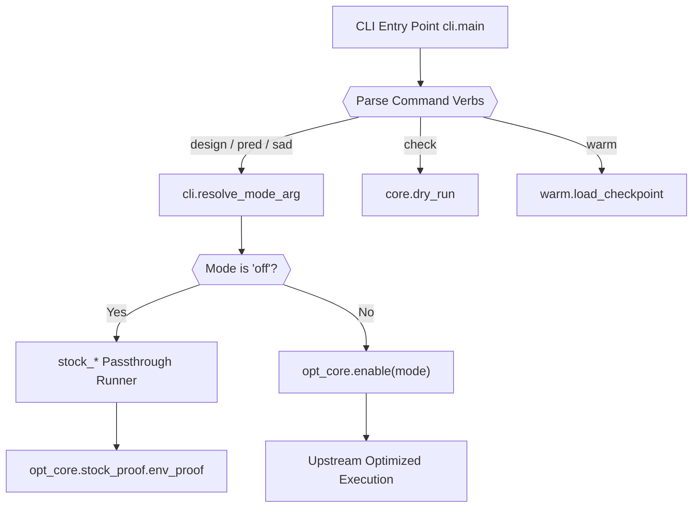
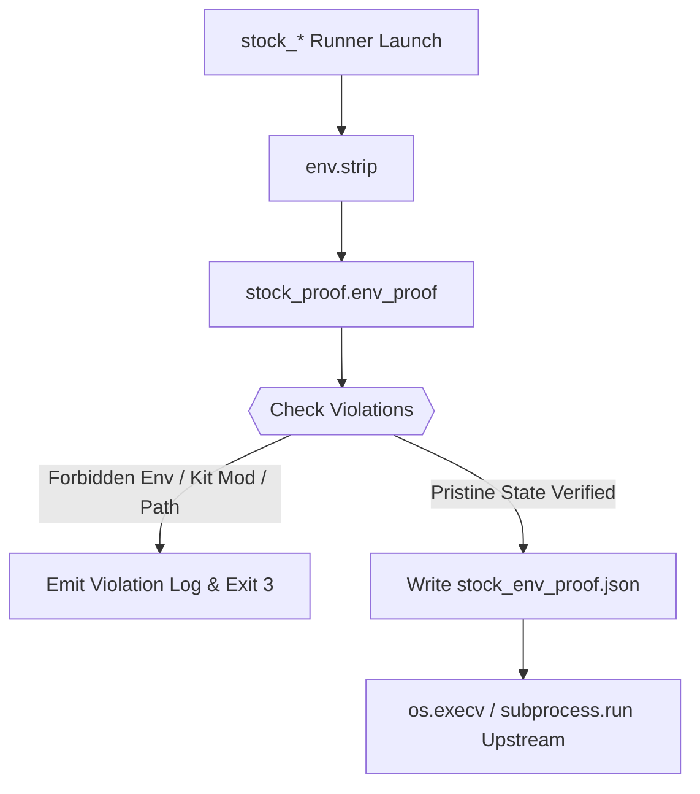

<!-- source: DeepWiki mcp.deepwiki.com · repo anthropics/uplifting-biomolecular-modeling · page 2.4 Kit CLIs and Stock Routes · fetched 2026-10-26 -->

# Kit CLIs and Stock Routes

Relevant source files

The following files were used as context for generating this wiki page:

- [af2ig/opt/af2ig_opt/cli.py](af2ig/opt/af2ig_opt/cli.py)
- [af3_jax/opt/af3_jax_opt/cli.py](af3_jax/opt/af3_jax_opt/cli.py)
- [af3_jax/opt/af3_jax_opt/convert.py](af3_jax/opt/af3_jax_opt/convert.py)
- [af3_torch/opt/af3_torch_opt/featurise.py](af3_torch/opt/af3_torch_opt/featurise.py)
- [af3_torch/opt/af3_torch_opt/pipeline_stream.py](af3_torch/opt/af3_torch_opt/pipeline_stream.py)
- [af3_torch/opt/af3_torch_opt/tests/test_cli_manifest.py](af3_torch/opt/af3_torch_opt/tests/test_cli_manifest.py)
- [af3_torch/opt/af3_torch_opt/tests/test_pipeline_stream.py](af3_torch/opt/af3_torch_opt/tests/test_pipeline_stream.py)
- [atlasfold/opt/atlasfold_opt/cli.py](atlasfold/opt/atlasfold_opt/cli.py)
- [boltz2/opt/boltz2_opt/cli.py](boltz2/opt/boltz2_opt/cli.py)
- [boltz2/opt/boltz2_opt/settings.py](boltz2/opt/boltz2_opt/settings.py)
- [boltzgen/opt/boltzgen_opt/cli.py](boltzgen/opt/boltzgen_opt/cli.py)
- [boltzgen/opt/boltzgen_opt/design.py](boltzgen/opt/boltzgen_opt/design.py)
- [boltzgen/opt/boltzgen_opt/tests/test_levers.py](boltzgen/opt/boltzgen_opt/tests/test_levers.py)
- [boltzgen/opt/boltzgen_opt/tests/test_stock_route.py](boltzgen/opt/boltzgen_opt/tests/test_stock_route.py)
- [borzoi/README.md](borzoi/README.md)
- [borzoi/opt/borzoi_opt/cli.py](borzoi/opt/borzoi_opt/cli.py)
- [borzoi/run.sh](borzoi/run.sh)
- [caliby/opt/caliby_opt/cli.py](caliby/opt/caliby_opt/cli.py)
- [caliby/opt/caliby_opt/design_run.py](caliby/opt/caliby_opt/design_run.py)
- [chai1/opt/chai1_opt/cli.py](chai1/opt/chai1_opt/cli.py)
- [chai1/opt/chai1_opt/stock_fold.py](chai1/opt/chai1_opt/stock_fold.py)
- [chai1/opt/chai1_opt/tests/test_big.py](chai1/opt/chai1_opt/tests/test_big.py)
- [chai1/opt/chai1_opt/tests/test_optin.py](chai1/opt/chai1_opt/tests/test_optin.py)
- [colabdesign/opt/colabdesign_opt/envproof.py](colabdesign/opt/colabdesign_opt/envproof.py)
- [colabdesign/opt/colabdesign_opt/levers.py](colabdesign/opt/colabdesign_opt/levers.py)
- [common/mps_packing/README.md](common/mps_packing/README.md)
- [common/mps_packing/mps_workers.sh](common/mps_packing/mps_workers.sh)
- [common/opt_core/opt_core/attn/__init__.py](common/opt_core/opt_core/attn/__init__.py)
- [common/opt_core/opt_core/kernels/trimul/native/pkg/v5/python/trimul_native/build.py](common/opt_core/opt_core/kernels/trimul/native/pkg/v5/python/trimul_native/build.py)
- [common/opt_core/opt_core/kernels/trimul/native/pkg/v5/python/trimul_native/vectors.py](common/opt_core/opt_core/kernels/trimul/native/pkg/v5/python/trimul_native/vectors.py)
- [common/opt_core/opt_core/stock_proof.py](common/opt_core/opt_core/stock_proof.py)
- [common/opt_core/tests/test_attn.py](common/opt_core/tests/test_attn.py)
- [common/opt_core/tests/test_stock_cli_process.py](common/opt_core/tests/test_stock_cli_process.py)
- [complexa/README.md](complexa/README.md)
- [complexa/STOCK.md](complexa/STOCK.md)
- [complexa/environment/Dockerfile](complexa/environment/Dockerfile)
- [complexa/opt/complexa_opt/levers.py](complexa/opt/complexa_opt/levers.py)
- [complexa/opt/complexa_opt/outputs.py](complexa/opt/complexa_opt/outputs.py)
- [complexa/opt/complexa_opt/stock_design.py](complexa/opt/complexa_opt/stock_design.py)
- [complexa/opt/complexa_opt/tests/test_lever_gates.py](complexa/opt/complexa_opt/tests/test_lever_gates.py)
- [complexa/opt/complexa_opt/tests/test_stock_env.py](complexa/opt/complexa_opt/tests/test_stock_env.py)
- [e1/opt/e1_opt/cli.py](e1/opt/e1_opt/cli.py)
- [e1/opt/e1_opt/kit_score.py](e1/opt/e1_opt/kit_score.py)
- [e1/opt/e1_opt/tests/test_off_env_proof.py](e1/opt/e1_opt/tests/test_off_env_proof.py)
- [ef2inv/opt/ef2inv_opt/cli.py](ef2inv/opt/ef2inv_opt/cli.py)
- [ef2inv/opt/ef2inv_opt/envproof.py](ef2inv/opt/ef2inv_opt/envproof.py)
- [ef2inv/opt/ef2inv_opt/tests/test_fallbacks.py](ef2inv/opt/ef2inv_opt/tests/test_fallbacks.py)
- [esm_if1/opt/esm_if1_opt/stock_design.py](esm_if1/opt/esm_if1_opt/stock_design.py)
- [esmfold2/opt/esmfold2_opt/cli.py](esmfold2/opt/esmfold2_opt/cli.py)
- [esmfold2/opt/esmfold2_opt/tests/test_off_env_proof.py](esmfold2/opt/esmfold2_opt/tests/test_off_env_proof.py)
- [genie3/opt/genie3_opt/cli.py](genie3/opt/genie3_opt/cli.py)
- [genie3/opt/genie3_opt/design.py](genie3/opt/genie3_opt/design.py)
- [genie3/opt/genie3_opt/stock_cli.py](genie3/opt/genie3_opt/stock_cli.py)
- [genie3/opt/genie3_opt/tests/test_cli_outputs_stock.py](genie3/opt/genie3_opt/tests/test_cli_outputs_stock.py)
- [mosaic/opt/mosaic_opt/stock_design.py](mosaic/opt/mosaic_opt/stock_design.py)
- [mosaic/opt/mosaic_opt/weights.py](mosaic/opt/mosaic_opt/weights.py)
- [opendde/opt/forward/fast_inference/levers/OFFLOAD/odde_offload.py](opendde/opt/forward/fast_inference/levers/OFFLOAD/odde_offload.py)
- [opendde/opt/opendde_opt/ran.py](opendde/opt/opendde_opt/ran.py)
- [opendde/opt/opendde_opt/tests/test_lever_mechanics.py](opendde/opt/opendde_opt/tests/test_lever_mechanics.py)
- [opendde/opt/opendde_opt/tests/test_lncore.py](opendde/opt/opendde_opt/tests/test_lncore.py)
- [opendde/opt/opendde_opt/tests/test_lnstream.py](opendde/opt/opendde_opt/tests/test_lnstream.py)
- [opendde/opt/opendde_opt/tests/test_ran.py](opendde/opt/opendde_opt/tests/test_ran.py)
- [opendde/opt/opendde_opt/tests/test_tp_struct_cpu.py](opendde/opt/opendde_opt/tests/test_tp_struct_cpu.py)
- [opendde/opt/opendde_opt/tp_struct.py](opendde/opt/opendde_opt/tp_struct.py)
- [opendde/stock/src/opendde/model/modules/structural_tokens.py](opendde/stock/src/opendde/model/modules/structural_tokens.py)
- [openfold3/opt/openfold3_opt/hooks.py](openfold3/opt/openfold3_opt/hooks.py)
- [openfold3/opt/openfold3_opt/tests/test_off_env_proof.py](openfold3/opt/openfold3_opt/tests/test_off_env_proof.py)
- [openfold3_ob0/opt/openfold3_ob0_opt/env.py](openfold3_ob0/opt/openfold3_ob0_opt/env.py)
- [openfold3_ob0/opt/openfold3_ob0_opt/hooks.py](openfold3_ob0/opt/openfold3_ob0_opt/hooks.py)
- [openfold3_ob0/opt/openfold3_ob0_opt/tests/test_kit_hook_detection.py](openfold3_ob0/opt/openfold3_ob0_opt/tests/test_kit_hook_detection.py)
- [openfold3_ob0/opt/openfold3_ob0_opt/tests/test_off_env_proof.py](openfold3_ob0/opt/openfold3_ob0_opt/tests/test_off_env_proof.py)
- [progen2/opt/forward/engines/progen2/kits/v0_ew/build.py](progen2/opt/forward/engines/progen2/kits/v0_ew/build.py)
- [progen2/opt/progen2_opt/cli.py](progen2/opt/progen2_opt/cli.py)
- [progen2/opt/progen2_opt/stock_cli.py](progen2/opt/progen2_opt/stock_cli.py)
- [progen2/opt/progen2_opt/tests/conftest.py](progen2/opt/progen2_opt/tests/conftest.py)
- [progen2/opt/progen2_opt/tests/test_cli_usage.py](progen2/opt/progen2_opt/tests/test_cli_usage.py)
- [progen2/opt/progen2_opt/tests/test_stock_cli.py](progen2/opt/progen2_opt/tests/test_stock_cli.py)
- [progen2/opt/progen2_opt/tests/test_stock_route_cpu.py](progen2/opt/progen2_opt/tests/test_stock_route_cpu.py)
- [proteinmpnn/opt/proteinmpnn_opt/cli.py](proteinmpnn/opt/proteinmpnn_opt/cli.py)
- [proteinmpnn/opt/proteinmpnn_opt/stock_run.py](proteinmpnn/opt/proteinmpnn_opt/stock_run.py)
- [proteinmpnn/opt/proteinmpnn_opt/tests/test_cli_manifest.py](proteinmpnn/opt/proteinmpnn_opt/tests/test_cli_manifest.py)
- [protenix_v1/opt/protenix_v1_opt/cli.py](protenix_v1/opt/protenix_v1_opt/cli.py)
- [protenix_v1/opt/protenix_v1_opt/tests/test_stock_route.py](protenix_v1/opt/protenix_v1_opt/tests/test_stock_route.py)
- [protenix_v2/opt/forward/PTX_TP/PTX_TP_ADDON/ptx_tp/launch.py](protenix_v2/opt/forward/PTX_TP/PTX_TP_ADDON/ptx_tp/launch.py)
- [protenix_v2/opt/forward/PTX_TP/PTX_TP_ADDON/ptx_tp/launch_core.py](protenix_v2/opt/forward/PTX_TP/PTX_TP_ADDON/ptx_tp/launch_core.py)
- [protenix_v2/opt/forward/PTX_TP/PTX_TP_ADDON/ptx_tp/rowlocal.py](protenix_v2/opt/forward/PTX_TP/PTX_TP_ADDON/ptx_tp/rowlocal.py)
- [protenix_v2/opt/protenix_opt/tests/test_cli_passthrough.py](protenix_v2/opt/protenix_opt/tests/test_cli_passthrough.py)
- [protenix_v2/opt/protenix_opt/tests/test_stock_route.py](protenix_v2/opt/protenix_opt/tests/test_stock_route.py)
- [pxdesign/STOCK.md](pxdesign/STOCK.md)
- [pxdesign/opt/pxdesign_opt/options.py](pxdesign/opt/pxdesign_opt/options.py)
- [pxdesign/opt/pxdesign_opt/stamps.py](pxdesign/opt/pxdesign_opt/stamps.py)
- [pxdesign/opt/pxdesign_opt/tests/test_cli_manifest.py](pxdesign/opt/pxdesign_opt/tests/test_cli_manifest.py)
- [pxdesign/opt/pxdesign_opt/tests/test_stamps.py](pxdesign/opt/pxdesign_opt/tests/test_stamps.py)
- [pxdesign/opt/pxdesign_opt/tests/test_stock_surface.py](pxdesign/opt/pxdesign_opt/tests/test_stock_surface.py)
- [pxdesign/run.sh](pxdesign/run.sh)
- [pxdesign/stock/PINS.json](pxdesign/stock/PINS.json)
- [rfdiffusion1/opt/rfdiffusion1_opt/cli.py](rfdiffusion1/opt/rfdiffusion1_opt/cli.py)
- [rfdiffusion1/opt/rfdiffusion1_opt/design.py](rfdiffusion1/opt/rfdiffusion1_opt/design.py)
- [rfdiffusion1/opt/rfdiffusion1_opt/serve.py](rfdiffusion1/opt/rfdiffusion1_opt/serve.py)
- [rfdiffusion1/opt/rfdiffusion1_opt/stock_cli.py](rfdiffusion1/opt/rfdiffusion1_opt/stock_cli.py)
- [rfdiffusion3/opt/rfdiffusion3_opt/cli.py](rfdiffusion3/opt/rfdiffusion3_opt/cli.py)
- [rfdiffusion3/opt/rfdiffusion3_opt/stock_design.py](rfdiffusion3/opt/rfdiffusion3_opt/stock_design.py)
- [rosettafold3/opt/rosettafold3_opt/cli.py](rosettafold3/opt/rosettafold3_opt/cli.py)
- [rosettafold3/opt/rosettafold3_opt/hostlean.py](rosettafold3/opt/rosettafold3_opt/hostlean.py)
- [rosettafold3/opt/rosettafold3_opt/tests/test_hostlean.py](rosettafold3/opt/rosettafold3_opt/tests/test_hostlean.py)
- [rosettafold3/opt/rosettafold3_opt/tests/test_size_routes.py](rosettafold3/opt/rosettafold3_opt/tests/test_size_routes.py)
- [rosettafold3/opt/rosettafold3_opt/tests/test_upstream_census.py](rosettafold3/opt/rosettafold3_opt/tests/test_upstream_census.py)
- [rosettafold3/opt/rosettafold3_opt/upstream.py](rosettafold3/opt/rosettafold3_opt/upstream.py)

## Purpose and Scope
This page details the implementation of per-kit command-line interfaces (`cli.py`), upstream command passthrough runners (`stock_*`), the cryptographic and environmental proof framework (`opt_core.stock_proof`) guaranteeing that `--mode off` executions are strictly pristine, and the exit rule system coupled with manifest emission. Every optimization kit provides a unified CLI facade that proxies or wraps upstream entry points while offering rigorous isolation for exact comparison.

Sources: [rfdiffusion3/opt/rfdiffusion3_opt/cli.py:1-39](), [protenix_v2/opt/protenix_opt/tests/test_stock_route.py:1-10]()

---

## 1. Per-Kit `cli.py` Architecture and Command Routing

Every kit implements a standard command router in `cli.py` (e.g., `rfdiffusion3_opt.cli`, `genie3_opt.cli`, `protenix_v1_opt.cli`) built on top of `argparse` or click. The router captures optimization-specific arguments (such as `--mode`, `--det`, `--n_gpu`, and `--allow-partial`) and passes downstream tokens verbatim to upstream entry points.

The core command lifecycle parsed by `cli.py` includes:
* **`design` / `pred` / `sad`**: The primary execution verb. It resolves the requested mode, validates environment constraints, constructs the activation delta, and either invokes the optimized engine in-process or delegates to a stock runner (`stock_design.py`, `stock_pred.py`, `stock_cli.py`, `stock_fold.py`) when `--mode off` is specified.
* **`check`**: A dry-run inspection verb that verifies kernel availability, pin integrity, GPU capabilities, and package versions without executing inference or importing heavy deep learning frameworks.
* **`warm`**: Loads model weights and captures compilation graphs under the specified mode without running a full job, verifying early-stage memory allocation and hardware target compatibility.

Mode resolution is handled centrally via `opt_core.modes` or kit-specific mode tables (`modes.resolve_mode_arg`), where command-line flags (`--mode`) strictly override environment variables (e.g., `RFDIFFUSION3_OPT`, `PROTENIX_OPT`), which in turn fall back to package defaults.

*Diagram 1: Command dispatch flow from `cli.py` through mode resolution to either stock isolation or optimized runtime activation.*

Sources: [rfdiffusion3/opt/rfdiffusion3_opt/cli.py:40-79](), [protenix_v1_opt/opt/protenix_v1_opt/cli.py:1-21]()

---

## 2. Stock Passthrough Runners (`stock_*`) and Subprocess Isolation

When a user requests `--mode off`, the kit invokes a dedicated stock runner module (`stock_pred.py`, `stock_cli.py`, `stock_design.py`, or `stock_fold.py`). These runners guarantee that upstream code executes in a pristine subprocess completely free of optimization side effects.

The isolation procedure entails:
1. **Environment Sanitization**: Stripping all environment variables whose prefixes match `stock/PINS.json` entries (`must_be_absent_prefixes`), such as kit-specific switch variables (`RF3_XATTEMPT`, `OF3_CUDA_GRAPHS`, `PTX_BLK`) while preserving explicit allowed exceptions (e.g., `RFD_ROOT`, `CHAI_DOWNLOADS_DIR`).
2. **`PYTHONPATH` Scrubbing**: Filtering `sys.path` and the `PYTHONPATH` environment variable to remove any paths residing inside kit directories or forward optimization packs.
3. **Subprocess Replacement / Invocation**: Executing the cleaned command via `subprocess.run` or replacing the current process image via `os.execv` into upstream's native console scripts or entry points (e.g., `rfd3.cli:app`, `run_inference.py`, `genie3`).

Sources: [rfdiffusion1/opt/rfdiffusion1_opt/stock_cli.py:1-14](), [chai1/opt/chai1_opt/stock_fold.py:1-27](), [genie3/opt/genie3_opt/stock_cli.py:1-16]()

---

## 3. Stock Proof Contract and Pristine Verification (`opt_core.stock_proof`)

Before invoking upstream code, the stock runner executes `opt_core.stock_proof.env_proof` to cryptographically and structurally prove that the execution environment is pristine. 

The proof inspects:
* **Forbidden Environment Variables**: Verifies that no variables matching `must_be_absent_prefixes` or `must_be_absent_names` remain in `os.environ` (outside allowed exceptions).
* **Loaded Modules**: Scans `sys.modules` to ensure no kit modules (`KIT_MODULE_PREFIXES`) or files under kit directories have been imported.
* **`sys.path` Integrity**: Confirms no kit directories reside on `sys.path`.
* **Autoload Binders**: Verifies that package-specific import finders (`_autoload`) are disarmed and inactive.
* **Framework Preload State**: Checks whether deep learning frameworks like `torch` or upstream tool modules were imported prematurely before the proof completed.
* **Deterministic Carve-Outs**: Validates precise environmental exceptions required for deterministic comparison (e.g., `CUBLAS_WORKSPACE_CONFIG`).

If any check fails, the proof records the exact violations, emits an error log, and terminates with exit code `3` (`EXIT_NOT_STOCK` / `EXIT_NOT_ACTIVE`), ensuring no compromised execution occurs.

*Diagram 2: Verification pipeline executed by `stock_proof.env_proof` prior to running upstream binaries.*

Sources: [protenix_v2/opt/protenix_opt/tests/test_stock_route.py:75-94](), [rfdiffusion1/opt/rfdiffusion1_opt/stock_cli.py:70-83](), [common/opt_core/opt_core/stock_proof.py:1-40]()

---

## 4. Exit Rules, Partial Compliance, and Manifest Emission

Command execution concludes by mapping runtime outcomes to standard exit codes via `opt_core.report` (exposed through `report.py`):
* **`0` (`EXIT_OK`)**: Successful execution with full lever engagement or valid stock execution.
* **`1` (`EXIT_FAIL`)**: Runtime failure, exception, or unhandled error during execution.
* **`2` (`EXIT_USAGE`)**: CLI usage error, invalid argument combination, or signature mismatch.
* **`3` (`EXIT_NOT_ACTIVE`)**: Refused gates, unserved execution paths, stock subprocess proof failure, or *partial activation* without authorization.

### Partial Activation and `--allow-partial`
A run is designated *partial* if a planned lever lacks evidence of application (e.g., hardware constraints or kernel mismatches forced a silent or explicit fallback). By default, partial activations trigger an immediate exit with code `3`. 

Passing `--allow-partial` (or setting `*_OPT_ALLOW_PARTIAL=1` in the environment) overrides this enforcement, logging the partial state into `opt_manifest.json` under `partial_reason` and allowing the command to exit with the underlying run's exit code.

### Manifest Emission
Upon completion, kits emit an `opt_manifest.json` report into the output directory. This manifest captures:
* Selected mode, form, and active status.
* Complete verification proof records (`stock_env_proof`).
* Applied levers, fallback reasons, and token execution metadata.

Sources: [rfdiffusion3/opt/rfdiffusion3_opt/cli.py:20-38](), [protenix_v1_opt/opt/protenix_v1_opt/cli.py:16-21]()

---

