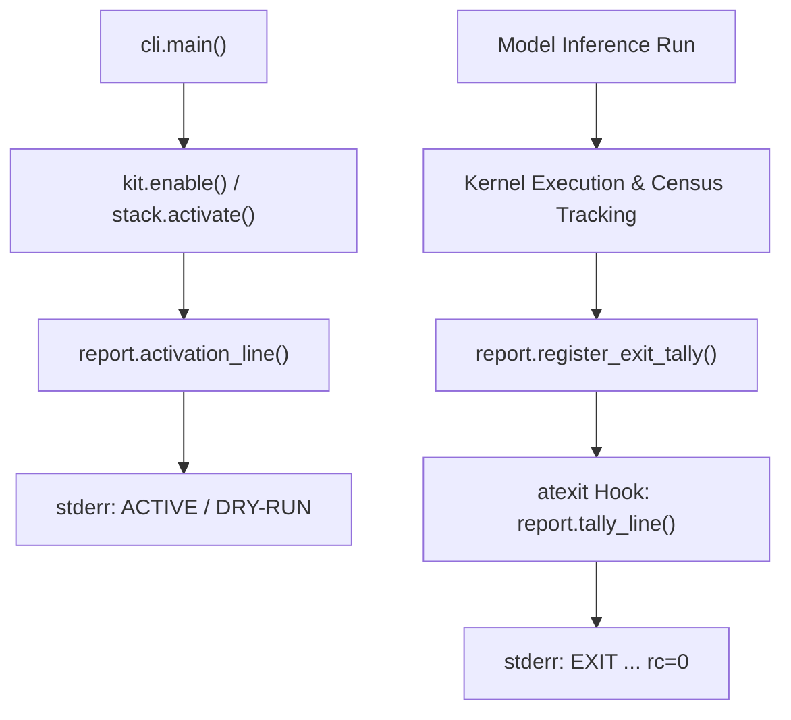
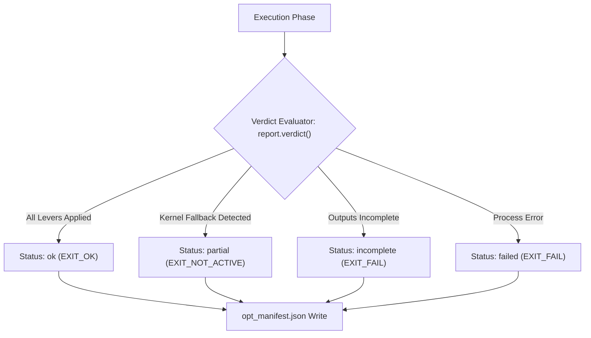

<!-- source: DeepWiki mcp.deepwiki.com · repo anthropics/uplifting-biomolecular-modeling · page 2.5 Reporting, Manifests and Evidence · fetched 2026-10-26 -->

# Reporting, Manifests and Evidence

Relevant source files

The following files were used as context for generating this wiki page:

- [af2ig/opt/af2ig_opt/report.py](af2ig/opt/af2ig_opt/report.py)
- [af3_jax/opt/af3_jax_opt/inprocess/kernels_probe.py](af3_jax/opt/af3_jax_opt/inprocess/kernels_probe.py)
- [af3_jax/opt/af3_jax_opt/kernels.py](af3_jax/opt/af3_jax_opt/kernels.py)
- [af3_jax/opt/af3_jax_opt/report.py](af3_jax/opt/af3_jax_opt/report.py)
- [af3_jax/opt/af3_jax_opt/stack.py](af3_jax/opt/af3_jax_opt/stack.py)
- [af3_jax/opt/af3_jax_opt/tests/test_kernels.py](af3_jax/opt/af3_jax_opt/tests/test_kernels.py)
- [af3_torch/opt/af3_torch_opt/report.py](af3_torch/opt/af3_torch_opt/report.py)
- [af3_torch/opt/af3_torch_opt/stack.py](af3_torch/opt/af3_torch_opt/stack.py)
- [boltz2/opt/boltz2_opt/kernels.py](boltz2/opt/boltz2_opt/kernels.py)
- [boltz2/opt/boltz2_opt/prep.py](boltz2/opt/boltz2_opt/prep.py)
- [boltz2/opt/boltz2_opt/report.py](boltz2/opt/boltz2_opt/report.py)
- [boltz2/opt/boltz2_opt/stack.py](boltz2/opt/boltz2_opt/stack.py)
- [boltz2/opt/boltz2_opt/tests/test_atom_big_by_card.py](boltz2/opt/boltz2_opt/tests/test_atom_big_by_card.py)
- [boltz2/opt/boltz2_opt/tests/test_cli_and_evidence.py](boltz2/opt/boltz2_opt/tests/test_cli_and_evidence.py)
- [boltz2/opt/boltz2_opt/tests/test_kernels.py](boltz2/opt/boltz2_opt/tests/test_kernels.py)
- [boltz2/opt/boltz2_opt/tests/test_rowpair_feats_cpu.py](boltz2/opt/boltz2_opt/tests/test_rowpair_feats_cpu.py)
- [boltzgen/opt/boltzgen_opt/manifest.py](boltzgen/opt/boltzgen_opt/manifest.py)
- [boltzgen/opt/boltzgen_opt/report.py](boltzgen/opt/boltzgen_opt/report.py)
- [caliby/opt/caliby_opt/manifest.py](caliby/opt/caliby_opt/manifest.py)
- [chai1/opt/chai1_opt/report.py](chai1/opt/chai1_opt/report.py)
- [chai1/opt/chai1_opt/tests/test_activation_rules.py](chai1/opt/chai1_opt/tests/test_activation_rules.py)
- [chrombpnet/opt/chrombpnet_opt/manifest.py](chrombpnet/opt/chrombpnet_opt/manifest.py)
- [colabdesign/opt/colabdesign_opt/evidence.py](colabdesign/opt/colabdesign_opt/evidence.py)
- [colabdesign/opt/colabdesign_opt/report.py](colabdesign/opt/colabdesign_opt/report.py)
- [colabfold/opt/colabfold_opt/manifest.py](colabfold/opt/colabfold_opt/manifest.py)
- [colabfold/opt/colabfold_opt/report.py](colabfold/opt/colabfold_opt/report.py)
- [colabfold/opt/colabfold_opt/stack.py](colabfold/opt/colabfold_opt/stack.py)
- [common/opt_core/opt_core/host/memo.py](common/opt_core/opt_core/host/memo.py)
- [common/opt_core/opt_core/manifest.py](common/opt_core/opt_core/manifest.py)
- [common/opt_core/opt_core/mem/record.py](common/opt_core/opt_core/mem/record.py)
- [common/opt_core/opt_core/report.py](common/opt_core/opt_core/report.py)
- [common/opt_core/tests/test_gates.py](common/opt_core/tests/test_gates.py)
- [common/opt_core/tests/test_gpu_classes_h200.py](common/opt_core/tests/test_gpu_classes_h200.py)
- [common/opt_core/tests/test_mem_assembly.py](common/opt_core/tests/test_mem_assembly.py)
- [common/opt_core/tests/test_mem_record_apply.py](common/opt_core/tests/test_mem_record_apply.py)
- [complexa/opt/complexa_opt/manifest.py](complexa/opt/complexa_opt/manifest.py)
- [e1/opt/e1_opt/tests/test_cli_score.py](e1/opt/e1_opt/tests/test_cli_score.py)
- [e1/opt/e1_opt/tests/test_kernels_proof.py](e1/opt/e1_opt/tests/test_kernels_proof.py)
- [ef2inv/opt/ef2inv_opt/manifest.py](ef2inv/opt/ef2inv_opt/manifest.py)
- [esm_if1/opt/esm_if1_opt/manifest.py](esm_if1/opt/esm_if1_opt/manifest.py)
- [esmc/opt/esmc_opt/report.py](esmc/opt/esmc_opt/report.py)
- [esmc/opt/esmc_opt/tests/test_kernels.py](esmc/opt/esmc_opt/tests/test_kernels.py)
- [esmfold2/opt/esmfold2_opt/report.py](esmfold2/opt/esmfold2_opt/report.py)
- [esmfold2/opt/esmfold2_opt/tests/test_lever_lines.py](esmfold2/opt/esmfold2_opt/tests/test_lever_lines.py)
- [esmfold2/opt/esmfold2_opt/tests/test_tx_lever.py](esmfold2/opt/esmfold2_opt/tests/test_tx_lever.py)
- [esmfold2/opt/esmfold2_opt/tests/test_xln.py](esmfold2/opt/esmfold2_opt/tests/test_xln.py)
- [esmfold2/opt/forward/fast_inference/driver/ef2_xln.py](esmfold2/opt/forward/fast_inference/driver/ef2_xln.py)
- [flashzoi/opt/flashzoi_opt/manifest.py](flashzoi/opt/flashzoi_opt/manifest.py)
- [genie3/opt/genie3_opt/manifest.py](genie3/opt/genie3_opt/manifest.py)
- [genie3/opt/genie3_opt/report.py](genie3/opt/genie3_opt/report.py)
- [mosaic/opt/mosaic_opt/report.py](mosaic/opt/mosaic_opt/report.py)
- [opendde/opt/opendde_opt/manifest.py](opendde/opt/opendde_opt/manifest.py)
- [opendde/opt/opendde_opt/report.py](opendde/opt/opendde_opt/report.py)
- [openfold3/opt/openfold3_opt/tests/test_lever_lines.py](openfold3/opt/openfold3_opt/tests/test_lever_lines.py)
- [openfold3_ob0/opt/openfold3_ob0_opt/tests/test_lever_lines.py](openfold3_ob0/opt/openfold3_ob0_opt/tests/test_lever_lines.py)
- [openfold3_ob0/opt/openfold3_ob0_opt/tests/test_templ_census.py](openfold3_ob0/opt/openfold3_ob0_opt/tests/test_templ_census.py)
- [progen2/opt/progen2_opt/report.py](progen2/opt/progen2_opt/report.py)
- [proteinmpnn/opt/proteinmpnn_opt/manifest.py](proteinmpnn/opt/proteinmpnn_opt/manifest.py)
- [protenix_v1/opt/protenix_v1_opt/kit.py](protenix_v1/opt/protenix_v1_opt/kit.py)
- [protenix_v1/opt/protenix_v1_opt/report.py](protenix_v1/opt/protenix_v1_opt/report.py)
- [protenix_v1/opt/protenix_v1_opt/tests/test_exit_rule.py](protenix_v1/opt/protenix_v1_opt/tests/test_exit_rule.py)
- [protenix_v1/opt/protenix_v1_opt/tests/test_frozen_weights.py](protenix_v1/opt/protenix_v1_opt/tests/test_frozen_weights.py)
- [protenix_v1/opt/protenix_v1_opt/tests/test_lever_lines.py](protenix_v1/opt/protenix_v1_opt/tests/test_lever_lines.py)
- [protenix_v1/opt/protenix_v1_opt/tests/test_rank0_features.py](protenix_v1/opt/protenix_v1_opt/tests/test_rank0_features.py)
- [protenix_v2/opt/protenix_opt/manifest.py](protenix_v2/opt/protenix_opt/manifest.py)
- [protenix_v2/opt/protenix_opt/report.py](protenix_v2/opt/protenix_opt/report.py)
- [protenix_v2/opt/protenix_opt/tests/test_b300_rows.py](protenix_v2/opt/protenix_opt/tests/test_b300_rows.py)
- [protenix_v2/opt/protenix_opt/tests/test_cli_manifest.py](protenix_v2/opt/protenix_opt/tests/test_cli_manifest.py)
- [protenix_v2/opt/protenix_opt/tests/test_lever_lines.py](protenix_v2/opt/protenix_opt/tests/test_lever_lines.py)
- [protenix_v2/opt/protenix_opt/tests/test_weights_digest.py](protenix_v2/opt/protenix_opt/tests/test_weights_digest.py)
- [pxdesign/opt/pxdesign_opt/manifest.py](pxdesign/opt/pxdesign_opt/manifest.py)
- [pxdesign/opt/pxdesign_opt/report.py](pxdesign/opt/pxdesign_opt/report.py)
- [rfdiffusion1/opt/rfdiffusion1_opt/manifest.py](rfdiffusion1/opt/rfdiffusion1_opt/manifest.py)
- [rfdiffusion1/opt/rfdiffusion1_opt/report.py](rfdiffusion1/opt/rfdiffusion1_opt/report.py)
- [rfdiffusion3/opt/rfdiffusion3_opt/manifest.py](rfdiffusion3/opt/rfdiffusion3_opt/manifest.py)
- [rfdiffusion3/opt/rfdiffusion3_opt/tests/test_census.py](rfdiffusion3/opt/rfdiffusion3_opt/tests/test_census.py)
- [rosettafold3/opt/rosettafold3_opt/report.py](rosettafold3/opt/rosettafold3_opt/report.py)
- [rosettafold3/opt/rosettafold3_opt/tests/test_exit_tally.py](rosettafold3/opt/rosettafold3_opt/tests/test_exit_tally.py)

## Purpose and Scope
This section details the post-run observability, reporting mechanisms, manifest generation, cell census collection, and evidence verification frameworks implemented across the optimization kits. Every kit maintains a dedicated `report.py` module [protenix_v2/opt/protenix_opt/report.py:1-13]() that standardizes terminal emission streams, registers atexit process tallies, tracks kernel fallback metrics, and enforces strict exit codes (`EXIT_OK`, `EXIT_FAIL`, `EXIT_USAGE`, `EXIT_NOT_ACTIVE`) [esmfold2/opt/esmfold2_opt/report.py:30-30](). Post-run engagement is proven via structured log lines (`ACTIVE`, `FINAL`, `LEVER`, `KERNELS`, `EXIT`) and recorded state snapshots persisted in `opt_manifest.json`.

Sources: [protenix_v2/opt/protenix_opt/report.py:1-13](), [esmfold2/opt/esmfold2_opt/report.py:30-30]()

---

## 1. Observability Architecture (`report.py` and Tally Engine)

Each kit implements a localized observability engine (e.g., `protenix_opt/report.py`, `chai1_opt/report.py`, `esmfold2_opt/report.py`, `rfdiffusion1_opt/report.py`) that formats messages to `sys.stderr` under a standardized kit tag prefix [protenix_v2/opt/protenix_opt/report.py:3-27](), [chai1/opt/chai1_opt/report.py:1-31](), [rfdiffusion1/opt/rfdiffusion1_opt/report.py:1-30](). 

### Key Line Types
- **Activation / Dry-Run Line**: Emitted upon initialization, detailing the resolved mode, target hardware, active lever subsets, and environment variables [protenix_v2/opt/protenix_opt/report.py:48-71](), [chai1/opt/chai1_opt/report.py:82-98]().
- **Lever Lines**: One `LEVER name=<id> state=<on|off|skipped>` line per registry lever printed after execution, validating active strategies and underlying module bindings [protenix_v2/opt/protenix_opt/report.py:6-8](), [rosettafold3/opt/rosettafold3_opt/tests/test_exit_tally.py:79-97]().
- **Exit Tally**: Emitted via an `atexit` hook, summarizing process-level counter statistics, execution status, and resource usage [protenix_v2/opt/protenix_opt/report.py:9-12](), [rosettafold3/opt/rosettafold3_opt/tests/test_exit_tally.py:27-43]().

Sources: [protenix_v2/opt/protenix_opt/report.py:3-72](), [chai1/opt/chai1_opt/report.py:1-31](), [rosettafold3/opt/rosettafold3_opt/tests/test_exit_tally.py:27-43]()

---

## 2. Exit Tally Mechanics and Interpreter Hooks

Exit verification relies on process-lifecycle hooks that capture runtime metrics [protenix_v2/opt/protenix_opt/report.py:9-12](). Kits register exit tallies prior to loading model modules, ensuring that LIFO execution of `atexit` handlers processes metrics accurately even if unexpected exceptions occur [chai1/opt/chai1_opt/tests/test_activation_rules.py:7-9]().

### Standard Exit Codes
| Exit Code Symbol | Numeric Value | Definition |
|------------------|---------------|------------|
| `EXIT_OK`        | `0`           | Successful execution with zero unhandled fallbacks or errors. |
| `EXIT_FAIL`      | `1`           | Runtime failure, exception, or incomplete output generation (`outputs short of the request`). |
| `EXIT_USAGE`     | `2`           | CLI argument error, mistyped mode, or unsupported configuration flag. |
| `EXIT_NOT_ACTIVE`| `3`           | Refusal by name, partial activation mismatch, or incompatible GPU / kernel requirements. |

Sources: [esmfold2/opt/esmfold2_opt/report.py:30-30](), [chai1/opt/chai1_opt/tests/test_activation_rules.py:7-9](), [protenix_v2/opt/protenix_opt/report.py:9-12]()

---

## 3. Manifests and Provenance (`opt_manifest.json`)

Runs generate structured JSON manifests (`opt_manifest.json`) capturing execution parameters, target card configurations, and provenance records [rfdiffusion3/opt/rfdiffusion3_opt/manifest.py:1](), [common/opt_core/opt_core/manifest.py:1]().

### Manifest Status Categories
The run status vocabulary is locked across kits:
- `ok`: All levers applied cleanly, outputs match expectations.
- `partial`: Kernel optimizations were dropped due to device constraints or compilation failures, triggering a refusal or fallback [esmfold2/opt/esmfold2_opt/report.py:16-21]().
- `incomplete`: Output file counts fell short of requested batch sizes [rfdiffusion1/opt/rfdiffusion1_opt/report.py:17-17]().
- `failed`: Non-zero exit code from worker processes or unhandled exceptions [rfdiffusion1/opt/rfdiffusion1_opt/report.py:17-17]().
- `refused`: Mode rejected prior to execution due to missing pins, invalid weights, or unverified environment variables [e1/opt/e1_opt/tests/test_cli_score.py:3-5]().

Sources: [esmfold2/opt/esmfold2_opt/report.py:16-21](), [rfdiffusion1/opt/rfdiffusion1_opt/report.py:14-19](), [e1/opt/e1_opt/tests/test_cli_score.py:3-5]()

---

## 4. Cell Census and Lever-Line Validation

Optimization kits employ census modules (e.g., `census.py`, `registry.py`) to record kernel invocation paths, fallback frequencies, and hardware-specific execution routes [rfdiffusion3/opt/rfdiffusion3_opt/tests/test_census.py:1-16]().

### Lever Line Testing Contract
Tests such as `test_lever_lines.py` enforce strict byte-level compatibility for emitted `LEVER` lines [rosettafold3/opt/rosettafold3_opt/tests/test_exit_tally.py:79-97]():
- **Name & State**: Must explicitly declare whether a lever is `on`, `off`, or `skipped` [rosettafold3/opt/rosettafold3_opt/tests/test_exit_tally.py:79-81]().
- **Reason Token**: Skipped or fallen-back levers must provide a documented reason token (e.g., `not_in_mode`, `below_gate`, `probe_zero`, `serve_only`) [rosettafold3/opt/rosettafold3_opt/tests/test_exit_tally.py:79-81]().
- **Origin & Implementation**: Points directly to the underlying module file path or core provider binding [rosettafold3/opt/rosettafold3_opt/tests/test_exit_tally.py:79-81]().

Sources: [rfdiffusion3/opt/rfdiffusion3_opt/tests/test_census.py:1-16](), [rosettafold3/opt/rosettafold3_opt/tests/test_exit_tally.py:79-97]()

---

