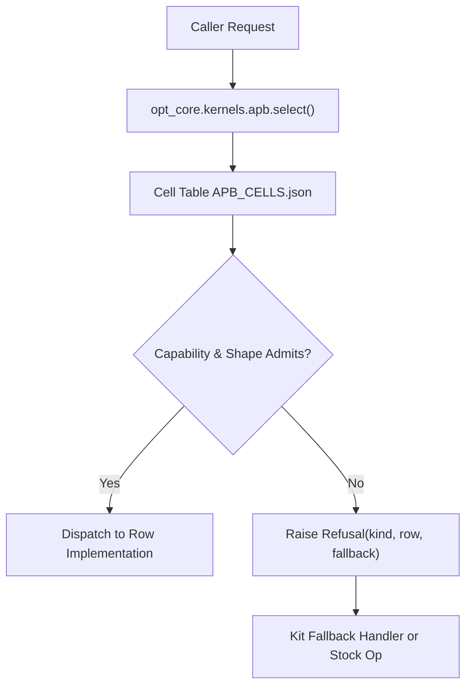
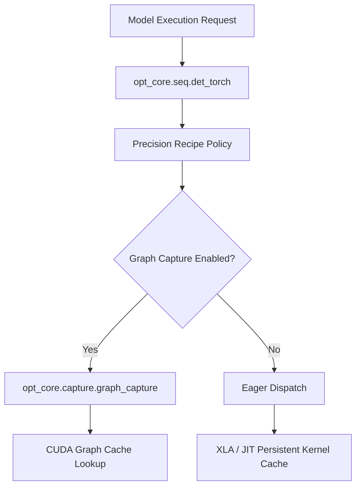

<!-- source: DeepWiki mcp.deepwiki.com · repo anthropics/uplifting-biomolecular-modeling · page 3 opt_core: The Shared Runtime · fetched 2026-10-26 -->

# opt_core: The Shared Runtime

Relevant source files

The following files were used as context for generating this wiki page:

- [af3_jax/CHANGES.md](af3_jax/CHANGES.md)
- [af3_jax/opt/forward/fast_inference/HOWTO.md](af3_jax/opt/forward/fast_inference/HOWTO.md)
- [af3_jax/opt/forward/flashpairformer/README.md](af3_jax/opt/forward/flashpairformer/README.md)
- [af3_jax/opt/forward/flashpairformer/af3_flashpairformer/__init__.py](af3_jax/opt/forward/flashpairformer/af3_flashpairformer/__init__.py)
- [af3_jax/opt/forward/flashpairformer/af3_flashpairformer/patch.py](af3_jax/opt/forward/flashpairformer/af3_flashpairformer/patch.py)
- [atlasfold/opt/atlasfold_opt/__init__.py](atlasfold/opt/atlasfold_opt/__init__.py)
- [atlasfold/opt/atlasfold_opt/stack.py](atlasfold/opt/atlasfold_opt/stack.py)
- [colabdesign/opt/colabdesign_opt/__init__.py](colabdesign/opt/colabdesign_opt/__init__.py)
- [colabdesign/opt/pyproject.toml](colabdesign/opt/pyproject.toml)
- [colabfold/opt/colabfold_opt/__init__.py](colabfold/opt/colabfold_opt/__init__.py)
- [colabfold/opt/colabfold_opt/cli.py](colabfold/opt/colabfold_opt/cli.py)
- [colabfold/opt/pyproject.toml](colabfold/opt/pyproject.toml)
- [common/README.md](common/README.md)
- [common/opt_core/CHANGES.md](common/opt_core/CHANGES.md)
- [common/opt_core/README.md](common/opt_core/README.md)
- [common/opt_core/opt_core/__init__.py](common/opt_core/opt_core/__init__.py)
- [common/opt_core/opt_core/capture/__init__.py](common/opt_core/opt_core/capture/__init__.py)
- [common/opt_core/opt_core/kernels/apb/__init__.py](common/opt_core/opt_core/kernels/apb/__init__.py)
- [common/opt_core/opt_core/kernels/ln/__init__.py](common/opt_core/opt_core/kernels/ln/__init__.py)
- [common/opt_core/opt_core/kernels/transition/__init__.py](common/opt_core/opt_core/kernels/transition/__init__.py)
- [common/opt_core/opt_core/kernels/triattn/__init__.py](common/opt_core/opt_core/kernels/triattn/__init__.py)
- [common/opt_core/opt_core/kernels/trimul/__init__.py](common/opt_core/opt_core/kernels/trimul/__init__.py)
- [common/opt_core/opt_core/of3_sampler/__init__.py](common/opt_core/opt_core/of3_sampler/__init__.py)
- [common/opt_core/opt_core/of3_trunk/__init__.py](common/opt_core/opt_core/of3_trunk/__init__.py)
- [common/opt_core/opt_core/seq/__init__.py](common/opt_core/opt_core/seq/__init__.py)
- [common/opt_core/pyproject.toml](common/opt_core/pyproject.toml)
- [common/opt_core/tests/test_apb_provider_cells.py](common/opt_core/tests/test_apb_provider_cells.py)
- [common/opt_core/tests/test_ln_provider_cells.py](common/opt_core/tests/test_ln_provider_cells.py)
- [common/opt_core/tests/test_pair_fused.py](common/opt_core/tests/test_pair_fused.py)
- [common/opt_core/tests/test_transition_provider_cells.py](common/opt_core/tests/test_transition_provider_cells.py)
- [common/opt_core/tests/test_triattn_cells.py](common/opt_core/tests/test_triattn_cells.py)
- [common/opt_core/tests/test_trimul_provider_cells.py](common/opt_core/tests/test_trimul_provider_cells.py)
- [openfold3/opt/openfold3_opt/cells/__init__.py](openfold3/opt/openfold3_opt/cells/__init__.py)
- [openfold3/opt/pyproject.toml](openfold3/opt/pyproject.toml)
- [openfold3/stock/src/pyproject.toml](openfold3/stock/src/pyproject.toml)
- [openfold3_ob0/opt/openfold3_ob0_opt/cells/__init__.py](openfold3_ob0/opt/openfold3_ob0_opt/cells/__init__.py)
- [openfold3_ob0/opt/pyproject.toml](openfold3_ob0/opt/pyproject.toml)
- [openfold3_ob0/stock/src/pyproject.toml](openfold3_ob0/stock/src/pyproject.toml)
- [rosettafold3/opt/pyproject.toml](rosettafold3/opt/pyproject.toml)
- [rosettafold3/opt/rosettafold3_opt/__init__.py](rosettafold3/opt/rosettafold3_opt/__init__.py)

The `opt_core` package serves as the shared runtime engine for all 35+ optimization kits in the repository (`[common/opt_core/README.md:1-10]()`). It encapsulates cross-cutting concerns—such as kernel provider abstractions, multi-GPU memory sharding, capture protocols, precision recipes, and caching layers—without containing any engine-specific business logic (`[common/opt_core/README.md:11-14]()`). Kits bind these capabilities through thin adapters and mode configurations.

For details on individual child mechanisms, see:
- [Kernel Provider Framework](#3.1)
- [Memory and Multi-GPU (rowpair / n_gpu)](#3.2)
- [Determinism, Precision and Compilation Caches](#3.3)

---

## 3.1 Kernel Provider Framework

The kernel provider framework (`opt_core.kernels.*`) standardizes how performance-critical operators (such as triangle attention, triangle multiplication, transition blocks, and LayerNorm) are selected, validated, and executed across heterogeneous hardware configurations (`[common/opt_core/README.md:61-82]`). Each operation family exposes a pure selection function (`select()`) driven by measured cell tables (`*_CELLS.json`), fallback definitions, and capability checks (`[common/opt_core/opt_core/kernels/apb/__init__.py:28-40]`, `[common/opt_core/opt_core/kernels/triattn/__init__.py:25-50]`).

Rather than performing silent substitutions, kernels adhere to a strict refusal-by-name contract (`[common/opt_core/README.md:51-60]`). If a requested optimization row cannot operate on the caller's stack shape, data type, or compute capability, it raises a `:class:Refusal` exception detailing the named row and its specified fallback (`[common/opt_core/opt_core/kernels/ln/__init__.py:76-83]`). 

For complete details on face modules, capability inheritance, int32 offset safety, and specific kernel suites, see [Kernel Provider Framework](#3.1).

Title: Kernel Provider Selection and Refusal Flow

Sources: `common/opt_core/opt_core/kernels/apb/__init__.py:28-40`, `common/opt_core/opt_core/kernels/ln/__init__.py:76-83`

Sources: `common/opt_core/README.md:61-94`, `common/opt_core/opt_core/kernels/apb/__init__.py:1-42`, `common/opt_core/opt_core/kernels/triattn/__init__.py:1-50`, `common/opt_core/opt_core/kernels/ln/__init__.py:1-37`

---

## 3.2 Memory and Multi-GPU (rowpair / n_gpu)

Under the `big` operational mode, `opt_core` provides memory-management machinery designed to scale large structural biology models across multiple accelerators (`[common/opt_core/README.md:44-50]`). This includes tensor-parallel rowpair sharding across token and pair axes, host slab allocations, dynamic offloading strategies, peak memory footprint tracking, and `--n_gpu` gating (`[common/opt_core/opt_core/mem/rowpair/__init__.py:1-50]()`).

Kits wire these sharded primitives directly into their trunk definitions and confidence heads, gating execution and rejecting configurations when card counts or tensor dimensions mismatch (`[common/opt_core/README.md:3-9]()`).

For deep technical specifications on sharding topologies, feature digest censuses, and tensor-parallel adapters, see [Memory and Multi-GPU (rowpair / n_gpu)](#3.2).

Sources: `common/opt_core/README.md:3-9`, `common/README.md:1-20`

---

## 3.3 Determinism, Precision and Compilation Caches

To maintain reproducibility and execution speed, `opt_core` implements unified precision policies, deterministic torch seed wrappers (`opt_core.seq.det_torch`), and graph capture machinery (`opt_core.capture`) (`[common/opt_core/README.md:3-9]()`). 

Compilation caches manage persistent artifacts across runs:
- **CUDA Graph Capture & Stackgraph Planning:** Records eager execution graphs for static-shape layers, bypassing Python dispatch overhead while verifying stack safety.
- **XLA / JIT Persistent Caches:** Manages precompiled binaries and Triton/Pallas cache directories to avoid runtime compilation pauses.

Title: Runtime Capture and Caching Flow

Sources: `common/opt_core/opt_core/capture/__init__.py:1-15`, `common/opt_core/opt_core/seq/__init__.py:1-20`

For details on precision policies, graph capture constraints, and XLA cache directories, see [Determinism, Precision and Compilation Caches](#3.3).

Sources: `common/opt_core/README.md:3-10`, `common/opt_core/opt_core/capture/__init__.py:1-15`, `common/opt_core/opt_core/seq/__init__.py:1-20`

---

