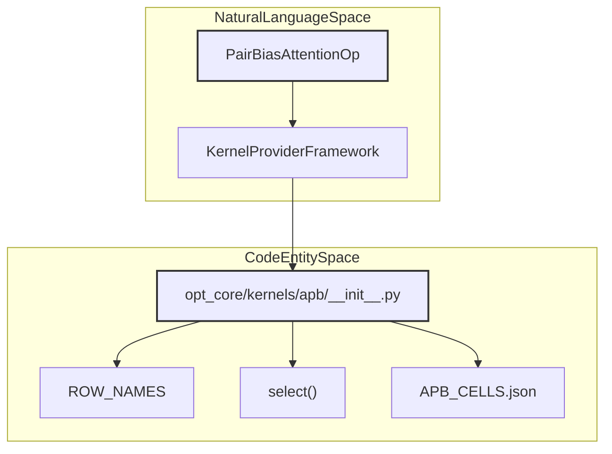
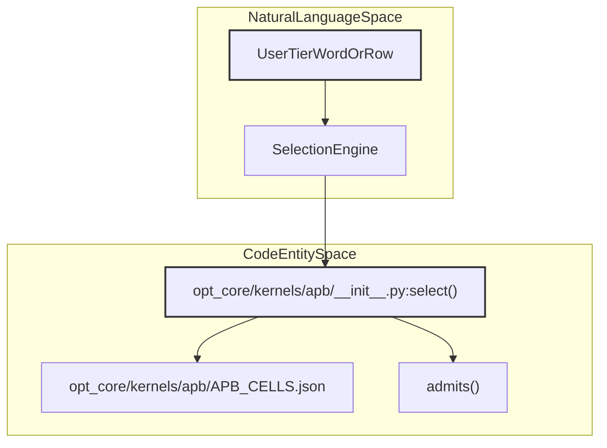

<!-- source: DeepWiki mcp.deepwiki.com · repo anthropics/uplifting-biomolecular-modeling · page 3.1 Kernel Provider Framework · fetched 2026-10-26 -->

# Kernel Provider Framework

Relevant source files

The following files were used as context for generating this wiki page:

- [common/opt_core/opt_core/kernels/META/triattn_xla.json](common/opt_core/opt_core/kernels/META/triattn_xla.json)
- [common/opt_core/opt_core/kernels/META/trimul_xla.json](common/opt_core/opt_core/kernels/META/trimul_xla.json)
- [common/opt_core/opt_core/kernels/apb/__init__.py](common/opt_core/opt_core/kernels/apb/__init__.py)
- [common/opt_core/opt_core/kernels/fpf_trimul_rows/kernels.py](common/opt_core/opt_core/kernels/fpf_trimul_rows/kernels.py)
- [common/opt_core/opt_core/kernels/fpf_trimul_v4/kdesc.py](common/opt_core/opt_core/kernels/fpf_trimul_v4/kdesc.py)
- [common/opt_core/opt_core/kernels/fpf_trimul_v4/kernels.py](common/opt_core/opt_core/kernels/fpf_trimul_v4/kernels.py)
- [common/opt_core/opt_core/kernels/fpf_trimul_v4/kexp.py](common/opt_core/opt_core/kernels/fpf_trimul_v4/kexp.py)
- [common/opt_core/opt_core/kernels/ln/__init__.py](common/opt_core/opt_core/kernels/ln/__init__.py)
- [common/opt_core/opt_core/kernels/transition/__init__.py](common/opt_core/opt_core/kernels/transition/__init__.py)
- [common/opt_core/opt_core/kernels/triattn/__init__.py](common/opt_core/opt_core/kernels/triattn/__init__.py)
- [common/opt_core/opt_core/kernels/triattn_xla/bin/k2b/sm_80/k2b_fwd_bf16_d16_mask0_b160_any.json](common/opt_core/opt_core/kernels/triattn_xla/bin/k2b/sm_80/k2b_fwd_bf16_d16_mask0_b160_any.json)
- [common/opt_core/opt_core/kernels/triattn_xla/bin/k2b/sm_80/k2b_fwd_bf16_d16_mask0_b161_any.json](common/opt_core/opt_core/kernels/triattn_xla/bin/k2b/sm_80/k2b_fwd_bf16_d16_mask0_b161_any.json)
- [common/opt_core/opt_core/kernels/triattn_xla/bin/k2b/sm_80/k2b_fwd_bf16_d16_mask1_b160_any.json](common/opt_core/opt_core/kernels/triattn_xla/bin/k2b/sm_80/k2b_fwd_bf16_d16_mask1_b160_any.json)
- [common/opt_core/opt_core/kernels/triattn_xla/bin/k2b/sm_80/k2b_fwd_bf16_d16_mask1_b161_any.json](common/opt_core/opt_core/kernels/triattn_xla/bin/k2b/sm_80/k2b_fwd_bf16_d16_mask1_b161_any.json)
- [common/opt_core/opt_core/kernels/triattn_xla/bin/k2b/sm_80/k2b_fwd_bf16_d32_mask0_b160_any.json](common/opt_core/opt_core/kernels/triattn_xla/bin/k2b/sm_80/k2b_fwd_bf16_d32_mask0_b160_any.json)
- [common/opt_core/opt_core/kernels/triattn_xla/bin/k2b/sm_80/k2b_fwd_bf16_d32_mask0_b161_any.json](common/opt_core/opt_core/kernels/triattn_xla/bin/k2b/sm_80/k2b_fwd_bf16_d32_mask0_b161_any.json)
- [common/opt_core/opt_core/kernels/triattn_xla/bin/k2b/sm_80/k2b_fwd_bf16_d32_mask1_b160_any.json](common/opt_core/opt_core/kernels/triattn_xla/bin/k2b/sm_80/k2b_fwd_bf16_d32_mask1_b160_any.json)
- [common/opt_core/opt_core/kernels/triattn_xla/bin/k2b/sm_80/k2b_fwd_bf16_d32_mask1_b161_any.json](common/opt_core/opt_core/kernels/triattn_xla/bin/k2b/sm_80/k2b_fwd_bf16_d32_mask1_b161_any.json)
- [common/opt_core/opt_core/kernels/triattn_xla/bin/k2b/sm_90/k2b_fwd_bf16_d16_mask0_b160_any.json](common/opt_core/opt_core/kernels/triattn_xla/bin/k2b/sm_90/k2b_fwd_bf16_d16_mask0_b160_any.json)
- [common/opt_core/opt_core/kernels/triattn_xla/bin/k2b/sm_90/k2b_fwd_bf16_d16_mask0_b161_any.json](common/opt_core/opt_core/kernels/triattn_xla/bin/k2b/sm_90/k2b_fwd_bf16_d16_mask0_b161_any.json)
- [common/opt_core/opt_core/kernels/triattn_xla/bin/k2b/sm_90/k2b_fwd_bf16_d16_mask1_b160_any.json](common/opt_core/opt_core/kernels/triattn_xla/bin/k2b/sm_90/k2b_fwd_bf16_d16_mask1_b160_any.json)
- [common/opt_core/opt_core/kernels/triattn_xla/bin/k2b/sm_90/k2b_fwd_bf16_d16_mask1_b161_any.json](common/opt_core/opt_core/kernels/triattn_xla/bin/k2b/sm_90/k2b_fwd_bf16_d16_mask1_b161_any.json)
- [common/opt_core/opt_core/kernels/triattn_xla/bin/k2b/sm_90/k2b_fwd_bf16_d32_mask0_b160_any.json](common/opt_core/opt_core/kernels/triattn_xla/bin/k2b/sm_90/k2b_fwd_bf16_d32_mask0_b160_any.json)
- [common/opt_core/opt_core/kernels/triattn_xla/bin/k2b/sm_90/k2b_fwd_bf16_d32_mask0_b161_any.json](common/opt_core/opt_core/kernels/triattn_xla/bin/k2b/sm_90/k2b_fwd_bf16_d32_mask0_b161_any.json)
- [common/opt_core/opt_core/kernels/triattn_xla/bin/k2b/sm_90/k2b_fwd_bf16_d32_mask1_b160_any.json](common/opt_core/opt_core/kernels/triattn_xla/bin/k2b/sm_90/k2b_fwd_bf16_d32_mask1_b160_any.json)
- [common/opt_core/opt_core/kernels/triattn_xla/bin/k2b/sm_90/k2b_fwd_bf16_d32_mask1_b161_any.json](common/opt_core/opt_core/kernels/triattn_xla/bin/k2b/sm_90/k2b_fwd_bf16_d32_mask1_b161_any.json)
- [common/opt_core/opt_core/kernels/trimul/__init__.py](common/opt_core/opt_core/kernels/trimul/__init__.py)
- [common/opt_core/opt_core/kernels/trimul_esm_shapes/kernels.py](common/opt_core/opt_core/kernels/trimul_esm_shapes/kernels.py)
- [common/opt_core/opt_core/kernels/trimul_xla/DESIGN.md](common/opt_core/opt_core/kernels/trimul_xla/DESIGN.md)
- [common/opt_core/opt_core/kernels/trimul_xla/NOTICE](common/opt_core/opt_core/kernels/trimul_xla/NOTICE)
- [common/opt_core/opt_core/kernels/trimul_xla/__init__.py](common/opt_core/opt_core/kernels/trimul_xla/__init__.py)
- [common/opt_core/tests/gpu/test_apb_core_gpu.py](common/opt_core/tests/gpu/test_apb_core_gpu.py)
- [common/opt_core/tests/test_apb_provider_cells.py](common/opt_core/tests/test_apb_provider_cells.py)
- [common/opt_core/tests/test_ln_provider_cells.py](common/opt_core/tests/test_ln_provider_cells.py)
- [common/opt_core/tests/test_pair_fused.py](common/opt_core/tests/test_pair_fused.py)
- [common/opt_core/tests/test_transition_provider_cells.py](common/opt_core/tests/test_transition_provider_cells.py)
- [common/opt_core/tests/test_triattn_cells.py](common/opt_core/tests/test_triattn_cells.py)
- [common/opt_core/tests/test_triattn_xla_pkg.py](common/opt_core/tests/test_triattn_xla_pkg.py)
- [common/opt_core/tests/test_trimul_provider_cells.py](common/opt_core/tests/test_trimul_provider_cells.py)
- [common/opt_core/tests/test_trimul_xla_pkg.py](common/opt_core/tests/test_trimul_xla_pkg.py)

The Kernel Provider Framework, located within `common/opt_core/opt_core/kernels/`, serves as the unified routing and optimization abstraction layer for biomolecular modeling models in the repository. Its primary purpose is to decouple high-level model definitions (such as AlphaFold3-family pairformers and diffusion transformers) from physical hardware execution paths. By maintaining declarative cell tables, strict admission rules, and explicit fallback mechanics, the framework ensures that inference runs at peak hardware efficiency without sacrificing numerical reproducibility.

For details on specific kernel implementations, refer to the child pages:
- [Triangle Multiplication Kernels (trimul)](#3.1.1)
- [Triangle and Pair-Bias Attention Kernels](#3.1.2)
- [LayerNorm, Transition, MSA and Atom Kernels](#3.1.3)

---

## 1. Face Modules and Layout (`kernels/*`)

Each kernel family (`apb`, `triattn`, `trimul`, `ln`, `transition`) exposes a standardized "face" module under `opt_core/kernels/`. These face modules define the canonical op boundary, enumerate available implementation rows, and maintain mappings of variants, boundaries, and metadata. 

For instance, the attention with pair bias (`apb`) face module defines boundary classifications (`core`, `producer`, `module`, `windowed`), specific implementation rows (`apb_attn`, `fpf_apb`, `dit_exact`, `l3a`, etc.), and precision variants like `tf32`, `ieee`, or `fp16`.

*Sources: [common/opt_core/opt_core/kernels/apb/__init__.py:1-42](), [common/opt_core/opt_core/kernels/triattn/__init__.py:1-24]()*

---

## 2. Selection, Admission, and Cell Tables (`select()`, `admits()`, `table()`)

Kernel selection is handled via pure Python functions (`select()`) that query measured performance tables (`APB_CELLS.json`, `TRIMUL_CELLS.json`, `TRIATTN_CELLS.json`) without importing heavy runtime frameworks during static inspection. 

When a model executes an operation, `select()` accepts compute capability (`cc`), data type (`dtype`), sequence length (`n_tokens`), and optional tier words (`fast`, `exact`, `faithful`, `big`) or direct row names. It queries the relevant cell table to determine the empirically verified fastest or most accurate kernel configuration for the caller's specific stack.

*Sources: [common/opt_core/opt_core/kernels/apb/__init__.py:28-36](), [common/opt_core/tests/test_triattn_cells.py:27-66]()*

---

## 3. Rows, Refusals, and Named Fallbacks

Every discrete kernel implementation is categorized as a "row" in the framework's architecture. Rows may belong to different performance or numerical classes: `fast` (Triton/CUDA optimized), `exact` (bit-identical reference checks), or `stock` (upstream PyTorch fallbacks). 

To prevent silent numerical divergence or runtime crashes, the framework employs strict refusal logic. If a selected row cannot support a specific geometry, encounters an architecture mismatch, or is marked capture-unsafe during CUDA graph capture, it raises an explicit `Refusal` exception by name. The framework then routes execution to a predetermined named fallback rather than failing silently.

*Sources: [common/opt_core/opt_core/kernels/triattn/__init__.py:30-49](), [common/opt_core/opt_core/kernels/apb/__init__.py:28-33]*

---

## 4. Int32 Offset Safety & Capability Inheritance

High-performance Triton kernels operating on transposed or multi-dimensional views must guard against 32-bit integer address overflows when sequence lengths and strides exceed $2^{31}$ elements. The framework calculates position strides prior to kernel launch; if an offset violation is detected, the kernel is refused by name and safely downgraded.

Additionally, for newer or unmeasured hardware architectures (e.g., compute capabilities without a dedicated benchmark column), the framework applies **capability inheritance**. It falls back to portable Triton implementations from the nearest measured column or defaults to the stock reference implementation.

*Sources: [common/opt_core/opt_core/kernels/triattn/__init__.py:46-73]()*

---

## 5. Child Pages Overview

For complete technical specifications, source breakdowns, and design documents, please consult the child pages:
- [Triangle Multiplication Kernels (trimul)](#3.1.1) — Native CUDA/Triton/XLA packages, `fpf_trimul_v4`, per-shape `.cu` variants, and build pipelines.
- [Triangle and Pair-Bias Attention Kernels](#3.1.2) — CUDA sm80/sm90a kernels, `triattn_xla`, pair-fused attention, and prebuilt ABI verification.
- [LayerNorm, Transition, MSA and Atom Kernels](#3.1.3) — Exact/fast LayerNorm, transition/af3_fused ops, MSA operations, and atom window DiT kernels.

---

