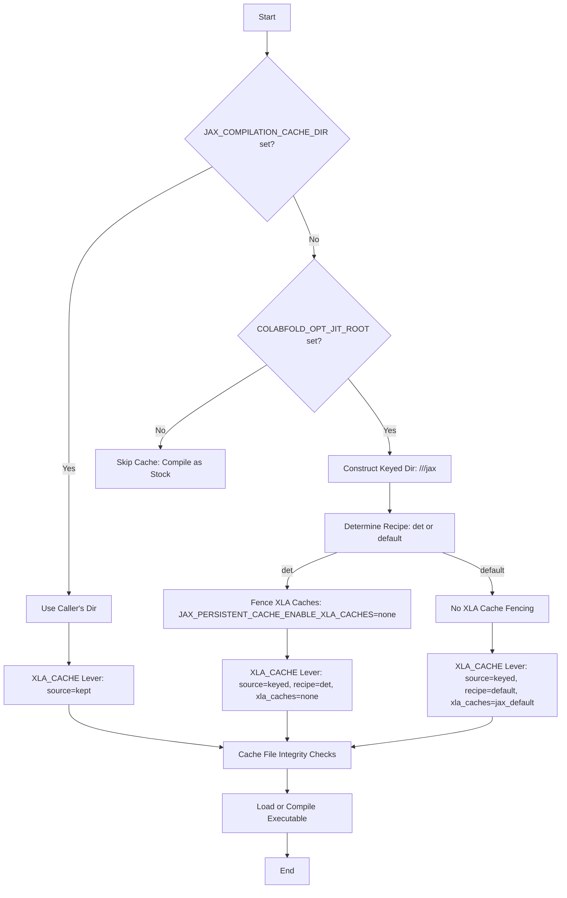

<!-- source: DeepWiki mcp.deepwiki.com · repo anthropics/uplifting-biomolecular-modeling · page 3.3 Determinism, Precision and Compilation Caches · fetched 2026-10-26 -->

# Determinism, Precision and Compilation Caches

Relevant source files

The following files were used as context for generating this wiki page:

- [af2ig/opt/af2ig_opt/ccache.py](af2ig/opt/af2ig_opt/ccache.py)
- [af2ig/opt/af2ig_opt/tests/test_program_store_checks.py](af2ig/opt/af2ig_opt/tests/test_program_store_checks.py)
- [af3_jax/opt/af3_jax_opt/inprocess/portable_cache_key.py](af3_jax/opt/af3_jax_opt/inprocess/portable_cache_key.py)
- [af3_jax/opt/af3_jax_opt/tests/test_cache_root_private.py](af3_jax/opt/af3_jax_opt/tests/test_cache_root_private.py)
- [af3_jax/opt/af3_jax_opt/tests/test_portable_cache_key.py](af3_jax/opt/af3_jax_opt/tests/test_portable_cache_key.py)
- [af3_torch/opt/af3_torch_opt/tests/test_castcache.py](af3_torch/opt/af3_torch_opt/tests/test_castcache.py)
- [af3_torch/opt/af3_torch_opt/tests/test_config_cache_root.py](af3_torch/opt/af3_torch_opt/tests/test_config_cache_root.py)
- [af3_torch/opt/af3_torch_opt/tests/test_config_exports_probe.py](af3_torch/opt/af3_torch_opt/tests/test_config_exports_probe.py)
- [atlasfold/opt/atlasfold_opt/hooks/denoiser_graph.py](atlasfold/opt/atlasfold_opt/hooks/denoiser_graph.py)
- [atlasfold/opt/atlasfold_opt/hooks/sampler_hoist.py](atlasfold/opt/atlasfold_opt/hooks/sampler_hoist.py)
- [atlasfold/opt/atlasfold_opt/tests/test_jit_env_cpu.py](atlasfold/opt/atlasfold_opt/tests/test_jit_env_cpu.py)
- [chai1/opt/chai1_opt/jit.py](chai1/opt/chai1_opt/jit.py)
- [colabdesign/opt/colabdesign_opt/compilecache_jax.py](colabdesign/opt/colabdesign_opt/compilecache_jax.py)
- [colabdesign/opt/colabdesign_opt/kernels/layers_opm.py](colabdesign/opt/colabdesign_opt/kernels/layers_opm.py)
- [colabdesign/opt/colabdesign_opt/kernels/proj_attn.py](colabdesign/opt/colabdesign_opt/kernels/proj_attn.py)
- [colabdesign/opt/colabdesign_opt/tests/test_compile_cache.py](colabdesign/opt/colabdesign_opt/tests/test_compile_cache.py)
- [colabdesign/opt/colabdesign_opt/tests/test_hoist_prev.py](colabdesign/opt/colabdesign_opt/tests/test_hoist_prev.py)
- [colabdesign/opt/colabdesign_opt/tests/test_launchers.py](colabdesign/opt/colabdesign_opt/tests/test_launchers.py)
- [colabdesign/opt/colabdesign_opt/tests/test_proj_attn.py](colabdesign/opt/colabdesign_opt/tests/test_proj_attn.py)
- [colabfold/opt/colabfold_opt/tests/test_weights_memo.py](colabfold/opt/colabfold_opt/tests/test_weights_memo.py)
- [colabfold/opt/colabfold_opt/tests/test_xla_cache.py](colabfold/opt/colabfold_opt/tests/test_xla_cache.py)
- [colabfold/opt/colabfold_opt/xla_cache.py](colabfold/opt/colabfold_opt/xla_cache.py)
- [common/opt_core/opt_core/capture/xla_cache.py](common/opt_core/opt_core/capture/xla_cache.py)
- [common/opt_core/opt_core/jax_design/pcc.md](common/opt_core/opt_core/jax_design/pcc.md)
- [common/opt_core/opt_core/jax_design/pcc.py](common/opt_core/opt_core/jax_design/pcc.py)
- [common/opt_core/opt_core/kernels/pallas/cd_layers/layers_transition.py](common/opt_core/opt_core/kernels/pallas/cd_layers/layers_transition.py)
- [common/opt_core/opt_core/precision/__init__.py](common/opt_core/opt_core/precision/__init__.py)
- [common/opt_core/opt_core/precision/policy.py](common/opt_core/opt_core/precision/policy.py)
- [common/opt_core/opt_core/precision/recipe.py](common/opt_core/opt_core/precision/recipe.py)
- [common/opt_core/opt_core/precision/tests/test_apply_switches.py](common/opt_core/opt_core/precision/tests/test_apply_switches.py)
- [common/opt_core/opt_core/precision/tests/test_reader_fp32_precision.py](common/opt_core/opt_core/precision/tests/test_reader_fp32_precision.py)
- [common/opt_core/opt_core/precision/tests/test_surface_and_recipe.py](common/opt_core/opt_core/precision/tests/test_surface_and_recipe.py)
- [common/opt_core/opt_core/precision/tests/test_tf32_override_gate.py](common/opt_core/opt_core/precision/tests/test_tf32_override_gate.py)
- [common/opt_core/opt_core/precision/tests/test_torch_primitives.py](common/opt_core/opt_core/precision/tests/test_torch_primitives.py)
- [common/opt_core/opt_core/seq/det_torch.py](common/opt_core/opt_core/seq/det_torch.py)
- [common/opt_core/opt_core/seq/numerics.py](common/opt_core/opt_core/seq/numerics.py)
- [common/opt_core/tests/test_cache_file_checks.py](common/opt_core/tests/test_cache_file_checks.py)
- [common/opt_core/tests/test_capture.py](common/opt_core/tests/test_capture.py)
- [common/opt_core/tests/test_counters_compare.py](common/opt_core/tests/test_counters_compare.py)
- [common/opt_core/tests/test_jax_design_pcc.py](common/opt_core/tests/test_jax_design_pcc.py)
- [common/opt_core/tests/test_kernel_cache_dirs.py](common/opt_core/tests/test_kernel_cache_dirs.py)
- [common/opt_core/tests/test_p12_gates_words.py](common/opt_core/tests/test_p12_gates_words.py)
- [common/opt_core/tests/test_report_manifest.py](common/opt_core/tests/test_report_manifest.py)
- [common/opt_core/tests/test_rowpair_triatt_jit_0515.py](common/opt_core/tests/test_rowpair_triatt_jit_0515.py)
- [common/opt_core/tests/test_seq_det_torch.py](common/opt_core/tests/test_seq_det_torch.py)
- [common/opt_core/tests/test_seq_numerics.py](common/opt_core/tests/test_seq_numerics.py)
- [complexa/opt/complexa_opt/tests/test_autoload.py](complexa/opt/complexa_opt/tests/test_autoload.py)
- [complexa/opt/complexa_opt/tests/test_cli.py](complexa/opt/complexa_opt/tests/test_cli.py)
- [complexa/opt/complexa_opt/tests/test_settings.py](complexa/opt/complexa_opt/tests/test_settings.py)
- [ef2inv/STOCK.md](ef2inv/STOCK.md)
- [ef2inv/opt/ef2inv_opt/patches.py](ef2inv/opt/ef2inv_opt/patches.py)
- [ef2inv/opt/forward/ESMFOLD2_DESIGN_FAST_INFERENCE_KIT_v1/k/ef2_esmc_hoist.py](ef2inv/opt/forward/ESMFOLD2_DESIGN_FAST_INFERENCE_KIT_v1/k/ef2_esmc_hoist.py)
- [ef2inv/opt/forward/ESMFOLD2_DESIGN_FAST_INFERENCE_KIT_v1/k/ef2_esmc_rope.py](ef2inv/opt/forward/ESMFOLD2_DESIGN_FAST_INFERENCE_KIT_v1/k/ef2_esmc_rope.py)
- [ef2inv/opt/forward/ESMFOLD2_DESIGN_FAST_INFERENCE_KIT_v1/k/ef2_state_guard.py](ef2inv/opt/forward/ESMFOLD2_DESIGN_FAST_INFERENCE_KIT_v1/k/ef2_state_guard.py)
- [ef2inv/upstream_issues/EF2INV-0003_esmc_rope_autograd.py](ef2inv/upstream_issues/EF2INV-0003_esmc_rope_autograd.py)
- [esmc/opt/esmc_opt/kits/qk_rotary/qk_ln_rope.py](esmc/opt/esmc_opt/kits/qk_rotary/qk_ln_rope.py)
- [evo2/opt/evo2_opt/tests/test_specdec_state.py](evo2/opt/evo2_opt/tests/test_specdec_state.py)
- [flashzoi/opt/flashzoi_opt/settings.py](flashzoi/opt/flashzoi_opt/settings.py)
- [flashzoi/opt/flashzoi_opt/stock_pred.py](flashzoi/opt/flashzoi_opt/stock_pred.py)
- [flashzoi/opt/flashzoi_opt/tests/test_multi.py](flashzoi/opt/flashzoi_opt/tests/test_multi.py)
- [flashzoi/opt/forward/kits_v1_25/engines/flashzoi/kits/v1_25/_wrap.py](flashzoi/opt/forward/kits_v1_25/engines/flashzoi/kits/v1_25/_wrap.py)
- [flashzoi/opt/forward/kits_v1_25/engines/flashzoi/kits/v1_25/tests/test_kit_v1_25.py](flashzoi/opt/forward/kits_v1_25/engines/flashzoi/kits/v1_25/tests/test_kit_v1_25.py)
- [flashzoi/opt/forward/kits_v1_25/engines/flashzoi/kits/v1_25/tests/test_numerics_class_v1_25.py](flashzoi/opt/forward/kits_v1_25/engines/flashzoi/kits/v1_25/tests/test_numerics_class_v1_25.py)
- [genie3/opt/forward/fast_inference/driver/g3fast.py](genie3/opt/forward/fast_inference/driver/g3fast.py)
- [genie3/opt/genie3_opt/jitdirs.py](genie3/opt/genie3_opt/jitdirs.py)
- [genie3/opt/genie3_opt/tests/test_jit_dirs.py](genie3/opt/genie3_opt/tests/test_jit_dirs.py)
- [genie3/stock/src/src/genie3/generation/config/diffusion/sampler/ddim.py](genie3/stock/src/src/genie3/generation/config/diffusion/sampler/ddim.py)
- [genie3/stock/src/src/genie3/generation/diffusion/sampler/ddim.py](genie3/stock/src/src/genie3/generation/diffusion/sampler/ddim.py)
- [gpnstar/opt/gpnstar_opt/accel/graphs.py](gpnstar/opt/gpnstar_opt/accel/graphs.py)
- [gpnstar/opt/gpnstar_opt/accel/runtime.py](gpnstar/opt/gpnstar_opt/accel/runtime.py)
- [gpnstar/opt/gpnstar_opt/report.py](gpnstar/opt/gpnstar_opt/report.py)
- [gpnstar/opt/gpnstar_opt/tests/test_lines.py](gpnstar/opt/gpnstar_opt/tests/test_lines.py)
- [mosaic/opt/mosaic_opt/mosaic_fast/repro_cache.py](mosaic/opt/mosaic_opt/mosaic_fast/repro_cache.py)
- [opendde/stock/src/opendde/utils/environment.py](opendde/stock/src/opendde/utils/environment.py)
- [opendde/stock/src/tests/test_attention_pair_bias.py](opendde/stock/src/tests/test_attention_pair_bias.py)
- [opendde/stock/src/tests/test_environment.py](opendde/stock/src/tests/test_environment.py)
- [opendde/stock/src/tests/test_utils.py](opendde/stock/src/tests/test_utils.py)
- [openfold3/stock/src/openfold3/entry_points/import_utils.py](openfold3/stock/src/openfold3/entry_points/import_utils.py)
- [openfold3/stock/src/openfold3/tests/test_diffusion_loss.py](openfold3/stock/src/openfold3/tests/test_diffusion_loss.py)
- [openfold3/stock/src/openfold3/tests/test_validation_metrics.py](openfold3/stock/src/openfold3/tests/test_validation_metrics.py)
- [openfold3_ob0/stock/src/openfold3/entry_points/import_utils.py](openfold3_ob0/stock/src/openfold3/entry_points/import_utils.py)
- [openfold3_ob0/stock/src/openfold3/tests/inference/test_inference_full.py](openfold3_ob0/stock/src/openfold3/tests/inference/test_inference_full.py)
- [openfold3_ob0/stock/src/openfold3/tests/test_confidence_metrics.py](openfold3_ob0/stock/src/openfold3/tests/test_confidence_metrics.py)
- [openfold3_ob0/stock/src/openfold3/tests/test_diffusion_loss.py](openfold3_ob0/stock/src/openfold3/tests/test_diffusion_loss.py)
- [openfold3_ob0/stock/src/openfold3/tests/test_training_full.py](openfold3_ob0/stock/src/openfold3/tests/test_training_full.py)
- [openfold3_ob0/stock/src/openfold3/tests/test_validation_metrics.py](openfold3_ob0/stock/src/openfold3/tests/test_validation_metrics.py)
- [progen2/opt/progen2_opt/tests/test_report.py](progen2/opt/progen2_opt/tests/test_report.py)
- [protenix_v1/opt/protenix_v1_opt/tests/test_config_jit_root.py](protenix_v1/opt/protenix_v1_opt/tests/test_config_jit_root.py)
- [protenix_v1/opt/protenix_v1_opt/tests/test_env_whitelist.py](protenix_v1/opt/protenix_v1_opt/tests/test_env_whitelist.py)
- [protenix_v1/opt/protenix_v1_opt/tests/test_merge_locks.py](protenix_v1/opt/protenix_v1_opt/tests/test_merge_locks.py)
- [protenix_v2/opt/protenix_opt/tests/test_kit_paths.py](protenix_v2/opt/protenix_opt/tests/test_kit_paths.py)
- [protenix_v2/opt/protenix_opt/tests/test_stackgraph_plan.py](protenix_v2/opt/protenix_opt/tests/test_stackgraph_plan.py)
- [protenix_v2/stock/src/tests/test_attention_lddt_loss.py](protenix_v2/stock/src/tests/test_attention_lddt_loss.py)
- [protenix_v2/stock/src/tests/test_attention_pair_bias.py](protenix_v2/stock/src/tests/test_attention_pair_bias.py)
- [protenix_v2/stock/src/tests/test_dataset_vectorization.py](protenix_v2/stock/src/tests/test_dataset_vectorization.py)
- [protenix_v2/stock/src/tests/test_fused_dropout_add.py](protenix_v2/stock/src/tests/test_fused_dropout_add.py)
- [protenix_v2/stock/src/tests/test_utils.py](protenix_v2/stock/src/tests/test_utils.py)
- [pxdesign/opt/pxdesign_opt/tests/test_exit_tally.py](pxdesign/opt/pxdesign_opt/tests/test_exit_tally.py)
- [rfdiffusion1/opt/rfdiffusion1_opt/schedules.py](rfdiffusion1/opt/rfdiffusion1_opt/schedules.py)
- [rfdiffusion1/opt/rfdiffusion1_opt/tests/test_cli_outputs_stock.py](rfdiffusion1/opt/rfdiffusion1_opt/tests/test_cli_outputs_stock.py)
- [rfdiffusion1/opt/rfdiffusion1_opt/tests/test_schedule_cache_dir.py](rfdiffusion1/opt/rfdiffusion1_opt/tests/test_schedule_cache_dir.py)
- [rfdiffusion1/opt/rfdiffusion1_opt/tests/test_stock_caller.py](rfdiffusion1/opt/rfdiffusion1_opt/tests/test_stock_caller.py)
- [rfdiffusion3/opt/rfdiffusion3_opt/tests/test_det.py](rfdiffusion3/opt/rfdiffusion3_opt/tests/test_det.py)
- [rfdiffusion3/opt/rfdiffusion3_opt/tests/test_install_verb.py](rfdiffusion3/opt/rfdiffusion3_opt/tests/test_install_verb.py)

This page details the mechanisms within `opt_core` that ensure deterministic execution, manage numerical precision, and leverage compilation caches for performance. It covers precision policies, PyTorch determinism settings, CUDA graph capture, XLA/JIT persistent caches, and kernel cache directories.

## Precision Policy and Recipe

The `opt_core.precision.policy` module defines how numerical precision is managed across different execution modes. A `Policy` [common/opt_core/opt_core/precision/policy.py:64-71]() is a frozen record of four process-wide numerics switches exposed by PyTorch:
*   **FP32 Matmul Precision**: Controls whether FP32 matrix multiplications use IEEE FP32, TF32 tensor cores, or BF16 tensor cores. Options are `"highest"`, `"high"`, and `"medium"` [common/opt_core/opt_core/precision/policy.py:50]().
*   **cuDNN TF32**: Enables or disables TF32 for cuDNN operations.
*   **Autocast Dtype**: Specifies the data type (`"bf16"`, `"fp16"`, or `None`) for the kit's own autocast regions.
*   **cuDNN Benchmark**: Controls whether cuDNN performs timing runs to select optimal algorithms.

A `Policy` can also include a `note` [common/opt_core/opt_core/precision/policy.py:70]() for descriptive purposes. A `None` value for any field indicates that the policy does not modify that setting [common/opt_core/opt_core/precision/policy.py:6]().

Each kit maintains a `Policy` per mode in its mode table. For instance, `off` and `exact` modes typically adhere to the stock engine's policy, while `fast` modes might introduce TF32 or autocast variants. Any deviation from the stock policy implies a change in rounding behavior, classifying such a mode as "tolerance-class" unless bitwise equality with stock is proven.

The `numerics_signature()` function [common/opt_core/opt_core/precision/policy.py:12]() generates a tuple representing the current numerics state, which is crucial for validating CUDA graphs, compiled artifacts, and cached tensors. The `NumericsGuard` [common/opt_core/opt_core/precision/policy.py:13]() compares this signature against the capture-time value, triggering a named event if a mismatch occurs, leading to the dropping of invalid caches.

The `opt_core.precision.recipe` module provides the `apply_switches()` function [common/opt_core/opt_core/precision/recipe.py:100-103]() which applies the specified precision settings to the PyTorch environment. This includes setting `torch.backends.cuda.matmul.allow_tf32`, `torch.backends.cudnn.allow_tf32`, `torch.backends.cudnn.benchmark`, and `torch.use_deterministic_algorithms` [common/opt_core/opt_core/precision/tests/test_apply_switches.py:102-104](). It also handles environment variables like `CUBLAS_WORKSPACE_CONFIG` [common/opt_core/opt_core/precision/tests/test_apply_switches.py:101]().

### TF32 Override Environment Variables

Environment variables like `NVIDIA_TF32_OVERRIDE` and `TORCH_ALLOW_TF32_CUBLAS_OVERRIDE` can silently alter the TF32 behavior, potentially breaking the declared precision policy. To prevent this, `exact`-class modes will refuse to run if these variables are present, while "tolerance-class" modes will run but log the override on their activation line [common/opt_core/opt_core/precision/policy.py:30-35]().

Sources:
- [common/opt_core/opt_core/precision/policy.py:6-39]()
- [common/opt_core/opt_core/precision/policy.py:50]()
- [common/opt_core/opt_core/precision/policy.py:64-71]()
- [common/opt_core/opt_core/precision/policy.py:12]()
- [common/opt_core/opt_core/precision/policy.py:13]()
- [common/opt_core/opt_core/precision/policy.py:30-35]()
- [common/opt_core/opt_core/precision/recipe.py:100-103]()
- [common/opt_core/opt_core/precision/tests/test_apply_switches.py:101-104]()

## Determinism in PyTorch

The `opt_core.seq.det_torch` module provides utilities for enforcing determinism in PyTorch operations. This is achieved by setting various PyTorch flags and environment variables.

The `Recipe` dataclass [common/opt_core/opt_core/det.py:12]() in `opt_core.det` encapsulates the settings for deterministic execution, including environment variables and the determinism level.

The `apply_switches()` function [common/opt_core/opt_core/precision/recipe.py:100-103]() in `opt_core.precision.recipe` is responsible for applying these settings. When `deterministic_algorithms=True` is passed, it sets `torch.use_deterministic_algorithms(True)` [common/opt_core/opt_core/precision/tests/test_apply_switches.py:112](). It also handles seeding for `torch.manual_seed` and `random.seed` [common/opt_core/opt_core/precision/tests/test_apply_switches.py:113-114](). If CUDA is unavailable, `torch.cuda.manual_seed_all` is skipped and noted as such [common/opt_core/opt_core/precision/tests/test_apply_switches.py:115]().

The `CUBLAS_WORKSPACE_CONFIG` environment variable is critical for deterministic CUDA operations. The `apply_switches` function ensures this variable is set correctly. If it's set after CUDA has been initialized, a `RecipeOrderError` is raised [common/opt_core/opt_core/precision/tests/test_apply_switches.py:143-145]().

Sources:
- [common/opt_core/opt_core/det.py:12]()
- [common/opt_core/opt_core/precision/recipe.py:100-103]()
- [common/opt_core/opt_core/precision/tests/test_apply_switches.py:112-115]()
- [common/opt_core/opt_core/precision/tests/test_apply_switches.py:143-145]()

## CUDA Graph Capture and Stackgraph Planning

CUDA graphs are used to capture a sequence of CUDA operations and replay them efficiently, reducing CPU overhead. The `opt_core` framework integrates CUDA graph capture, particularly for performance-critical sections.

In the `flashzoi` kit, the `KitRunner` [flashzoi/opt/forward/kits_v1_25/engines/flashzoi/kits/v1_25/_wrap.py:97]() manages graph capture. A CUDA graph is captured for each unique batch shape at its first call. Subsequent calls with the same shape replay the captured graph. If a device refuses a capture, the fused kernels run eagerly instead [flashzoi/opt/forward/kits_v1_25/engines/flashzoi/kits/v1_25/_wrap.py:109-110]().

The `effective_flags_from()` function [flashzoi/opt/forward/kits_v1_25/engines/flashzoi/kits/v1_25/_wrap.py:39]() determines if a lever, such as `graph`, is "effective." For the `graph` lever, it's effective if its tag holds and `graph_replays` are greater than zero, or if `eager_fused_calls` are greater than zero and equal to `predict_calls` (indicating eager execution for variant surfaces) [flashzoi/opt/forward/kits_v1_25/engines/flashzoi/kits/v1_25/_wrap.py:51-53]().

Stackgraph planning, as seen in `protenix_v2/opt/protenix_opt/tests/test_stackgraph_plan.py`, involves optimizing the execution flow for specific models. This can include hoisting operations or applying other transformations to improve graph capture efficiency.

Sources:
- [flashzoi/opt/forward/kits_v1_25/engines/flashzoi/kits/v1_25/_wrap.py:39]()
- [flashzoi/opt/forward/kits_v1_25/engines/flashzoi/kits/v1_25/_wrap.py:51-53]()
- [flashzoi/opt/forward/kits_v1_25/engines/flashzoi/kits/v1_25/_wrap.py:97]()
- [flashzoi/opt/forward/kits_v1_25/engines/flashzoi/kits/v1_25/_wrap.py:109-110]()
- [protenix_v2/opt/protenix_opt/tests/test_stackgraph_plan.py]()

## XLA/JIT Persistent Caches

For JAX-based kits, `opt_core` implements a persistent compilation cache for XLA executables. This cache is managed by the `colabfold/opt/colabfold_opt/xla_cache.py` module.

### Cache Keying and Placement

The XLA cache directory is keyed by both the stack (e.g., `jax0.5.3-cu12.9-sm90`) and the numerics recipe (`det` or `default`) [colabfold/opt/colabfold_opt/xla_cache.py:1-2](). This ensures that executables compiled under different JAX versions, CUDA versions, or numerics settings are stored separately.

The placement of the cache directory is determined by the following hierarchy:
1.  **`JAX_COMPILATION_CACHE_DIR`**: If this environment variable is already set by the caller, its value is used directly. The kit respects the caller's choice, and the cache line will indicate `source=kept` [colabfold/opt/colabfold_opt/xla_cache.py:22-26]().
2.  **`COLABFOLD_OPT_JIT_ROOT`**: If `JAX_COMPILATION_CACHE_DIR` is not set, but `COLABFOLD_OPT_JIT_ROOT` is (often provided by `configs/*.env`), the cache directory is constructed as `<root>/<stack key>/<recipe>/jax`. This is indicated by `source=keyed` [colabfold/opt/colabfold_opt/xla_cache.py:27-29]().
3.  **Skipped**: If neither variable is set, the cache is skipped, and the run compiles as stock does [colabfold/opt/colabfold_opt/xla_cache.py:30-31]().

### Deterministic Recipe (`det`)

When the numerics recipe is `det`, it implies that XLA's deterministic flags are in use (e.g., `--xla_gpu_deterministic_ops` or `--xla_gpu_autotune_level=0`) [colabfold/opt/colabfold_opt/xla_cache.py:51-52](). In this case, the cache directory is fenced to prevent interference from XLA's per-fusion AUTOTUNE results cache. Specifically, `JAX_PERSISTENT_CACHE_ENABLE_XLA_CACHES` is set to `none` for both the current process and child processes [colabfold/opt/colabfold_opt/xla_cache.py:14-17](). This ensures that a deterministic run is byte-identical to a cache-free deterministic run.

The `recipe()` function [colabfold/opt/colabfold_opt/xla_cache.py:61]() parses `XLA_FLAGS` to determine if the `det` recipe should be applied.

### Cache File Integrity

The `opt_core.capture.xla_cache` module (and `opt_core.host.memo`, `mem.rowpair.ckpt`) performs rigorous checks on cached files before unpickling them.
*   **SHA256 Verification**: The SHA256 hash of the file's content is checked against a stored hash line. If they don't match, the file is treated as absent and rebuilt [common/opt_core/tests/test_cache_file_checks.py:74-78]().
*   **Permissions**: Files or directories writable by group or other users are refused to prevent tampering [common/opt_core/tests/test_cache_file_checks.py:106-108]().
*   **Ownership**: Files owned by a different user (unless the current process is root) are refused [common/opt_core/tests/test_cache_file_checks.py:122-126]().
*   **Umask**: Files written by the cache itself are never refused, regardless of the umask [common/opt_core/tests/test_cache_file_checks.py:150-151]().

This robust integrity checking ensures that cached artifacts are trustworthy and prevents silent corruption or security vulnerabilities.

#### XLA Cache Diagram

Title: XLA Cache Decision Flow

Sources:
- [colabfold/opt/colabfold_opt/xla_cache.py:1-2]()
- [colabfold/opt/colabfold_opt/xla_cache.py:14-17]()
- [colabfold/opt/colabfold_opt/xla_cache.py:22-26]()
- [colabfold/opt/colabfold_opt/xla_cache.py:27-29]()
- [colabfold/opt/colabfold_opt/xla_cache.py:30-31]()
- [colabfold/opt/colabfold_opt/xla_cache.py:51-52]()
- [colabfold/opt/colabfold_opt/xla_cache.py:61]()
- [common/opt_core/tests/test_cache_file_checks.py:74-78]()
- [common/opt_core/tests/test_cache_file_checks.py:106-108]()
- [common/opt_core/tests/test_cache_file_checks.py:122-126]()
- [common/opt_core/tests/test_cache_file_checks.py:150-151]()

## Kernel Cache Directories

Beyond XLA/JIT caches, `opt_core` also manages directories for pre-compiled kernels. These directories store compiled binaries for custom CUDA or Triton kernels, allowing them to be loaded directly rather than recompiled on each run.

The `test_kernel_cache_dirs.py` [common/opt_core/tests/test_kernel_cache_dirs.py]() file contains tests related to the management and integrity of these kernel cache directories. Similar to XLA caches, these directories are subject to checks for ownership, permissions, and content integrity to ensure that only trusted and valid kernels are loaded.

Sources:
- [common/opt_core/tests/test_kernel_cache_dirs.py]()

---

