<!-- source: DeepWiki mcp.deepwiki.com · repo anthropics/uplifting-biomolecular-modeling · page 4 Stock Upstream Model Code · fetched 2026-10-26 -->

# Stock Upstream Model Code

<details>
<summary>Relevant source files</summary>

The following files were used as context for generating this wiki page:

- [af3_torch/opt/forward/af3t/af3_torch/xfold/nn/diffusion_head.py](af3_torch/opt/forward/af3t/af3_torch/xfold/nn/diffusion_head.py)
- [atlasfold/stock/src/src/atlasfold/model/network/diffusion_head.py](atlasfold/stock/src/src/atlasfold/model/network/diffusion_head.py)
- [boltz2/stock/src/boltz/model/layers/attentionv2.py](boltz2/stock/src/boltz/model/layers/attentionv2.py)
- [boltz2/stock/src/boltz/model/modules/diffusionv2.py](boltz2/stock/src/boltz/model/modules/diffusionv2.py)
- [boltz2/stock/src/boltz/model/modules/encodersv2.py](boltz2/stock/src/boltz/model/modules/encodersv2.py)
- [boltz2/stock/src/boltz/model/modules/transformersv2.py](boltz2/stock/src/boltz/model/modules/transformersv2.py)
- [boltzgen/stock/src/boltzgen/model/layers/attention.py](boltzgen/stock/src/boltzgen/model/layers/attention.py)
- [boltzgen/stock/src/boltzgen/model/modules/diffusion.py](boltzgen/stock/src/boltzgen/model/modules/diffusion.py)
- [boltzgen/stock/src/boltzgen/model/modules/encoders.py](boltzgen/stock/src/boltzgen/model/modules/encoders.py)
- [boltzgen/stock/src/boltzgen/model/modules/transformers.py](boltzgen/stock/src/boltzgen/model/modules/transformers.py)
- [mosaic/stock/src/joltz/src/joltz/__init__.py](mosaic/stock/src/joltz/src/joltz/__init__.py)
- [opendde/stock/src/opendde/model/modules/diffusion.py](opendde/stock/src/opendde/model/modules/diffusion.py)
- [openfold3/stock/src/openfold3/core/__init__.py](openfold3/stock/src/openfold3/core/__init__.py)
- [openfold3/stock/src/openfold3/core/data/io/__init__.py](openfold3/stock/src/openfold3/core/data/io/__init__.py)
- [openfold3/stock/src/openfold3/core/data/io/sequence/__init__.py](openfold3/stock/src/openfold3/core/data/io/sequence/__init__.py)
- [openfold3/stock/src/openfold3/core/data/io/structure/__init__.py](openfold3/stock/src/openfold3/core/data/io/structure/__init__.py)
- [openfold3/stock/src/openfold3/core/data/pipelines/__init__.py](openfold3/stock/src/openfold3/core/data/pipelines/__init__.py)
- [openfold3/stock/src/openfold3/core/data/pipelines/featurization/__init__.py](openfold3/stock/src/openfold3/core/data/pipelines/featurization/__init__.py)
- [openfold3/stock/src/openfold3/core/data/pipelines/preprocessing/caches/__init__.py](openfold3/stock/src/openfold3/core/data/pipelines/preprocessing/caches/__init__.py)
- [openfold3/stock/src/openfold3/core/data/pipelines/sample_processing/__init__.py](openfold3/stock/src/openfold3/core/data/pipelines/sample_processing/__init__.py)
- [openfold3/stock/src/openfold3/core/data/primitives/__init__.py](openfold3/stock/src/openfold3/core/data/primitives/__init__.py)
- [openfold3/stock/src/openfold3/core/data/primitives/featurization/__init__.py](openfold3/stock/src/openfold3/core/data/primitives/featurization/__init__.py)
- [openfold3/stock/src/openfold3/core/data/primitives/permutation/__init__.py](openfold3/stock/src/openfold3/core/data/primitives/permutation/__init__.py)
- [openfold3/stock/src/openfold3/core/data/primitives/quality_control/__init__.py](openfold3/stock/src/openfold3/core/data/primitives/quality_control/__init__.py)
- [openfold3/stock/src/openfold3/core/data/primitives/sequence/__init__.py](openfold3/stock/src/openfold3/core/data/primitives/sequence/__init__.py)
- [openfold3/stock/src/openfold3/core/data/primitives/structure/__init__.py](openfold3/stock/src/openfold3/core/data/primitives/structure/__init__.py)
- [openfold3/stock/src/openfold3/core/kernels/__init__.py](openfold3/stock/src/openfold3/core/kernels/__init__.py)
- [openfold3/stock/src/openfold3/core/loss/__init__.py](openfold3/stock/src/openfold3/core/loss/__init__.py)
- [openfold3/stock/src/openfold3/core/metrics/__init__.py](openfold3/stock/src/openfold3/core/metrics/__init__.py)
- [openfold3/stock/src/openfold3/core/model/feature_embedders/__init__.py](openfold3/stock/src/openfold3/core/model/feature_embedders/__init__.py)
- [openfold3/stock/src/openfold3/core/model/heads/__init__.py](openfold3/stock/src/openfold3/core/model/heads/__init__.py)
- [openfold3/stock/src/openfold3/core/model/latent/__init__.py](openfold3/stock/src/openfold3/core/model/latent/__init__.py)
- [openfold3/stock/src/openfold3/core/model/layers/__init__.py](openfold3/stock/src/openfold3/core/model/layers/__init__.py)
- [openfold3/stock/src/openfold3/core/model/layers/diffusion_conditioning.py](openfold3/stock/src/openfold3/core/model/layers/diffusion_conditioning.py)
- [openfold3/stock/src/openfold3/core/model/structure/__init__.py](openfold3/stock/src/openfold3/core/model/structure/__init__.py)
- [openfold3/stock/src/openfold3/core/runners/__init__.py](openfold3/stock/src/openfold3/core/runners/__init__.py)
- [openfold3/stock/src/openfold3/entry_points/__init__.py](openfold3/stock/src/openfold3/entry_points/__init__.py)
- [openfold3_ob0/stock/src/openfold3/core/data/__init__.py](openfold3_ob0/stock/src/openfold3/core/data/__init__.py)
- [openfold3_ob0/stock/src/openfold3/core/data/framework/single_datasets/__init__.py](openfold3_ob0/stock/src/openfold3/core/data/framework/single_datasets/__init__.py)
- [openfold3_ob0/stock/src/openfold3/core/data/pipelines/featurization/__init__.py](openfold3_ob0/stock/src/openfold3/core/data/pipelines/featurization/__init__.py)
- [openfold3_ob0/stock/src/openfold3/core/data/pipelines/preprocessing/caches/__init__.py](openfold3_ob0/stock/src/openfold3/core/data/pipelines/preprocessing/caches/__init__.py)
- [openfold3_ob0/stock/src/openfold3/core/data/pipelines/sample_processing/__init__.py](openfold3_ob0/stock/src/openfold3/core/data/pipelines/sample_processing/__init__.py)
- [openfold3_ob0/stock/src/openfold3/core/data/primitives/featurization/__init__.py](openfold3_ob0/stock/src/openfold3/core/data/primitives/featurization/__init__.py)
- [openfold3_ob0/stock/src/openfold3/core/data/primitives/permutation/__init__.py](openfold3_ob0/stock/src/openfold3/core/data/primitives/permutation/__init__.py)
- [openfold3_ob0/stock/src/openfold3/core/data/primitives/quality_control/__init__.py](openfold3_ob0/stock/src/openfold3/core/data/primitives/quality_control/__init__.py)
- [openfold3_ob0/stock/src/openfold3/core/data/tools/__init__.py](openfold3_ob0/stock/src/openfold3/core/data/tools/__init__.py)
- [openfold3_ob0/stock/src/openfold3/core/kernels/__init__.py](openfold3_ob0/stock/src/openfold3/core/kernels/__init__.py)
- [openfold3_ob0/stock/src/openfold3/core/loss/__init__.py](openfold3_ob0/stock/src/openfold3/core/loss/__init__.py)
- [openfold3_ob0/stock/src/openfold3/core/metrics/__init__.py](openfold3_ob0/stock/src/openfold3/core/metrics/__init__.py)
- [openfold3_ob0/stock/src/openfold3/core/model/layers/diffusion_conditioning.py](openfold3_ob0/stock/src/openfold3/core/model/layers/diffusion_conditioning.py)
- [openfold3_ob0/stock/src/openfold3/core/model/structure/__init__.py](openfold3_ob0/stock/src/openfold3/core/model/structure/__init__.py)
- [openfold3_ob0/stock/src/openfold3/core/runners/__init__.py](openfold3_ob0/stock/src/openfold3/core/runners/__init__.py)
- [openfold3_ob0/stock/src/openfold3/projects/of3_all_atom/__init__.py](openfold3_ob0/stock/src/openfold3/projects/of3_all_atom/__init__.py)
- [protenix_v2/stock/src/protenix/model/modules/diffusion.py](protenix_v2/stock/src/protenix/model/modules/diffusion.py)
- [pxdesign/stock/src/Protenix/protenix/model/modules/diffusion.py](pxdesign/stock/src/Protenix/protenix/model/modules/diffusion.py)
- [rosettafold3/opt/forward/rf3_xattempt_addon/patched/rf3/model/RF3_structure.py](rosettafold3/opt/forward/rf3_xattempt_addon/patched/rf3/model/RF3_structure.py)
- [rosettafold3/stock/src/models/rf3/src/rf3/model/RF3_structure.py](rosettafold3/stock/src/models/rf3/src/rf3/model/RF3_structure.py)

</details>


This page provides a high-level overview of the vendored upstream model code found under each kit's `stock/` directory. These `stock/` trees contain the original, unmodified releases of various biomolecular modeling tools. A significant portion of these tools, particularly in the protein structure prediction domain, implement variations of the AlphaFold3-family architecture.

The purpose of this page is to introduce the common architectural patterns and data handling mechanisms present across these diverse upstream projects. Detailed discussions of specific components and their implementations are deferred to the child pages.

## AlphaFold3-Family Model Architecture

Many of the protein structure prediction kits in this repository are based on or inspired by the AlphaFold3 (AF3) architecture. This family of models typically employs a diffusion-based generative approach, conditioned by sequence and structural information. Key architectural components often include:

*   **Diffusion Conditioning**: Modules like `DiffusionConditioning` [rosettafold3/stock/src/models/rf3/src/rf3/model/RF3_structure.py:184-201]() and `SingleConditioning` [boltz2/stock/src/boltz/model/modules/encodersv2.py:123-177]() are responsible for integrating time-step information and input features into the model's latent representations.
*   **Atom Attention Encoder/Decoder**: These components, such as `AtomAttentionEncoderDiffusion` and `AtomAttentionDecoder` [rosettafold3/stock/src/models/rf3/src/rf3/model/RF3_structure.py:33-70](), handle the fine-grained atomic-level interactions and transformations.
*   **Diffusion Transformer**: A core component that processes the token-level representations, often incorporating pairformer and triangular primitives. The `DiffusionTransformer` [rosettafold3/stock/src/models/rf3/src/rf3/model/RF3_structure.py:109]() is a prime example.
*   **Atom Diffusion**: The overall diffusion process that refines atomic coordinates.
*   **Pairformer/Triangular Primitives**: Fundamental building blocks for processing pairwise residue information, including `PairWeightedAveraging` [mosaic/stock/src/joltz/src/joltz/__init__.py:107-148]() and `TriangleMultiplicationOutgoing`/`Incoming` [mosaic/stock/src/joltz/src/joltz/__init__.py:150-199]().
*   **Confidence Heads**: Modules that predict the confidence of the generated structures, found across various implementations like Boltz, OpenFold3, Protenix, RF3, and AtlasFold.

For details, see [AlphaFold3-Family Model Architecture](#4.1).

Sources:
- [mosaic/stock/src/joltz/src/joltz/__init__.py:107-148]()
- [mosaic/stock/src/joltz/src/joltz/__init__.py:150-199]()
- [rosettafold3/stock/src/models/rf3/src/rf3/model/RF3_structure.py:33-70]()
- [rosettafold3/stock/src/models/rf3/src/rf3/model/RF3_structure.py:109]()
- [rosettafold3/stock/src/models/rf3/src/rf3/model/RF3_structure.py:184-201]()
- [boltz2/stock/src/boltz/model/modules/encodersv2.py:123-177]()

### AlphaFold3-Family Core Components

```mermaid
graph TD
    subgraph "Input Features"
        A[Sequence Features]
        B[MSA Features]
        C[Template Features]
        D[Time Step (t)]
        E[Noisy Atomic Coordinates (X_noisy_L)]
    end

    subgraph "Conditioning"
        DC[DiffusionConditioning]
        SC[SingleConditioning]
        PC[PairwiseConditioning]
        FE[FourierEmbedding]
        RPE[RelativePositionEncoder]
    end

    subgraph "Encoder"
        AAE[AtomAttentionEncoderDiffusion]
        DT[DiffusionTransformer]
        P[PairformerBlock]
        TM_OUT[TriangleMultiplicationOutgoing]
        TM_IN[TriangleMultiplicationIncoming]
        PWA[PairWeightedAveraging]
    end

    subgraph "Decoder"
        AAD[AtomAttentionDecoder]
    end

    subgraph "Output"
        X_out[Predicted Atomic Coordinates (X_out_L)]
        Conf[Confidence Heads]
    end

    A --> DC
    B --> DC
    C --> DC
    D --> DC
    E --> AAE

    DC --> SC
    DC --> PC
    SC --> FE
    PC --> RPE

    SC -- "Single Embeddings (S_I)" --> AAE
    PC -- "Pair Embeddings (Z_II)" --> AAE

    AAE -- "Token Activations (A_I)" --> DT
    AAE -- "Skip Connections (Q_skip_L, C_skip_L, P_skip_LL)" --> AAD

    DT -- "Refined Token Activations" --> AAD

    AAD -- "Atomic Updates (R_update_L)" --> X_out

    DT --> Conf
    AAD --> Conf

    style DC fill:#f9f,stroke:#333,stroke-width:2px
    style SC fill:#f9f,stroke:#333,stroke-width:2px
    style PC fill:#f9f,stroke:#333,stroke-width:2px
    style FE fill:#f9f,stroke:#333,stroke-width:2px
    style RPE fill:#f9f,stroke:#333,stroke-width:2px
    style AAE fill:#bbf,stroke:#333,stroke-width:2px
    style DT fill:#bbf,stroke:#333,stroke-width:2px
    style P fill:#bbf,stroke:#333,stroke-width:2px
    style TM_OUT fill:#bbf,stroke:#333,stroke-width:2px
    style TM_IN fill:#bbf,stroke:#333,stroke-width:2px
    style PWA fill:#bbf,stroke:#333,stroke-width:2px
    style AAD fill:#ccf,stroke:#333,stroke-width:2px
    style Conf fill:#cfc,stroke:#333,stroke-width:2px
```
Title: AlphaFold3-Family Architecture Overview
Sources:
- [rosettafold3/stock/src/models/rf3/src/rf3/model/RF3_structure.py:70-182]()
- [boltz2/stock/src/boltz/model/modules/encodersv2.py:123-177]()
- [boltz2/stock/src/boltz/model/modules/encodersv2.py:36-47]()
- [boltzgen/stock/src/boltzgen/model/modules/encoders.py:42-50]()
- [mosaic/stock/src/joltz/src/joltz/__init__.py:107-148]()
- [mosaic/stock/src/joltz/src/joltz/__init__.py:150-199]()

## Data Pipelines, Featurization and Resources

The `stock/` trees include the original data processing and featurization logic from the upstream projects. This typically involves:

*   **MSA/Template Parsing**: Mechanisms for parsing Multiple Sequence Alignments (MSAs) and structural templates.
*   **Featurization**: Conversion of raw biological data (sequences, MSAs, templates) into numerical features suitable for model input. This often includes relative position encodings, as seen in `RelativePositionEncoder` [boltz2/stock/src/boltz/model/modules/encodersv2.py:36-47]() and [boltzgen/stock/src/boltzgen/model/modules/encoders.py:42-50]().
*   **mmCIF C++ Parsers**: Some projects, like `af3_jax`, may include high-performance C++ parsers for mmCIF files, which are standard for protein structure data.
*   **Chai_lab Data Modules**: Data modules from `chai_lab` are often integrated for data loading and preprocessing.
*   **OpenFold3 Data Primitives**: The `openfold3` kit contains various data primitives for quality control, featurization, permutation, and sequence/structure I/O [openfold3/stock/src/openfold3/core/data/primitives/quality_control/__init__.py:1-14](), [openfold3/stock/src/openfold3/core/data/primitives/featurization/__init__.py:1-14](), [openfold3/stock/src/openfold3/core/data/primitives/sequence/__init__.py:1-14](), [openfold3/stock/src/openfold3/core/data/primitives/structure/__init__.py:1-14]().
*   **Reference Molecule SDFs**: Standard Data File (SDF) formats for reference molecules are used in some contexts.
*   **Dataset Preprocessing Scripts**: Scripts for preparing large-scale datasets for training and inference.

For details, see [Data Pipelines, Featurization and Resources](#4.2).

Sources:
- [boltz2/stock/src/boltz/model/modules/encodersv2.py:36-47]()
- [boltzgen/stock/src/boltzgen/model/modules/encoders.py:42-50]()
- [openfold3/stock/src/openfold3/core/data/primitives/quality_control/__init__.py:1-14]()
- [openfold3/stock/src/openfold3/core/data/primitives/featurization/__init__.py:1-14]()
- [openfold3/stock/src/openfold3/core/data/primitives/sequence/__init__.py:1-14]()
- [openfold3/stock/src/openfold3/core/data/primitives/structure/__init__.py:1-14]()

## Sequence Models and Genomics Stock Code

Beyond protein structure prediction, the repository also includes stock implementations of various sequence models and genomics tools. These kits provide the original code for:

*   **ESM/ESMC/ESMFold2 Transformers**: Models like ESM (Evolutionary Scale Modeling) and its variants, used for protein language modeling and structure prediction.
*   **ProGen2**: A generative protein language model.
*   **Evo2/Vortex**: Models for evolutionary sequence analysis.
*   **Enformer/Borzoi/Flashzoi**: Genomics models for predicting gene expression and regulatory effects.
*   **ChromBPNet**: A model for predicting chromatin accessibility.

These stock implementations serve as the baseline for optimization efforts within their respective kits.

For details, see [Sequence Models and Genomics Stock Code](#4.3).

## Package Layout of the OpenFold3 / OpenDDE Stock Trees

The `openfold3`, `openfold3_ob0`, and `opendde` kits represent some of the largest and most complex `stock/` trees. Their package layouts are generally structured to separate concerns, facilitating modular development and maintenance. A typical layout includes:

*   `core/data`: Contains modules related to data loading, preprocessing, featurization, and I/O [openfold3/stock/src/openfold3/core/data/io/sequence/__init__.py:1-14](), [openfold3/stock/src/openfold3/core/data/pipelines/featurization/__init__.py:1-14]().
*   `core/model`: Houses the core model architecture, including layers, modules, and overall model definitions [openfold3/stock/src/openfold3/core/model/latent/__init__.py:1-14](), [openfold3/stock/src/openfold3/core/model/layers/__init__.py:1-14]().
*   `config`: Configuration files for model parameters, training, and inference.
*   `entry_points`: Scripts or modules that define how the model can be run or interacted with [openfold3/stock/src/openfold3/entry_points/__init__.py:1-14]().
*   `tests`: Unit and integration tests for the stock code.

Understanding this layout is crucial for navigating and modifying the upstream code effectively.

For details, see [Package Layout of the OpenFold3 / OpenDDE Stock Trees](#4.4).

Sources:
- [openfold3/stock/src/openfold3/core/data/io/sequence/__init__.py:1-14]()
- [openfold3/stock/src/openfold3/core/data/pipelines/featurization/__init__.py:1-14]()
- [openfold3/stock/src/openfold3/core/model/latent/__init__.py:1-14]()
- [openfold3/stock/src/openfold3/core/model/layers/__init__.py:1-14]()
- [openfold3/stock/src/openfold3/entry_points/__init__.py:1-14]()

### OpenFold3 Stock Tree Module Map

```mermaid
graph TD
    A[openfold3/stock/src/openfold3] --> B[core/]
    B --> C[core/data/]
    C --> C1[core/data/io/]
    C1 --> C1a[core/data/io/sequence/]
    C1 --> C1b[core/data/io/structure/]
    C --> C2[core/data/primitives/]
    C2 --> C2a[core/data/primitives/featurization/]
    C2 --> C2b[core/data/primitives/quality_control/]
    C2 --> C2c[core/data/primitives/permutation/]
    C2 --> C2d[core/data/primitives/sequence/]
    C2 --> C2e[core/data/primitives/structure/]
    C --> C3[core/data/pipelines/]
    C3 --> C3a[core/data/pipelines/featurization/]
    C3 --> C3b[core/data/pipelines/sample_processing/]
    C3 --> C3c[core/data/pipelines/preprocessing/caches/]
    C --> C4[core/data/tools/]

    B --> D[core/model/]
    D --> D1[core/model/feature_embedders/]
    D --> D2[core/model/heads/]
    D --> D3[core/model/latent/]
    D --> D4[core/model/layers/]
    D4 --> D4a[core/model/layers/diffusion_conditioning.py]
    D --> D5[core/model/structure/]

    B --> E[core/kernels/]
    B --> F[core/loss/]
    B --> G[core/metrics/]
    B --> H[core/runners/]

    A --> I[config/]
    A --> J[entry_points/]
    A --> K[projects/]
    K --> K1[projects/of3_all_atom/]
    A --> L[tests/]
```


Title: OpenFold3 Stock Tree Module Map
Sources:
- [openfold3/stock/src/openfold3/core/data/io/sequence/__init__.py:1-14]()
- [openfold3/stock/src/openfold3/core/data/io/structure/__init__.py:1-14]()
- [openfold3/stock/src/openfold3/core/data/primitives/featurization/__init__.py:1-14]()
- [openfold3/stock/src/openfold3/core/data/primitives/quality_control/__init__.py:1-14]()
- [openfold3/stock/src/openfold3/core/data/primitives/permutation/__init__.py:1-14]()
- [openfold3/stock/src/openfold3/core/data/primitives/sequence/__init__.py:1-14]()
- [openfold3/stock/src/openfold3/core/data/primitives/structure/__init__.py:1-14]()
- [openfold3/stock/src/openfold3/core/data/pipelines/featurization/__init__.py:1-14]()
- [openfold3/stock/src/openfold3/core/data/pipelines/sample_processing/__init__.py:1-14]()
- [openfold3/stock/src/openfold3/core/data/pipelines/preprocessing/caches/__init__.py:1-14]()
- [openfold3_ob0/stock/src/openfold3/core/data/tools/__init__.py:1-14]()
- [openfold3/stock/src/openfold3/core/model/feature_embedders/__init__.py:1-14]()
- [openfold3/stock/src/openfold3/core/model/heads/__init__.py:1-14]()
- [openfold3/stock/src/openfold3/core/model/latent/__init__.py:1-14]()
- [openfold3/stock/src/openfold3/core/model/layers/__init__.py:1-14]()
- [openfold3/stock/src/openfold3/core/model/layers/diffusion_conditioning.py:1-14]()
- [openfold3/stock/src/openfold3/core/model/structure/__init__.py:1-14]()
- [openfold3/stock/src/openfold3/core/kernels/__init__.py:1-14]()
- [openfold3/stock/src/openfold3/core/loss/__init__.py:1-14]()
- [openfold3/stock/src/openfold3/core/metrics/__init__.py:1-14]()
- [openfold3_ob0/stock/src/openfold3/core/runners/__init__.py:1-14]()
- [openfold3/stock/src/openfold3/entry_points/__init__.py:1-14]()
- [openfold3_ob0/stock/src/openfold3/projects/of3_all_atom/__init__.py:1-14]()

---

