<!-- source: DeepWiki mcp.deepwiki.com · repo anthropics/uplifting-biomolecular-modeling · page 4.1 AlphaFold3-Family Model Architecture · fetched 2026-10-26 -->

# AlphaFold3-Family Model Architecture

<details>
<summary>Relevant source files</summary>

The following files were used as context for generating this wiki page:

- [af3_jax/opt/af3_jax_opt/inprocess/atom_cond_hoist.py](af3_jax/opt/af3_jax_opt/inprocess/atom_cond_hoist.py)
- [af3_jax/stock/src/src/alphafold3/model/model.py](af3_jax/stock/src/src/alphafold3/model/model.py)
- [af3_jax/stock/src/src/alphafold3/model/network/atom_cross_attention.py](af3_jax/stock/src/src/alphafold3/model/network/atom_cross_attention.py)
- [af3_jax/stock/src/src/alphafold3/model/network/confidence_head.py](af3_jax/stock/src/src/alphafold3/model/network/confidence_head.py)
- [af3_jax/stock/src/src/alphafold3/model/network/diffusion_head.py](af3_jax/stock/src/src/alphafold3/model/network/diffusion_head.py)
- [af3_jax/stock/src/src/alphafold3/model/network/diffusion_transformer.py](af3_jax/stock/src/src/alphafold3/model/network/diffusion_transformer.py)
- [af3_jax/stock/src/src/alphafold3/model/network/evoformer.py](af3_jax/stock/src/src/alphafold3/model/network/evoformer.py)
- [af3_jax/stock/src/src/alphafold3/model/network/modules.py](af3_jax/stock/src/src/alphafold3/model/network/modules.py)
- [af3_torch/opt/af3_torch_opt/canonical_noise.py](af3_torch/opt/af3_torch_opt/canonical_noise.py)
- [af3_torch/opt/forward/af3t/af3_torch/xfold/alphafold3.py](af3_torch/opt/forward/af3t/af3_torch/xfold/alphafold3.py)
- [af3_torch/opt/forward/af3t/af3_torch/xfold/nn/atom_cross_attention.py](af3_torch/opt/forward/af3t/af3_torch/xfold/nn/atom_cross_attention.py)
- [af3_torch/opt/forward/af3t/af3_torch/xfold/nn/attention.py](af3_torch/opt/forward/af3t/af3_torch/xfold/nn/attention.py)
- [af3_torch/opt/forward/af3t/af3_torch/xfold/nn/diffusion_head.py](af3_torch/opt/forward/af3t/af3_torch/xfold/nn/diffusion_head.py)
- [af3_torch/opt/forward/af3t/af3_torch/xfold/nn/pairformer.py](af3_torch/opt/forward/af3t/af3_torch/xfold/nn/pairformer.py)
- [atlasfold/stock/src/src/atlasfold/model/network/diffusion_head.py](atlasfold/stock/src/src/atlasfold/model/network/diffusion_head.py)
- [boltz2/stock/src/boltz/model/layers/attentionv2.py](boltz2/stock/src/boltz/model/layers/attentionv2.py)
- [boltz2/stock/src/boltz/model/layers/triangular_attention/primitives.py](boltz2/stock/src/boltz/model/layers/triangular_attention/primitives.py)
- [boltz2/stock/src/boltz/model/layers/triangular_attention/utils.py](boltz2/stock/src/boltz/model/layers/triangular_attention/utils.py)
- [boltz2/stock/src/boltz/model/modules/diffusionv2.py](boltz2/stock/src/boltz/model/modules/diffusionv2.py)
- [boltz2/stock/src/boltz/model/modules/encodersv2.py](boltz2/stock/src/boltz/model/modules/encodersv2.py)
- [boltz2/stock/src/boltz/model/modules/transformersv2.py](boltz2/stock/src/boltz/model/modules/transformersv2.py)
- [boltzgen/stock/src/boltzgen/model/layers/attention.py](boltzgen/stock/src/boltzgen/model/layers/attention.py)
- [boltzgen/stock/src/boltzgen/model/layers/triangular_attention/primitives.py](boltzgen/stock/src/boltzgen/model/layers/triangular_attention/primitives.py)
- [boltzgen/stock/src/boltzgen/model/modules/diffusion.py](boltzgen/stock/src/boltzgen/model/modules/diffusion.py)
- [boltzgen/stock/src/boltzgen/model/modules/encoders.py](boltzgen/stock/src/boltzgen/model/modules/encoders.py)
- [boltzgen/stock/src/boltzgen/model/modules/transformers.py](boltzgen/stock/src/boltzgen/model/modules/transformers.py)
- [genie3/opt/genie3_opt/sampling.py](genie3/opt/genie3_opt/sampling.py)
- [mosaic/stock/src/joltz/src/joltz/__init__.py](mosaic/stock/src/joltz/src/joltz/__init__.py)
- [opendde/stock/src/opendde/model/modules/diffusion.py](opendde/stock/src/opendde/model/modules/diffusion.py)
- [opendde/stock/src/opendde/model/triangular/layers.py](opendde/stock/src/opendde/model/triangular/layers.py)
- [opendde/stock/src/opendde/model/utils.py](opendde/stock/src/opendde/model/utils.py)
- [openfold3/stock/src/openfold3/core/model/layers/diffusion_conditioning.py](openfold3/stock/src/openfold3/core/model/layers/diffusion_conditioning.py)
- [openfold3/stock/src/openfold3/core/model/primitives/attention.py](openfold3/stock/src/openfold3/core/model/primitives/attention.py)
- [openfold3/stock/src/openfold3/core/utils/chunk_utils.py](openfold3/stock/src/openfold3/core/utils/chunk_utils.py)
- [openfold3/stock/src/openfold3/core/utils/tensor_utils.py](openfold3/stock/src/openfold3/core/utils/tensor_utils.py)
- [openfold3_ob0/stock/src/openfold3/core/model/layers/diffusion_conditioning.py](openfold3_ob0/stock/src/openfold3/core/model/layers/diffusion_conditioning.py)
- [openfold3_ob0/stock/src/openfold3/core/model/primitives/attention.py](openfold3_ob0/stock/src/openfold3/core/model/primitives/attention.py)
- [openfold3_ob0/stock/src/openfold3/core/utils/chunk_utils.py](openfold3_ob0/stock/src/openfold3/core/utils/chunk_utils.py)
- [openfold3_ob0/stock/src/openfold3/core/utils/tensor_utils.py](openfold3_ob0/stock/src/openfold3/core/utils/tensor_utils.py)
- [protenix_v2/stock/src/protenix/model/modules/diffusion.py](protenix_v2/stock/src/protenix/model/modules/diffusion.py)
- [protenix_v2/stock/src/protenix/model/triangular/layers.py](protenix_v2/stock/src/protenix/model/triangular/layers.py)
- [protenix_v2/stock/src/protenix/model/utils.py](protenix_v2/stock/src/protenix/model/utils.py)
- [pxdesign/stock/src/Protenix/protenix/model/modules/diffusion.py](pxdesign/stock/src/Protenix/protenix/model/modules/diffusion.py)
- [pxdesign/stock/src/Protenix/protenix/model/utils.py](pxdesign/stock/src/Protenix/protenix/model/utils.py)
- [pxdesign/stock/src/Protenix/protenix/openfold_local/model/primitives.py](pxdesign/stock/src/Protenix/protenix/openfold_local/model/primitives.py)
- [pxdesign/stock/src/Protenix/protenix/openfold_local/utils/chunk_utils.py](pxdesign/stock/src/Protenix/protenix/openfold_local/utils/chunk_utils.py)
- [pxdesign/stock/src/Protenix/protenix/openfold_local/utils/tensor_utils.py](pxdesign/stock/src/Protenix/protenix/openfold_local/utils/tensor_utils.py)
- [rosettafold3/opt/forward/rf3_xattempt_addon/patched/rf3/model/RF3_structure.py](rosettafold3/opt/forward/rf3_xattempt_addon/patched/rf3/model/RF3_structure.py)
- [rosettafold3/stock/src/models/rf3/src/rf3/model/RF3_structure.py](rosettafold3/stock/src/models/rf3/src/rf3/model/RF3_structure.py)

</details>


This page details the common architectural components found across AlphaFold3-family models, including Boltz, OpenFold3, Protenix, RF3, and AtlasFold. These models share core concepts such as Diffusion Conditioning, Atom Attention Encoders/Decoders, Diffusion Transformers, Atom Diffusion, and pairformer/triangular primitives. We will also explore the various confidence heads implemented in these different model variants.

## Core Architectural Components

The AlphaFold3-family models generally follow a diffusion-based generative architecture for biomolecular modeling. This involves iteratively refining a noisy input structure towards a predicted structure. Key to this process are several interconnected modules:

### Diffusion Conditioning

The `DiffusionConditioning` module is responsible for incorporating time-step information and other contextual features into the single and pairwise representations used by the model. This allows the model to adapt its predictions based on the current noise level in the diffusion process.

In Boltz2, the `SingleConditioning` module [boltz2/stock/src/boltz/model/modules/encodersv2.py:123-178]() and `PairwiseConditioning` module [boltz2/stock/src/boltz/model/modules/encodersv2.py:180-204]() perform this role. `SingleConditioning` takes `times`, `s_trunk`, and `s_inputs` as input. It normalizes and embeds the single features, and if not disabled, incorporates Fourier embeddings of the time step. The output is then passed through a series of `Transition` layers. `PairwiseConditioning` initializes pairwise features using `dim_pairwise_init_proj` and processes them through `Transition` layers.

Similarly, in BoltzGen, `SingleConditioning` [boltzgen/stock/src/boltzgen/model/modules/encoders.py:131-197]() and `PairwiseConditioning` [boltzgen/stock/src/boltzgen/model/modules/encoders.py:200-213]() serve the same purpose, with slight variations in input dimensions and initialization.

RF3's `DiffusionConditioning` [rosettafold3/opt/forward/rf3_xattempt_addon/patched/rf3/model/RF3_structure.py:184-194]() takes `sigma_data`, `c_z`, `c_s`, `c_s_inputs`, `c_t_embed`, and `relative_position_encoding` as parameters. It uses `RelativePositionEncoding` to generate pairwise features and then processes them through a `to_zii` sequential layer.

The `forward_hoisted` method in RF3's `DiffusionConditioning` [rosettafold3/opt/forward/rf3_xattempt_addon/patched/rf3/model/RF3_structure.py:134-136]() is an optimization that reuses step-invariant conditioning within a sampler roll-out, avoiding redundant computations.

### Atom Attention Encoder and Decoder

The Atom Attention Encoder and Decoder modules handle the interaction between the coarse-grained token representations and the fine-grained atomic coordinates.

#### Atom Attention Encoder

The `AtomAttentionEncoderDiffusion` in RF3 [rosettafold3/opt/forward/rf3_xattempt_addon/patched/rf3/model/RF3_structure.py:98-104]() takes `c_token`, `c_s`, `c_atom`, and `c_atompair` as input. It processes atomic coordinates and single/pairwise features to produce updated token representations and skip connections for the decoder.

#### Atom Attention Decoder

The `AtomAttentionDecoder` in RF3 [rosettafold3/opt/forward/rf3_xattempt_addon/patched/rf3/model/RF3_structure.py:35-70]() takes `c_token`, `c_atom`, `c_atompair`, and an `atom_transformer` as input. It broadcasts per-token activations to per-atom activations, adds skip connections, and then uses an `AtomTransformer` to refine the atomic features. Finally, it maps these refined features to position updates.

The `AtomTransformer` itself is a key component within both the encoder and decoder, performing cross-attention operations. For example, in Boltz2, `AtomTransformer` [boltz2/stock/src/boltz/model/modules/transformersv2.py:1-10]() is imported and used.

### Diffusion Transformer

The `DiffusionTransformer` is a central component that processes the token-level representations, incorporating information from both single and pairwise features. It typically consists of multiple layers of attention and feed-forward networks.

In RF3, the `DiffusionTransformer` [rosettafold3/opt/forward/rf3_xattempt_addon/patched/rf3/model/RF3_structure.py:110-111]() takes `c_token`, `c_s`, and `c_tokenpair` as input. It refines the token activations (`A_I`) using single (`S_I`) and pairwise (`Z_II`) conditioning.

### Atom Diffusion

The overall diffusion process, often referred to as Atom Diffusion, involves iteratively adding noise to and then denoising atomic coordinates. The `DiffusionModule` in RF3 [rosettafold3/opt/forward/rf3_xattempt_addon/patched/rf3/model/RF3_structure.py:73-182]() encapsulates this process.

The `DiffusionModule` takes noisy atomic coordinates (`X_noisy_L`) and a time step (`t`) as input. It first conditions the features using `DiffusionConditioning` [rosettafold3/opt/forward/rf3_xattempt_addon/patched/rf3/model/RF3_structure.py:130-140](). Then, it scales the noisy positions, processes them through the `AtomAttentionEncoder` [rosettafold3/opt/forward/rf3_xattempt_addon/patched/rf3/model/RF3_structure.py:154-156]() to get token-level features, applies the `DiffusionTransformer` [rosettafold3/opt/forward/rf3_xattempt_addon/patched/rf3/model/RF3_structure.py:159-160](), and finally uses the `AtomAttentionDecoder` [rosettafold3/opt/forward/rf3_xattempt_addon/patched/rf3/model/RF3_structure.py:164-166]() to predict updates to the atomic positions. The `f_pred` parameter determines the prediction strategy (e.g., "edm", "unconditioned", "noise_pred") [rosettafold3/opt/forward/rf3_xattempt_addon/patched/rf3/model/RF3_structure.py:143-152, 168-178]().

### Pairformer and Triangular Primitives

Many AlphaFold3-family models leverage "pairformer" and "triangular" primitives for processing pairwise residue information. These are fundamental building blocks for capturing long-range interactions.

#### Pairformer

The `PairformerBlock` is a core component of the Evoformer architecture, which processes both single and pairwise representations. In `af3_torch`, the `Evoformer` class [af3_torch/opt/forward/af3t/af3_torch/xfold/alphafold3.py:25-72]() initializes `EvoformerBlock` for MSA processing and `PairformerBlock` for trunk processing.

#### Triangular Multiplication

Triangular multiplication operations are crucial for updating pairwise representations. These operations allow information to flow between pairs of residues based on a third residue.

In Boltz, `TriangleMultiplicationOutgoing` [mosaic/stock/src/joltz/src/joltz/__init__.py:150-174]() and `TriangleMultiplicationIncoming` [mosaic/stock/src/joltz/src/joltz/__init__.py:176-200]() are implemented. These modules normalize input, apply linear transformations with gating, perform an `einsum` operation to combine features from three residues, and then apply further linear transformations and gating.

#### Triangular Attention

Triangular attention mechanisms are another way to integrate information from a third residue into pairwise representations, often used in conjunction with or as an alternative to triangular multiplication.

In Boltz, the `Attention` class [mosaic/stock/src/joltz/src/joltz/__init__.py:202-208]() is a primitive for attention, which can be used in triangular attention layers.

OpenFold3 and OpenFold3_OB0 also feature attention layers with optimizations like LMA and DeepSpeed EvoformerAttention [openfold3/stock/src/openfold3/core/model/primitives/attention.py:19-21](). The `_attention` function [openfold3/stock/src/openfold3/core/model/primitives/attention.py:125-167]() calculates attention scores, adds biases, normalizes with softmax, and then multiplies by values. `attention_chunked_trainable` [openfold3/stock/src/openfold3/core/model/primitives/attention.py:170-204]() provides a chunked version for training.

### Confidence Heads

Confidence heads are used to predict various metrics related to the quality of the predicted structure. These can include predicted local distance difference test (pLDDT), predicted aligned error (PAE), and other measures of accuracy.

Different models in the AlphaFold3-family implement various confidence heads:

*   **Boltz**: Boltz models include `Confidence` [boltz.model.modules.confidence]() and `ConfidenceV2` [boltz.model.modules.confidencev2]() modules, as seen in the imports for the JAX translation [mosaic/stock/src/joltz/src/joltz/__init__.py:34-35]().
*   **OpenFold3**: OpenFold3 models typically include `DistogramHead` and `ConfidenceHead` [af3_torch/opt/forward/af3t/af3_torch/xfold/alphafold3.py:19-20]().
*   **Protenix**: Protenix models also feature confidence prediction mechanisms.
*   **RF3**: RF3 models integrate confidence prediction, often as part of their overall structure prediction pipeline.
*   **AtlasFold**: AtlasFold models, like other AlphaFold3 variants, incorporate confidence heads to assess prediction quality.

## Architectural Overview Diagram

The following diagram illustrates the high-level data flow and interaction between the main architectural components in an AlphaFold3-family model.

```mermaid
graph TD
    subgraph "Input Features"
        I_X_noisy_L[("X_noisy_L (Noisy Atom Coords)")]
        I_t[("t (Time Step)")]
        I_f[("f (Input Features)")]
        I_S_inputs_I[("S_inputs_I (Input Single Feats)")]
        I_S_trunk_I[("S_trunk_I (Trunk Single Feats)")]
        I_Z_trunk_II[("Z_trunk_II (Trunk Pair Feats)")]
    end

    subgraph "Diffusion Module (RF3_structure.py)"
        DC[DiffusionConditioning]
        AAEnc[AtomAttentionEncoderDiffusion]
        DT[DiffusionTransformer]
        AADec[AtomAttentionDecoder]
    end

    subgraph "Core Primitives"
        RPE[RelativePositionEncoding]
        TM_Out[TriangleMultiplicationOutgoing]
        TM_In[TriangleMultiplicationIncoming]
        Attn[Attention]
        T[Transition]
        PWA[PairWeightedAveraging]
        FE[FourierEmbedding]
    end

    subgraph "Confidence Heads"
        CH[ConfidenceHead]
        DH[DistogramHead]
    end

    I_X_noisy_L --> AAEnc
    I_t --> DC
    I_f --> DC
    I_S_inputs_I --> DC
    I_S_trunk_I --> DC
    I_Z_trunk_II --> DC

    DC -- "S_I, Z_II" --> AAEnc
    DC -- "S_I, Z_II" --> DT

    AAEnc -- "A_I, Q_skip_L, C_skip_L, P_skip_LL" --> DT
    AAEnc -- "Q_skip_L, C_skip_L, P_skip_LL" --> AADec

    DT -- "A_I (refined)" --> AADec

    AADec -- "R_update_L" --> O_X_out_L[("X_out_L (Predicted Atom Coords)")]

    DC -- RPE
    DC -- FE

    DT -- TM_Out
    DT -- TM_In
    DT -- Attn
    DT -- T
    DT -- PWA

    O_X_out_L --> CH
    O_X_out_L --> DH

    style I_X_noisy_L fill:#ace,stroke:#333,stroke-width:2px
    style I_t fill:#ace,stroke:#333,stroke-width:2px
    style I_f fill:#ace,stroke:#333,stroke-width:2px
    style I_S_inputs_I fill:#ace,stroke:#333,stroke-width:2px
    style I_S_trunk_I fill:#ace,stroke:#333,stroke-width:2px
    style I_Z_trunk_II fill:#ace,stroke:#333,stroke-width:2px
    style O_X_out_L fill:#ace,stroke:#333,stroke-width:2px
```
**Diagram 1: AlphaFold3-Family Model Architecture Overview**

Sources:
- [rosettafold3/opt/forward/rf3_xattempt_addon/patched/rf3/model/RF3_structure.py:73-182]()
- [rosettafold3/opt/forward/rf3_xattempt_addon/patched/rf3/model/RF3_structure.py:184-194]()
- [rosettafold3/opt/forward/rf3_xattempt_addon/patched/rf3/model/RF3_structure.py:98-104]()
- [rosettafold3/opt/forward/rf3_xattempt_addon/patched/rf3/model/RF3_structure.py:35-70]()
- [boltz2/stock/src/boltz/model/modules/encodersv2.py:123-178]()
- [boltz2/stock/src/boltz/model/modules/encodersv2.py:180-204]()
- [boltzgen/stock/src/boltzgen/model/modules/encoders.py:131-197]()
- [boltzgen/stock/src/boltzgen/model/modules/encoders.py:200-213]()
- [mosaic/stock/src/joltz/src/joltz/__init__.py:150-174]()
- [mosaic/stock/src/joltz/src/joltz/__init__.py:176-200]()
- [mosaic/stock/src/joltz/src/joltz/__init__.py:202-208]()
- [openfold3/stock/src/openfold3/core/model/primitives/attention.py:125-167]()
- [openfold3/stock/src/openfold3/core/model/primitives/attention.py:170-204]()
- [af3_torch/opt/forward/af3t/af3_torch/xfold/alphafold3.py:19-20]()

## Code Entity to System Name Mapping

This diagram shows how the conceptual components of the AlphaFold3-family architecture map to specific classes and modules within the codebase, particularly focusing on the Boltz and RF3 implementations.

```mermaid
graph TD
    subgraph "Architectural Concepts"
        A[Diffusion Conditioning]
        B[Atom Attention Encoder]
        C[Atom Attention Decoder]
        D[Diffusion Transformer]
        E[Triangular Multiplication]
        F[Triangular Attention]
        G[Pairformer Block]
        H[Confidence Head]
        I[Distogram Head]
    end

    subgraph "Boltz (JAX/PyTorch)"
        Boltz_SC[boltz.model.modules.encodersv2.SingleConditioning]
        Boltz_PC[boltz.model.modules.encodersv2.PairwiseConditioning]
        Boltz_AAEnc[boltz.model.modules.transformersv2.AtomTransformer]
        Boltz_AADec[boltz.model.modules.transformersv2.AtomTransformer]
        Boltz_DT[boltz.model.modules.transformersv2.AtomTransformer]
        Boltz_TMO[boltz.model.layers.triangular_mult.TriangleMultiplicationOutgoing]
        Boltz_TMI[boltz.model.layers.triangular_mult.TriangleMultiplicationIncoming]
        Boltz_Attn[boltz.model.layers.triangular_attention.primitives.Attention]
        Boltz_Conf[boltz.model.modules.confidence.Confidence]
        Boltz_ConfV2[boltz.model.modules.confidencev2.ConfidenceV2]
    end

    subgraph "RF3 (PyTorch)"
        RF3_DC[rf3.model.RF3_structure.DiffusionConditioning]
        RF3_AAEnc[rf3.model.RF3_structure.AtomAttentionEncoderDiffusion]
        RF3_AADec[rf3.model.RF3_structure.AtomAttentionDecoder]
        RF3_DT[rf3.model.RF3_structure.DiffusionTransformer]
        RF3_RPE[rf3.model.layers.pairformer_layers.RelativePositionEncoding]
    end

    subgraph "OpenFold3 (PyTorch)"
        OF3_Attn[openfold3.core.model.primitives.attention._attention]
        OF3_PB[openfold3.core.model.primitives.pairformer.PairformerBlock]
        OF3_DH[openfold3.core.model.primitives.head.DistogramHead]
        OF3_CH[openfold3.core.model.primitives.head.ConfidenceHead]
    end

    A --> Boltz_SC
    A --> Boltz_PC
    A --> RF3_DC

    B --> Boltz_AAEnc
    B --> RF3_AAEnc

    C --> Boltz_AADec
    C --> RF3_AADec

    D --> Boltz_DT
    D --> RF3_DT

    E --> Boltz_TMO
    E --> Boltz_TMI

    F --> Boltz_Attn
    F --> OF3_Attn

    G --> OF3_PB

    H --> Boltz_Conf
    H --> Boltz_ConfV2
    H --> OF3_CH

    I --> OF3_DH

    RF3_DC --> RF3_RPE
```


**Diagram 2: Mapping Architectural Concepts to Code Entities**

Sources:
- [boltz2/stock/src/boltz/model/modules/encodersv2.py:123-178]()
- [boltz2/stock/src/boltz/model/modules/encodersv2.py:180-204]()
- [boltz2/stock/src/boltz/model/modules/transformersv2.py:1-10]()
- [mosaic/stock/src/joltz/src/joltz/__init__.py:150-174]()
- [mosaic/stock/src/joltz/src/joltz/__init__.py:176-200]()
- [mosaic/stock/src/joltz/src/joltz/__init__.py:202-208]()
- [mosaic/stock/src/joltz/src/joltz/__init__.py:34-35]()
- [rosettafold3/opt/forward/rf3_xattempt_addon/patched/rf3/model/RF3_structure.py:184-194]()
- [rosettafold3/opt/forward/rf3_xattempt_addon/patched/rf3/model/RF3_structure.py:98-104]()
- [rosettafold3/opt/forward/rf3_xattempt_addon/patched/rf3/model/RF3_structure.py:35-70]()
- [rosettafold3/opt/forward/rf3_xattempt_addon/patched/rf3/model/RF3_structure.py:110-111]()
- [rosettafold3/opt/forward/rf3_xattempt_addon/patched/rf3/model/RF3_structure.py:15-16]()
- [openfold3/stock/src/openfold3/core/model/primitives/attention.py:125-167]()
- [af3_torch/opt/forward/af3t/af3_torch/xfold/alphafold3.py:19-20]()

## Initialization Strategies

Many of the linear layers and other modules within these models employ specific initialization strategies to aid training stability and performance. Common initializers include:

*   **LeCun normal initialization (`lecun_normal_init_`)**: Used as a "default" initialization, often for weights. [protenix_v2/stock/src/protenix/model/triangular/layers.py:159]()
*   **He normal initialization (`he_normal_init_`)**: Used for layers followed by ReLU activations. [protenix_v2/stock/src/protenix/model/triangular/layers.py:161]()
*   **Glorot uniform initialization (`glorot_uniform_init_`)**: Also known as Xavier uniform, for layers with tanh or sigmoid activations. [protenix_v2/stock/src/protenix/model/triangular/layers.py:163]()
*   **Gating initialization (`gating_init_`)**: Sets weights to zero and biases to one, typically for gating mechanisms. [protenix_v2/stock/src/protenix/model/triangular/layers.py:165-167]()
*   **Final initialization (`final_init_`)**: Sets both weights and biases to zero, often for the final layer of a residual block. [protenix_v2/stock/src/protenix/model/triangular/layers.py:170]()
*   **Normal initialization (`normal_init_`)**: Kaiming normal initialization for linear layers. [protenix_v2/stock/src/protenix/model/triangular/layers.py:169]()

These initializers are often encapsulated within custom `Linear` layers, such as `OpenfoldLinear` [protenix_v2/stock/src/protenix/model/triangular/layers.py:104-176]() and `Linear` [boltzgen/stock/src/boltzgen/model/layers/triangular_attention/primitives.py:98-166](), which allow specifying the initialization strategy during module creation.

Sources:
- [protenix_v2/stock/src/protenix/model/triangular/layers.py:104-176]()
- [protenix_v2/stock/src/protenix/model/triangular/layers.py:159]()
- [protenix_v2/stock/src/protenix/model/triangular/layers.py:161]()
- [protenix_v2/stock/src/protenix/model/triangular/layers.py:163]()
- [protenix_v2/stock/src/protenix/model/triangular/layers.py:165-167]()
- [protenix_v2/stock/src/protenix/model/triangular/layers.py:170]()
- [protenix_v2/stock/src/protenix/model/triangular/layers.py:169]()
- [boltzgen/stock/src/boltzgen/model/layers/triangular_attention/primitives.py:98-166]()

## Utility Functions

Several utility functions are commonly used across these models for tensor manipulation and data augmentation:

*   `centre_random_augmentation`: Implements Algorithm 19 from AF3, which centers input coordinates and applies random rotations and translations. [protenix_v2/stock/src/protenix/model/utils.py:28-94]()
*   `uniform_random_rotation`: Generates random rotation matrices using `scipy.spatial.transform.Rotation`. [protenix_v2/stock/src/protenix/model/utils.py:98-110]()
*   `rot_vec_mul`: Applies a rotation matrix to a vector. [protenix_v2/stock/src/protenix/model/utils.py:113-143]()
*   `permute_final_dims`: Permutes the final dimensions of a tensor. [protenix_v2/stock/src/protenix/model/utils.py:146-160]()
*   `flatten_final_dims`: Flattens the final dimensions of a tensor. [protenix_v2/stock/src/protenix/model/utils.py:163-175]()
*   `one_hot`: Generates one-hot embeddings from input values and bins. [protenix_v2/stock/src/protenix/model/utils.py:178-193]()
*   `batched_gather`: Gathers data according to specified indices. [protenix_v2/stock/src/protenix/model/utils.py:196-202]()

Sources:
- [protenix_v2/stock/src/protenix/model/utils.py:28-94]()
- [protenix_v2/stock/src/protenix/model/utils.py:98-110]()
- [protenix_v2/stock/src/protenix/model/utils.py:113-143]()
- [protenix_v2/stock/src/protenix/model/utils.py:146-160]()
- [protenix_v2/stock/src/protenix/model/utils.py:163-175]()
- [protenix_v2/stock/src/protenix/model/utils.py:178-193]()
- [protenix_v2/stock/src/protenix/model/utils.py:196-202]()

---

