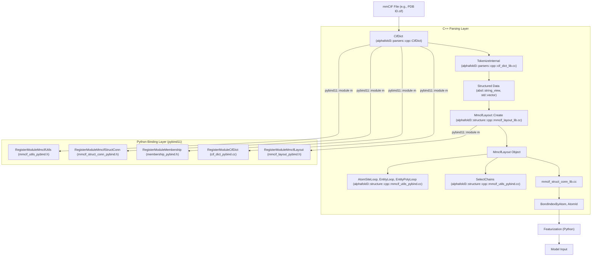
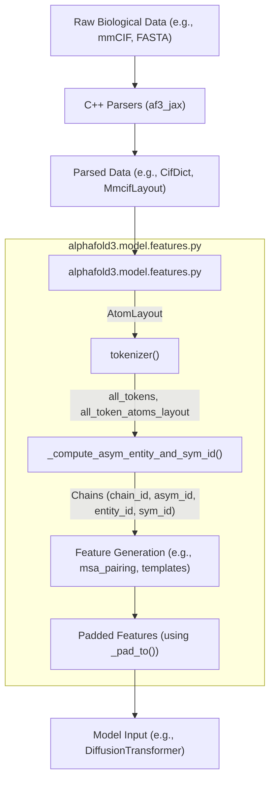
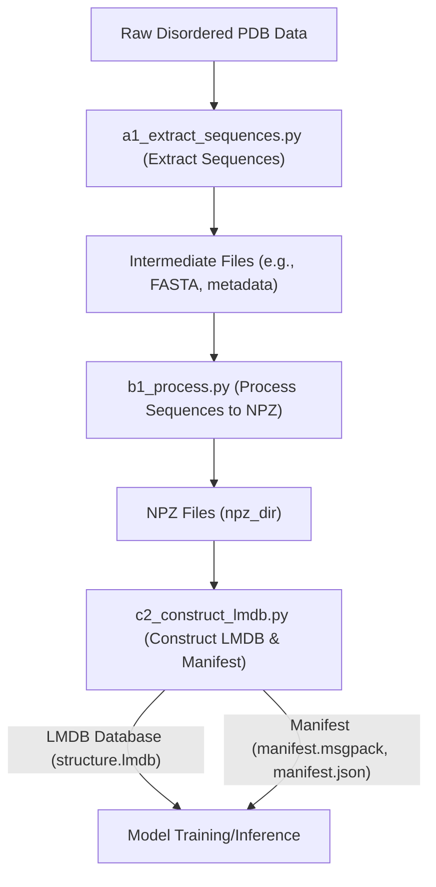

<!-- source: DeepWiki mcp.deepwiki.com · repo anthropics/uplifting-biomolecular-modeling · page 4.2 Data Pipelines, Featurization and Resources · fetched 2026-10-26 -->

# Data Pipelines, Featurization and Resources

Relevant source files

The following files were used as context for generating this wiki page:

- [af3_jax/stock/src/src/alphafold3/common/folding_input.py](af3_jax/stock/src/src/alphafold3/common/folding_input.py)
- [af3_jax/stock/src/src/alphafold3/constants/chemical_components.py](af3_jax/stock/src/src/alphafold3/constants/chemical_components.py)
- [af3_jax/stock/src/src/alphafold3/cpp.cc](af3_jax/stock/src/src/alphafold3/cpp.cc)
- [af3_jax/stock/src/src/alphafold3/data/cpp/msa_profile_pybind.h](af3_jax/stock/src/src/alphafold3/data/cpp/msa_profile_pybind.h)
- [af3_jax/stock/src/src/alphafold3/data/featurisation.py](af3_jax/stock/src/src/alphafold3/data/featurisation.py)
- [af3_jax/stock/src/src/alphafold3/data/tools/subprocess_utils.py](af3_jax/stock/src/src/alphafold3/data/tools/subprocess_utils.py)
- [af3_jax/stock/src/src/alphafold3/model/confidence_types.py](af3_jax/stock/src/src/alphafold3/model/confidence_types.py)
- [af3_jax/stock/src/src/alphafold3/model/confidences.py](af3_jax/stock/src/src/alphafold3/model/confidences.py)
- [af3_jax/stock/src/src/alphafold3/model/features.py](af3_jax/stock/src/src/alphafold3/model/features.py)
- [af3_jax/stock/src/src/alphafold3/model/json_serialize_pybind.cc](af3_jax/stock/src/src/alphafold3/model/json_serialize_pybind.cc)
- [af3_jax/stock/src/src/alphafold3/model/json_serialize_pybind.h](af3_jax/stock/src/src/alphafold3/model/json_serialize_pybind.h)
- [af3_jax/stock/src/src/alphafold3/model/merging_features.py](af3_jax/stock/src/src/alphafold3/model/merging_features.py)
- [af3_jax/stock/src/src/alphafold3/model/mkdssp_pybind.h](af3_jax/stock/src/src/alphafold3/model/mkdssp_pybind.h)
- [af3_jax/stock/src/src/alphafold3/model/msa_pairing.py](af3_jax/stock/src/src/alphafold3/model/msa_pairing.py)
- [af3_jax/stock/src/src/alphafold3/model/network/featurization.py](af3_jax/stock/src/src/alphafold3/model/network/featurization.py)
- [af3_jax/stock/src/src/alphafold3/model/pipeline/inter_chain_bonds.py](af3_jax/stock/src/src/alphafold3/model/pipeline/inter_chain_bonds.py)
- [af3_jax/stock/src/src/alphafold3/model/pipeline/pipeline.py](af3_jax/stock/src/src/alphafold3/model/pipeline/pipeline.py)
- [af3_jax/stock/src/src/alphafold3/model/pipeline/structure_cleaning.py](af3_jax/stock/src/src/alphafold3/model/pipeline/structure_cleaning.py)
- [af3_jax/stock/src/src/alphafold3/model/post_processing.py](af3_jax/stock/src/src/alphafold3/model/post_processing.py)
- [af3_jax/stock/src/src/alphafold3/parsers/cpp/cif_dict_lib.cc](af3_jax/stock/src/src/alphafold3/parsers/cpp/cif_dict_lib.cc)
- [af3_jax/stock/src/src/alphafold3/parsers/cpp/cif_dict_lib.h](af3_jax/stock/src/src/alphafold3/parsers/cpp/cif_dict_lib.h)
- [af3_jax/stock/src/src/alphafold3/parsers/cpp/cif_dict_pybind.cc](af3_jax/stock/src/src/alphafold3/parsers/cpp/cif_dict_pybind.cc)
- [af3_jax/stock/src/src/alphafold3/parsers/cpp/cif_dict_pybind.h](af3_jax/stock/src/src/alphafold3/parsers/cpp/cif_dict_pybind.h)
- [af3_jax/stock/src/src/alphafold3/parsers/cpp/fasta_iterator.pyi](af3_jax/stock/src/src/alphafold3/parsers/cpp/fasta_iterator.pyi)
- [af3_jax/stock/src/src/alphafold3/parsers/cpp/fasta_iterator_lib.cc](af3_jax/stock/src/src/alphafold3/parsers/cpp/fasta_iterator_lib.cc)
- [af3_jax/stock/src/src/alphafold3/parsers/cpp/fasta_iterator_lib.h](af3_jax/stock/src/src/alphafold3/parsers/cpp/fasta_iterator_lib.h)
- [af3_jax/stock/src/src/alphafold3/parsers/cpp/fasta_iterator_pybind.cc](af3_jax/stock/src/src/alphafold3/parsers/cpp/fasta_iterator_pybind.cc)
- [af3_jax/stock/src/src/alphafold3/parsers/cpp/fasta_iterator_pybind.h](af3_jax/stock/src/src/alphafold3/parsers/cpp/fasta_iterator_pybind.h)
- [af3_jax/stock/src/src/alphafold3/parsers/cpp/msa_conversion_pybind.cc](af3_jax/stock/src/src/alphafold3/parsers/cpp/msa_conversion_pybind.cc)
- [af3_jax/stock/src/src/alphafold3/parsers/cpp/msa_conversion_pybind.h](af3_jax/stock/src/src/alphafold3/parsers/cpp/msa_conversion_pybind.h)
- [af3_jax/stock/src/src/alphafold3/structure/chemical_components.py](af3_jax/stock/src/src/alphafold3/structure/chemical_components.py)
- [af3_jax/stock/src/src/alphafold3/structure/cpp/aggregation_pybind.h](af3_jax/stock/src/src/alphafold3/structure/cpp/aggregation_pybind.h)
- [af3_jax/stock/src/src/alphafold3/structure/cpp/membership_pybind.h](af3_jax/stock/src/src/alphafold3/structure/cpp/membership_pybind.h)
- [af3_jax/stock/src/src/alphafold3/structure/cpp/mmcif_altlocs.cc](af3_jax/stock/src/src/alphafold3/structure/cpp/mmcif_altlocs.cc)
- [af3_jax/stock/src/src/alphafold3/structure/cpp/mmcif_atom_site_pybind.h](af3_jax/stock/src/src/alphafold3/structure/cpp/mmcif_atom_site_pybind.h)
- [af3_jax/stock/src/src/alphafold3/structure/cpp/mmcif_layout_lib.cc](af3_jax/stock/src/src/alphafold3/structure/cpp/mmcif_layout_lib.cc)
- [af3_jax/stock/src/src/alphafold3/structure/cpp/mmcif_layout_pybind.h](af3_jax/stock/src/src/alphafold3/structure/cpp/mmcif_layout_pybind.h)
- [af3_jax/stock/src/src/alphafold3/structure/cpp/mmcif_struct_conn_lib.cc](af3_jax/stock/src/src/alphafold3/structure/cpp/mmcif_struct_conn_lib.cc)
- [af3_jax/stock/src/src/alphafold3/structure/cpp/mmcif_struct_conn_pybind.h](af3_jax/stock/src/src/alphafold3/structure/cpp/mmcif_struct_conn_pybind.h)
- [af3_jax/stock/src/src/alphafold3/structure/cpp/mmcif_utils_pybind.cc](af3_jax/stock/src/src/alphafold3/structure/cpp/mmcif_utils_pybind.cc)
- [af3_jax/stock/src/src/alphafold3/structure/cpp/mmcif_utils_pybind.h](af3_jax/stock/src/src/alphafold3/structure/cpp/mmcif_utils_pybind.h)
- [af3_jax/stock/src/src/alphafold3/structure/cpp/string_array_pybind.cc](af3_jax/stock/src/src/alphafold3/structure/cpp/string_array_pybind.cc)
- [af3_jax/stock/src/src/alphafold3/structure/cpp/string_array_pybind.h](af3_jax/stock/src/src/alphafold3/structure/cpp/string_array_pybind.h)
- [af3_torch/opt/forward/af3t/af3_torch/xfold/nn/featurization.py](af3_torch/opt/forward/af3t/af3_torch/xfold/nn/featurization.py)
- [atlasfold/stock/src/scripts/preprocess/af2/a2_construct_lmdb.py](atlasfold/stock/src/scripts/preprocess/af2/a2_construct_lmdb.py)
- [atlasfold/stock/src/scripts/preprocess/cameo_val/a1_process.py](atlasfold/stock/src/scripts/preprocess/cameo_val/a1_process.py)
- [atlasfold/stock/src/scripts/preprocess/disordered_pdb_af2/a1_extract_sequences.py](atlasfold/stock/src/scripts/preprocess/disordered_pdb_af2/a1_extract_sequences.py)
- [atlasfold/stock/src/scripts/preprocess/disordered_pdb_af2/a3_check_gdt.py](atlasfold/stock/src/scripts/preprocess/disordered_pdb_af2/a3_check_gdt.py)
- [atlasfold/stock/src/scripts/preprocess/disordered_pdb_esm/a1_extract_sequences.py](atlasfold/stock/src/scripts/preprocess/disordered_pdb_esm/a1_extract_sequences.py)
- [atlasfold/stock/src/scripts/preprocess/disordered_pdb_esm/a3_check_gdt.py](atlasfold/stock/src/scripts/preprocess/disordered_pdb_esm/a3_check_gdt.py)
- [atlasfold/stock/src/scripts/preprocess/disordered_pdb_esm/c2_construct_lmdb.py](atlasfold/stock/src/scripts/preprocess/disordered_pdb_esm/c2_construct_lmdb.py)
- [atlasfold/stock/src/scripts/preprocess/rcsb/a1_extract_sequences.py](atlasfold/stock/src/scripts/preprocess/rcsb/a1_extract_sequences.py)
- [atlasfold/stock/src/scripts/preprocess/rcsb/b1_process.py](atlasfold/stock/src/scripts/preprocess/rcsb/b1_process.py)
- [atlasfold/stock/src/scripts/preprocess_multimer/disordered_pdb/a1_extract_sequences.py](atlasfold/stock/src/scripts/preprocess_multimer/disordered_pdb/a1_extract_sequences.py)
- [atlasfold/stock/src/scripts/preprocess_multimer/disordered_pdb/b1_process.py](atlasfold/stock/src/scripts/preprocess_multimer/disordered_pdb/b1_process.py)
- [atlasfold/stock/src/scripts/preprocess_multimer/rcsb/a1_extract_sequences.py](atlasfold/stock/src/scripts/preprocess_multimer/rcsb/a1_extract_sequences.py)
- [atlasfold/stock/src/scripts/preprocess_multimer/rcsb/b1_process.py](atlasfold/stock/src/scripts/preprocess_multimer/rcsb/b1_process.py)
- [atlasfold/stock/src/scripts/preprocess_multimer/rcsb/c1_process_templates.py](atlasfold/stock/src/scripts/preprocess_multimer/rcsb/c1_process_templates.py)
- [atlasfold/stock/src/scripts/preprocess_multimer/rcsb/c3_create_template_mapping.py](atlasfold/stock/src/scripts/preprocess_multimer/rcsb/c3_create_template_mapping.py)
- [atlasfold/stock/src/src/atlasfold/train/losses/diffusion.py](atlasfold/stock/src/src/atlasfold/train/losses/diffusion.py)
- [atlasfold/stock/src/src/atlasfold/utils/geometry/metrics.py](atlasfold/stock/src/src/atlasfold/utils/geometry/metrics.py)
- [chai1/stock/src/chai_lab/data/__init__.py](chai1/stock/src/chai_lab/data/__init__.py)
- [chai1/stock/src/chai_lab/data/collate/__init__.py](chai1/stock/src/chai_lab/data/collate/__init__.py)
- [chai1/stock/src/chai_lab/data/dataset/__init__.py](chai1/stock/src/chai_lab/data/dataset/__init__.py)
- [chai1/stock/src/chai_lab/data/dataset/constraints/__init__.py](chai1/stock/src/chai_lab/data/dataset/constraints/__init__.py)
- [chai1/stock/src/chai_lab/data/dataset/embeddings/__init__.py](chai1/stock/src/chai_lab/data/dataset/embeddings/__init__.py)
- [chai1/stock/src/chai_lab/data/dataset/msas/__init__.py](chai1/stock/src/chai_lab/data/dataset/msas/__init__.py)
- [chai1/stock/src/chai_lab/data/features/__init__.py](chai1/stock/src/chai_lab/data/features/__init__.py)
- [chai1/stock/src/chai_lab/data/features/generators/__init__.py](chai1/stock/src/chai_lab/data/features/generators/__init__.py)
- [chai1/stock/src/chai_lab/data/io/__init__.py](chai1/stock/src/chai_lab/data/io/__init__.py)
- [chai1/stock/src/chai_lab/data/parsing/__init__.py](chai1/stock/src/chai_lab/data/parsing/__init__.py)
- [chai1/stock/src/chai_lab/data/parsing/msas/__init__.py](chai1/stock/src/chai_lab/data/parsing/msas/__init__.py)
- [chai1/stock/src/chai_lab/data/parsing/structure/__init__.py](chai1/stock/src/chai_lab/data/parsing/structure/__init__.py)
- [chai1/stock/src/chai_lab/model/__init__.py](chai1/stock/src/chai_lab/model/__init__.py)
- [chai1/stock/src/chai_lab/ranking/__init__.py](chai1/stock/src/chai_lab/ranking/__init__.py)
- [chai1/stock/src/chai_lab/utils/__init__.py](chai1/stock/src/chai_lab/utils/__init__.py)
- [esmfold2/opt/forward/fast_inference/driver/ef2_feats.py](esmfold2/opt/forward/fast_inference/driver/ef2_feats.py)
- [esmfold2/opt/forward/fast_inference/upstream/U6_msa_features_vectorised.diff](esmfold2/opt/forward/fast_inference/upstream/U6_msa_features_vectorised.diff)
- [esmfold2/opt/forward/fast_inference/upstream/U6_msa_features_vectorised.md](esmfold2/opt/forward/fast_inference/upstream/U6_msa_features_vectorised.md)
- [esmfold2/stock/src/esm/models/esmfold2/conformers.py](esmfold2/stock/src/esm/models/esmfold2/conformers.py)
- [esmfold2/stock/src/esm/models/esmfold2/paired_msa.py](esmfold2/stock/src/esm/models/esmfold2/paired_msa.py)
- [esmfold2/stock/src/esm/utils/structure/metrics.py](esmfold2/stock/src/esm/utils/structure/metrics.py)
- [esmfold2/stock/src/esm/utils/structure/molecular_complex.py](esmfold2/stock/src/esm/utils/structure/molecular_complex.py)
- [esmfold2/stock/src/esm/utils/structure/protein_chain.py](esmfold2/stock/src/esm/utils/structure/protein_chain.py)
- [esmfold2/stock/src/esm/utils/structure/protein_complex.py](esmfold2/stock/src/esm/utils/structure/protein_complex.py)
- [esmfold2/stock/src/esm/utils/structure/protein_structure.py](esmfold2/stock/src/esm/utils/structure/protein_structure.py)
- [openfold3/stock/src/openfold3/core/data/resources/canonical_protein_data/reference_mols/ARG.sdf](openfold3/stock/src/openfold3/core/data/resources/canonical_protein_data/reference_mols/ARG.sdf)
- [openfold3/stock/src/openfold3/core/data/resources/canonical_protein_data/reference_mols/ASN.sdf](openfold3/stock/src/openfold3/core/data/resources/canonical_protein_data/reference_mols/ASN.sdf)
- [openfold3/stock/src/openfold3/core/data/resources/canonical_protein_data/reference_mols/ASP.sdf](openfold3/stock/src/openfold3/core/data/resources/canonical_protein_data/reference_mols/ASP.sdf)
- [openfold3/stock/src/openfold3/core/data/resources/canonical_protein_data/reference_mols/GLN.sdf](openfold3/stock/src/openfold3/core/data/resources/canonical_protein_data/reference_mols/GLN.sdf)
- [openfold3/stock/src/openfold3/core/data/resources/canonical_protein_data/reference_mols/GLU.sdf](openfold3/stock/src/openfold3/core/data/resources/canonical_protein_data/reference_mols/GLU.sdf)
- [openfold3/stock/src/openfold3/core/data/resources/canonical_protein_data/reference_mols/HIS.sdf](openfold3/stock/src/openfold3/core/data/resources/canonical_protein_data/reference_mols/HIS.sdf)
- [openfold3/stock/src/openfold3/core/data/resources/canonical_protein_data/reference_mols/ILE.sdf](openfold3/stock/src/openfold3/core/data/resources/canonical_protein_data/reference_mols/ILE.sdf)
- [openfold3/stock/src/openfold3/core/data/resources/canonical_protein_data/reference_mols/LEU.sdf](openfold3/stock/src/openfold3/core/data/resources/canonical_protein_data/reference_mols/LEU.sdf)
- [openfold3/stock/src/openfold3/core/data/resources/canonical_protein_data/reference_mols/LYS.sdf](openfold3/stock/src/openfold3/core/data/resources/canonical_protein_data/reference_mols/LYS.sdf)
- [openfold3/stock/src/openfold3/core/data/resources/canonical_protein_data/reference_mols/MET.sdf](openfold3/stock/src/openfold3/core/data/resources/canonical_protein_data/reference_mols/MET.sdf)
- [openfold3/stock/src/openfold3/core/data/resources/canonical_protein_data/reference_mols/PHE.sdf](openfold3/stock/src/openfold3/core/data/resources/canonical_protein_data/reference_mols/PHE.sdf)
- [openfold3/stock/src/openfold3/core/data/resources/canonical_protein_data/reference_mols/PRO.sdf](openfold3/stock/src/openfold3/core/data/resources/canonical_protein_data/reference_mols/PRO.sdf)
- [openfold3/stock/src/openfold3/core/data/resources/canonical_protein_data/reference_mols/SER.sdf](openfold3/stock/src/openfold3/core/data/resources/canonical_protein_data/reference_mols/SER.sdf)
- [openfold3/stock/src/openfold3/core/data/resources/canonical_protein_data/reference_mols/THR.sdf](openfold3/stock/src/openfold3/core/data/resources/canonical_protein_data/reference_mols/THR.sdf)
- [openfold3/stock/src/openfold3/core/data/resources/canonical_protein_data/reference_mols/TYR.sdf](openfold3/stock/src/openfold3/core/data/resources/canonical_protein_data/reference_mols/TYR.sdf)
- [openfold3/stock/src/openfold3/core/data/resources/canonical_protein_data/reference_mols/UNK.sdf](openfold3/stock/src/openfold3/core/data/resources/canonical_protein_data/reference_mols/UNK.sdf)
- [openfold3/stock/src/openfold3/core/data/resources/canonical_protein_data/reference_mols/VAL.sdf](openfold3/stock/src/openfold3/core/data/resources/canonical_protein_data/reference_mols/VAL.sdf)
- [openfold3/stock/src/scripts/data_preprocessing/create_pdb-weighted_training_dataset_cache.py](openfold3/stock/src/scripts/data_preprocessing/create_pdb-weighted_training_dataset_cache.py)
- [openfold3/stock/src/scripts/data_preprocessing/create_protein-monomer_training_dataset_cache.py](openfold3/stock/src/scripts/data_preprocessing/create_protein-monomer_training_dataset_cache.py)
- [openfold3/stock/src/scripts/data_preprocessing/cross_validate_atomarray_msa.py](openfold3/stock/src/scripts/data_preprocessing/cross_validate_atomarray_msa.py)
- [openfold3/stock/src/scripts/data_preprocessing/preprocess_template_alignments_new_of3.py](openfold3/stock/src/scripts/data_preprocessing/preprocess_template_alignments_new_of3.py)
- [openfold3_ob0/stock/src/openfold3/core/data/resources/canonical_protein_data/reference_mols/ARG.sdf](openfold3_ob0/stock/src/openfold3/core/data/resources/canonical_protein_data/reference_mols/ARG.sdf)
- [openfold3_ob0/stock/src/openfold3/core/data/resources/canonical_protein_data/reference_mols/ASN.sdf](openfold3_ob0/stock/src/openfold3/core/data/resources/canonical_protein_data/reference_mols/ASN.sdf)
- [openfold3_ob0/stock/src/openfold3/core/data/resources/canonical_protein_data/reference_mols/ASP.sdf](openfold3_ob0/stock/src/openfold3/core/data/resources/canonical_protein_data/reference_mols/ASP.sdf)
- [openfold3_ob0/stock/src/openfold3/core/data/resources/canonical_protein_data/reference_mols/GLN.sdf](openfold3_ob0/stock/src/openfold3/core/data/resources/canonical_protein_data/reference_mols/GLN.sdf)
- [openfold3_ob0/stock/src/openfold3/core/data/resources/canonical_protein_data/reference_mols/GLU.sdf](openfold3_ob0/stock/src/openfold3/core/data/resources/canonical_protein_data/reference_mols/GLU.sdf)
- [openfold3_ob0/stock/src/openfold3/core/data/resources/canonical_protein_data/reference_mols/HIS.sdf](openfold3_ob0/stock/src/openfold3/core/data/resources/canonical_protein_data/reference_mols/HIS.sdf)
- [openfold3_ob0/stock/src/openfold3/core/data/resources/canonical_protein_data/reference_mols/ILE.sdf](openfold3_ob0/stock/src/openfold3/core/data/resources/canonical_protein_data/reference_mols/ILE.sdf)
- [openfold3_ob0/stock/src/openfold3/core/data/resources/canonical_protein_data/reference_mols/LEU.sdf](openfold3_ob0/stock/src/openfold3/core/data/resources/canonical_protein_data/reference_mols/LEU.sdf)
- [openfold3_ob0/stock/src/openfold3/core/data/resources/canonical_protein_data/reference_mols/LYS.sdf](openfold3_ob0/stock/src/openfold3/core/data/resources/canonical_protein_data/reference_mols/LYS.sdf)
- [openfold3_ob0/stock/src/openfold3/core/data/resources/canonical_protein_data/reference_mols/MET.sdf](openfold3_ob0/stock/src/openfold3/core/data/resources/canonical_protein_data/reference_mols/MET.sdf)
- [openfold3_ob0/stock/src/openfold3/core/data/resources/canonical_protein_data/reference_mols/PHE.sdf](openfold3_ob0/stock/src/openfold3/core/data/resources/canonical_protein_data/reference_mols/PHE.sdf)
- [openfold3_ob0/stock/src/openfold3/core/data/resources/canonical_protein_data/reference_mols/PRO.sdf](openfold3_ob0/stock/src/openfold3/core/data/resources/canonical_protein_data/reference_mols/PRO.sdf)
- [openfold3_ob0/stock/src/openfold3/core/data/resources/canonical_protein_data/reference_mols/SER.sdf](openfold3_ob0/stock/src/openfold3/core/data/resources/canonical_protein_data/reference_mols/SER.sdf)
- [openfold3_ob0/stock/src/openfold3/core/data/resources/canonical_protein_data/reference_mols/THR.sdf](openfold3_ob0/stock/src/openfold3/core/data/resources/canonical_protein_data/reference_mols/THR.sdf)
- [openfold3_ob0/stock/src/openfold3/core/data/resources/canonical_protein_data/reference_mols/TYR.sdf](openfold3_ob0/stock/src/openfold3/core/data/resources/canonical_protein_data/reference_mols/TYR.sdf)
- [openfold3_ob0/stock/src/openfold3/core/data/resources/canonical_protein_data/reference_mols/UNK.sdf](openfold3_ob0/stock/src/openfold3/core/data/resources/canonical_protein_data/reference_mols/UNK.sdf)
- [openfold3_ob0/stock/src/openfold3/core/data/resources/canonical_protein_data/reference_mols/VAL.sdf](openfold3_ob0/stock/src/openfold3/core/data/resources/canonical_protein_data/reference_mols/VAL.sdf)
- [openfold3_ob0/stock/src/scripts/data_preprocessing/create_RNA-monomer_training_dataset_cache.py](openfold3_ob0/stock/src/scripts/data_preprocessing/create_RNA-monomer_training_dataset_cache.py)
- [openfold3_ob0/stock/src/scripts/data_preprocessing/create_pdb-weighted_training_dataset_cache.py](openfold3_ob0/stock/src/scripts/data_preprocessing/create_pdb-weighted_training_dataset_cache.py)
- [openfold3_ob0/stock/src/scripts/data_preprocessing/create_protein-monomer_training_dataset_cache.py](openfold3_ob0/stock/src/scripts/data_preprocessing/create_protein-monomer_training_dataset_cache.py)
- [openfold3_ob0/stock/src/scripts/data_preprocessing/cross_validate_atomarray_msa.py](openfold3_ob0/stock/src/scripts/data_preprocessing/cross_validate_atomarray_msa.py)
- [openfold3_ob0/stock/src/scripts/data_preprocessing/preparse_alignments_of3.py](openfold3_ob0/stock/src/scripts/data_preprocessing/preparse_alignments_of3.py)
- [openfold3_ob0/stock/src/scripts/data_preprocessing/preprocess_pdb_of3.py](openfold3_ob0/stock/src/scripts/data_preprocessing/preprocess_pdb_of3.py)
- [openfold3_ob0/stock/src/scripts/data_preprocessing/preprocess_rfam.py](openfold3_ob0/stock/src/scripts/data_preprocessing/preprocess_rfam.py)
- [openfold3_ob0/stock/src/scripts/data_preprocessing/preprocess_template_alignments_new_of3.py](openfold3_ob0/stock/src/scripts/data_preprocessing/preprocess_template_alignments_new_of3.py)
- [openfold3_ob0/stock/src/scripts/datasets/generate_subset_cache.py](openfold3_ob0/stock/src/scripts/datasets/generate_subset_cache.py)
- [pxdesign/stock/src/Protenix/protenix/data/msa_utils.py](pxdesign/stock/src/Protenix/protenix/data/msa_utils.py)
- [pxdesign/stock/src/Protenix/protenix/openfold_local/data/msa_pairing.py](pxdesign/stock/src/Protenix/protenix/openfold_local/data/msa_pairing.py)
- [pxdesign/stock/src/Protenix/protenix/openfold_local/data/parsers.py](pxdesign/stock/src/Protenix/protenix/openfold_local/data/parsers.py)

This page details the data pipelines, featurization processes, and associated resources used across the various kits in the repository. It covers how raw biological data, such as Multiple Sequence Alignments (MSAs) and structural templates, are parsed, processed, and transformed into the features consumed by the models. Key components include C++ parsers for mmCIF files in `af3_jax`, data modules from `chai_lab`, data primitives from `openfold3`, reference molecule SDFs, and various dataset preprocessing scripts.

## MSA and Template Parsing

Multiple Sequence Alignments (MSAs) and structural templates are crucial inputs for many protein modeling tasks. The codebase includes utilities for parsing these data types.

### FASTA Parsing

FASTA files, commonly used for sequence data, are parsed using C++ implementations for efficiency.
The `alphafold3::ParseFasta` function [af3_jax/stock/src/src/alphafold3/parsers/cpp/fasta_iterator_lib.cc:40-52]() extracts amino acid sequences from a FASTA string. For cases where descriptions are also needed, `alphafold3::ParseFastaIncludeDescriptions` [af3_jax/stock/src/src/alphafold3/parsers/cpp/fasta_iterator_lib.cc:57-71]() provides both sequences and their associated descriptions.
For streaming FASTA data from files or strings, `FastaFileIterator` and `FastaStringIterator` classes are available [af3_jax/stock/src/src/alphafold3/parsers/cpp/fasta_iterator_lib.cc:74-128](). These iterators provide a `Next()` method to retrieve sequence-description pairs.

Sources:
- [af3_jax/stock/src/src/alphafold3/parsers/cpp/fasta_iterator_lib.cc:40-128]()

## mmCIF C++ Parsers in af3_jax

The `af3_jax` kit leverages highly optimized C++ parsers for handling mmCIF (Macromolecular Crystallographic Information File) data. These parsers are exposed to Python via `pybind11` bindings.

### CifDict

The `CifDict` class [af3_jax/stock/src/src/alphafold3/parsers/cpp/cif_dict_lib.cc:20-22]() is a core component for representing and accessing data from mmCIF files. It provides a dictionary-like interface to mmCIF categories and their associated data loops.
The parsing logic for `CifDict` involves tokenizing the mmCIF string, handling quoted and multiline tokens, and organizing the data into a structured format. The `TokenizeInternal` function [af3_jax/stock/src/src/alphafold3/parsers/cpp/cif_dict_lib.cc:120-161]() is responsible for this tokenization.

### mmCIF Layout

The `MmcifLayout` class [af3_jax/stock/src/src/alphafold3/structure/cpp/mmcif_layout_lib.cc:41-45]() provides a structured view of the mmCIF data, organizing it by models, chains, residues, and atoms. It includes methods for filtering the layout based on indices [af3_jax/stock/src/src/alphafold3/structure/cpp/mmcif_layout_lib.cc:48-89]() and for creating a layout from a `CifDict` [af3_jax/stock/src/src/alphafold3/structure/cpp/mmcif_layout_lib.cc:91-167]().

### mmCIF Utilities

Several utility functions are provided for working with mmCIF data, exposed through `mmcif_utils_pybind.h` [af3_jax/stock/src/src/alphafold3/structure/cpp/mmcif_utils_pybind.h:27-29](). These include:
- `AtomSiteLoop`: A structure to hold references to atom site columns, ensuring consistency in size [af3_jax/stock/src/src/alphafold3/structure/cpp/mmcif_utils_pybind.cc:85-121]().
- `EntityLoop` and `EntityPolyLoop`: Similar structures for entity and entity_poly categories [af3_jax/stock/src/src/alphafold3/structure/cpp/mmcif_utils_pybind.cc:125-153]().
- `SelectChains`: A function to filter chains based on type (e.g., nucleotides, ligands, water) [af3_jax/stock/src/src/alphafold3/structure/cpp/mmcif_utils_pybind.cc:157-181]().
- `mmcif_struct_conn_lib.cc`: This file contains C++ logic for processing structural connectivity information from mmCIF files, including identifying atoms and filling in bond information [af3_jax/stock/src/src/alphafold3/structure/cpp/mmcif_struct_conn_lib.cc:42-175](). This is exposed via `mmcif_struct_conn_pybind.h` [af3_jax/stock/src/src/alphafold3/structure/cpp/mmcif_struct_conn_pybind.h:27-29]().

### mmCIF C++ Parser Data Flow

Sources:
- [af3_jax/stock/src/src/alphafold3/parsers/cpp/cif_dict_lib.cc:20-161]()
- [af3_jax/stock/src/src/alphafold3/structure/cpp/mmcif_layout_lib.cc:41-167]()
- [af3_jax/stock/src/src/alphafold3/structure/cpp/mmcif_utils_pybind.h:27-29]()
- [af3_jax/stock/src/src/alphafold3/structure/cpp/mmcif_utils_pybind.cc:85-181]()
- [af3_jax/stock/src/src/alphafold3/structure/cpp/mmcif_struct_conn_lib.cc:42-175]()
- [af3_jax/stock/src/src/alphafold3/structure/cpp/mmcif_struct_conn_pybind.h:27-29]()
- [af3_jax/stock/src/src/alphafold3/structure/cpp/membership_pybind.h:27-29]()
- [af3_jax/stock/src/src/alphafold3/parsers/cpp/cif_dict_pybind.cc:51-53]()
- [af3_jax/stock/src/src/alphafold3/structure/cpp/mmcif_layout_pybind.h]()

## chai_lab Data Modules

The `chai_lab` directory contains data-related modules, including `io`, `parsing`, `collate`, and `features/generators`. These modules provide abstractions and utilities for data handling within the `chai1` kit.

- `chai_lab/data/io/__init__.py`: This module likely handles input/output operations for various data formats.
- `chai_lab/data/parsing/__init__.py`: This module would contain general parsing utilities.
- `chai_lab/data/parsing/msas/__init__.py`: Specifically for MSA parsing.
- `chai_lab/data/parsing/structure/__init__.py`: For parsing structural data.
- `chai_lab/data/collate/__init__.py`: Contains logic for collating data batches, often used in data loaders.
- `chai_lab/data/features/generators/__init__.py`: This module is expected to house functions or classes responsible for generating specific features from raw data.

Sources:
- [chai1/stock/src/chai_lab/data/io/__init__.py:1-3]()
- [chai1/stock/src/chai_lab/data/parsing/__init__.py]()
- [chai1/stock/src/chai_lab/data/parsing/msas/__init__.py]()
- [chai1/stock/src/chai_lab/data/parsing/structure/__init__.py]()
- [chai1/stock/src/chai_lab/data/collate/__init__.py]()
- [chai1/stock/src/chai_lab/data/features/generators/__init__.py]()

## OpenFold3 Data Primitives

The `openfold3` kit defines several data primitives and utilities for featurization, particularly within `alphafold3/model/features.py`.

### AtomLayout and Tokenization

The `atom_layout.AtomLayout` class is central to representing atomic structures. The `tokenizer` function [af3_jax/stock/src/src/alphafold3/model/features.py:173-203]() maps a flat `AtomLayout` to tokens suitable for the Evoformer, creating one token per polymer residue and one token per ligand atom. This involves generating a representative atom for each token and a detailed layout of all atoms per token.

### Chains and Entity/Symmetry IDs

The `Chains` dataclass [af3_jax/stock/src/src/alphafold3/model/features.py:114-119]() stores chain-level information such as `chain_id`, `asym_id`, `entity_id`, and `sym_id`. The `_compute_asym_entity_and_sym_id` function [af3_jax/stock/src/src/alphafold3/model/features.py:128-170]() computes these identifiers by finding identical sequences and assigning entity and symmetry IDs to each chain.

### Padding

The `_pad_to` function [af3_jax/stock/src/src/alphafold3/model/features.py:69-102]() is a utility for padding NumPy arrays to a specified shape, which is essential for creating uniform batch sizes for models.

### Featurization Pipeline

Sources:
- [af3_jax/stock/src/src/alphafold3/model/features.py:69-102]()
- [af3_jax/stock/src/src/alphafold3/model/features.py:114-119]()
- [af3_jax/stock/src/src/alphafold3/model/features.py:128-170]()
- [af3_jax/stock/src/src/alphafold3/model/features.py:173-203]()

## Reference Molecule SDFs

The `openfold3` kit includes a collection of canonical protein data, specifically reference molecule SDF (Structure-Data File) files. These files define the standard atomic structure and connectivity for various amino acids and common ligands. Examples include:

- `PRO.sdf`: Proline reference molecule.
- `ASN.sdf`: Asparagine reference molecule.
- `UNK.sdf`: Unknown residue reference molecule.
- `ASP.sdf`: Aspartic acid reference molecule.
- `ILE.sdf`: Isoleucine reference molecule.

These SDFs are crucial for tasks like atom layout generation and ensuring consistent representation of molecular components across the modeling pipeline.

Sources:
- [openfold3/stock/src/openfold3/core/data/resources/canonical_protein_data/reference_mols/PRO.sdf]()
- [openfold3/stock/src/openfold3/core/data/resources/canonical_protein_data/reference_mols/ASN.sdf]()
- [openfold3/stock/src/openfold3/core/data/resources/canonical_protein_data/reference_mols/UNK.sdf]()
- [openfold3/stock/src/openfold3/core/data/resources/canonical_protein_data/reference_mols/ASP.sdf]()
- [openfold3/stock/src/openfold3/core/data/resources/canonical_protein_data/reference_mols/ILE.sdf]()
- [openfold3_ob0/stock/src/openfold3/core/data/resources/canonical_protein_data/reference_mols/UNK.sdf]()
- [openfold3_ob0/stock/src/openfold3/core/data/resources/canonical_protein_data/reference_mols/ASP.sdf]()

## Dataset Preprocessing Scripts

Several kits include scripts for preprocessing large datasets, often involving the creation of LMDB (Lightning Memory-mapped Database) files and manifest files for efficient data loading during training.

### AtlasFold Preprocessing

The `atlasfold` kit contains scripts for preprocessing disordered PDB data for ESMFold and AlphaFold2.

- `c2_construct_lmdb.py`: This script constructs an LMDB database from preprocessed NPZ files and generates a manifest (in msgpack and JSON formats). It involves:
    - Initializing an LMDB environment and writing NPZ file contents to it [atlasfold/stock/src/scripts/preprocess/disordered_pdb_esm/c2_construct_lmdb.py:96-113]().
    - Extracting metadata from NPZ files in parallel using `multiprocessing.Pool` and `process_metadata` function [atlasfold/stock/src/scripts/preprocess/disordered_pdb_esm/c2_construct_lmdb.py:124-143]().
    - Computing cluster sizes and saving the manifest [atlasfold/stock/src/scripts/preprocess/disordered_pdb_esm/c2_construct_lmdb.py:145-162]().
- `a1_extract_sequences.py`: Scripts like this are used to extract sequences from raw data sources (e.g., PDB files) as a first step in preprocessing.

### OpenFold3 Preprocessing

The `openfold3` and `openfold3_ob0` kits also include various preprocessing scripts:

- `create_protein-monomer_training_dataset_cache.py`: Scripts for creating training dataset caches for protein monomers.
- `create_RNA-monomer_training_dataset_cache.py`: For RNA monomer datasets.
- `create_pdb-weighted_training_dataset_cache.py`: For PDB-weighted datasets.
- `preprocess_rfam.py`: Script for preprocessing RFAM data.
- `generate_subset_cache.py`: Utility for generating subsets of existing caches.
- `cross_validate_atomarray_msa.py`: Script for cross-validating atom array MSAs.

### Preprocessing Workflow Example (AtlasFold)

Sources:
- [atlasfold/stock/src/scripts/preprocess/disordered_pdb_esm/c2_construct_lmdb.py:96-162]()
- [atlasfold/stock/src/scripts/preprocess/disordered_pdb_esm/a1_extract_sequences.py]()
- [atlasfold/stock/src/scripts/preprocess_multimer/disordered_pdb/a1_extract_sequences.py]()
- [atlasfold/stock/src/scripts/preprocess_multimer/disordered_pdb/b1_process.py]()
- [atlasfold/stock/src/scripts/preprocess/af2/a2_construct_lmdb.py]()
- [openfold3_ob0/stock/src/scripts/data_preprocessing/create_pdb-weighted_training_dataset_cache.py]()
- [openfold3_ob0/stock/src/scripts/data_preprocessing/preprocess_rfam.py]()
- [openfold3/stock/src/scripts/data_preprocessing/create_protein-monomer_training_dataset_cache.py]()
- [openfold3/stock/src/scripts/data_preprocessing/cross_validate_atomarray_msa.py]()
- [openfold3_ob0/stock/src/scripts/data_preprocessing/create_RNA-monomer_training_dataset_cache.py]()
- [openfold3_ob0/stock/src/scripts/data_preprocessing/create_protein-monomer_training_dataset_cache.py]()
- [openfold3_ob0/stock/src/scripts/datasets/generate_subset_cache.py]()

---

