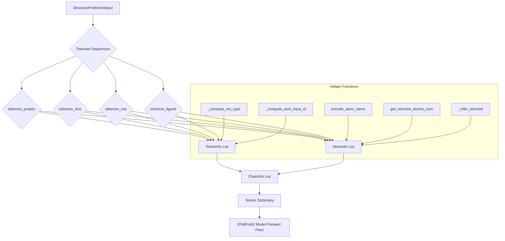

<!-- source: DeepWiki mcp.deepwiki.com · repo anthropics/uplifting-biomolecular-modeling · page 4.3 Sequence Models and Genomics Stock Code · fetched 2026-10-26 -->

# Sequence Models and Genomics Stock Code

<details>
<summary>Relevant source files</summary>

The following files were used as context for generating this wiki page:

- [af3_torch/opt/forward/af3t/af3_torch/xfold/nn/diffusion_transformer.py](af3_torch/opt/forward/af3t/af3_torch/xfold/nn/diffusion_transformer.py)
- [atlasfold/opt/atlasfold_opt/hooks/sampler_hostsync.py](atlasfold/opt/atlasfold_opt/hooks/sampler_hostsync.py)
- [atlasfold/opt/atlasfold_opt/tests/test_output_overlap_cpu.py](atlasfold/opt/atlasfold_opt/tests/test_output_overlap_cpu.py)
- [atlasfold/opt/atlasfold_opt/tests/test_sampler_hoist_cpu.py](atlasfold/opt/atlasfold_opt/tests/test_sampler_hoist_cpu.py)
- [atlasfold/opt/atlasfold_opt/tests/test_sampler_hostsync_cpu.py](atlasfold/opt/atlasfold_opt/tests/test_sampler_hostsync_cpu.py)
- [atlasfold/stock/src/scripts/benchmark/lm/run_atlaslm.py](atlasfold/stock/src/scripts/benchmark/lm/run_atlaslm.py)
- [atlasfold/stock/src/scripts/benchmark/lm/run_esm2.py](atlasfold/stock/src/scripts/benchmark/lm/run_esm2.py)
- [atlasfold/stock/src/scripts/benchmark/lm/run_esmc.py](atlasfold/stock/src/scripts/benchmark/lm/run_esmc.py)
- [atlasfold/stock/src/scripts/preprocess/af2/a1_process.py](atlasfold/stock/src/scripts/preprocess/af2/a1_process.py)
- [atlasfold/stock/src/scripts/preprocess_multimer/rcsb/b3_filter.py](atlasfold/stock/src/scripts/preprocess_multimer/rcsb/b3_filter.py)
- [atlasfold/stock/src/src/atlasfold/common/process.py](atlasfold/stock/src/src/atlasfold/common/process.py)
- [atlasfold/stock/src/src/atlasfold/train/utils/ema.py](atlasfold/stock/src/src/atlasfold/train/utils/ema.py)
- [atlasfold/stock/src/src/atlasfold/utils/geometry/random_augment.py](atlasfold/stock/src/src/atlasfold/utils/geometry/random_augment.py)
- [atlasfold/stock/src/src/atlaslm/layers/transformer_stack.py](atlasfold/stock/src/src/atlaslm/layers/transformer_stack.py)
- [boltz2/stock/src/boltz/model/modules/utils.py](boltz2/stock/src/boltz/model/modules/utils.py)
- [caliby/stock/check_pins.py](caliby/stock/check_pins.py)
- [chai1/stock/src/chai_lab/chai1.py](chai1/stock/src/chai_lab/chai1.py)
- [chai1/stock/src/chai_lab/data/features/feature_factory.py](chai1/stock/src/chai_lab/data/features/feature_factory.py)
- [chai1/stock/src/chai_lab/data/features/generators/base.py](chai1/stock/src/chai_lab/data/features/generators/base.py)
- [chai1/stock/src/chai_lab/data/features/generators/identity.py](chai1/stock/src/chai_lab/data/features/generators/identity.py)
- [chai1/stock/src/chai_lab/data/features/generators/templates.py](chai1/stock/src/chai_lab/data/features/generators/templates.py)
- [chai1/stock/src/chai_lab/model/utils.py](chai1/stock/src/chai_lab/model/utils.py)
- [colabdesign/stock/check_pins.py](colabdesign/stock/check_pins.py)
- [colabfold/stock/src/colabfold/batch.py](colabfold/stock/src/colabfold/batch.py)
- [common/opt_core/opt_core/kernels/transition/build_flash_prebuilt.py](common/opt_core/opt_core/kernels/transition/build_flash_prebuilt.py)
- [common/opt_core/opt_core/kernels/triattn_xla/csrc/build.py](common/opt_core/opt_core/kernels/triattn_xla/csrc/build.py)
- [common/opt_core/opt_core/seq/varlen.py](common/opt_core/opt_core/seq/varlen.py)
- [complexa/stock/check_pins.py](complexa/stock/check_pins.py)
- [e1/CHANGES.md](e1/CHANGES.md)
- [e1/opt/forward/engines/e1/kits/attn/__init__.py](e1/opt/forward/engines/e1/kits/attn/__init__.py)
- [e1/opt/forward/engines/e1/kits/attn/adapter.py](e1/opt/forward/engines/e1/kits/attn/adapter.py)
- [e1/opt/forward/engines/e1/kits/eager/__init__.py](e1/opt/forward/engines/e1/kits/eager/__init__.py)
- [e1/opt/forward/engines/e1/kits/ew1/__init__.py](e1/opt/forward/engines/e1/kits/ew1/__init__.py)
- [e1/opt/forward/engines/e1/kits/ew1/patches.py](e1/opt/forward/engines/e1/kits/ew1/patches.py)
- [e1/opt/forward/engines/e1/kits/multiseq/__init__.py](e1/opt/forward/engines/e1/kits/multiseq/__init__.py)
- [e1/opt/forward/engines/e1/kits/v0/__init__.py](e1/opt/forward/engines/e1/kits/v0/__init__.py)
- [e1/opt/forward/engines/e1/kits/v1/__init__.py](e1/opt/forward/engines/e1/kits/v1/__init__.py)
- [e1/opt/forward/engines/e1/kits/v1_2/__init__.py](e1/opt/forward/engines/e1/kits/v1_2/__init__.py)
- [e1/stock/src/E1/model/flash_attention_utils.py](e1/stock/src/E1/model/flash_attention_utils.py)
- [enformer/CHANGES.md](enformer/CHANGES.md)
- [enformer/README.md](enformer/README.md)
- [enformer/STOCK.md](enformer/STOCK.md)
- [enformer/environment/Dockerfile](enformer/environment/Dockerfile)
- [enformer/environment/apptainer.def](enformer/environment/apptainer.def)
- [enformer/opt/enformer_opt/__init__.py](enformer/opt/enformer_opt/__init__.py)
- [enformer/opt/enformer_opt/__main__.py](enformer/opt/enformer_opt/__main__.py)
- [enformer/opt/enformer_opt/_runtime.py](enformer/opt/enformer_opt/_runtime.py)
- [enformer/opt/forward/enformer_kit/engines/enformer/kits/v0_2/__init__.py](enformer/opt/forward/enformer_kit/engines/enformer/kits/v0_2/__init__.py)
- [enformer/opt/pyproject.toml](enformer/opt/pyproject.toml)
- [enformer/run.sh](enformer/run.sh)
- [enformer_deepmind/CHANGES.md](enformer_deepmind/CHANGES.md)
- [enformer_deepmind/README.md](enformer_deepmind/README.md)
- [enformer_deepmind/STOCK.md](enformer_deepmind/STOCK.md)
- [enformer_deepmind/environment/Dockerfile](enformer_deepmind/environment/Dockerfile)
- [enformer_deepmind/opt/enformer_deepmind_opt/__init__.py](enformer_deepmind/opt/enformer_deepmind_opt/__init__.py)
- [enformer_deepmind/opt/enformer_deepmind_opt/__main__.py](enformer_deepmind/opt/enformer_deepmind_opt/__main__.py)
- [enformer_deepmind/opt/enformer_deepmind_opt/_runtime.py](enformer_deepmind/opt/enformer_deepmind_opt/_runtime.py)
- [enformer_deepmind/opt/enformer_deepmind_opt/ops/BUILD.json](enformer_deepmind/opt/enformer_deepmind_opt/ops/BUILD.json)
- [enformer_deepmind/opt/enformer_deepmind_opt/ops/README.md](enformer_deepmind/opt/enformer_deepmind_opt/ops/README.md)
- [enformer_deepmind/opt/enformer_deepmind_opt/ops/__init__.py](enformer_deepmind/opt/enformer_deepmind_opt/ops/__init__.py)
- [enformer_deepmind/opt/enformer_deepmind_opt/ops/build.sh](enformer_deepmind/opt/enformer_deepmind_opt/ops/build.sh)
- [enformer_deepmind/opt/enformer_deepmind_opt/ops/edm_layernorm.cu.cc](enformer_deepmind/opt/enformer_deepmind_opt/ops/edm_layernorm.cu.cc)
- [enformer_deepmind/opt/pyproject.toml](enformer_deepmind/opt/pyproject.toml)
- [enformer_deepmind/run.sh](enformer_deepmind/run.sh)
- [esmc/stock/check_pins.py](esmc/stock/check_pins.py)
- [esmc/stock/src/esm/esm/models/esmc/layers.py](esmc/stock/src/esm/esm/models/esmc/layers.py)
- [esmfold2/stock/check_pins.py](esmfold2/stock/check_pins.py)
- [esmfold2/stock/src/esm/models/esmfold2/prepare_input.py](esmfold2/stock/src/esm/models/esmfold2/prepare_input.py)
- [esmfold2/stock/src/esm/models/esmfold2/processor.py](esmfold2/stock/src/esm/models/esmfold2/processor.py)
- [esmfold2/stock/src/transformers/src/transformers/models/esmfold2/modeling_esmfold2_common.py](esmfold2/stock/src/transformers/src/transformers/models/esmfold2/modeling_esmfold2_common.py)
- [evo2/CHANGES.md](evo2/CHANGES.md)
- [evo2/opt/evo2_opt/cli.py](evo2/opt/evo2_opt/cli.py)
- [evo2/opt/evo2_opt/kit/__init__.py](evo2/opt/evo2_opt/kit/__init__.py)
- [evo2/route/evo2_route.py](evo2/route/evo2_route.py)
- [evo2/stock/src/evo2/test/test_evo2_generation.py](evo2/stock/src/evo2/test/test_evo2_generation.py)
- [evo2/stock/src/vortex/model/rotary.py](evo2/stock/src/vortex/model/rotary.py)
- [gpnstar/stock/check_pins.py](gpnstar/stock/check_pins.py)
- [mosaic/stock/check_pins.py](mosaic/stock/check_pins.py)
- [opendde/stock/src/opendde/config/schema.py](opendde/stock/src/opendde/config/schema.py)
- [opendde/stock/src/tests/smoke/test_cueq_runtime.py](opendde/stock/src/tests/smoke/test_cueq_runtime.py)
- [openfold3/stock/src/openfold3/core/utils/exponential_moving_average.py](openfold3/stock/src/openfold3/core/utils/exponential_moving_average.py)
- [openfold3/stock/src/openfold3/entry_points/validate_rocm.py](openfold3/stock/src/openfold3/entry_points/validate_rocm.py)
- [openfold3/stock/src/scripts/analysis/run_ost.py](openfold3/stock/src/scripts/analysis/run_ost.py)
- [openfold3/stock/src/scripts/data_preprocessing/create_RNA-monomer_training_dataset_cache.py](openfold3/stock/src/scripts/data_preprocessing/create_RNA-monomer_training_dataset_cache.py)
- [openfold3/stock/src/scripts/data_preprocessing/preparse_alignments_of3.py](openfold3/stock/src/scripts/data_preprocessing/preparse_alignments_of3.py)
- [openfold3/stock/src/scripts/data_preprocessing/preparse_monomer_msas_from_s3.py](openfold3/stock/src/scripts/data_preprocessing/preparse_monomer_msas_from_s3.py)
- [openfold3/stock/src/scripts/data_preprocessing/preprocess_pdb_of3.py](openfold3/stock/src/scripts/data_preprocessing/preprocess_pdb_of3.py)
- [openfold3/stock/src/scripts/data_preprocessing/preprocess_rfam.py](openfold3/stock/src/scripts/data_preprocessing/preprocess_rfam.py)
- [openfold3_ob0/stock/src/openfold3/core/utils/exponential_moving_average.py](openfold3_ob0/stock/src/openfold3/core/utils/exponential_moving_average.py)
- [openfold3_ob0/stock/src/openfold3/entry_points/validate_rocm.py](openfold3_ob0/stock/src/openfold3/entry_points/validate_rocm.py)
- [openfold3_ob0/stock/src/scripts/analysis/run_ost.py](openfold3_ob0/stock/src/scripts/analysis/run_ost.py)
- [openfold3_ob0/stock/src/scripts/data_preprocessing/generate_representatives_from_preparsed.py](openfold3_ob0/stock/src/scripts/data_preprocessing/generate_representatives_from_preparsed.py)
- [progen2/CHANGES.md](progen2/CHANGES.md)
- [progen2/opt/forward/engines/progen2/kits/v0_ew/__init__.py](progen2/opt/forward/engines/progen2/kits/v0_ew/__init__.py)
- [progen2/opt/forward/engines/progen2/kits/v0_ew/ext.py](progen2/opt/forward/engines/progen2/kits/v0_ew/ext.py)
- [progen2/opt/forward/engines/progen2/kits/v0_ew/patches.py](progen2/opt/forward/engines/progen2/kits/v0_ew/patches.py)
- [progen2/opt/forward/engines/progen2/kits/v0_score_r3_1/__init__.py](progen2/opt/forward/engines/progen2/kits/v0_score_r3_1/__init__.py)
- [progen2/opt/progen2_opt/__init__.py](progen2/opt/progen2_opt/__init__.py)
- [progen2/opt/progen2_opt/api.py](progen2/opt/progen2_opt/api.py)
- [progen2/opt/progen2_opt/modes.py](progen2/opt/progen2_opt/modes.py)
- [progen2/opt/progen2_opt/score.py](progen2/opt/progen2_opt/score.py)
- [protenix_v1/opt/forward/v05_addon/lib/kit112_src/infopt_graphs/tests/test_cueq_stream.py](protenix_v1/opt/forward/v05_addon/lib/kit112_src/infopt_graphs/tests/test_cueq_stream.py)
- [protenix_v2/stock/src/protenix/data/esm/compute_esm.py](protenix_v2/stock/src/protenix/data/esm/compute_esm.py)
- [protenix_v2/stock/src/runner/train.py](protenix_v2/stock/src/runner/train.py)
- [pxdesign/stock/check_pins.py](pxdesign/stock/check_pins.py)
- [pxdesign/stock/src/Protenix/protenix/data/compute_esm.py](pxdesign/stock/src/Protenix/protenix/data/compute_esm.py)
- [rfdiffusion3/opt/forward/xattempt_addon/patched/rfd3/model/inference_sampler.py](rfdiffusion3/opt/forward/xattempt_addon/patched/rfd3/model/inference_sampler.py)
- [rosettafold3/opt/forward/rf3_xattempt_addon/patched/rf3/diffusion_samplers/inference_sampler.py](rosettafold3/opt/forward/rf3_xattempt_addon/patched/rf3/diffusion_samplers/inference_sampler.py)
- [rosettafold3/stock/src/models/rf3/src/rf3/diffusion_samplers/inference_sampler.py](rosettafold3/stock/src/models/rf3/src/rf3/diffusion_samplers/inference_sampler.py)

</details>


This page details the stock implementations of various sequence models and genomics tools included in the repository. It covers protein language models like ESM, ESMC, and ProGen2, protein structure prediction models like ESMFold2, and genomics models such as Enformer, Borzoi, Flashzoi, and ChromBPNet. For each, the page outlines their core components, how they are integrated, and the mechanisms for their optimization kits.

## ESM/ESMC/ESMFold2 Transformers

The repository includes stock implementations of several models from the Evolutionary Scale Modeling (ESM) family, including ESM, ESMC, and ESMFold2. These models are primarily used for protein sequence understanding and structure prediction.

### ESM and ESMC

ESM (Evolutionary Scale Modeling) models are protein language models that learn representations of protein sequences. ESMC is a specific variant of ESM. The `esmc` kit provides an implementation of ESMC, including its transformer layers.

The `EsmcRotaryEmbedding` class [esmc/stock/src/esm/esm/models/esmc/layers.py:29-179]() handles Rotary Position Embeddings (RoPE), which are crucial for transformer models processing sequences. It supports both pure-PyTorch and optimized Flash-Attention Triton RoPE kernels, with a fallback mechanism. The `_compute_inv_freq` method [esmc/stock/src/esm/esm/models/esmc/layers.py:97-104]() calculates inverse frequencies for the embeddings, and `_update_cos_sin_cache` [esmc/stock/src/esm/esm/models/esmc/layers.py:106-149]() manages the caching of cosine and sine terms for efficiency.

The `atlasfold` kit also leverages ESMC models for benchmarking. The `atlasfold/stock/src/scripts/benchmark/lm/run_esmc.py` script [atlasfold/stock/src/scripts/benchmark/lm/run_esmc.py:1-181]() defines how to load and evaluate ESMC models, including `esmc_300m`, `esmc_600m`, and `esmc_6b`. It uses `huggingface_hub.snapshot_download` [atlasfold/stock/src/scripts/benchmark/lm/run_esmc.py:59-62]() to fetch pretrained weights and `AtlasLM` [atlasfold/stock/src/scripts/benchmark/lm/run_esmc.py:13]() as the model class.

The `pxdesign` and `protenix_v2` kits also utilize ESM models, specifically ESM2, for computing protein embeddings. The `compute_esm.py` script [pxdesign/stock/src/Protenix/protenix/data/compute_esm.py:1-196]() in both kits defines functions like `load_esm_model` [pxdesign/stock/src/Protenix/protenix/data/compute_esm.py:49-66]() and `compute_esm2_embeddings` [pxdesign/stock/src/Protenix/protenix/data/compute_esm.py:100-134]() to load ESM2 models and process protein sequences from FASTA files into embeddings.

### ESMFold2

ESMFold2 is a protein structure prediction model. Its stock implementation includes shared building blocks for HuggingFace model variants [esmfold2/stock/src/transformers/src/transformers/models/esmfold2/modeling_esmfold2_common.py:1-9](). Key components include:
*   **Fused Kernels**: The model integrates vendored inference-only Triton kernels for operations like `FusedDropoutResidual`, `FusedLNLinearSwiGLU`, `fused_pair_bias`, and `triangle_multiplicative_update_with_residual` [esmfold2/stock/src/transformers/src/transformers/models/esmfold2/modeling_esmfold2_common.py:58-76](). These are activated when `_fused_active` [esmfold2/stock/src/transformers/src/transformers/models/esmfold2/modeling_esmfold2_common.py:85-92]() returns true.
*   **DropoutResidual**: This module [esmfold2/stock/src/transformers/src/transformers/models/esmfold2/modeling_esmfold2_common.py:99-133]() implements `residual + dropout(delta)` with row/col-shared dropout, optionally using fused kernels.
*   **MSA Subsampling**: The `maybe_subsample_msa` function [esmfold2/stock/src/transformers/src/transformers/models/esmfold2/modeling_esmfold2_common.py:168-191]() allows for random subsampling of MSA rows to a `max_depth`, keeping the query row.
*   **Input Preparation**: The `esmfold2/stock/src/esm/models/esmfold2/prepare_input.py` module [esmfold2/stock/src/esm/models/esmfold2/prepare_input.py:1-221]() handles the conversion of `StructurePredictionInput` into the tensor dictionary expected by the ESMFold2 model. This includes tokenizing protein, DNA, RNA, and ligand sequences, and generating atom-level features.

#### ESMFold2 Data Flow for Input Preparation

The `prepare_input.py` module [esmfold2/stock/src/esm/models/esmfold2/prepare_input.py:1-221]() is central to preparing data for ESMFold2.


**Diagram Title: ESMFold2 Input Preparation Data Flow**
Sources:
- [esmfold2/stock/src/esm/models/esmfold2/prepare_input.py:1-221]()

The `StructurePredictionInput` is processed by various tokenization functions based on the molecule type. For proteins, `tokenize_protein` [esmfold2/stock/src/esm/models/esmfold2/prepare_input.py:191-221]() generates `TokenInfo` and `AtomInfo` lists. Helper functions like `encode_atom_name` [esmfold2/stock/src/esm/models/esmfold2/prepare_input.py:116-124]() and `get_element_atomic_num` [esmfold2/stock/src/esm/models/esmfold2/prepare_input.py:127-133]() assist in creating atom-level features. These lists are then aggregated into `ChainInfo` and finally converted into a tensor dictionary suitable for the ESMFold2 model's forward pass.

Sources:
- [esmfold2/stock/src/transformers/src/transformers/models/esmfold2/modeling_esmfold2_common.py:1-191]()
- [esmfold2/stock/src/esm/models/esmfold2/prepare_input.py:1-221]()
- [esmc/stock/src/esm/esm/models/esmc/layers.py:29-179]()
- [atlasfold/stock/src/scripts/benchmark/lm/run_esmc.py:1-181]()
- [pxdesign/stock/src/Protenix/protenix/data/compute_esm.py:1-196]()
- [protenix_v2/stock/src/protenix/data/esm/compute_esm.py:1-196]()

## ProGen2

ProGen2 is a protein generative language model. The repository includes an optimization kit for ProGen2. The `progen2/opt/progen2_opt/modes.py` file defines the modes for the ProGen2 kit. The `progen2/opt/forward/engines/progen2/kits/v0_ew/__init__.py` and `progen2/opt/forward/engines/progen2/kits/v0_score_r3_1/__init__.py` directories likely contain the specific optimization implementations for different versions or scoring mechanisms. The `progen2/CHANGES.md` file documents the changes introduced by the optimization kit.

Sources:
- progen2/opt/progen2_opt/modes.py
- progen2/opt/forward/engines/progen2/kits/v0_ew/__init__.py
- progen2/opt/forward/engines/progen2/kits/v0_score_r3_1/__init__.py
- progen2/CHANGES.md

## Evo2/Vortex

Evo2 and Vortex refer to models related to protein evolution and sequence analysis. The `evo2` kit provides optimizations for these. The `evo2/route/evo2_route.py` file is likely the entry point for routing requests through the Evo2 optimization kit. The `evo2/stock/src/vortex/model/rotary.py` file indicates that Vortex models also utilize Rotary Position Embeddings, similar to ESMC, suggesting a transformer-based architecture.

Sources:
- evo2/route/evo2_route.py
- evo2/stock/src/vortex/model/rotary.py

## Enformer/Borzoi/Flashzoi

These models are primarily focused on genomics, particularly predicting gene expression and regulatory activity from DNA sequences.

### Enformer

The repository provides optimization kits for both the PyTorch implementation of Enformer (`enformer`) and the official TensorFlow release from DeepMind (`enformer_deepmind`).

The `enformer` kit optimizes `enformer-pytorch` 0.8.12. It offers an `exact` mode that provides identical outputs but faster inference [enformer/README.md:9](). The kit's runtime is managed by `enformer/opt/enformer_opt/_runtime.py`. The `enformer/opt/forward/enformer_kit/engines/enformer/kits/v0_2/__init__.py` directory contains the specific optimization implementations.

The `enformer_deepmind` kit optimizes the official TensorFlow release `deepmind/enformer/1`. Similar to the PyTorch version, it provides an `exact` mode for faster, identical output inference [enformer_deepmind/README.md:9](). The `enformer_deepmind/opt/enformer_deepmind_opt/_runtime.py` manages its runtime. The `enformer_deepmind/opt/enformer_deepmind_opt/ops/` directory contains custom operations, with `enformer_deepmind/opt/enformer_deepmind_opt/ops/build.sh` and `enformer_deepmind/opt/enformer_deepmind_opt/ops/README.md` detailing their build and usage.

Both Enformer kits emphasize a "drop-in" nature, meaning existing scripts can run with optimizations by setting an environment variable (e.g., `ENFORMER_OPT=exact`) or calling `enable()` in code [enformer/README.md:5-6](). The `STOCK.md` files [enformer/README.md:11](), [enformer_deepmind/README.md:11]() for both kits detail the pinned software stack and model weights.

#### Enformer Kit Activation

The Enformer kits demonstrate a common pattern for activating optimizations.

```mermaid
graph TD
    A[User Script] --> B{Environment Variable Set?};
    B -- ENFORMER_OPT=exact --> C[enformer_opt.enable() called];
    B -- ENFORMER_OPT=off or unset --> D[Stock Enformer];
    C --> E[Kit Runtime (_runtime.py)];
    E --> F[Optimized Kernels/Patches];
    F --> G[Enformer Model (Optimized)];
    D --> H[Enformer Model (Stock)];
    G --> I[Prediction Output];
    H --> I;
```
**Diagram Title: Enformer Kit Activation Flow**
Sources:
- [enformer/README.md:5-6]()
- [enformer/opt/enformer_opt/_runtime.py]()
- [enformer_deepmind/README.md:5-6]()
- [enformer_deepmind/opt/enformer_deepmind_opt/_runtime.py]()

When `ENFORMER_OPT=exact` is set or `enformer_opt.enable()` is called, the kit's runtime intercepts the model loading and applies optimized kernels and patches. Otherwise, the stock Enformer model runs.

Sources:
- [enformer/README.md:1-103]()
- [enformer_deepmind/README.md:1-105]()
- [enformer_deepmind/STOCK.md:1-61]()
- enformer/opt/enformer_opt/_runtime.py
- enformer/opt/forward/enformer_kit/engines/enformer/kits/v0_2/__init__.py
- enformer_deepmind/opt/enformer_deepmind_opt/_runtime.py
- enformer_deepmind/opt/enformer_deepmind_opt/ops/README.md
- enformer_deepmind/opt/enformer_deepmind_opt/ops/build.sh

### Borzoi and Flashzoi

Borzoi and Flashzoi are other genomics models. The `flashzoi` kit likely provides optimizations for Flashzoi, potentially leveraging fast attention mechanisms. The `borzoi` datapath is mentioned in the context of sequence/genomics kit forward packs, indicating its integration into the optimization framework.

Sources:
- (Mentioned in TOC, specific file details not provided in snippet)

## ChromBPNet

ChromBPNet is a convolutional neural network for predicting chromatin accessibility. The repository includes stock implementations and optimization kits for ChromBPNet, supporting both PyTorch and TensorFlow versions. These kits likely include prebuilt Triton caches for performance.

Sources:
- (Mentioned in TOC, specific file details not provided in snippet)

## Stock Code Verification

For all these stock implementations, the repository includes `check_pins.py` scripts (e.g., [esmc/stock/check_pins.py:1-116](), [complexa/stock/check_pins.py:1-136]()) to verify that the installed upstream packages and their dependencies match the pinned versions and commits. These scripts ensure reproducibility and consistency across different environments. They check package metadata, git commits, and the cleanliness of source directories.

The `check_pins.py` script for ESMC [esmc/stock/check_pins.py:1-116]() specifically checks for the presence and version of `flash_attn` and `transformer_engine`, which are crucial for accelerated performance. It uses an `import_probe` function [esmc/stock/check_pins.py:100-116]() to verify that these accelerator modules can be imported successfully after `torch`.

Sources:
- [esmc/stock/check_pins.py:1-116]()
- [complexa/stock/check_pins.py:1-136]()

---

