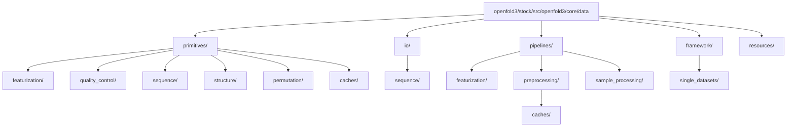
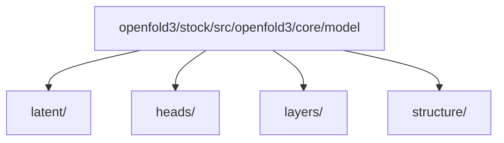
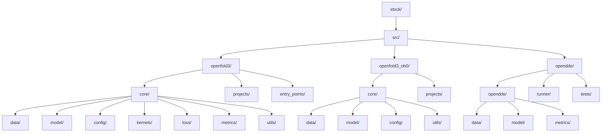

<!-- source: DeepWiki mcp.deepwiki.com · repo anthropics/uplifting-biomolecular-modeling · page 4.4 Package Layout of the OpenFold3 / OpenDDE Stock Trees · fetched 2026-10-26 -->

# Package Layout of the OpenFold3 / OpenDDE Stock Trees

Relevant source files

The following files were used as context for generating this wiki page:

- [opendde/stock/src/opendde/data/__init__.py](opendde/stock/src/opendde/data/__init__.py)
- [opendde/stock/src/opendde/data/core/__init__.py](opendde/stock/src/opendde/data/core/__init__.py)
- [opendde/stock/src/opendde/data/msa/__init__.py](opendde/stock/src/opendde/data/msa/__init__.py)
- [opendde/stock/src/opendde/data/template/__init__.py](opendde/stock/src/opendde/data/template/__init__.py)
- [opendde/stock/src/opendde/data/tools/__init__.py](opendde/stock/src/opendde/data/tools/__init__.py)
- [opendde/stock/src/opendde/metrics/__init__.py](opendde/stock/src/opendde/metrics/__init__.py)
- [opendde/stock/src/opendde/model/__init__.py](opendde/stock/src/opendde/model/__init__.py)
- [opendde/stock/src/opendde/model/modules/__init__.py](opendde/stock/src/opendde/model/modules/__init__.py)
- [opendde/stock/src/opendde/model/triangular/__init__.py](opendde/stock/src/opendde/model/triangular/__init__.py)
- [opendde/stock/src/opendde/utils/__init__.py](opendde/stock/src/opendde/utils/__init__.py)
- [opendde/stock/src/runner/__init__.py](opendde/stock/src/runner/__init__.py)
- [opendde/stock/src/tests/__init__.py](opendde/stock/src/tests/__init__.py)
- [openfold3/stock/src/openfold3/core/__init__.py](openfold3/stock/src/openfold3/core/__init__.py)
- [openfold3/stock/src/openfold3/core/config/__init__.py](openfold3/stock/src/openfold3/core/config/__init__.py)
- [openfold3/stock/src/openfold3/core/data/__init__.py](openfold3/stock/src/openfold3/core/data/__init__.py)
- [openfold3/stock/src/openfold3/core/data/framework/single_datasets/__init__.py](openfold3/stock/src/openfold3/core/data/framework/single_datasets/__init__.py)
- [openfold3/stock/src/openfold3/core/data/io/__init__.py](openfold3/stock/src/openfold3/core/data/io/__init__.py)
- [openfold3/stock/src/openfold3/core/data/io/sequence/__init__.py](openfold3/stock/src/openfold3/core/data/io/sequence/__init__.py)
- [openfold3/stock/src/openfold3/core/data/io/structure/__init__.py](openfold3/stock/src/openfold3/core/data/io/structure/__init__.py)
- [openfold3/stock/src/openfold3/core/data/pipelines/__init__.py](openfold3/stock/src/openfold3/core/data/pipelines/__init__.py)
- [openfold3/stock/src/openfold3/core/data/pipelines/featurization/__init__.py](openfold3/stock/src/openfold3/core/data/pipelines/featurization/__init__.py)
- [openfold3/stock/src/openfold3/core/data/pipelines/preprocessing/__init__.py](openfold3/stock/src/openfold3/core/data/pipelines/preprocessing/__init__.py)
- [openfold3/stock/src/openfold3/core/data/pipelines/preprocessing/caches/__init__.py](openfold3/stock/src/openfold3/core/data/pipelines/preprocessing/caches/__init__.py)
- [openfold3/stock/src/openfold3/core/data/pipelines/sample_processing/__init__.py](openfold3/stock/src/openfold3/core/data/pipelines/sample_processing/__init__.py)
- [openfold3/stock/src/openfold3/core/data/primitives/__init__.py](openfold3/stock/src/openfold3/core/data/primitives/__init__.py)
- [openfold3/stock/src/openfold3/core/data/primitives/caches/__init__.py](openfold3/stock/src/openfold3/core/data/primitives/caches/__init__.py)
- [openfold3/stock/src/openfold3/core/data/primitives/featurization/__init__.py](openfold3/stock/src/openfold3/core/data/primitives/featurization/__init__.py)
- [openfold3/stock/src/openfold3/core/data/primitives/permutation/__init__.py](openfold3/stock/src/openfold3/core/data/primitives/permutation/__init__.py)
- [openfold3/stock/src/openfold3/core/data/primitives/quality_control/__init__.py](openfold3/stock/src/openfold3/core/data/primitives/quality_control/__init__.py)
- [openfold3/stock/src/openfold3/core/data/primitives/sequence/__init__.py](openfold3/stock/src/openfold3/core/data/primitives/sequence/__init__.py)
- [openfold3/stock/src/openfold3/core/data/primitives/structure/__init__.py](openfold3/stock/src/openfold3/core/data/primitives/structure/__init__.py)
- [openfold3/stock/src/openfold3/core/data/resources/__init__.py](openfold3/stock/src/openfold3/core/data/resources/__init__.py)
- [openfold3/stock/src/openfold3/core/data/tools/__init__.py](openfold3/stock/src/openfold3/core/data/tools/__init__.py)
- [openfold3/stock/src/openfold3/core/kernels/__init__.py](openfold3/stock/src/openfold3/core/kernels/__init__.py)
- [openfold3/stock/src/openfold3/core/kernels/triton/__init__.py](openfold3/stock/src/openfold3/core/kernels/triton/__init__.py)
- [openfold3/stock/src/openfold3/core/loss/__init__.py](openfold3/stock/src/openfold3/core/loss/__init__.py)
- [openfold3/stock/src/openfold3/core/metrics/__init__.py](openfold3/stock/src/openfold3/core/metrics/__init__.py)
- [openfold3/stock/src/openfold3/core/model/__init__.py](openfold3/stock/src/openfold3/core/model/__init__.py)
- [openfold3/stock/src/openfold3/core/model/feature_embedders/__init__.py](openfold3/stock/src/openfold3/core/model/feature_embedders/__init__.py)
- [openfold3/stock/src/openfold3/core/model/heads/__init__.py](openfold3/stock/src/openfold3/core/model/heads/__init__.py)
- [openfold3/stock/src/openfold3/core/model/latent/__init__.py](openfold3/stock/src/openfold3/core/model/latent/__init__.py)
- [openfold3/stock/src/openfold3/core/model/layers/__init__.py](openfold3/stock/src/openfold3/core/model/layers/__init__.py)
- [openfold3/stock/src/openfold3/core/model/structure/__init__.py](openfold3/stock/src/openfold3/core/model/structure/__init__.py)
- [openfold3/stock/src/openfold3/core/runners/__init__.py](openfold3/stock/src/openfold3/core/runners/__init__.py)
- [openfold3/stock/src/openfold3/core/utils/__init__.py](openfold3/stock/src/openfold3/core/utils/__init__.py)
- [openfold3/stock/src/openfold3/entry_points/__init__.py](openfold3/stock/src/openfold3/entry_points/__init__.py)
- [openfold3/stock/src/openfold3/projects/__init__.py](openfold3/stock/src/openfold3/projects/__init__.py)
- [openfold3/stock/src/openfold3/projects/of3_all_atom/__init__.py](openfold3/stock/src/openfold3/projects/of3_all_atom/__init__.py)
- [openfold3/stock/src/openfold3/projects/of3_all_atom/config/__init__.py](openfold3/stock/src/openfold3/projects/of3_all_atom/config/__init__.py)
- [openfold3_ob0/stock/src/openfold3/core/__init__.py](openfold3_ob0/stock/src/openfold3/core/__init__.py)
- [openfold3_ob0/stock/src/openfold3/core/config/__init__.py](openfold3_ob0/stock/src/openfold3/core/config/__init__.py)
- [openfold3_ob0/stock/src/openfold3/core/data/__init__.py](openfold3_ob0/stock/src/openfold3/core/data/__init__.py)
- [openfold3_ob0/stock/src/openfold3/core/data/framework/single_datasets/__init__.py](openfold3_ob0/stock/src/openfold3/core/data/framework/single_datasets/__init__.py)
- [openfold3_ob0/stock/src/openfold3/core/data/io/__init__.py](openfold3_ob0/stock/src/openfold3/core/data/io/__init__.py)
- [openfold3_ob0/stock/src/openfold3/core/data/io/sequence/__init__.py](openfold3_ob0/stock/src/openfold3/core/data/io/sequence/__init__.py)
- [openfold3_ob0/stock/src/openfold3/core/data/io/structure/__init__.py](openfold3_ob0/stock/src/openfold3/core/data/io/structure/__init__.py)
- [openfold3_ob0/stock/src/openfold3/core/data/pipelines/__init__.py](openfold3_ob0/stock/src/openfold3/core/data/pipelines/__init__.py)
- [openfold3_ob0/stock/src/openfold3/core/data/pipelines/featurization/__init__.py](openfold3_ob0/stock/src/openfold3/core/data/pipelines/featurization/__init__.py)
- [openfold3_ob0/stock/src/openfold3/core/data/pipelines/preprocessing/__init__.py](openfold3_ob0/stock/src/openfold3/core/data/pipelines/preprocessing/__init__.py)
- [openfold3_ob0/stock/src/openfold3/core/data/pipelines/preprocessing/caches/__init__.py](openfold3_ob0/stock/src/openfold3/core/data/pipelines/preprocessing/caches/__init__.py)
- [openfold3_ob0/stock/src/openfold3/core/data/pipelines/sample_processing/__init__.py](openfold3_ob0/stock/src/openfold3/core/data/pipelines/sample_processing/__init__.py)
- [openfold3_ob0/stock/src/openfold3/core/data/primitives/__init__.py](openfold3_ob0/stock/src/openfold3/core/data/primitives/__init__.py)
- [openfold3_ob0/stock/src/openfold3/core/data/primitives/caches/__init__.py](openfold3_ob0/stock/src/openfold3/core/data/primitives/caches/__init__.py)
- [openfold3_ob0/stock/src/openfold3/core/data/primitives/featurization/__init__.py](openfold3_ob0/stock/src/openfold3/core/data/primitives/featurization/__init__.py)
- [openfold3_ob0/stock/src/openfold3/core/data/primitives/permutation/__init__.py](openfold3_ob0/stock/src/openfold3/core/data/primitives/permutation/__init__.py)
- [openfold3_ob0/stock/src/openfold3/core/data/primitives/quality_control/__init__.py](openfold3_ob0/stock/src/openfold3/core/data/primitives/quality_control/__init__.py)
- [openfold3_ob0/stock/src/openfold3/core/data/primitives/sequence/__init__.py](openfold3_ob0/stock/src/openfold3/core/data/primitives/sequence/__init__.py)
- [openfold3_ob0/stock/src/openfold3/core/data/primitives/structure/__init__.py](openfold3_ob0/stock/src/openfold3/core/data/primitives/structure/__init__.py)
- [openfold3_ob0/stock/src/openfold3/core/data/resources/__init__.py](openfold3_ob0/stock/src/openfold3/core/data/resources/__init__.py)
- [openfold3_ob0/stock/src/openfold3/core/data/tools/__init__.py](openfold3_ob0/stock/src/openfold3/core/data/tools/__init__.py)
- [openfold3_ob0/stock/src/openfold3/core/kernels/__init__.py](openfold3_ob0/stock/src/openfold3/core/kernels/__init__.py)
- [openfold3_ob0/stock/src/openfold3/core/kernels/triton/__init__.py](openfold3_ob0/stock/src/openfold3/core/kernels/triton/__init__.py)
- [openfold3_ob0/stock/src/openfold3/core/loss/__init__.py](openfold3_ob0/stock/src/openfold3/core/loss/__init__.py)
- [openfold3_ob0/stock/src/openfold3/core/metrics/__init__.py](openfold3_ob0/stock/src/openfold3/core/metrics/__init__.py)
- [openfold3_ob0/stock/src/openfold3/core/model/__init__.py](openfold3_ob0/stock/src/openfold3/core/model/__init__.py)
- [openfold3_ob0/stock/src/openfold3/core/model/feature_embedders/__init__.py](openfold3_ob0/stock/src/openfold3/core/model/feature_embedders/__init__.py)
- [openfold3_ob0/stock/src/openfold3/core/model/heads/__init__.py](openfold3_ob0/stock/src/openfold3/core/model/heads/__init__.py)
- [openfold3_ob0/stock/src/openfold3/core/model/latent/__init__.py](openfold3_ob0/stock/src/openfold3/core/model/latent/__init__.py)
- [openfold3_ob0/stock/src/openfold3/core/model/layers/__init__.py](openfold3_ob0/stock/src/openfold3/core/model/layers/__init__.py)
- [openfold3_ob0/stock/src/openfold3/core/model/structure/__init__.py](openfold3_ob0/stock/src/openfold3/core/model/structure/__init__.py)
- [openfold3_ob0/stock/src/openfold3/core/runners/__init__.py](openfold3_ob0/stock/src/openfold3/core/runners/__init__.py)
- [openfold3_ob0/stock/src/openfold3/core/utils/__init__.py](openfold3_ob0/stock/src/openfold3/core/utils/__init__.py)
- [openfold3_ob0/stock/src/openfold3/entry_points/__init__.py](openfold3_ob0/stock/src/openfold3/entry_points/__init__.py)
- [openfold3_ob0/stock/src/openfold3/projects/__init__.py](openfold3_ob0/stock/src/openfold3/projects/__init__.py)
- [openfold3_ob0/stock/src/openfold3/projects/of3_all_atom/__init__.py](openfold3_ob0/stock/src/openfold3/projects/of3_all_atom/__init__.py)
- [openfold3_ob0/stock/src/openfold3/projects/of3_all_atom/config/__init__.py](openfold3_ob0/stock/src/openfold3/projects/of3_all_atom/config/__init__.py)

This page details the package layout of the vendored upstream releases for the `openfold3`, `openfold3_ob0`, and `opendde` kits. Understanding this structure is crucial for navigating the codebase, identifying core components, and understanding how optimizations are applied. We will examine the `core/data`, `core/model`, `config`, `entry_points`, and `tests` directories within these stock trees.

## OpenFold3 and OpenFold3_OB0 Stock Tree Layout

The `openfold3` and `openfold3_ob0` kits share a very similar stock tree structure, reflecting their common origin in the AlphaFold3-family models. The primary components are organized under `stock/src/openfold3/core/`.

### Core Data (`core/data`)

The `core/data` directory is responsible for all aspects of data handling, from raw input processing to featurization and pipeline management.

**Diagram: OpenFold3 `core/data` Module Map**

Sources:
- [openfold3/stock/src/openfold3/core/data/__init__.py:1-14]()
- [openfold3_ob0/stock/src/openfold3/core/data/__init__.py:1-14]()
- [openfold3/stock/src/openfold3/core/data/primitives/quality_control/__init__.py:1-14]()
- [openfold3_ob0/stock/src/openfold3/core/data/primitives/structure/__init__.py:1-14]()
- [openfold3_ob0/stock/src/openfold3/core/data/io/__init__.py:1-14]()
- [openfold3_ob0/stock/src/openfold3/core/data/primitives/featurization/__init__.py]()
- [openfold3/stock/src/openfold3/core/data/io/sequence/__init__.py]()
- [openfold3/stock/src/openfold3/core/data/primitives/permutation/__init__.py]()
- [openfold3_ob0/stock/src/openfold3/core/data/pipelines/featurization/__init__.py]()
- [openfold3/stock/src/openfold3/core/data/primitives/caches/__init__.py]()
- [openfold3_ob0/stock/src/openfold3/core/data/pipelines/preprocessing/caches/__init__.py]()
- [openfold3_ob0/stock/src/openfold3/core/data/framework/single_datasets/__init__.py]()
- [openfold3/stock/src/openfold3/core/data/pipelines/sample_processing/__init__.py]()
- [openfold3_ob0/stock/src/openfold3/core/data/pipelines/preprocessing/__init__.py]()
- [openfold3_ob0/stock/src/openfold3/core/data/resources/__init__.py]()

Key sub-directories include:
*   `primitives/`: Contains fundamental data structures and operations.
    *   `featurization/`: Modules for converting raw biological data into model-consumable features [openfold3_ob0/stock/src/openfold3/core/data/primitives/featurization/__init__.py]().
    *   `quality_control/`: Logic for data validation and filtering [openfold3/stock/src/openfold3/core/data/primitives/quality_control/__init__.py:1-14]().
    *   `sequence/`: Handles sequence-related data primitives [openfold3/stock/src/openfold3/core/data/primitives/sequence/__init__.py]().
    *   `structure/`: Deals with protein structure data primitives [openfold3_ob0/stock/src/openfold3/core/data/primitives/structure/__init__.py:1-14]().
    *   `permutation/`: Modules related to data permutation [openfold3/stock/src/openfold3/core/data/primitives/permutation/__init__.py]().
    *   `caches/`: Implementations for caching data during processing [openfold3/stock/src/openfold3/core/data/primitives/caches/__init__.py]().
*   `io/`: Input/Output operations.
    *   `sequence/`: Specific I/O for sequence data [openfold3/stock/src/openfold3/core/data/io/sequence/__init__.py]().
*   `pipelines/`: Orchestrates data processing workflows.
    *   `featurization/`: Data pipelines for featurization [openfold3_ob0/stock/src/openfold3/core/data/pipelines/featurization/__init__.py]().
    *   `preprocessing/`: General data preprocessing pipelines [openfold3_ob0/stock/src/openfold3/core/data/pipelines/preprocessing/__init__.py]().
    *   `sample_processing/`: Handles processing of individual data samples [openfold3/stock/src/openfold3/core/data/pipelines/sample_processing/__init__.py]().
*   `framework/`: Provides foundational data structures and utilities.
    *   `single_datasets/`: Modules for managing single datasets [openfold3/stock/src/openfold3/core/data/framework/single_datasets/__init__.py]().
*   `resources/`: Stores static data resources [openfold3_ob0/stock/src/openfold3/core/data/resources/__init__.py]().

### Core Model (`core/model`)

The `core/model` directory contains the neural network architecture and related components.

**Diagram: OpenFold3 `core/model` Module Map**

Sources:
- [openfold3/stock/src/openfold3/core/model/__init__.py:1-14]()
- [openfold3/stock/src/openfold3/core/model/latent/__init__.py:1-14]()
- [openfold3_ob0/stock/src/openfold3/core/model/latent/__init__.py]()
- [openfold3_ob0/stock/src/openfold3/core/model/heads/__init__.py]()
- [openfold3/stock/src/openfold3/core/model/layers/__init__.py]()
- [openfold3/stock/src/openfold3/core/model/structure/__init__.py]()

Key sub-directories include:
*   `latent/`: Modules related to latent representations within the model [openfold3/stock/src/openfold3/core/model/latent/__init__.py:1-14]().
*   `heads/`: Contains the prediction heads of the model [openfold3_ob0/stock/src/openfold3/core/model/heads/__init__.py]().
*   `layers/`: Defines various neural network layers used in the model [openfold3/stock/src/openfold3/core/model/layers/__init__.py]().
*   `structure/`: Components specifically for predicting and refining protein structures [openfold3/stock/src/openfold3/core/model/structure/__init__.py]().

### Other Core Components

Beyond `data` and `model`, the `core` directory also includes:
*   `config/`: Configuration files and utilities for the model [openfold3_ob0/stock/src/openfold3/core/config/__init__.py:1-14]().
*   `kernels/`: Custom CUDA/Triton kernels for performance-critical operations [openfold3/stock/src/openfold3/core/kernels/__init__.py]().
    *   `triton/`: Triton-specific kernels [openfold3/stock/src/openfold3/core/kernels/triton/__init__.py]().
*   `loss/`: Loss functions used for training [openfold3/stock/src/openfold3/core/loss/__init__.py]().
*   `metrics/`: Evaluation metrics [openfold3/stock/src/openfold3/core/metrics/__init__.py]().
*   `utils/`: General utility functions [openfold3/stock/src/openfold3/core/utils/__init__.py]().

Sources:
- [openfold3_ob0/stock/src/openfold3/core/config/__init__.py:1-14]()
- [openfold3/stock/src/openfold3/core/kernels/__init__.py]()
- [openfold3/stock/src/openfold3/core/kernels/triton/__init__.py]()
- [openfold3/stock/src/openfold3/core/loss/__init__.py]()
- [openfold3/stock/src/openfold3/core/metrics/__init__.py]()
- [openfold3/stock/src/openfold3/core/utils/__init__.py]()
- [openfold3_ob0/stock/src/openfold3/core/utils/__init__.py:1-14]()
- [openfold3_ob0/stock/src/openfold3/core/loss/__init__.py]()
- [openfold3_ob0/stock/src/openfold3/core/__init__.py]()

### Projects (`projects`)

The `projects` directory houses specific project implementations built on the core OpenFold3 framework.
*   `of3_all_atom/config/`: Configuration for the all-atom OpenFold3 project [openfold3/stock/src/openfold3/projects/of3_all_atom/config/__init__.py]().

Sources:
- [openfold3/stock/src/openfold3/projects/__init__.py]()
- [openfold3/stock/src/openfold3/projects/of3_all_atom/config/__init__.py]()
- [openfold3_ob0/stock/src/openfold3/projects/__init__.py]()
- [openfold3_ob0/stock/src/openfold3/projects/of3_all_atom/config/__init__.py]()

### Entry Points (`entry_points`)

The `entry_points` directory contains scripts or modules that serve as the main entry points for running the OpenFold3 model, often for inference or training tasks [openfold3/stock/src/openfold3/entry_points/__init__.py]().

Sources:
- [openfold3/stock/src/openfold3/entry_points/__init__.py]()

## OpenDDE Stock Tree Layout

The `opendde` kit has its own distinct stock tree structure, reflecting its different focus, likely on Diffusion Denoising Encoders. The primary components are organized under `stock/src/opendde/`.

### Data (`data`)

The `data` directory in `opendde` handles data processing specific to its domain.
*   `template/`: Contains templates for data structures or processing [opendde/stock/src/opendde/data/template/__init__.py:1-2]().
*   `core/`: Core data utilities [opendde/stock/src/opendde/data/core/__init__.py]().

Sources:
- [opendde/stock/src/opendde/data/__init__.py]()
- [opendde/stock/src/opendde/data/template/__init__.py:1-2]()
- [opendde/stock/src/opendde/data/core/__init__.py]()

### Model (`model`)

The `model` directory in `opendde` defines its neural network architecture.
*   `triangular/`: Modules related to triangular attention or similar operations, a common primitive in protein modeling [opendde/stock/src/opendde/model/triangular/__init__.py:1-2]().

Sources:
- [opendde/stock/src/opendde/model/triangular/__init__.py:1-2]()

### Metrics (`metrics`)

The `metrics` directory contains evaluation metrics specific to the OpenDDE model [opendde/stock/src/opendde/metrics/__init__.py:1-2]().

Sources:
- [opendde/stock/src/opendde/metrics/__init__.py:1-2]()

### Runner (`runner`)

The `runner` directory likely contains scripts or modules for executing the OpenDDE model, similar to entry points [opendde/stock/src/runner/__init__.py:1-2]().

Sources:
- [opendde/stock/src/runner/__init__.py:1-2]()

### Tests (`tests`)

The `tests` directory contains unit and integration tests for the OpenDDE codebase [opendde/stock/src/tests/__init__.py]().

Sources:
- [opendde/stock/src/tests/__init__.py]()

## Overall Stock Tree Structure

The following diagram illustrates the high-level package layout for these stock trees, highlighting the common and distinct top-level directories.

**Diagram: High-Level Stock Tree Layout for OpenFold3, OpenFold3_OB0, and OpenDDE**

Sources:
- [openfold3/stock/src/openfold3/core/data/__init__.py:1-14]()
- [openfold3/stock/src/openfold3/core/model/__init__.py:1-14]()
- [openfold3_ob0/stock/src/openfold3/core/config/__init__.py:1-14]()
- [openfold3/stock/src/openfold3/entry_points/__init__.py]()
- [opendde/stock/src/opendde/data/template/__init__.py:1-2]()
- [opendde/stock/src/opendde/model/triangular/__init__.py:1-2]()
- [opendde/stock/src/opendde/metrics/__init__.py:1-2]()
- [opendde/stock/src/runner/__init__.py:1-2]()
- [opendde/stock/src/tests/__init__.py]()
- [openfold3/stock/src/openfold3/core/kernels/__init__.py]()
- [openfold3/stock/src/openfold3/core/loss/__init__.py]()
- [openfold3/stock/src/openfold3/core/metrics/__init__.py]()
- [openfold3/stock/src/openfold3/core/utils/__init__.py]()
- [openfold3/stock/src/openfold3/projects/__init__.py]()

---

