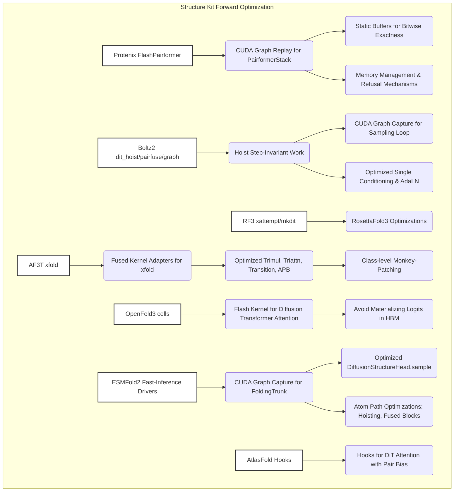
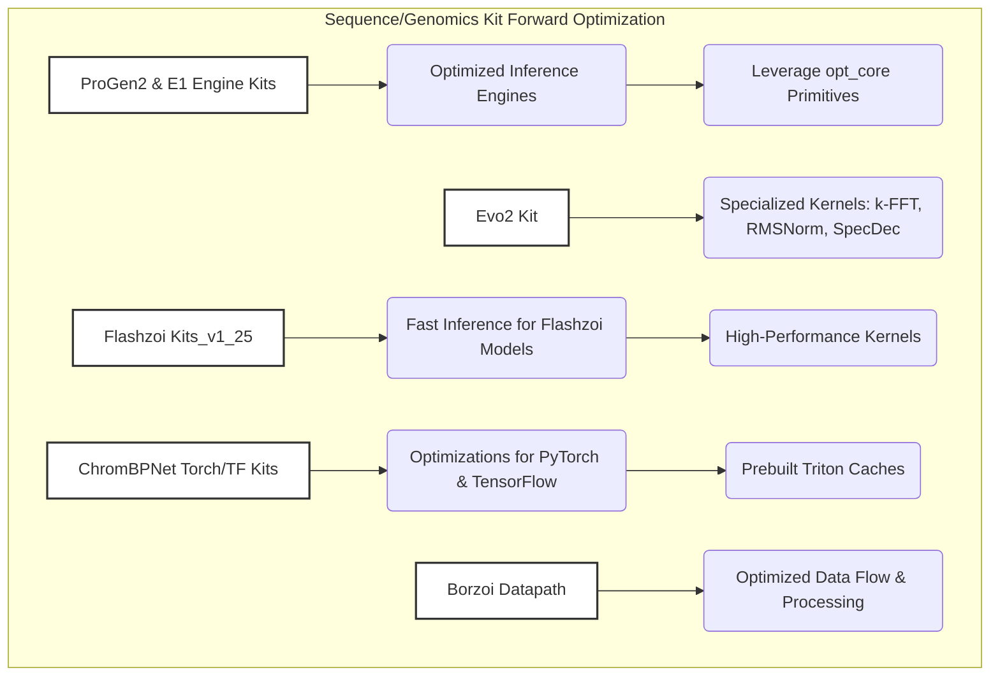
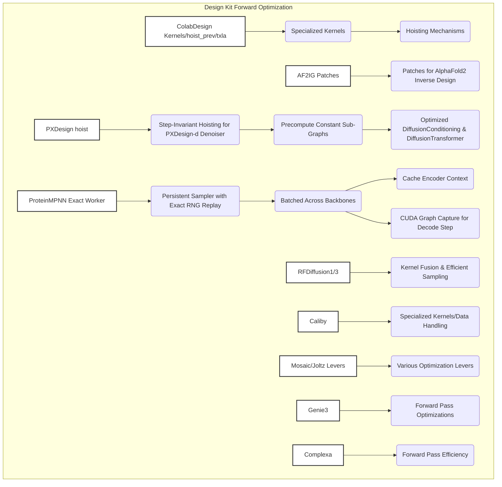

<!-- source: DeepWiki mcp.deepwiki.com · repo anthropics/uplifting-biomolecular-modeling · page 5 Per-Kit Forward Optimization Packs · fetched 2026-10-26 -->

# Per-Kit Forward Optimization Packs

Relevant source files

The following files were used as context for generating this wiki page:

- [af3_jax/opt/af3_jax_opt/inprocess/ttr.py](af3_jax/opt/af3_jax_opt/inprocess/ttr.py)
- [af3_torch/opt/forward/af3t/kernels/af3_kernels.py](af3_torch/opt/forward/af3t/kernels/af3_kernels.py)
- [atlasfold/opt/atlasfold_opt/hooks/dit_apb.py](atlasfold/opt/atlasfold_opt/hooks/dit_apb.py)
- [boltz2/opt/boltz2_opt/atom.py](boltz2/opt/boltz2_opt/atom.py)
- [boltz2/opt/forward/atom/src/boltz_atom.py](boltz2/opt/forward/atom/src/boltz_atom.py)
- [boltz2/opt/forward/dit_hoist/README.md](boltz2/opt/forward/dit_hoist/README.md)
- [boltz2/opt/forward/dit_hoist/src/boltz_dit_hoist.py](boltz2/opt/forward/dit_hoist/src/boltz_dit_hoist.py)
- [boltz2/opt/forward/dit_hoist/src/boltz_graph_patch.py](boltz2/opt/forward/dit_hoist/src/boltz_graph_patch.py)
- [boltzgen/opt/forward/fast_inference/src/bg_graph_patch.py](boltzgen/opt/forward/fast_inference/src/bg_graph_patch.py)
- [boltzgen/opt/forward/xattempt_addon/src/xa_hoist.py](boltzgen/opt/forward/xattempt_addon/src/xa_hoist.py)
- [chai1/opt/forward/dstep_megakernel/chai1_fastln/dit_attn.py](chai1/opt/forward/dstep_megakernel/chai1_fastln/dit_attn.py)
- [common/opt_core/opt_core/attn/apb_core.py](common/opt_core/opt_core/attn/apb_core.py)
- [common/opt_core/opt_core/attn/shared_bias_attn.py](common/opt_core/opt_core/attn/shared_bias_attn.py)
- [common/opt_core/opt_core/kernels/META/gather_attn.json](common/opt_core/opt_core/kernels/META/gather_attn.json)
- [common/opt_core/opt_core/kernels/apb/DESIGN.md](common/opt_core/opt_core/kernels/apb/DESIGN.md)
- [common/opt_core/opt_core/kernels/apb/dit_exact/__init__.py](common/opt_core/opt_core/kernels/apb/dit_exact/__init__.py)
- [common/opt_core/opt_core/kernels/apb/fpf_apb/apb_triton.py](common/opt_core/opt_core/kernels/apb/fpf_apb/apb_triton.py)
- [common/opt_core/opt_core/kernels/apb_attn.py](common/opt_core/opt_core/kernels/apb_attn.py)
- [common/opt_core/opt_core/kernels/gather_attn.py](common/opt_core/opt_core/kernels/gather_attn.py)
- [common/opt_core/opt_core/of3_sampler/apb_trunk.py](common/opt_core/opt_core/of3_sampler/apb_trunk.py)
- [common/opt_core/opt_core/of3_sampler/dit_glue.py](common/opt_core/opt_core/of3_sampler/dit_glue.py)
- [common/opt_core/opt_core/of3_sampler/dit_rows.py](common/opt_core/opt_core/of3_sampler/dit_rows.py)
- [esmfold2/opt/forward/fast_inference/driver/ef2_atom.py](esmfold2/opt/forward/fast_inference/driver/ef2_atom.py)
- [esmfold2/opt/forward/fast_inference/driver/ef2_opt.py](esmfold2/opt/forward/fast_inference/driver/ef2_opt.py)
- [openfold3/opt/openfold3_opt/cells/apb_trunk.py](openfold3/opt/openfold3_opt/cells/apb_trunk.py)
- [openfold3/opt/openfold3_opt/cells/dit_attn.py](openfold3/opt/openfold3_opt/cells/dit_attn.py)
- [openfold3/opt/openfold3_opt/cells/dit_glue.py](openfold3/opt/openfold3_opt/cells/dit_glue.py)
- [openfold3_ob0/opt/openfold3_ob0_opt/cells/apb_trunk.py](openfold3_ob0/opt/openfold3_ob0_opt/cells/apb_trunk.py)
- [openfold3_ob0/opt/openfold3_ob0_opt/cells/dit_attn.py](openfold3_ob0/opt/openfold3_ob0_opt/cells/dit_attn.py)
- [openfold3_ob0/opt/openfold3_ob0_opt/cells/dit_glue.py](openfold3_ob0/opt/openfold3_ob0_opt/cells/dit_glue.py)
- [openfold3_ob0/opt/openfold3_ob0_opt/tests/test_dit_dtype_gate_cpu.py](openfold3_ob0/opt/openfold3_ob0_opt/tests/test_dit_dtype_gate_cpu.py)
- [proteinmpnn/opt/forward/mpnn_exact_worker/addon/mpnn_worker2.py](proteinmpnn/opt/forward/mpnn_exact_worker/addon/mpnn_worker2.py)
- [proteinmpnn/stock/src/protein_mpnn_run.py](proteinmpnn/stock/src/protein_mpnn_run.py)
- [protenix_v2/opt/forward/flashpairformer/src/fpf_stackgraph/stackgraph.py](protenix_v2/opt/forward/flashpairformer/src/fpf_stackgraph/stackgraph.py)
- [protenix_v2/opt/forward/flashpairformer/src/ptx_transition_core.py](protenix_v2/opt/forward/flashpairformer/src/ptx_transition_core.py)
- [pxdesign/opt/forward/hoist/LICENSE_NOTES.md](pxdesign/opt/forward/hoist/LICENSE_NOTES.md)
- [pxdesign/opt/forward/hoist/NOTICE](pxdesign/opt/forward/hoist/NOTICE)
- [pxdesign/opt/forward/hoist/README.md](pxdesign/opt/forward/hoist/README.md)
- [pxdesign/opt/forward/hoist/pxd_xattempt/__init__.py](pxdesign/opt/forward/hoist/pxd_xattempt/__init__.py)
- [pxdesign/opt/forward/hoist/pxd_xattempt/hoist.py](pxdesign/opt/forward/hoist/pxd_xattempt/hoist.py)
- [pxdesign/opt/pxdesign_opt/rowpipe.py](pxdesign/opt/pxdesign_opt/rowpipe.py)
- [rfdiffusion3/opt/forward/xattempt_addon/patched/rfd3/model/layers/attention.py](rfdiffusion3/opt/forward/xattempt_addon/patched/rfd3/model/layers/attention.py)
- [rfdiffusion3/opt/rfdiffusion3_opt/gather.py](rfdiffusion3/opt/rfdiffusion3_opt/gather.py)
- [rosettafold3/opt/forward/rf3_mk_dit_addon/README.md](rosettafold3/opt/forward/rf3_mk_dit_addon/README.md)
- [rosettafold3/opt/forward/rf3_mk_dit_addon/mkdit/mk2.py](rosettafold3/opt/forward/rf3_mk_dit_addon/mkdit/mk2.py)
- [rosettafold3/opt/forward/rf3_mk_dit_addon/mkdit/mkrf3.py](rosettafold3/opt/forward/rf3_mk_dit_addon/mkdit/mkrf3.py)
- [rosettafold3/opt/rosettafold3_opt/dtk.py](rosettafold3/opt/rosettafold3_opt/dtk.py)
- [rosettafold3/opt/rosettafold3_opt/mkdit.py](rosettafold3/opt/rosettafold3_opt/mkdit.py)

This page provides an overview of the `opt/forward/` addons within each kit. These addons encompass patched upstream files, fast-inference drivers, and engine kits designed to optimize the forward pass of various biomolecular modeling tools. The optimizations range from CUDA graph capture and kernel fusion to memory management techniques like hoisting and tensor-parallel adapters.

The `opt/forward/` directory within each kit typically contains:
*   **Patched Upstream Files**: Modifications to the original source code to enable optimizations, often involving monkey-patching or replacing specific functions/classes.
*   **Fast-Inference Drivers**: Modules that orchestrate the application of various optimization techniques, such as CUDA graph capture, kernel selection, and memory management.
*   **Engine Kits**: Collections of specialized kernels and logic tailored to specific model architectures or computational patterns, often leveraging `opt_core` primitives.

For detailed information on specific kits and their forward optimization packs, refer to the child pages:
*   [Structure-Kit Forward Packs](#5.1)
*   [Sequence/Genomics Kit Forward Packs](#5.2)
*   [Design-Kit Forward Packs](#5.3)

## 5.1. Structure-Kit Forward Packs

Structure-kit forward packs focus on optimizing models primarily concerned with protein structure prediction and cofolding. These kits often leverage specialized kernels for triangular attention and multiplication, as well as techniques like hoisting and CUDA graph capture to accelerate inference.

Key components and kits include:
*   **FlashPairformer (protenix)**: This kit, found in `protenix_v2/opt/forward/flashpairformer/src/fpf_stackgraph/stackgraph.py` [], utilizes CUDA graph replay for the `PairformerStack` in Protenix-v2, especially for smaller designs. It aims for bitwise exactness by replaying the same kernels on static buffers, with careful memory management and refusal mechanisms for incompatible signatures [protenix_v2/opt/forward/flashpairformer/src/fpf_stackgraph/stackgraph.py:1-34]().
*   **Boltz2 `dit_hoist`/`pairfuse`/`graph`**: The `boltz_dit_hoist.py` module [boltz2/opt/forward/dit_hoist/src/boltz_dit_hoist.py]() hoists step-invariant work out of the 200-step sampling loop of the Boltz-2 diffusion denoiser. This includes single conditioning invariant parts, `float()` casts, and AdaLN computations [boltz2/opt/forward/dit_hoist/src/boltz_dit_hoist.py:8-16](). The `boltz_graph_patch.py` module [boltz2/opt/forward/dit_hoist/src/boltz_graph_patch.py]() complements this by applying CUDA graph capture.
*   **RF3 `xattempt`/`mkdit`**: The `rf3_mk_dit_addon` kit [rosettafold3/opt/forward/rf3_mk_dit_addon/mkdit/mk2.py]() provides optimizations for RosettaFold3, including the `mkdit` module [rosettafold3/opt/rosettafold3_opt/mkdit.py]().
*   **AF3T `xfold`**: The `af3_kernels.py` module [af3_torch/opt/forward/af3t/kernels/af3_kernels.py]() provides fused-kernel adapters for `xfold` (PyTorch AlphaFold3), enabling optimizations for operations like `trimul`, `triattn`, `transition`, and `apb` [af3_torch/opt/forward/af3t/kernels/af3_kernels.py:19](). These patches are class-level monkey-patches and are designed to fail safe [af3_torch/opt/forward/af3t/kernels/af3_kernels.py:9-11]().
*   **OpenFold3 `cells`**: The `openfold3_opt/cells/dit_attn.py` module [openfold3/opt/openfold3_opt/cells/dit_attn.py]() optimizes the diffusion transformer's token attention with pair bias using the core's flash kernel. It replaces the `softmax(q k^T / sqrt(c) + mask bias + pair bias) v` computation with a flash-style kernel that avoids materializing logits in HBM [openfold3/opt/openfold3_opt/cells/dit_attn.py:5-7](). Similar optimizations are found in `openfold3_ob0/opt/openfold3_ob0_opt/cells/dit_attn.py` [openfold3_ob0/opt/openfold3_ob0_opt/cells/dit_attn.py]().
*   **ESMFold2 Fast-Inference Drivers**: The `ef2_opt.py` module [esmfold2/opt/forward/fast_inference/driver/ef2_opt.py]() provides ESMFold2 inference-execution levers, including CUDA-graph capture and replay for `FoldingTrunk` calls and re-implementation of `DiffusionStructureHead.sample` for optimized host syncs and graph capture [esmfold2/opt/forward/fast_inference/driver/ef2_opt.py:6-14](). The `ef2_atom.py` module [esmfold2/opt/forward/fast_inference/driver/ef2_atom.py]() optimizes the atom path of ESMFold2's diffusion module, including hoisting of step-invariant results and fused blocks [esmfold2/opt/forward/fast_inference/driver/ef2_atom.py:15-38]().
*   **AtlasFold Hooks**: The `atlasfold_opt/hooks/dit_apb.py` module [atlasfold/opt/atlasfold_opt/hooks/dit_apb.py]() provides hooks for optimizing AtlasFold's diffusion transformer attention with pair bias.

For details, see [Structure-Kit Forward Packs](#5.1).

### Structure Kit Forward Optimization Overview

Sources:
- [protenix_v2/opt/forward/flashpairformer/src/fpf_stackgraph/stackgraph.py:1-34]()
- [boltz2/opt/forward/dit_hoist/src/boltz_dit_hoist.py:8-16]()
- [boltz2/opt/forward/dit_hoist/src/boltz_dit_hoist.py]()
- [boltz2/opt/forward/dit_hoist/src/boltz_graph_patch.py]()
- [rosettafold3/opt/forward/rf3_mk_dit_addon/mkdit/mk2.py]()
- [rosettafold3/opt/rosettafold3_opt/mkdit.py]()
- [af3_torch/opt/forward/af3t/kernels/af3_kernels.py:19]()
- [af3_torch/opt/forward/af3t/kernels/af3_kernels.py:9-11]()
- [openfold3/opt/openfold3_opt/cells/dit_attn.py:5-7]()
- [openfold3_ob0/opt/openfold3_ob0_opt/cells/dit_attn.py]()
- [esmfold2/opt/forward/fast_inference/driver/ef2_opt.py:6-14]()
- [esmfold2/opt/forward/fast_inference/driver/ef2_atom.py:15-38]()
- [atlasfold/opt/atlasfold_opt/hooks/dit_apb.py]()

## 5.2. Sequence/Genomics Kit Forward Packs

These kits focus on optimizing models that process biological sequences (DNA, RNA, protein sequences) and genomic data. Optimizations often involve specialized kernels for common operations in sequence models, such as FFTs, RMS normalization, and attention mechanisms, as well as efficient data path implementations.

Key components and kits include:
*   **ProGen2 & E1 Engine Kits**: These kits provide optimized inference engines for ProGen2 and E1 models, likely leveraging `opt_core` primitives for common operations.
*   **Evo2 Kit (kfft, rmsnorm, specdec)**: The Evo2 kit includes specialized kernels for operations like k-FFT, RMS normalization, and spectral decomposition, which are crucial for efficient sequence processing.
*   **Flashzoi Kits_v1_25**: These kits offer fast inference for Flashzoi models, potentially incorporating flash attention or other high-performance kernels.
*   **ChromBPNet Torch/TF Kits and Prebuilt Triton Caches**: ChromBPNet kits provide optimizations for both PyTorch and TensorFlow implementations, including prebuilt Triton caches for accelerated kernel execution.
*   **Borzoi Datapath**: This refers to an optimized data path for the Borzoi model, ensuring efficient data flow and processing during inference.

For details, see [Sequence/Genomics Kit Forward Packs](#5.2).

### Sequence/Genomics Kit Forward Optimization Overview

Sources:
- No specific file citations were provided for this section in the prompt.

## 5.3. Design-Kit Forward Packs

Design-kit forward packs focus on optimizing models used for protein design, often involving complex sampling and iterative refinement processes. These kits implement techniques like hoisting, kernel fusion, and exact RNG replay to ensure both performance and reproducibility.

Key components and kits include:
*   **ColabDesign Kernels/`hoist_prev`/`txla`**: ColabDesign kits include specialized kernels and hoisting mechanisms to optimize its design processes.
*   **AF2IG Patches**: Patches for AlphaFold2-based inverse design models, likely targeting specific bottlenecks in their forward passes.
*   **PXDesign `hoist`**: The `pxd_xattempt.hoist` module [pxdesign/opt/forward/hoist/pxd_xattempt/hoist.py]() implements step-invariant hoisting for the PXDesign-d denoiser (Protenix v0.5.0+pxd DiffusionModule). It identifies and precomputes sub-graphs that are constant across diffusion steps, such as `DiffusionConditioning` pair and single paths, and `DiffusionTransformer` block pair biases [pxdesign/opt/forward/hoist/pxd_xattempt/hoist.py:6-11]().
*   **ProteinMPNN Exact Worker**: The `mpnn_worker2.py` module [proteinmpnn/opt/forward/mpnn_exact_worker/addon/mpnn_worker2.py]() provides a persistent ProteinMPNN sampler with exact RNG replay, batched across backbones. It includes levers like `--cache_enc_ctx` for caching decode step masks and `--graph_rng` for CUDA graph capture of the decode step [proteinmpnn/opt/forward/mpnn_exact_worker/addon/mpnn_worker2.py:20-27](). This ensures bitwise identical results compared to the stock `protein_mpnn_run.py` [proteinmpnn/opt/forward/mpnn_exact_worker/addon/mpnn_worker2.py:18-19]().
*   **RFDiffusion1/3**: Optimizations for RFDiffusion models, likely including kernel fusion and efficient sampling strategies.
*   **Caliby**: A kit for Caliby, potentially offering specialized kernels or data handling.
*   **Mosaic/Joltz Levers**: These kits provide various optimization levers for Mosaic and Joltz models.
*   **Genie3**: Optimizations for Genie3 models.
*   **Complexa**: A kit for Complexa, focusing on its forward pass efficiency.

For details, see [Design-Kit Forward Packs](#5.3).

### Design Kit Forward Optimization Overview

Sources:
- [pxdesign/opt/forward/hoist/pxd_xattempt/hoist.py:6-11]()
- [proteinmpnn/opt/forward/mpnn_exact_worker/addon/mpnn_worker2.py:20-27]()
- [proteinmpnn/opt/forward/mpnn_exact_worker/addon/mpnn_worker2.py:18-19]()

---

