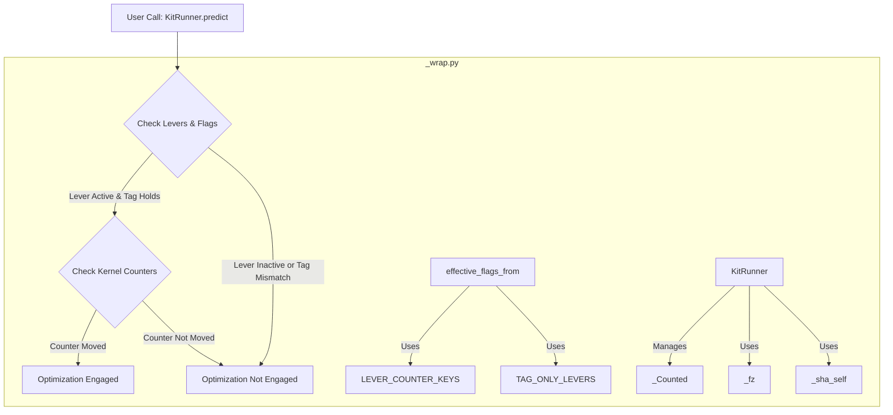
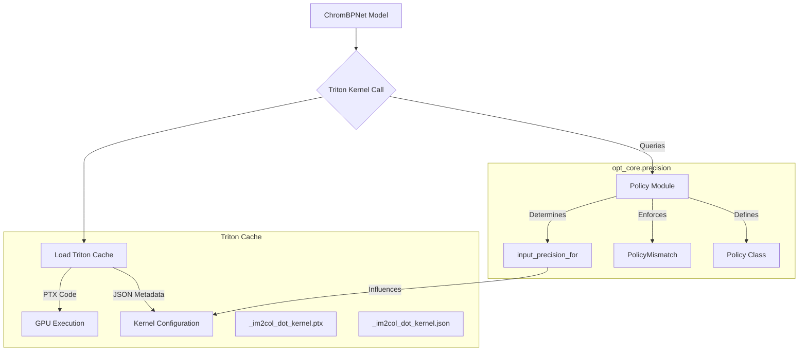

<!-- source: DeepWiki mcp.deepwiki.com · repo anthropics/uplifting-biomolecular-modeling · page 5.2 Sequence/Genomics Kit Forward Packs · fetched 2026-10-26 -->

# Sequence/Genomics Kit Forward Packs

<details>
<summary>Relevant source files</summary>

The following files were used as context for generating this wiki page:

- [af3_torch/opt/af3_torch_opt/tests/test_castcache.py](af3_torch/opt/af3_torch_opt/tests/test_castcache.py)
- [atlasfold/opt/atlasfold_opt/hooks/denoiser_graph.py](atlasfold/opt/atlasfold_opt/hooks/denoiser_graph.py)
- [atlasfold/opt/atlasfold_opt/hooks/sampler_hoist.py](atlasfold/opt/atlasfold_opt/hooks/sampler_hoist.py)
- [atlasfold/stock/src/src/atlaslm/layers/transformer_stack.py](atlasfold/stock/src/src/atlaslm/layers/transformer_stack.py)
- [chrombpnet/opt/kit/torch/triton_cache_sm89_l40s/178fe305e55193d6bddbd0dde6e14589b0b63d728d76ccd0d2c9066b552f3735/_gap_serial_kernel.json](chrombpnet/opt/kit/torch/triton_cache_sm89_l40s/178fe305e55193d6bddbd0dde6e14589b0b63d728d76ccd0d2c9066b552f3735/_gap_serial_kernel.json)
- [chrombpnet/opt/kit/torch/triton_cache_sm89_l40s/1a624ce51bdbc9382bd12680608ed41415bf2d801d2b2476f9c197147e0209c4/_im2col_dot_kernel.json](chrombpnet/opt/kit/torch/triton_cache_sm89_l40s/1a624ce51bdbc9382bd12680608ed41415bf2d801d2b2476f9c197147e0209c4/_im2col_dot_kernel.json)
- [chrombpnet/opt/kit/torch/triton_cache_sm89_l40s/1a624ce51bdbc9382bd12680608ed41415bf2d801d2b2476f9c197147e0209c4/_im2col_dot_kernel.ptx](chrombpnet/opt/kit/torch/triton_cache_sm89_l40s/1a624ce51bdbc9382bd12680608ed41415bf2d801d2b2476f9c197147e0209c4/_im2col_dot_kernel.ptx)
- [chrombpnet/opt/kit/torch/triton_cache_sm89_l40s/4678d35af8a924dc07bf4f5dc1f9ce166efd5da6a286e5add4dc7845211032b1/_gap_serial_kernel.json](chrombpnet/opt/kit/torch/triton_cache_sm89_l40s/4678d35af8a924dc07bf4f5dc1f9ce166efd5da6a286e5add4dc7845211032b1/_gap_serial_kernel.json)
- [chrombpnet/opt/kit/torch/triton_cache_sm89_l40s/52f27c6f205847b0ae6d4ea3cf7b160065b93fc9526278d8bbd9f9703cc2b60d/_im2col_dot_kernel.json](chrombpnet/opt/kit/torch/triton_cache_sm89_l40s/52f27c6f205847b0ae6d4ea3cf7b160065b93fc9526278d8bbd9f9703cc2b60d/_im2col_dot_kernel.json)
- [chrombpnet/opt/kit/torch/triton_cache_sm89_l40s/52f27c6f205847b0ae6d4ea3cf7b160065b93fc9526278d8bbd9f9703cc2b60d/_im2col_dot_kernel.ptx](chrombpnet/opt/kit/torch/triton_cache_sm89_l40s/52f27c6f205847b0ae6d4ea3cf7b160065b93fc9526278d8bbd9f9703cc2b60d/_im2col_dot_kernel.ptx)
- [chrombpnet/opt/kit/torch/triton_cache_sm89_l40s/53f95da69db59cba491a9cf1f15f0b7525daa59face29ae12df3cb918c419b51/_im2col_dot_kernel.json](chrombpnet/opt/kit/torch/triton_cache_sm89_l40s/53f95da69db59cba491a9cf1f15f0b7525daa59face29ae12df3cb918c419b51/_im2col_dot_kernel.json)
- [chrombpnet/opt/kit/torch/triton_cache_sm89_l40s/937370abc16b366b5b9f5de7b6390e00161256088687b5a4ca20f95af40ca044/_im2col_dot_kernel.json](chrombpnet/opt/kit/torch/triton_cache_sm89_l40s/937370abc16b366b5b9f5de7b6390e00161256088687b5a4ca20f95af40ca044/_im2col_dot_kernel.json)
- [chrombpnet/opt/kit/torch/triton_cache_sm89_l40s/937370abc16b366b5b9f5de7b6390e00161256088687b5a4ca20f95af40ca044/_im2col_dot_kernel.ptx](chrombpnet/opt/kit/torch/triton_cache_sm89_l40s/937370abc16b366b5b9f5de7b6390e00161256088687b5a4ca20f95af40ca044/_im2col_dot_kernel.ptx)
- [chrombpnet/opt/kit/torch/triton_cache_sm89_l40s/9f049bb2514ecdcd3b3e0ee91d62e69904f634fcf135097f1af97db46e3a154f/_head_serial_kernel.json](chrombpnet/opt/kit/torch/triton_cache_sm89_l40s/9f049bb2514ecdcd3b3e0ee91d62e69904f634fcf135097f1af97db46e3a154f/_head_serial_kernel.json)
- [chrombpnet/opt/kit/torch/triton_cache_sm89_l40s/a33922ee91f3b603c197e0a341a6418fb0e1a03ee12e77bd47ee19c97b4c825c/_head_serial_kernel.json](chrombpnet/opt/kit/torch/triton_cache_sm89_l40s/a33922ee91f3b603c197e0a341a6418fb0e1a03ee12e77bd47ee19c97b4c825c/_head_serial_kernel.json)
- [chrombpnet/opt/kit/torch/triton_cache_sm89_l40s/b625a6c2cf6c6f72d41e63670ea7c6867a96b27fac9fdfaef363b30a9d691798/_im2col_dot_kernel.json](chrombpnet/opt/kit/torch/triton_cache_sm89_l40s/b625a6c2cf6c6f72d41e63670ea7c6867a96b27fac9fdfaef363b30a9d691798/_im2col_dot_kernel.json)
- [chrombpnet/opt/kit/torch/triton_cache_sm89_l40s/e7fbd0e5bafd221d7dcfb0f64a5f4bdd9605088d31b6388c1b7c39dbad14b4fc/_im2col_dot_kernel.json](chrombpnet/opt/kit/torch/triton_cache_sm89_l40s/e7fbd0e5bafd221d7dcfb0f64a5f4bdd9605088d31b6388c1b7c39dbad14b4fc/_im2col_dot_kernel.json)
- [chrombpnet/opt/kit/torch/triton_cache_sm89_l40s/e7fbd0e5bafd221d7dcfb0f64a5f4bdd9605088d31b6388c1b7c39dbad14b4fc/_im2col_dot_kernel.ptx](chrombpnet/opt/kit/torch/triton_cache_sm89_l40s/e7fbd0e5bafd221d7dcfb0f64a5f4bdd9605088d31b6388c1b7c39dbad14b4fc/_im2col_dot_kernel.ptx)
- [chrombpnet/opt/kit/torch/triton_cache_sm90/095378f98043a2d7aa303f52bcc678969c4fdfe7c6bad66330ad12c166ca562e/_gap_serial_kernel.json](chrombpnet/opt/kit/torch/triton_cache_sm90/095378f98043a2d7aa303f52bcc678969c4fdfe7c6bad66330ad12c166ca562e/_gap_serial_kernel.json)
- [chrombpnet/opt/kit/torch/triton_cache_sm90/1a009ea04ffb495c85dc5b16f8c58a025565ba46c056eb7e8a8ca3903c9a5bbe/_head_serial_kernel.json](chrombpnet/opt/kit/torch/triton_cache_sm90/1a009ea04ffb495c85dc5b16f8c58a025565ba46c056eb7e8a8ca3903c9a5bbe/_head_serial_kernel.json)
- [chrombpnet/opt/kit/torch/triton_cache_sm90/2cbf88875070c452e44ddb73ebc9708f103491befca4129dacb473813b2ef6ab/_im2col_dot_kernel.json](chrombpnet/opt/kit/torch/triton_cache_sm90/2cbf88875070c452e44ddb73ebc9708f103491befca4129dacb473813b2ef6ab/_im2col_dot_kernel.json)
- [chrombpnet/opt/kit/torch/triton_cache_sm90/36f311ed6c8aabb3fb0f73067ca7f02d616b4224e5cee3f134053ff4b14490ce/_im2col_dot_kernel.json](chrombpnet/opt/kit/torch/triton_cache_sm90/36f311ed6c8aabb3fb0f73067ca7f02d616b4224e5cee3f134053ff4b14490ce/_im2col_dot_kernel.json)
- [chrombpnet/opt/kit/torch/triton_cache_sm90/3eb9e39e4716b162e8739d30ae72e4ab9ddec1adfa47ab47cf10267d4dfaae44/_im2col_dot_kernel.json](chrombpnet/opt/kit/torch/triton_cache_sm90/3eb9e39e4716b162e8739d30ae72e4ab9ddec1adfa47ab47cf10267d4dfaae44/_im2col_dot_kernel.json)
- [chrombpnet/opt/kit/torch/triton_cache_sm90/3eb9e39e4716b162e8739d30ae72e4ab9ddec1adfa47ab47cf10267d4dfaae44/_im2col_dot_kernel.ptx](chrombpnet/opt/kit/torch/triton_cache_sm90/3eb9e39e4716b162e8739d30ae72e4ab9ddec1adfa47ab47cf10267d4dfaae44/_im2col_dot_kernel.ptx)
- [chrombpnet/opt/kit/torch/triton_cache_sm90/474d4e68dc0c6cc86148d78f558065237d22b9fb8de6f365df3a280d65d79aa6/_im2col_dot_kernel.json](chrombpnet/opt/kit/torch/triton_cache_sm90/474d4e68dc0c6cc86148d78f558065237d22b9fb8de6f365df3a280d65d79aa6/_im2col_dot_kernel.json)
- [chrombpnet/opt/kit/torch/triton_cache_sm90/59c7d57262a00ef5104d4b7b2595af05e55c80842d5ef0108640be162424b117/_im2col_dot_kernel.json](chrombpnet/opt/kit/torch/triton_cache_sm90/59c7d57262a00ef5104d4b7b2595af05e55c80842d5ef0108640be162424b117/_im2col_dot_kernel.json)
- [chrombpnet/opt/kit/torch/triton_cache_sm90/59c7d57262a00ef5104d4b7b2595af05e55c80842d5ef0108640be162424b117/_im2col_dot_kernel.ptx](chrombpnet/opt/kit/torch/triton_cache_sm90/59c7d57262a00ef5104d4b7b2595af05e55c80842d5ef0108640be162424b117/_im2col_dot_kernel.ptx)
- [chrombpnet/opt/kit/torch/triton_cache_sm90/62e937db20d49c0c07e7ff6677bde50892ef33ae28f224674e66c1187c43bb32/_im2col_dot_kernel.json](chrombpnet/opt/kit/torch/triton_cache_sm90/62e937db20d49c0c07e7ff6677bde50892ef33ae28f224674e66c1187c43bb32/_im2col_dot_kernel.json)
- [chrombpnet/opt/kit/torch/triton_cache_sm90/62e937db20d49c0c07e7ff6677bde50892ef33ae28f224674e66c1187c43bb32/_im2col_dot_kernel.ptx](chrombpnet/opt/kit/torch/triton_cache_sm90/62e937db20d49c0c07e7ff6677bde50892ef33ae28f224674e66c1187c43bb32/_im2col_dot_kernel.ptx)
- [chrombpnet/opt/kit/torch/triton_cache_sm90/662accc89191fc01750a75839c42ff0a56fd8a346c6fae00169af24a865a8c07/_gap_serial_kernel.json](chrombpnet/opt/kit/torch/triton_cache_sm90/662accc89191fc01750a75839c42ff0a56fd8a346c6fae00169af24a865a8c07/_gap_serial_kernel.json)
- [chrombpnet/opt/kit/torch/triton_cache_sm90/78d4ef8871fc8207113515a5d32b73a2d0e21d3e0690423a99cad649c38a9fe1/_dense_chains_kernel.json](chrombpnet/opt/kit/torch/triton_cache_sm90/78d4ef8871fc8207113515a5d32b73a2d0e21d3e0690423a99cad649c38a9fe1/_dense_chains_kernel.json)
- [chrombpnet/opt/kit/torch/triton_cache_sm90/865652c5028878d456baa44ba3231cc3780660598fb87f3882511eb268359274/_im2col_dot_kernel.json](chrombpnet/opt/kit/torch/triton_cache_sm90/865652c5028878d456baa44ba3231cc3780660598fb87f3882511eb268359274/_im2col_dot_kernel.json)
- [chrombpnet/opt/kit/torch/triton_cache_sm90/865652c5028878d456baa44ba3231cc3780660598fb87f3882511eb268359274/_im2col_dot_kernel.ptx](chrombpnet/opt/kit/torch/triton_cache_sm90/865652c5028878d456baa44ba3231cc3780660598fb87f3882511eb268359274/_im2col_dot_kernel.ptx)
- [chrombpnet/opt/kit/torch/triton_cache_sm90/8d3137fdc1f2048d6ca52326fe237e9381544fc06e25026abdee3075a60305c6/_head_serial_kernel.json](chrombpnet/opt/kit/torch/triton_cache_sm90/8d3137fdc1f2048d6ca52326fe237e9381544fc06e25026abdee3075a60305c6/_head_serial_kernel.json)
- [chrombpnet/opt/kit/torch/triton_cache_sm90/94cf7bd57229ad807fce84c5761107b5a5a2ebfbbc4446caa034d0ea32aa4873/_im2col_dot_kernel.json](chrombpnet/opt/kit/torch/triton_cache_sm90/94cf7bd57229ad807fce84c5761107b5a5a2ebfbbc4446caa034d0ea32aa4873/_im2col_dot_kernel.json)
- [chrombpnet/opt/kit/torch/triton_cache_sm90/9f1ffddd4adf964fdd43c4ba17dda9f8018a3593f89614d2a940f2d70aa5b75c/_im2col_dot_kernel.json](chrombpnet/opt/kit/torch/triton_cache_sm90/9f1ffddd4adf964fdd43c4ba17dda9f8018a3593f89614d2a940f2d70aa5b75c/_im2col_dot_kernel.json)
- [chrombpnet/opt/kit/torch/triton_cache_sm90/9f1ffddd4adf964fdd43c4ba17dda9f8018a3593f89614d2a940f2d70aa5b75c/_im2col_dot_kernel.ptx](chrombpnet/opt/kit/torch/triton_cache_sm90/9f1ffddd4adf964fdd43c4ba17dda9f8018a3593f89614d2a940f2d70aa5b75c/_im2col_dot_kernel.ptx)
- [chrombpnet/opt/kit/torch/triton_cache_sm90/a20f6c8441d1f4c35904df8eecbf5af091c41280487ad6aeaa7d6d6b7f8ebf38/_im2col_dot_kernel.json](chrombpnet/opt/kit/torch/triton_cache_sm90/a20f6c8441d1f4c35904df8eecbf5af091c41280487ad6aeaa7d6d6b7f8ebf38/_im2col_dot_kernel.json)
- [chrombpnet/opt/kit/torch/triton_cache_sm90/a20f6c8441d1f4c35904df8eecbf5af091c41280487ad6aeaa7d6d6b7f8ebf38/_im2col_dot_kernel.ptx](chrombpnet/opt/kit/torch/triton_cache_sm90/a20f6c8441d1f4c35904df8eecbf5af091c41280487ad6aeaa7d6d6b7f8ebf38/_im2col_dot_kernel.ptx)
- [chrombpnet/opt/kit/torch/triton_cache_sm90/a37d9e625fb442fe6ce84bfa73582cd029d5ba2347b068c78c78bde9410df8d7/_im2col_dot_kernel.json](chrombpnet/opt/kit/torch/triton_cache_sm90/a37d9e625fb442fe6ce84bfa73582cd029d5ba2347b068c78c78bde9410df8d7/_im2col_dot_kernel.json)
- [chrombpnet/opt/kit/torch/triton_cache_sm90/a7debca1180bd6cefa1ed187761ee4f86f5217146c9a7a95979b11562dcb2ff0/_im2col_dot_kernel.json](chrombpnet/opt/kit/torch/triton_cache_sm90/a7debca1180bd6cefa1ed187761ee4f86f5217146c9a7a95979b11562dcb2ff0/_im2col_dot_kernel.json)
- [chrombpnet/opt/kit/torch/triton_cache_sm90/b3aedfdd8f3ab44fd54277516adca39b81c3ee7375f5aca48f408f36496ab922/_im2col_dot_kernel.json](chrombpnet/opt/kit/torch/triton_cache_sm90/b3aedfdd8f3ab44fd54277516adca39b81c3ee7375f5aca48f408f36496ab922/_im2col_dot_kernel.json)
- [chrombpnet/opt/kit/torch/triton_cache_sm90/b9e557d261a617d4396ada90941bfe0cb821de2d990df04c2b24b597dc65c970/_im2col_dot_kernel.json](chrombpnet/opt/kit/torch/triton_cache_sm90/b9e557d261a617d4396ada90941bfe0cb821de2d990df04c2b24b597dc65c970/_im2col_dot_kernel.json)
- [chrombpnet/opt/kit/torch/triton_cache_sm90/b9e557d261a617d4396ada90941bfe0cb821de2d990df04c2b24b597dc65c970/_im2col_dot_kernel.ptx](chrombpnet/opt/kit/torch/triton_cache_sm90/b9e557d261a617d4396ada90941bfe0cb821de2d990df04c2b24b597dc65c970/_im2col_dot_kernel.ptx)
- [chrombpnet/opt/kit/torch/triton_cache_sm90/cd24682fd4b4d27322b5c57d8e4d9e2535ba6cf674dfd188823a36a0da128bdb/_dense_chains_kernel.json](chrombpnet/opt/kit/torch/triton_cache_sm90/cd24682fd4b4d27322b5c57d8e4d9e2535ba6cf674dfd188823a36a0da128bdb/_dense_chains_kernel.json)
- [chrombpnet/opt/kit/torch/triton_cache_sm90/def5ebfe90c56b2fe017bbc5bf7ded89e253b3fdc5592d337392328527d86f2b/_im2col_dot_kernel.json](chrombpnet/opt/kit/torch/triton_cache_sm90/def5ebfe90c56b2fe017bbc5bf7ded89e253b3fdc5592d337392328527d86f2b/_im2col_dot_kernel.json)
- [chrombpnet/opt/kit/torch/triton_cache_sm90/def5ebfe90c56b2fe017bbc5bf7ded89e253b3fdc5592d337392328527d86f2b/_im2col_dot_kernel.ptx](chrombpnet/opt/kit/torch/triton_cache_sm90/def5ebfe90c56b2fe017bbc5bf7ded89e253b3fdc5592d337392328527d86f2b/_im2col_dot_kernel.ptx)
- [chrombpnet/opt/kit/torch/triton_cache_sm90/e05c2037ff437da3a4322a36b6737095a3d90ba8d04b74e2cee272a63a1293ca/_im2col_dot_kernel.json](chrombpnet/opt/kit/torch/triton_cache_sm90/e05c2037ff437da3a4322a36b6737095a3d90ba8d04b74e2cee272a63a1293ca/_im2col_dot_kernel.json)
- [chrombpnet/opt/kit/torch/triton_cache_sm90/e05c2037ff437da3a4322a36b6737095a3d90ba8d04b74e2cee272a63a1293ca/_im2col_dot_kernel.ptx](chrombpnet/opt/kit/torch/triton_cache_sm90/e05c2037ff437da3a4322a36b6737095a3d90ba8d04b74e2cee272a63a1293ca/_im2col_dot_kernel.ptx)
- [chrombpnet/opt/kit/torch/triton_cache_sm90/ecb2c3b85394b5081901c3cf66f0f6f9cc345f5ece31aae03b96c3127ecdde80/_im2col_dot_kernel.json](chrombpnet/opt/kit/torch/triton_cache_sm90/ecb2c3b85394b5081901c3cf66f0f6f9cc345f5ece31aae03b96c3127ecdde80/_im2col_dot_kernel.json)
- [chrombpnet/opt/kit/torch/triton_cache_sm90/ecb2c3b85394b5081901c3cf66f0f6f9cc345f5ece31aae03b96c3127ecdde80/_im2col_dot_kernel.ptx](chrombpnet/opt/kit/torch/triton_cache_sm90/ecb2c3b85394b5081901c3cf66f0f6f9cc345f5ece31aae03b96c3127ecdde80/_im2col_dot_kernel.ptx)
- [chrombpnet/opt/kit/torch/triton_cache_sm90/f69b11aec29f7da33e872c7b12645f3f92607ca337d65fabedb0600bec4b8ed5/_im2col_dot_kernel.json](chrombpnet/opt/kit/torch/triton_cache_sm90/f69b11aec29f7da33e872c7b12645f3f92607ca337d65fabedb0600bec4b8ed5/_im2col_dot_kernel.json)
- [common/opt_core/opt_core/kernels/apb/ditfast/NOTICE](common/opt_core/opt_core/kernels/apb/ditfast/NOTICE)
- [common/opt_core/opt_core/kernels/apb/ditfast/atom_kernels.py](common/opt_core/opt_core/kernels/apb/ditfast/atom_kernels.py)
- [common/opt_core/opt_core/kernels/apb/ditfast/kernels.py](common/opt_core/opt_core/kernels/apb/ditfast/kernels.py)
- [common/opt_core/opt_core/precision/__init__.py](common/opt_core/opt_core/precision/__init__.py)
- [common/opt_core/opt_core/precision/policy.py](common/opt_core/opt_core/precision/policy.py)
- [common/opt_core/opt_core/precision/recipe.py](common/opt_core/opt_core/precision/recipe.py)
- [common/opt_core/opt_core/precision/tests/test_apply_switches.py](common/opt_core/opt_core/precision/tests/test_apply_switches.py)
- [common/opt_core/opt_core/precision/tests/test_reader_fp32_precision.py](common/opt_core/opt_core/precision/tests/test_reader_fp32_precision.py)
- [common/opt_core/opt_core/precision/tests/test_surface_and_recipe.py](common/opt_core/opt_core/precision/tests/test_surface_and_recipe.py)
- [common/opt_core/opt_core/precision/tests/test_tf32_override_gate.py](common/opt_core/opt_core/precision/tests/test_tf32_override_gate.py)
- [common/opt_core/opt_core/precision/tests/test_torch_primitives.py](common/opt_core/opt_core/precision/tests/test_torch_primitives.py)
- [common/opt_core/opt_core/seq/det_torch.py](common/opt_core/opt_core/seq/det_torch.py)
- [common/opt_core/opt_core/seq/numerics.py](common/opt_core/opt_core/seq/numerics.py)
- [common/opt_core/opt_core/seq/varlen.py](common/opt_core/opt_core/seq/varlen.py)
- [common/opt_core/tests/test_seq_det_torch.py](common/opt_core/tests/test_seq_det_torch.py)
- [common/opt_core/tests/test_seq_numerics.py](common/opt_core/tests/test_seq_numerics.py)
- [e1/CHANGES.md](e1/CHANGES.md)
- [e1/opt/forward/engines/e1/kits/attn/__init__.py](e1/opt/forward/engines/e1/kits/attn/__init__.py)
- [e1/opt/forward/engines/e1/kits/attn/adapter.py](e1/opt/forward/engines/e1/kits/attn/adapter.py)
- [e1/opt/forward/engines/e1/kits/eager/__init__.py](e1/opt/forward/engines/e1/kits/eager/__init__.py)
- [e1/opt/forward/engines/e1/kits/ew1/__init__.py](e1/opt/forward/engines/e1/kits/ew1/__init__.py)
- [e1/opt/forward/engines/e1/kits/ew1/patches.py](e1/opt/forward/engines/e1/kits/ew1/patches.py)
- [e1/opt/forward/engines/e1/kits/multiseq/__init__.py](e1/opt/forward/engines/e1/kits/multiseq/__init__.py)
- [e1/opt/forward/engines/e1/kits/v0/__init__.py](e1/opt/forward/engines/e1/kits/v0/__init__.py)
- [e1/opt/forward/engines/e1/kits/v1/__init__.py](e1/opt/forward/engines/e1/kits/v1/__init__.py)
- [e1/opt/forward/engines/e1/kits/v1_2/__init__.py](e1/opt/forward/engines/e1/kits/v1_2/__init__.py)
- [e1/stock/src/E1/model/flash_attention_utils.py](e1/stock/src/E1/model/flash_attention_utils.py)
- [ef2inv/STOCK.md](ef2inv/STOCK.md)
- [ef2inv/opt/ef2inv_opt/patches.py](ef2inv/opt/ef2inv_opt/patches.py)
- [ef2inv/opt/forward/ESMFOLD2_DESIGN_FAST_INFERENCE_KIT_v1/k/ef2_esmc_hoist.py](ef2inv/opt/forward/ESMFOLD2_DESIGN_FAST_INFERENCE_KIT_v1/k/ef2_esmc_hoist.py)
- [ef2inv/opt/forward/ESMFOLD2_DESIGN_FAST_INFERENCE_KIT_v1/k/ef2_esmc_rope.py](ef2inv/opt/forward/ESMFOLD2_DESIGN_FAST_INFERENCE_KIT_v1/k/ef2_esmc_rope.py)
- [ef2inv/opt/forward/ESMFOLD2_DESIGN_FAST_INFERENCE_KIT_v1/k/ef2_state_guard.py](ef2inv/opt/forward/ESMFOLD2_DESIGN_FAST_INFERENCE_KIT_v1/k/ef2_state_guard.py)
- [ef2inv/upstream_issues/EF2INV-0003_esmc_rope_autograd.py](ef2inv/upstream_issues/EF2INV-0003_esmc_rope_autograd.py)
- [esmc/opt/esmc_opt/kits/qk_rotary/qk_ln_rope.py](esmc/opt/esmc_opt/kits/qk_rotary/qk_ln_rope.py)
- [esmc/stock/src/esm/esm/models/esmc/layers.py](esmc/stock/src/esm/esm/models/esmc/layers.py)
- [evo2/CHANGES.md](evo2/CHANGES.md)
- [evo2/opt/evo2_opt/kit/__init__.py](evo2/opt/evo2_opt/kit/__init__.py)
- [evo2/opt/evo2_opt/kit/c2r.py](evo2/opt/evo2_opt/kit/c2r.py)
- [evo2/opt/evo2_opt/kit/c2r_apply.py](evo2/opt/evo2_opt/kit/c2r_apply.py)
- [evo2/opt/evo2_opt/kit/compact.py](evo2/opt/evo2_opt/kit/compact.py)
- [evo2/opt/evo2_opt/kit/kfft.py](evo2/opt/evo2_opt/kit/kfft.py)
- [evo2/stock/src/vortex/model/rotary.py](evo2/stock/src/vortex/model/rotary.py)
- [flashzoi/opt/flashzoi_opt/settings.py](flashzoi/opt/flashzoi_opt/settings.py)
- [flashzoi/opt/flashzoi_opt/stock_pred.py](flashzoi/opt/flashzoi_opt/stock_pred.py)
- [flashzoi/opt/forward/kits_v1_25/engines/flashzoi/kits/v1_25/_wrap.py](flashzoi/opt/forward/kits_v1_25/engines/flashzoi/kits/v1_25/_wrap.py)
- [flashzoi/opt/forward/kits_v1_25/engines/flashzoi/kits/v1_25/tests/test_kit_v1_25.py](flashzoi/opt/forward/kits_v1_25/engines/flashzoi/kits/v1_25/tests/test_kit_v1_25.py)
- [flashzoi/opt/forward/kits_v1_25/engines/flashzoi/kits/v1_25/tests/test_numerics_class_v1_25.py](flashzoi/opt/forward/kits_v1_25/engines/flashzoi/kits/v1_25/tests/test_numerics_class_v1_25.py)
- [genie3/opt/forward/fast_inference/driver/g3fast.py](genie3/opt/forward/fast_inference/driver/g3fast.py)
- [genie3/stock/src/src/genie3/generation/config/diffusion/sampler/ddim.py](genie3/stock/src/src/genie3/generation/config/diffusion/sampler/ddim.py)
- [genie3/stock/src/src/genie3/generation/diffusion/sampler/ddim.py](genie3/stock/src/src/genie3/generation/diffusion/sampler/ddim.py)
- [gpnstar/opt/gpnstar_opt/accel/graphs.py](gpnstar/opt/gpnstar_opt/accel/graphs.py)
- [gpnstar/opt/gpnstar_opt/accel/runtime.py](gpnstar/opt/gpnstar_opt/accel/runtime.py)
- [opendde/opt/forward/fast_inference/levers/DITFAST/tools/odde_addon.py](opendde/opt/forward/fast_inference/levers/DITFAST/tools/odde_addon.py)
- [opendde/opt/forward/fast_inference/levers/SAMPLER/third_party/opendde_fpf_ditfast/NOTICE](opendde/opt/forward/fast_inference/levers/SAMPLER/third_party/opendde_fpf_ditfast/NOTICE)
- [opendde/opt/forward/fast_inference/levers/SAMPLER/third_party/opendde_fpf_ditfast/__init__.py](opendde/opt/forward/fast_inference/levers/SAMPLER/third_party/opendde_fpf_ditfast/__init__.py)
- [opendde/opt/forward/fast_inference/levers/SAMPLER/third_party/opendde_fpf_ditfast/_plumbing.py](opendde/opt/forward/fast_inference/levers/SAMPLER/third_party/opendde_fpf_ditfast/_plumbing.py)
- [opendde/stock/src/opendde/utils/environment.py](opendde/stock/src/opendde/utils/environment.py)
- [opendde/stock/src/tests/test_environment.py](opendde/stock/src/tests/test_environment.py)
- [openfold3/stock/src/openfold3/entry_points/import_utils.py](openfold3/stock/src/openfold3/entry_points/import_utils.py)
- [openfold3_ob0/stock/src/openfold3/entry_points/import_utils.py](openfold3_ob0/stock/src/openfold3/entry_points/import_utils.py)
- [progen2/CHANGES.md](progen2/CHANGES.md)
- [progen2/opt/forward/engines/progen2/kits/v0_ew/__init__.py](progen2/opt/forward/engines/progen2/kits/v0_ew/__init__.py)
- [progen2/opt/forward/engines/progen2/kits/v0_ew/patches.py](progen2/opt/forward/engines/progen2/kits/v0_ew/patches.py)
- [progen2/opt/forward/engines/progen2/kits/v0_score_r3_1/__init__.py](progen2/opt/forward/engines/progen2/kits/v0_score_r3_1/__init__.py)
- [progen2/opt/progen2_opt/__init__.py](progen2/opt/progen2_opt/__init__.py)
- [progen2/opt/progen2_opt/api.py](progen2/opt/progen2_opt/api.py)
- [progen2/opt/progen2_opt/modes.py](progen2/opt/progen2_opt/modes.py)
- [progen2/opt/progen2_opt/score.py](progen2/opt/progen2_opt/score.py)
- [protenix_v1/opt/forward/v05_addon/lib/protenix_fpf_ditfast/NOTICE](protenix_v1/opt/forward/v05_addon/lib/protenix_fpf_ditfast/NOTICE)
- [protenix_v1/opt/forward/v05_addon/lib/protenix_fpf_ditfast/README.md](protenix_v1/opt/forward/v05_addon/lib/protenix_fpf_ditfast/README.md)
- [protenix_v1/opt/forward/v05_addon/lib/protenix_fpf_ditfast/__init__.py](protenix_v1/opt/forward/v05_addon/lib/protenix_fpf_ditfast/__init__.py)
- [protenix_v1/opt/forward/v05_addon/lib/protenix_fpf_ditfast/_plumbing.py](protenix_v1/opt/forward/v05_addon/lib/protenix_fpf_ditfast/_plumbing.py)
- [protenix_v1/opt/forward/v05_addon/ptxfpf/ditfast_ptx1.py](protenix_v1/opt/forward/v05_addon/ptxfpf/ditfast_ptx1.py)
- [protenix_v1/opt/protenix_v1_opt/tests/test_ditfast_ptx1.py](protenix_v1/opt/protenix_v1_opt/tests/test_ditfast_ptx1.py)
- [protenix_v2/opt/forward/DIT_FUSE/NOTICE](protenix_v2/opt/forward/DIT_FUSE/NOTICE)
- [protenix_v2/opt/forward/DIT_FUSE/tools/dit_fuse.py](protenix_v2/opt/forward/DIT_FUSE/tools/dit_fuse.py)
- [protenix_v2/opt/forward/flashpairformer/third_party/protenix_fpf_ditfast/NOTICE](protenix_v2/opt/forward/flashpairformer/third_party/protenix_fpf_ditfast/NOTICE)
- [protenix_v2/opt/forward/flashpairformer/third_party/protenix_fpf_ditfast/__init__.py](protenix_v2/opt/forward/flashpairformer/third_party/protenix_fpf_ditfast/__init__.py)
- [protenix_v2/opt/forward/flashpairformer/third_party/protenix_fpf_ditfast/_plumbing.py](protenix_v2/opt/forward/flashpairformer/third_party/protenix_fpf_ditfast/_plumbing.py)
- [protenix_v2/opt/protenix_opt/sampler_levers.py](protenix_v2/opt/protenix_opt/sampler_levers.py)
- [rfdiffusion1/opt/rfdiffusion1_opt/tests/test_stock_caller.py](rfdiffusion1/opt/rfdiffusion1_opt/tests/test_stock_caller.py)
- [rfdiffusion3/opt/rfdiffusion3_opt/tests/test_det.py](rfdiffusion3/opt/rfdiffusion3_opt/tests/test_det.py)

</details>


This page details the forward optimization packs for sequence and genomics models. These kits provide specialized optimizations for models like ProGen2, E1, Evo2, Flashzoi, ChromBPNet, and Borzoi, focusing on improving inference speed and efficiency. This includes engine kits, specialized kernel implementations, prebuilt Triton caches, and datapath optimizations.

## ProGen2 & E1 Engine Kits

The ProGen2 and E1 kits provide optimized inference engines for their respective models. These kits typically involve custom implementations of core model components to leverage hardware acceleration and reduce computational overhead.

### ProGen2 Engine Kit

The ProGen2 kit, located at `progen2/opt/forward/engines/progen2/kits/v0_ew/__init__.py`(), focuses on optimizing the ProGen2 model. The specific optimizations are defined within this kit's structure. The kit's modes are managed by `progen2/opt/progen2_opt/modes.py`().

### E1 Engine Kit

Similarly, the E1 kit, found at `e1/opt/forward/engines/e1/kits/ew1/__init__.py`(), provides an optimized engine for the E1 model. There's also an eager variant of the E1 kit at `e1/opt/forward/engines/e1/kits/eager/__init__.py`(). These kits likely implement custom kernels or leverage existing `opt_core` kernels to accelerate key operations within the E1 model's forward pass.

Sources:
- [progen2/opt/forward/engines/progen2/kits/v0_ew/__init__.py]()
- [progen2/opt/progen2_opt/modes.py]()
- [e1/opt/forward/engines/e1/kits/ew1/__init__.py]()
- [e1/opt/forward/engines/e1/kits/eager/__init__.py]()

## Evo2 Kit (kfft, rmsnorm, specdec)

The Evo2 kit introduces several specialized optimizations, including `kfft` for efficient FFT-based convolutions, `rmsnorm` for optimized RMS normalization, and `specdec` for spectral decomposition.

### kfft: Optimized FFT-based Convolutions

The `kfft` module (`evo2/opt/evo2_opt/kit/kfft.py`()) optimizes the two FFT long convolutions used in `vortex.ops.hcl_interface.hcl_fft_conv` and `hcm_interface.hcm_fft_conv`. The core idea is to restructure these operations to minimize recomputation and memory copies.

**Implementation Details:**

*   **Filter Spectra Caching:** Filter spectra are cached per `(layer, L, device)` for one length at a time, managed by `lkeyed.py`(). The HCM spectrum is stored once per filter group.
*   **Memory Budget:** A budget of 1/7th of the device's total memory is allocated for spectra caching (`kshapes.py` `SPECTRA_BUDGET` [evo2/opt/evo2_opt/kit/kfft.py:62]()). If a layer's spectrum exceeds this budget, its filter is built and transformed on every call, similar to the stock implementation, with a warning message printed (`_name_per_call` [evo2/opt/evo2_opt/kit/kfft.py:65-74]()).
*   **Deferred Featurizer FIR:** The blocks' featurizer FIR (Finite Impulse Response) is deferred into the chains. The featurizer call returns a raw `(B, 3D, L)` input view with taps attached. The pad and epilogue launches apply the 3-tap FIR inline using `base._fir3_kernel`'s element, avoiding materialization of `z_pre` [evo2/opt/evo2_opt/kit/kfft.py:1]().
*   **cuFFT Integration:** Gated activation is cast and zero-padded into a persistent buffer by a Triton launch. It's then transformed by a persistent one-sided cuFFT plan. The spectral product uses Vortex's complex multiply into a persistent product buffer. The inverse transform uses a persistent C2R plan. cuFFT plans are created using `torch` 2.7.1's parameters (`compact.r2c_half_plan_args` / `c2r_plan_args`) [evo2/opt/evo2_opt/kit/kfft.py:1]().
*   **`_Plans` Class:** The `_Plans` class (`evo2/opt/evo2_opt/kit/kfft.py:77-111`()) manages cuFFT plans, keyed by `(kind, batch, n)`. It uses `libcufft` through `K7._CuFFT` bindings. A single work area per device is shared by its plans.

**Data Flow:**

```mermaid
graph TD
    A[Input Tensor] --> B{Gated Activation}
    B --> C[Triton Launch: Cast & Zero-Pad]
    C --> D[Persistent Buffer]
    D --> E[cuFFT R2C Plan]
    E --> F[Filter Spectra Cache]
    F --> G{Spectral Product (Vortex Complex Multiply)}
    G --> H[Persistent Product Buffer]
    H --> I[cuFFT C2R Plan]
    I --> J[Inverse Transform Output]
    J --> K[Epilogues (Vortex Kernels)]
    K --> L[Output Tensor]

    subgraph kfft.py
        C
        D
        E
        F
        G
        H
        I
        J
        K
    end

    subgraph evo2_opt/kit
        F -- manages --> LK[lkeyed.py]
        F -- budget --> KS[kshapes.py]
        E -- uses --> C[compact.py]
        I -- uses --> C
        E -- bindings --> K7[base.py]
        I -- bindings --> K7
    end
```
Diagram: kfft Data Flow
Sources:
- [evo2/opt/evo2_opt/kit/kfft.py:1]()
- [evo2/opt/evo2_opt/kit/kfft.py:62]()
- [evo2/opt/evo2_opt/kit/kfft.py:65-74]()
- [evo2/opt/evo2_opt/kit/kfft.py:77-111]()

### rmsnorm and specdec

The Evo2 kit also includes optimizations for RMS normalization and spectral decomposition. While specific files for `rmsnorm` and `specdec` are not provided in the given context, these would typically involve custom kernel implementations or highly optimized PyTorch operations to improve performance. The `EsmcRotaryEmbedding` class in `esmc/stock/src/esm/esm/models/esmc/layers.py`() demonstrates how specialized implementations, like Flash-Attention Triton RoPE kernel, are selected for performance-critical operations.

Sources:
- [esmc/stock/src/esm/esm/models/esmc/layers.py:29-179]()

## Flashzoi Kits_v1_25

The Flashzoi kits_v1_25 provide optimized components for the Flashzoi model, focusing on fused operations and CUDA graph capture. The primary entry point for these optimizations is the `_wrap.py` module.

### `_wrap.py` Module

The `_wrap.py` module (`flashzoi/opt/forward/kits_v1_25/engines/flashzoi/kits/v1_25/_wrap.py`()) acts as the kit wrapper. Its `build` function returns a kit package namespace containing `KitRunner`, `describe`, `ALL`, `LEVERS`, `PINS`, and `LEVER_CLASS`, parameterized by the version's composition. This includes `stack_kwargs` (FastNCHW flags like `decoder_fused`, `transformer_fused`, `relu_epilogue`, `skip_fused`) and `pre_stack` (model patches like `swap_layernorms` for `ln_fused`) [flashzoi/opt/forward/kits_v1_25/engines/flashzoi/kits/v1_25/_wrap.py:1-3]().

**Key Components and Mechanisms:**

*   **`STACK_FLAG_ATTRS`**: Defines the attributes that can be used as stack flags for various fused operations [flashzoi/opt/forward/kits_v1_25/engines/flashzoi/kits/v1_25/_wrap.py:21]().
*   **`LEVER_COUNTER_KEYS`**: Maps levers to the kernel counters that provide evidence of their activation. This is crucial for verifying that optimizations are actually being used [flashzoi/opt/forward/kits_v1_25/engines/flashzoi/kits/v1_25/_wrap.py:23-27]().
*   **`PRECAST_REQUIRED`**: Specifies levers that require precasting parameters to fused FP16 kernels [flashzoi/opt/forward/kits_v1_25/engines/flashzoi/kits/v1_25/_wrap.py:29]().
*   **`TAG_ONLY_LEVERS`**: Levers that do not have their own kernels but are evidenced by their attach tag [flashzoi/opt/forward/kits_v1_25/engines/flashzoi/kits/v1_25/_wrap.py:30]().
*   **`effective_flags_from`**: A function that determines the effective flags for each lever by checking if its attach-time tag still holds and if its associated kernel counter has moved [flashzoi/opt/forward/kits_v1_25/engines/flashzoi/kits/v1_25/_wrap.py:39-62]().
*   **`_fz()`**: Lazily imports the kernel module (`pkg + ".fz_exact"`) to avoid importing Triton on machines without a GPU [flashzoi/opt/forward/kits_v1_25/engines/flashzoi/kits/v1_25/_wrap.py:72-74]().
*   **`_sha_self()`**: Computes the SHA256 hash of the `fz_exact.py` file, which is used for verification and reporting in the activation manifest [flashzoi/opt/forward/kits_v1_25/engines/flashzoi/kits/v1_25/_wrap.py:76-77]().
*   **`_Counted` Class**: Wraps kernel module objects to count every call of a pinned path component, ensuring no silent fallbacks [flashzoi/opt/forward/kits_v1_25/engines/flashzoi/kits/v1_25/_wrap.py:82-96]().
*   **`KitRunner` Class**: Manages the stock model and the kit stack. Its `predict` and `predict_tensor` methods are the main entry points. It tracks various counts like `predict_calls`, `graph_replays`, and `stage1_calls` [flashzoi/opt/forward/kits_v1_25/engines/flashzoi/kits/v1_25/_wrap.py:98-112]().
    *   **Warm-up and CUDA Graph Capture**: `apply()` performs a single eager warm-up forward. CUDA graphs are captured per batch shape at the first call of that shape. If a device refuses a capture, the fused kernels run eagerly [flashzoi/opt/forward/kits_v1_25/engines/flashzoi/kits/v1_25/_wrap.py:105-109]().
    *   **Refusal Policy**: Calls that cannot take the kit's path (e.g., no captured graph for the shape, wrong dtype) raise an error, preventing silent degradation to the stock route [flashzoi/opt/forward/kits_v1_25/engines/flashzoi/kits/v1_25/_wrap.py:100-103]().


Diagram: Flashzoi KitRunner and Lever Activation
Sources:
- [flashzoi/opt/forward/kits_v1_25/engines/flashzoi/kits/v1_25/_wrap.py:1-3]()
- [flashzoi/opt/forward/kits_v1_25/engines/flashzoi/kits/v1_25/_wrap.py:21]()
- [flashzoi/opt/forward/kits_v1_25/engines/flashzoi/kits/v1_25/_wrap.py:23-27]()
- [flashzoi/opt/forward/kits_v1_25/engines/flashzoi/kits/v1_25/_wrap.py:29]()
- [flashzoi/opt/forward/kits_v1_25/engines/flashzoi/kits/v1_25/_wrap.py:30]()
- [flashzoi/opt/forward/kits_v1_25/engines/flashzoi/kits/v1_25/_wrap.py:39-62]()
- [flashzoi/opt/forward/kits_v1_25/engines/flashzoi/kits/v1_25/_wrap.py:72-74]()
- [flashzoi/opt/forward/kits_v1_25/engines/flashzoi/kits/v1_25/_wrap.py:76-77]()
- [flashzoi/opt/forward/kits_v1_25/engines/flashzoi/kits/v1_25/_wrap.py:82-96]()
- [flashzoi/opt/forward/kits_v1_25/engines/flashzoi/kits/v1_25/_wrap.py:98-112]()
- [flashzoi/opt/forward/kits_v1_25/engines/flashzoi/kits/v1_25/_wrap.py:100-103]()
- [flashzoi/opt/forward/kits_v1_25/engines/flashzoi/kits/v1_25/_wrap.py:105-109]()

## ChromBPNet Torch/TF Kits and Prebuilt Triton Caches

The ChromBPNet kit provides optimizations for both PyTorch and TensorFlow implementations, leveraging prebuilt Triton caches for performance.

### Triton Caches

The ChromBPNet kit utilizes prebuilt Triton caches for specific kernels, particularly `_im2col_dot_kernel`. These caches contain compiled PTX (Parallel Thread Execution) code and metadata for various GPU architectures (e.g., `sm_90a` for H100, `sm_89` for L40S).

**Example Cache Structure:**

*   **PTX Files**: These files contain the compiled GPU assembly code for the kernel. For example, `chrombpnet/opt/kit/torch/triton_cache_sm90/ecb2c3b85394b5081901c3cf66f0f6f9cc345f5ece31aae03b96c3127ecdde80/_im2col_dot_kernel.ptx`() shows a PTX file for an `_im2col_dot_kernel` targeting `sm_90a`.
*   **JSON Metadata Files**: Alongside each PTX file, a JSON file provides metadata about the compiled kernel, such as its hash, target architecture, number of warps, stages, shared memory usage, and allowed input precisions. For example, `chrombpnet/opt/kit/torch/triton_cache_sm90/ecb2c3b85394b5081901c3cf66f0f6fcc345f5ece31aae03b96c3127ecdde80/_im2col_dot_kernel.json`() specifies details for the corresponding PTX.

**Key Metadata Fields in JSON:**

*   `hash`: Unique identifier for the kernel.
*   `target`: Specifies the backend (`cuda`), architecture (`arch`), and `warp_size`.
*   `num_warps`, `num_ctas`, `num_stages`: Configuration for kernel launch.
*   `default_dot_input_precision`, `allowed_dot_input_precisions`: Defines the precision settings for dot products, which can include `tf32`, `tf32x3`, and `ieee`. This relates to the `opt_core.precision.policy` module's handling of TF32 and IEEE floating-point operations.
*   `shared`: Amount of shared memory used by the kernel.

The presence of multiple PTX and JSON files (e.g., `chrombpnet/opt/kit/torch/triton_cache_sm90/def5ebfe90c56b2fe017bbc5bf7ded89e253b3fdc5592d337392328527d86f2b/_im2col_dot_kernel.ptx`(), `chrombpnet/opt/kit/torch/triton_cache_sm90/b9e557d261a617d4396ada90941bfe0cb821de2d990df04c2b24b597dc65c970/_im2col_dot_kernel.ptx`()) indicates that different kernel configurations or versions are cached for various scenarios or hardware.

### Precision Policy and Triton Kernels

The `opt_core.precision.policy` module (`common/opt_core/opt_core/precision/policy.py`()) defines the numerics policy for a mode, including FP32 matmul precision (`highest`, `high`, `medium`), cuDNN TF32, and autocast settings. This policy directly influences how Triton kernels, like `_im2col_dot_kernel`, execute.

*   **`input_precision_for`**: This function (`common/opt_core/opt_core/precision/policy.py:29-30`()) provides the `tl.dot` input precision word for FP32 operands, ensuring that shared kernels do not run TF32 products if the stock policy is `"highest"`.
*   **`PolicyMismatch`**: An `opt_core.precision.PolicyMismatch` error (`common/opt_core/opt_core/precision/policy.py:58-62`()) is raised if the live process flags differ from the declared policy, ensuring numerical fidelity for `exact` modes.
*   **`Policy` Class**: The `Policy` dataclass (`common/opt_core/opt_core/precision/policy.py:64-71`()) encapsulates these settings, allowing kits to declare their numerical requirements.

The `test_torch_primitives.py` (`common/opt_core/opt_core/precision/tests/test_torch_primitives.py`()) and `test_apply_switches.py` (`common/opt_core/opt_core/precision/tests/test_apply_switches.py`()) files contain tests that verify the correct application and enforcement of these precision policies, including how `torch.set_float32_matmul_precision` and cuDNN flags are handled.


Diagram: ChromBPNet Triton Cache and Precision Policy
Sources:
- [chrombpnet/opt/kit/torch/triton_cache_sm90/ecb2c3b85394b5081901c3cf66f0f6f9cc345f5ece31aae03b96c3127ecdde80/_im2col_dot_kernel.ptx]()
- [chrombpnet/opt/kit/torch/triton_cache_sm90/ecb2c3b85394b5081901c3cf66f0f6f9cc345f5ece31aae03b96c3127ecdde80/_im2col_dot_kernel.json]()
- [chrombpnet/opt/kit/torch/triton_cache_sm90/def5ebfe90c56b2fe017bbc5bf7ded89e253b3fdc5592d337392328527d86f2b/_im2col_dot_kernel.ptx]()
- [chrombpnet/opt/kit/torch/triton_cache_sm90/b9e557d261a617d4396ada90941bfe0cb821de2d990df04c2b24b597dc65c970/_im2col_dot_kernel.ptx]()
- [common/opt_core/opt_core/precision/policy.py:29-30]()
- [common/opt_core/opt_core/precision/policy.py:58-62]()
- [common/opt_core/opt_core/precision/policy.py:64-71]()
- [common/opt_core/opt_core/precision/tests/test_torch_primitives.py]()
- [common/opt_core/opt_core/precision/tests/test_apply_switches.py]()

## Borzoi Datapath

The Borzoi kit focuses on optimizing the data path for the Borzoi model. While specific files for Borzoi datapath optimizations are not provided in the given context, such optimizations typically involve:

*   **Efficient Data Loading**: Reducing I/O bottlenecks and optimizing data transfer to the GPU.
*   **Memory Layout Optimizations**: Arranging data in memory to improve cache locality and reduce memory access latency.
*   **Custom Preprocessing Kernels**: Accelerating data preprocessing steps using specialized GPU kernels.
*   **Batching and Padding Strategies**: Implementing smart batching and padding to maximize GPU utilization and minimize wasted computation.

The `atlasfold/opt/atlasfold_opt/hooks/denoiser_graph.py`() provides an example of how CUDA graphs are used to optimize the denoiser network in AtlasFold, which is a common technique for datapath optimization in deep learning models. This involves capturing the forward pass into a CUDA graph to reduce kernel launch overhead. Similarly, `protenix_v2/opt/protenix_opt/sampler_levers.py`() and `protenix_v1/opt/forward/v05_addon/lib/protenix_fpf_ditfast/__init__.py`() indicate datapath optimizations for Protenix, likely involving similar techniques.

Sources:
- [atlasfold/opt/atlasfold_opt/hooks/denoiser_graph.py]()
- [protenix_v2/opt/protenix_opt/sampler_levers.py]()
- [protenix_v1/opt/forward/v05_addon/lib/protenix_fpf_ditfast/__init__.py]()

---

