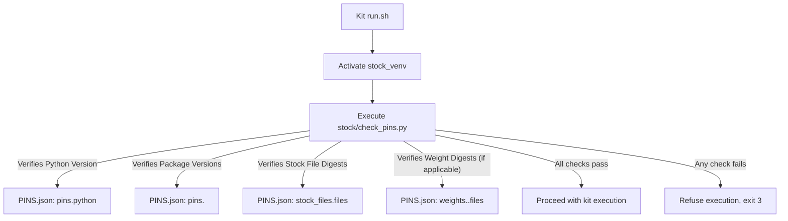

<!-- source: DeepWiki mcp.deepwiki.com · repo anthropics/uplifting-biomolecular-modeling · page 6.1 Pin Verification and Weights · fetched 2026-10-26 -->

# Pin Verification and Weights

<details>
<summary>Relevant source files</summary>

The following files were used as context for generating this wiki page:

- [af2ig/opt/af2ig_opt/stock_cli.py](af2ig/opt/af2ig_opt/stock_cli.py)
- [af2ig/opt/af2ig_opt/tests/test_weights_memo.py](af2ig/opt/af2ig_opt/tests/test_weights_memo.py)
- [af2ig/opt/af2ig_opt/weights.py](af2ig/opt/af2ig_opt/weights.py)
- [af2ig/stock/check_pins.py](af2ig/stock/check_pins.py)
- [af3_jax/opt/af3_jax_opt/tests/test_cli.py](af3_jax/opt/af3_jax_opt/tests/test_cli.py)
- [af3_jax/opt/af3_jax_opt/variants.py](af3_jax/opt/af3_jax_opt/variants.py)
- [af3_jax/stock/check_pins.py](af3_jax/stock/check_pins.py)
- [af3_torch/opt/af3_torch_opt/stock_venv.py](af3_torch/opt/af3_torch_opt/stock_venv.py)
- [af3_torch/opt/af3_torch_opt/tests/test_stack_gates.py](af3_torch/opt/af3_torch_opt/tests/test_stack_gates.py)
- [af3_torch/opt/af3_torch_opt/weights.py](af3_torch/opt/af3_torch_opt/weights.py)
- [af3_torch/stock/check_pins.py](af3_torch/stock/check_pins.py)
- [af3_torch/stock/fetch_upstream.py](af3_torch/stock/fetch_upstream.py)
- [boltz2/opt/boltz2_opt/stock_pred.py](boltz2/opt/boltz2_opt/stock_pred.py)
- [boltz2/opt/boltz2_opt/tests/test_kit_files_and_pins.py](boltz2/opt/boltz2_opt/tests/test_kit_files_and_pins.py)
- [boltz2/opt/boltz2_opt/weights.py](boltz2/opt/boltz2_opt/weights.py)
- [boltzgen/opt/boltzgen_opt/weights.py](boltzgen/opt/boltzgen_opt/weights.py)
- [borzoi/opt/datapath/pipeline_tf/build.py](borzoi/opt/datapath/pipeline_tf/build.py)
- [caliby/opt/caliby_opt/weights.py](caliby/opt/caliby_opt/weights.py)
- [chai1/opt/chai1_opt/weights.py](chai1/opt/chai1_opt/weights.py)
- [chrombpnet/opt/chrombpnet_opt/stock_pred_bw.py](chrombpnet/opt/chrombpnet_opt/stock_pred_bw.py)
- [chrombpnet/opt/chrombpnet_opt/weights.py](chrombpnet/opt/chrombpnet_opt/weights.py)
- [chrombpnet/stock/check_pins.py](chrombpnet/stock/check_pins.py)
- [colabdesign/opt/colabdesign_opt/tests/test_cli.py](colabdesign/opt/colabdesign_opt/tests/test_cli.py)
- [colabdesign/opt/colabdesign_opt/weights.py](colabdesign/opt/colabdesign_opt/weights.py)
- [colabfold/opt/colabfold_opt/tests/test_stock_pins.py](colabfold/opt/colabfold_opt/tests/test_stock_pins.py)
- [colabfold/opt/colabfold_opt/weights.py](colabfold/opt/colabfold_opt/weights.py)
- [colabfold/stock/check_pins.py](colabfold/stock/check_pins.py)
- [colabfold/stock/src/colabfold/download.py](colabfold/stock/src/colabfold/download.py)
- [common/opt_core/opt_core/cell_census.py](common/opt_core/opt_core/cell_census.py)
- [common/opt_core/opt_core/mem/peak.py](common/opt_core/opt_core/mem/peak.py)
- [common/opt_core/tests/test_rowpair_e2e_043.py](common/opt_core/tests/test_rowpair_e2e_043.py)
- [complexa/opt/complexa_opt/weights.py](complexa/opt/complexa_opt/weights.py)
- [e1/opt/e1_opt/stock_score.py](e1/opt/e1_opt/stock_score.py)
- [e1/opt/e1_opt/tests/test_weights_notice.py](e1/opt/e1_opt/tests/test_weights_notice.py)
- [e1/stock/check_pins.py](e1/stock/check_pins.py)
- [ef2inv/opt/ef2inv_opt/tests/test_stub_cli_pins.py](ef2inv/opt/ef2inv_opt/tests/test_stub_cli_pins.py)
- [ef2inv/opt/ef2inv_opt/weights.py](ef2inv/opt/ef2inv_opt/weights.py)
- [enformer/stock/check_pins.py](enformer/stock/check_pins.py)
- [esmfold2/opt/esmfold2_opt/tests/test_weights_digest_memo.py](esmfold2/opt/esmfold2_opt/tests/test_weights_digest_memo.py)
- [esmfold2/opt/esmfold2_opt/tests/test_weights_unknown_warns.py](esmfold2/opt/esmfold2_opt/tests/test_weights_unknown_warns.py)
- [esmfold2/opt/esmfold2_opt/weights.py](esmfold2/opt/esmfold2_opt/weights.py)
- [flashzoi/stock/check_pins.py](flashzoi/stock/check_pins.py)
- [opendde/opt/opendde_opt/tests/test_weights_and_digest.py](opendde/opt/opendde_opt/tests/test_weights_and_digest.py)
- [opendde/opt/opendde_opt/weights.py](opendde/opt/opendde_opt/weights.py)
- [openfold3/opt/openfold3_opt/tests/test_check_pins_reference.py](openfold3/opt/openfold3_opt/tests/test_check_pins_reference.py)
- [openfold3/opt/openfold3_opt/tests/test_cli_commands.py](openfold3/opt/openfold3_opt/tests/test_cli_commands.py)
- [openfold3/opt/openfold3_opt/weights.py](openfold3/opt/openfold3_opt/weights.py)
- [openfold3/stock/check_pins.py](openfold3/stock/check_pins.py)
- [openfold3_ob0/opt/openfold3_ob0_opt/tests/test_cli_commands.py](openfold3_ob0/opt/openfold3_ob0_opt/tests/test_cli_commands.py)
- [openfold3_ob0/stock/check_pins.py](openfold3_ob0/stock/check_pins.py)
- [progen2/stock/check_pins.py](progen2/stock/check_pins.py)
- [proteinmpnn/opt/proteinmpnn_opt/weights.py](proteinmpnn/opt/proteinmpnn_opt/weights.py)
- [proteinmpnn/stock/check_pins.py](proteinmpnn/stock/check_pins.py)
- [protenix_v1/opt/protenix_v1_opt/tests/test_weights_digest_memo.py](protenix_v1/opt/protenix_v1_opt/tests/test_weights_digest_memo.py)
- [protenix_v1/opt/protenix_v1_opt/weights.py](protenix_v1/opt/protenix_v1_opt/weights.py)
- [pxdesign/opt/pxdesign_opt/cli.py](pxdesign/opt/pxdesign_opt/cli.py)
- [pxdesign/opt/pxdesign_opt/weights.py](pxdesign/opt/pxdesign_opt/weights.py)
- [rfdiffusion1/opt/rfdiffusion1_opt/weights.py](rfdiffusion1/opt/rfdiffusion1_opt/weights.py)
- [rosettafold3/opt/rosettafold3_opt/tests/test_weights.py](rosettafold3/opt/rosettafold3_opt/tests/test_weights.py)
- [rosettafold3/opt/rosettafold3_opt/weights.py](rosettafold3/opt/rosettafold3_opt/weights.py)

</details>


This page details the mechanisms for ensuring the byte-for-byte reproducibility of the codebase, focusing on `PINS.json`, the `stock/check_pins.py` utility, `fetch_upstream.py` scripts, `weights.py` modules, digest memoization, and the composition of `stock_venv` environments. These components collectively guarantee that the software and its associated data (like model weights) are precisely as expected, preventing discrepancies that could affect performance or correctness.

## PINS.json: The Source of Truth

`PINS.json` is a kit-specific JSON file that serves as the definitive record for all external dependencies and internal file digests. It pins specific versions of Python, Python packages, the exact byte content of stock files, and the SHA2256 digests of model weights. This ensures that any deviation from these pinned values is detected, maintaining the integrity and reproducibility of each kit.

For example, `progen2/stock/PINS.json` would contain entries like:
```json
{
  "pins": {
    "python": "3.10",
    "torch": "2.1.0",
    "transformers": "4.35.2",
    "tokenizers": "0.15.0"
  },
  "transformers_wheel": {
    "members_sha256": {
      "transformers/models/progen/modeling_progen.py": "..."
    }
  },
  "files": [
    "progen2/stock/src/progen2/modeling_progen.py",
    // ... other stock files
  ],
  "stock_files": {
    "files": {
      "progen2/stock/src/progen2/modeling_progen.py": "sha256_digest_of_file"
    }
  },
  "weights": {
    "progen2-small": {
      "files": {
        "pytorch_model.bin": {
          "sha256": "sha256_digest_of_weight_file"
        },
        "config.json": {
          "sha256": "sha256_digest_of_config_file"
        }
      }
    }
  }
}
```
This structure allows for granular control and verification of every critical component.

Sources:
- [progen2/stock/check_pins.py:1-24]()
- [openfold3_ob0/stock/check_pins.py:1-17]()

## `stock/check_pins.py`: Verifying the Environment

The `stock/check_pins.py` script is a crucial utility for verifying that the current environment aligns with the specifications in `PINS.json`. It performs checks on the Python interpreter, installed packages, stock files, and optionally, model weights.

### Verification Checks

The script performs several types of checks:

1.  **Interpreter Version**: Compares the current Python interpreter's major.minor version against `pins.python` in `PINS.json`. A mismatch is noted but does not cause a refusal.
    [progen2/stock/check_pins.py:53-59]()
2.  **Package Versions**: Verifies the versions of key Python packages (e.g., `torch`, `transformers`, `tokenizers`) against `PINS.json`. It also checks the SHA256 digest of specific members within the `transformers` wheel. A package not installed or a member with a mismatched digest leads to a refusal.
    [progen2/stock/check_pins.py:62-87]()
3.  **Stock Files**: Ensures that all files listed in `PINS.json` under `files` and `stock_files.files` are present in the specified stock directory and that their SHA256 digests match the pinned values. Missing or mismatched files result in a refusal.
    [progen2/stock/check_pins.py:94-122]()
4.  **Weights (Optional)**: When `--weights-dir` is provided, it checks the SHA256 digests of model weight files against `PINS.json`. This check can either read digests from a `SHA256SUMS` file or compute them directly using `--hash-weights`. Mismatched weights lead to a refusal.
    [progen2/stock/check_pins.py:125-200]()

### Exit Codes

The script uses specific exit codes to indicate the verification outcome:
*   `0`: All checked items are at their pins.
*   `3`: One or more checked items are not at their pins.
*   `2`: A directory required for checking is absent.
[progen2/stock/check_pins.py:9-10]()

### `check_pins.py` Data Flow
```mermaid
graph TD
    A[Start check_pins.py] --> B{Load PINS.json};
    B --> C{Check Interpreter Version};
    C -- Mismatch --> D[Note Interpreter Version];
    C -- Match --> E[Check Package Versions];
    E -- Mismatch/Missing --> F[Refuse Package];
    E -- Match --> G[Check Stock Files];
    G -- Mismatch/Missing --> H[Refuse Stock File];
    G -- Match --> I{Check Weights (if --weights-dir)};
    I -- Mismatch/Missing --> J[Refuse Weight];
    I -- Match --> K[All Checks Pass];
    K --> L[Exit 0];
    F --> M[Exit 3];
    H --> M;
    J --> M;
    B -- Directory Absent --> N[Exit 2];
```
Title: `check_pins.py` Data Flow
Sources:
- [progen2/stock/check_pins.py:1-242]()
- [colabfold/stock/check_pins.py:1-212]()
- [af3_torch/stock/check_pins.py:1-154]()
- [openfold3_ob0/stock/check_pins.py:1-161]()

## `fetch_upstream.py`: Acquiring Upstream Code

The `fetch_upstream.py` scripts, such as `af3_torch/stock/fetch_upstream.py`, are responsible for downloading and preparing upstream codebases. These scripts are typically invoked during the `install` phase of a kit. They ensure that the exact version of the upstream project, as specified in `PINS.json`, is fetched and made available to the kit.

For example, `af3_torch/stock/fetch_upstream.py` would download the AlphaFold3 upstream repository. The `PINS.json` for `af3_torch` would contain details about the upstream archive, including its URL and SHA256 digest.
[af3_torch/stock/check_pins.py:10-12]()

## `weights.py` Modules: Managing Model Weights

Each kit often includes a `weights.py` module (e.g., `complexa/opt/complexa_opt/weights.py`, `chai1/opt/chai1_opt/weights.py`). These modules handle the fetching, verification, and management of model weights. They are designed to:

1.  **Fetch Weights**: Use upstream's own download mechanisms to acquire model checkpoints. This ensures that the kit uses the same process as the original project, minimizing potential discrepancies.
    [complexa/opt/complexa_opt/weights.py:1-13]()
    [chai1/opt/chai1_opt/weights.py:1-12]()
2.  **Verify Digests**: After fetching, the `weights.py` module performs a SHA256 digest check against the pinned values in `PINS.json`. This is a critical step to confirm the integrity and correctness of the downloaded weights.
    [complexa/opt/complexa_opt/weights.py:97-102]()
    [chai1/opt/chai1_opt/weights.py:88-92]()
3.  **Memoization**: The digest computation can be memoized to avoid redundant calculations, especially when `check_pins.py` or other tools need to repeatedly verify weights. This is often handled by the `stack.weights_match` function, which can be called with `afresh=True` to recompute and update the memo.
    [chai1/opt/chai1_opt/weights.py:60-60]()
4.  **Refusal on Mismatch**: If a weight file is missing or its digest does not match the pinned value, the process is refused, and an error is reported. This prevents the kit from running with incorrect or unverified weights.
    [complexa/opt/complexa_opt/weights.py:100-102]()
    [chai1/opt/chai1_opt/weights.py:88-92]()

### `weights.py` Workflow
```mermaid
graph TD
    A[Start weights.py (e.g., run.sh install --weights DIR)] --> B{Check if weights are present in DIR};
    B -- Absent --> C[Identify missing weights];
    C --> D[Call upstream's downloader for missing weights];
    D -- Download Fails --> E[Report failure, exit 1];
    D -- Download Success --> F[Verify SHA256 digest of all weights in DIR against PINS.json];
    F -- Mismatch --> G[Report mismatch, exit 1];
    F -- Match --> H[Report success, exit 0];
    B -- Present --> F;
```
Title: `weights.py` Workflow
Sources:
- [complexa/opt/complexa_opt/weights.py:1-116]()
- [chai1/opt/chai1_opt/weights.py:1-106]()
- [openfold3/opt/openfold3_opt/weights.py]()
- [rosettafold3/opt/rosettafold3_opt/tests/test_weights.py]()
- [af2ig/opt/af2ig_opt/weights.py]()
- [boltz2/opt/boltz2_opt/weights.py]()
- [boltzgen/opt/boltzgen_opt/weights.py]()
- [caliby/opt/caliby_opt/weights.py]()
- [chrombpnet/opt/chrombpnet_opt/weights.py]()
- [colabdesign/opt/colabdesign_opt/weights.py]()
- [ef2inv/opt/ef2inv_opt/weights.py]()
- [opendde/opt/opendde_opt/weights.py]()
- [proteinmpnn/opt/proteinmpnn_opt/weights.py]()
- [protenix_v1/opt/protenix_v1_opt/weights.py]()
- [pxdesign/opt/pxdesign_opt/weights.py]()
- [rfdiffusion1/opt/rfdiffusion1_opt/weights.py]()

## Digest Memoization

Digest memoization is employed to optimize the performance of repeated digest calculations. When a file's SHA256 is computed, the result can be stored (memoized) for subsequent checks. This is particularly useful in scenarios where `check_pins.py` or `weights.py` might be called multiple times within a single execution flow or across different stages of a kit's lifecycle. The `stack.weights_match` function, for instance, can leverage this memoization, with an option to force a fresh computation if needed.
[chai1/opt/chai1_opt/weights.py:60-60]()
[protenix_v1/opt/protenix_v1_opt/tests/test_weights_digest_memo.py]()

## `stock_venv` Composition

The `stock_venv` refers to the Python virtual environment that is configured to precisely match the pinned Python version and package dependencies specified in `PINS.json`. This environment is critical for ensuring that the stock (unoptimized) version of the upstream tool runs exactly as intended, providing a reliable baseline for comparison with optimized modes.

The `check_pins.py` script is often run within this `stock_venv` to verify its composition. The `run.sh` script for each kit typically sets up and activates this environment before executing any commands, ensuring that the pin checks are performed against the correct interpreter and package set.
[boltz2/opt/boltz2_opt/tests/test_kit_files_and_pins.py:87-92]()

### `stock_venv` Verification

Title: `stock_venv` Verification Flow
Sources:
- [progen2/stock/check_pins.py:1-242]()
- [boltz2/opt/boltz2_opt/tests/test_kit_files_and_pins.py:87-92]()
- [af3_torch/opt/af3_torch_opt/stock_venv.py]()

---

