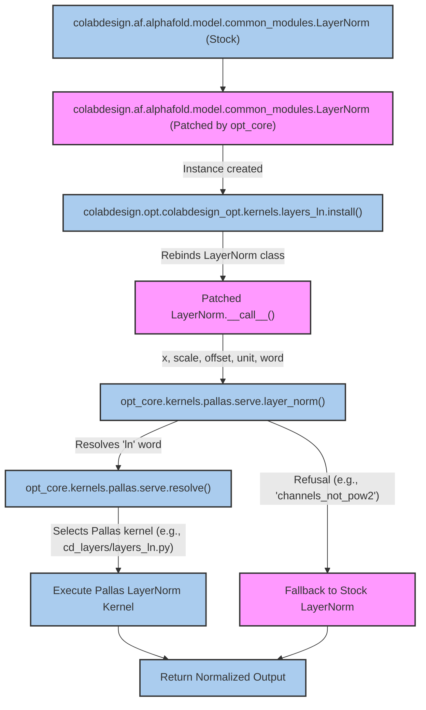

<!-- source: DeepWiki mcp.deepwiki.com · repo anthropics/uplifting-biomolecular-modeling · extra page LayerNorm, Transition, MSA and Atom Kernels · fetched 2026-10-26 -->

# LayerNorm, Transition, MSA and Atom Kernels

<details>
<summary>Relevant source files</summary>

The following files were used as context for generating this wiki page:

- [af2ig/opt/af2ig_opt/flash_attn.py](af2ig/opt/af2ig_opt/flash_attn.py)
- [af2ig/opt/forward/af2ig_kit/patches/05_flash_attention.diff](af2ig/opt/forward/af2ig_kit/patches/05_flash_attention.diff)
- [af3_jax/opt/af3_jax_opt/inprocess/af3_jax_atom_attn_pallas.py](af3_jax/opt/af3_jax_opt/inprocess/af3_jax_atom_attn_pallas.py)
- [af3_jax/opt/af3_jax_opt/inprocess/atom_attn.py](af3_jax/opt/af3_jax_opt/inprocess/atom_attn.py)
- [af3_jax/opt/af3_jax_opt/inprocess/dattn.py](af3_jax/opt/af3_jax_opt/inprocess/dattn.py)
- [af3_jax/opt/af3_jax_opt/inprocess/triatt_xla.py](af3_jax/opt/af3_jax_opt/inprocess/triatt_xla.py)
- [af3_jax/opt/af3_jax_opt/inprocess/trimul_cd.py](af3_jax/opt/af3_jax_opt/inprocess/trimul_cd.py)
- [af3_torch/opt/af3_torch_opt/ln_rows.py](af3_torch/opt/af3_torch_opt/ln_rows.py)
- [af3_torch/opt/forward/af3t/af3_torch/xfold/fastnn/gated_linear_unit.py](af3_torch/opt/forward/af3t/af3_torch/xfold/fastnn/gated_linear_unit.py)
- [af3_torch/opt/forward/af3t/af3_torch/xfold/fastnn/layer_norm.py](af3_torch/opt/forward/af3t/af3_torch/xfold/fastnn/layer_norm.py)
- [af3_torch/opt/forward/af3t/kernels/af3t_glu_proj.py](af3_torch/opt/forward/af3t/kernels/af3t_glu_proj.py)
- [af3_torch/opt/forward/af3t/kernels/third_party/af3t_opm.py](af3_torch/opt/forward/af3t/kernels/third_party/af3t_opm.py)
- [af3_torch/opt/forward/af3t/kernels/third_party/lnl_fused.py](af3_torch/opt/forward/af3t/kernels/third_party/lnl_fused.py)
- [af3_torch/opt/forward/dtk/dtk_modules.py](af3_torch/opt/forward/dtk/dtk_modules.py)
- [atlasfold/opt/atlasfold_opt/hooks/atom_bf16.py](atlasfold/opt/atlasfold_opt/hooks/atom_bf16.py)
- [atlasfold/opt/atlasfold_opt/hooks/atom_kdedup.py](atlasfold/opt/atlasfold_opt/hooks/atom_kdedup.py)
- [atlasfold/opt/atlasfold_opt/hooks/atom_rows.py](atlasfold/opt/atlasfold_opt/hooks/atom_rows.py)
- [atlasfold/opt/atlasfold_opt/hooks/atom_sdpa.py](atlasfold/opt/atlasfold_opt/hooks/atom_sdpa.py)
- [atlasfold/opt/atlasfold_opt/hooks/atom_tf32.py](atlasfold/opt/atlasfold_opt/hooks/atom_tf32.py)
- [boltz2/opt/forward/atom/src/boltz_atom_kernels.py](boltz2/opt/forward/atom/src/boltz_atom_kernels.py)
- [boltz2/opt/forward/precision/boltz2_precision.py](boltz2/opt/forward/precision/boltz2_precision.py)
- [boltz2/opt/forward/sampler/src/bz_sampler.py](boltz2/opt/forward/sampler/src/bz_sampler.py)
- [boltz2/opt/forward/sampler/src/bz_sampler_dit.py](boltz2/opt/forward/sampler/src/bz_sampler_dit.py)
- [colabdesign/opt/colabdesign_opt/kernels/__init__.py](colabdesign/opt/colabdesign_opt/kernels/__init__.py)
- [colabdesign/opt/colabdesign_opt/kernels/layers_ln.py](colabdesign/opt/colabdesign_opt/kernels/layers_ln.py)
- [colabfold/opt/forward/af2_pallas_flash/NOTICE](colabfold/opt/forward/af2_pallas_flash/NOTICE)
- [colabfold/opt/forward/af2_pallas_flash/README.md](colabfold/opt/forward/af2_pallas_flash/README.md)
- [colabfold/opt/forward/af2_pallas_flash/af2_pallas_flash/af2_pallas_attn.py](colabfold/opt/forward/af2_pallas_flash/af2_pallas_flash/af2_pallas_attn.py)
- [common/opt_core/opt_core/attn/sdpa_bias.py](common/opt_core/opt_core/attn/sdpa_bias.py)
- [common/opt_core/opt_core/kernels/META/pallas_triatt.json](common/opt_core/opt_core/kernels/META/pallas_triatt.json)
- [common/opt_core/opt_core/kernels/META/rfd_layernorm.json](common/opt_core/opt_core/kernels/META/rfd_layernorm.json)
- [common/opt_core/opt_core/kernels/apb/ditfast/NOTICE](common/opt_core/opt_core/kernels/apb/ditfast/NOTICE)
- [common/opt_core/opt_core/kernels/apb/ditfast/atom_kernels.py](common/opt_core/opt_core/kernels/apb/ditfast/atom_kernels.py)
- [common/opt_core/opt_core/kernels/apb/ditfast/kernels.py](common/opt_core/opt_core/kernels/apb/ditfast/kernels.py)
- [common/opt_core/opt_core/kernels/apb/l3a/NOTICE.md](common/opt_core/opt_core/kernels/apb/l3a/NOTICE.md)
- [common/opt_core/opt_core/kernels/apb/l3a/__init__.py](common/opt_core/opt_core/kernels/apb/l3a/__init__.py)
- [common/opt_core/opt_core/kernels/apb/l3a/fab_batched.py](common/opt_core/opt_core/kernels/apb/l3a/fab_batched.py)
- [common/opt_core/opt_core/kernels/atom_window.py](common/opt_core/opt_core/kernels/atom_window.py)
- [common/opt_core/opt_core/kernels/dtk_kernels.py](common/opt_core/opt_core/kernels/dtk_kernels.py)
- [common/opt_core/opt_core/kernels/flash_triattn_serve.py](common/opt_core/opt_core/kernels/flash_triattn_serve.py)
- [common/opt_core/opt_core/kernels/fpf_pallas/transition_pallas.py](common/opt_core/opt_core/kernels/fpf_pallas/transition_pallas.py)
- [common/opt_core/opt_core/kernels/fpf_pallas_serve.py](common/opt_core/opt_core/kernels/fpf_pallas_serve.py)
- [common/opt_core/opt_core/kernels/fpf_triatt_pro/prologue.py](common/opt_core/opt_core/kernels/fpf_triatt_pro/prologue.py)
- [common/opt_core/opt_core/kernels/fpf_trimul/arch_tables.json](common/opt_core/opt_core/kernels/fpf_trimul/arch_tables.json)
- [common/opt_core/opt_core/kernels/fpf_trimul/trimul.py](common/opt_core/opt_core/kernels/fpf_trimul/trimul.py)
- [common/opt_core/opt_core/kernels/ln/exactln/triton_ln.py](common/opt_core/opt_core/kernels/ln/exactln/triton_ln.py)
- [common/opt_core/opt_core/kernels/ln/fastln/fastln.py](common/opt_core/opt_core/kernels/ln/fastln/fastln.py)
- [common/opt_core/opt_core/kernels/ln/fastln/lpout.py](common/opt_core/opt_core/kernels/ln/fastln/lpout.py)
- [common/opt_core/opt_core/kernels/ln_proj.py](common/opt_core/opt_core/kernels/ln_proj.py)
- [common/opt_core/opt_core/kernels/lnl_fused.py](common/opt_core/opt_core/kernels/lnl_fused.py)
- [common/opt_core/opt_core/kernels/pallas/DESIGN.md](common/opt_core/opt_core/kernels/pallas/DESIGN.md)
- [common/opt_core/opt_core/kernels/pallas/__init__.py](common/opt_core/opt_core/kernels/pallas/__init__.py)
- [common/opt_core/opt_core/kernels/pallas/cd_layers/layers_ln.py](common/opt_core/opt_core/kernels/pallas/cd_layers/layers_ln.py)
- [common/opt_core/opt_core/kernels/pallas/cd_layers/layers_opm.py](common/opt_core/opt_core/kernels/pallas/cd_layers/layers_opm.py)
- [common/opt_core/opt_core/kernels/pallas/mlp_transition/mlp_transition_pallas.py](common/opt_core/opt_core/kernels/pallas/mlp_transition/mlp_transition_pallas.py)
- [common/opt_core/opt_core/kernels/pallas/rowshared_flash_pallas.NOTICE](common/opt_core/opt_core/kernels/pallas/rowshared_flash_pallas.NOTICE)
- [common/opt_core/opt_core/kernels/pallas/rowshared_flash_pallas.py](common/opt_core/opt_core/kernels/pallas/rowshared_flash_pallas.py)
- [common/opt_core/opt_core/kernels/pallas/serve.py](common/opt_core/opt_core/kernels/pallas/serve.py)
- [common/opt_core/opt_core/kernels/pallas_attn/NOTICE](common/opt_core/opt_core/kernels/pallas_attn/NOTICE)
- [common/opt_core/opt_core/kernels/pallas_attn_serve.py](common/opt_core/opt_core/kernels/pallas_attn_serve.py)
- [common/opt_core/opt_core/kernels/pallas_triatt/NOTICE](common/opt_core/opt_core/kernels/pallas_triatt/NOTICE)
- [common/opt_core/opt_core/kernels/pallas_triatt/__init__.py](common/opt_core/opt_core/kernels/pallas_triatt/__init__.py)
- [common/opt_core/opt_core/kernels/rfd_layernorm.py](common/opt_core/opt_core/kernels/rfd_layernorm.py)
- [common/opt_core/opt_core/kernels/transition/af3/af3_fused.py](common/opt_core/opt_core/kernels/transition/af3/af3_fused.py)
- [common/opt_core/opt_core/kernels/trimul/af3t_form.py](common/opt_core/opt_core/kernels/trimul/af3t_form.py)
- [common/opt_core/opt_core/kernels/trimul/of3_form.py](common/opt_core/opt_core/kernels/trimul/of3_form.py)
- [common/opt_core/opt_core/mem/rowpair/_torch.py](common/opt_core/opt_core/mem/rowpair/_torch.py)
- [common/opt_core/opt_core/of3_sampler/atom_window.py](common/opt_core/opt_core/of3_sampler/atom_window.py)
- [common/opt_core/opt_core/ops/msa_fused/msa_triton.py](common/opt_core/opt_core/ops/msa_fused/msa_triton.py)
- [common/opt_core/opt_core/ops/msa_opm/__init__.py](common/opt_core/opt_core/ops/msa_opm/__init__.py)
- [common/opt_core/opt_core/ops/msa_pwa/__init__.py](common/opt_core/opt_core/ops/msa_pwa/__init__.py)
- [common/opt_core/opt_core/precision/cast_cache.py](common/opt_core/opt_core/precision/cast_cache.py)
- [common/opt_core/tests/test_a100_tables.py](common/opt_core/tests/test_a100_tables.py)
- [common/opt_core/tests/test_p12_kernels_fpf_cells.py](common/opt_core/tests/test_p12_kernels_fpf_cells.py)
- [common/opt_core/tests/test_pair_fused_triattn_safe.py](common/opt_core/tests/test_pair_fused_triattn_safe.py)
- [esmfold2/opt/forward/fast_inference/driver/ef2_dit.py](esmfold2/opt/forward/fast_inference/driver/ef2_dit.py)
- [esmfold2/opt/forward/fast_inference/driver/ef2_msa.py](esmfold2/opt/forward/fast_inference/driver/ef2_msa.py)
- [esmfold2/opt/forward/fast_inference/driver/ef2_w4.py](esmfold2/opt/forward/fast_inference/driver/ef2_w4.py)
- [esmfold2/stock/src/transformers/src/transformers/models/esmfold2/kernels/fused_lnlin_swiglu.py](esmfold2/stock/src/transformers/src/transformers/models/esmfold2/kernels/fused_lnlin_swiglu.py)
- [evo2/opt/evo2_opt/kit/c2r.py](evo2/opt/evo2_opt/kit/c2r.py)
- [evo2/opt/evo2_opt/kit/c2r_apply.py](evo2/opt/evo2_opt/kit/c2r_apply.py)
- [evo2/opt/evo2_opt/kit/compact.py](evo2/opt/evo2_opt/kit/compact.py)
- [evo2/opt/evo2_opt/kit/kfft.py](evo2/opt/evo2_opt/kit/kfft.py)
- [evo2/opt/evo2_opt/kit/rmsnorm.py](evo2/opt/evo2_opt/kit/rmsnorm.py)
- [flashzoi/opt/forward/kits_v1_25/engines/flashzoi/kits/v1_25/fz_exact.py](flashzoi/opt/forward/kits_v1_25/engines/flashzoi/kits/v1_25/fz_exact.py)
- [opendde/opt/forward/fast_inference/levers/DITFAST/tools/odde_addon.py](opendde/opt/forward/fast_inference/levers/DITFAST/tools/odde_addon.py)
- [opendde/opt/forward/fast_inference/levers/SAMPLER/third_party/opendde_fpf_ditfast/NOTICE](opendde/opt/forward/fast_inference/levers/SAMPLER/third_party/opendde_fpf_ditfast/NOTICE)
- [opendde/opt/forward/fast_inference/levers/SAMPLER/third_party/opendde_fpf_ditfast/__init__.py](opendde/opt/forward/fast_inference/levers/SAMPLER/third_party/opendde_fpf_ditfast/__init__.py)
- [opendde/opt/forward/fast_inference/levers/SAMPLER/third_party/opendde_fpf_ditfast/_plumbing.py](opendde/opt/forward/fast_inference/levers/SAMPLER/third_party/opendde_fpf_ditfast/_plumbing.py)
- [openfold3/opt/openfold3_opt/cells/atom_hoist.py](openfold3/opt/openfold3_opt/cells/atom_hoist.py)
- [openfold3/opt/openfold3_opt/cells/atom_window.py](openfold3/opt/openfold3_opt/cells/atom_window.py)
- [openfold3_ob0/opt/openfold3_ob0_opt/cells/atom_hoist.py](openfold3_ob0/opt/openfold3_ob0_opt/cells/atom_hoist.py)
- [openfold3_ob0/opt/openfold3_ob0_opt/cells/atom_window.py](openfold3_ob0/opt/openfold3_ob0_opt/cells/atom_window.py)
- [protenix_v1/opt/forward/v05_addon/lib/protenix_fpf_ditfast/NOTICE](protenix_v1/opt/forward/v05_addon/lib/protenix_fpf_ditfast/NOTICE)
- [protenix_v1/opt/forward/v05_addon/lib/protenix_fpf_ditfast/README.md](protenix_v1/opt/forward/v05_addon/lib/protenix_fpf_ditfast/README.md)
- [protenix_v1/opt/forward/v05_addon/lib/protenix_fpf_ditfast/__init__.py](protenix_v1/opt/forward/v05_addon/lib/protenix_fpf_ditfast/__init__.py)
- [protenix_v1/opt/forward/v05_addon/lib/protenix_fpf_ditfast/_plumbing.py](protenix_v1/opt/forward/v05_addon/lib/protenix_fpf_ditfast/_plumbing.py)
- [protenix_v1/opt/forward/v05_addon/ptxfpf/ditfast_ptx1.py](protenix_v1/opt/forward/v05_addon/ptxfpf/ditfast_ptx1.py)
- [protenix_v1/opt/protenix_v1_opt/tests/test_ditfast_ptx1.py](protenix_v1/opt/protenix_v1_opt/tests/test_ditfast_ptx1.py)
- [protenix_v2/opt/forward/DIT_FUSE/NOTICE](protenix_v2/opt/forward/DIT_FUSE/NOTICE)
- [protenix_v2/opt/forward/DIT_FUSE/tools/dit_fuse.py](protenix_v2/opt/forward/DIT_FUSE/tools/dit_fuse.py)
- [protenix_v2/opt/forward/flashpairformer/third_party/protenix_fpf_ditfast/NOTICE](protenix_v2/opt/forward/flashpairformer/third_party/protenix_fpf_ditfast/NOTICE)
- [protenix_v2/opt/forward/flashpairformer/third_party/protenix_fpf_ditfast/__init__.py](protenix_v2/opt/forward/flashpairformer/third_party/protenix_fpf_ditfast/__init__.py)
- [protenix_v2/opt/forward/flashpairformer/third_party/protenix_fpf_ditfast/_plumbing.py](protenix_v2/opt/forward/flashpairformer/third_party/protenix_fpf_ditfast/_plumbing.py)
- [protenix_v2/opt/protenix_opt/sampler_levers.py](protenix_v2/opt/protenix_opt/sampler_levers.py)
- [rfdiffusion3/opt/forward/xattempt_addon/patched/rfd3/model/layers/layer_utils.py](rfdiffusion3/opt/forward/xattempt_addon/patched/rfd3/model/layers/layer_utils.py)
- [rfdiffusion3/opt/rfdiffusion3_opt/report.py](rfdiffusion3/opt/rfdiffusion3_opt/report.py)
- [rfdiffusion3/opt/rfdiffusion3_opt/tests/test_fzt_fallback.py](rfdiffusion3/opt/rfdiffusion3_opt/tests/test_fzt_fallback.py)

</details>


This page details the implementation and usage of optimized kernels for Layer Normalization (LN), Transition blocks, Multi-Sequence Alignment (MSA) operations, and Atom-level operations within the `opt_core` runtime. These kernels are designed to accelerate inference in biomolecular modeling tools by providing highly optimized, often fused, implementations of common computational patterns. The focus is on `exactln`/`fastln`, `transition`/`af3_fused`, `msa_opm`/`msa_pwa`/`msa_fused` ops, atom window and DiT fast kernels, and Pallas serve paths.

## Layer Normalization Kernels

The `opt_core` provides optimized Layer Normalization (LN) kernels, including `exactln` and `fastln`, to accelerate the ubiquitous LN operation in neural networks. These kernels are often integrated into larger fused operations for maximum performance.

### `exactln`

The `exactln` kernels aim for bitwise reproducibility with stock PyTorch or JAX implementations while offering performance improvements. An example of an `exactln` Triton-based LayerNorm can be found in [common/opt_core/opt_core/kernels/ln/exactln/triton_ln.py](). These kernels are typically used when strict numerical equivalence to the original model is required.

Sources:
* [common/opt_core/opt_core/kernels/ln/exactln/triton_ln.py]()

### `fastln`

The `fastln` kernels prioritize performance, potentially introducing minor numerical deviations compared to stock implementations, but remaining within acceptable tolerance classes. An example of a `fastln` Triton-based LayerNorm is in [common/opt_core/opt_core/kernels/ln/fastln/fastln.py](). These are often used when the performance gain outweighs the need for bitwise exactness.

### Pallas LayerNorm

For JAX-based models, the `opt_core` provides Pallas-based LayerNorm kernels. The `colabdesign` kit, for instance, leverages a Pallas/Triton row kernel for `common_modules.LayerNorm` calls. This kernel reads rows once, keeps statistics in registers, and writes normalized rows once, optimizing for HBM bandwidth.

The `colabdesign` LayerNorm adapter, defined in [colabdesign/opt/colabdesign_opt/kernels/layers_ln.py](), rebinds `colabdesign.af.alphafold.model.common_modules.LayerNorm` to a subclass that dispatches to the Pallas kernel. It supports `bf16` and `f32` dtypes and specific channel sizes. Fallbacks to the stock method are handled by name for unsupported configurations, such as `channels_not_pow2` for 384-channel norms [colabdesign/opt/colabdesign_opt/kernels/layers_ln.py:57-58]().

The numerical class for Pallas LayerNorm is `precision` because the reduction order and rounding may differ from XLA's fusions, preventing bitwise exactness [colabdesign/opt/colabdesign_opt/kernels/layers_ln.py:21-22]().

Sources:
* [colabdesign/opt/colabdesign_opt/kernels/layers_ln.py]()
* [common/opt_core/opt_core/kernels/ln/fastln/fastln.py]()
* [common/opt_core/opt_core/kernels/ln/exactln/triton_ln.py]()

## Transition Kernels

Transition blocks, often involving Layer Normalization, linear transformations, and activation functions (like SwiGLU), are critical components in many models. The `opt_core` provides fused kernels for these operations.

### `af3_fused` Transition

The `af3_fused` transition kernel, located at [common/opt_core/opt_core/kernels/transition/af3/af3_fused.py](), is designed for AlphaFold3-family models. It fuses the LayerNorm, linear transformations, and SwiGLU activation into a single kernel.

### ESMFold2 W4 Transition Kernels

The `esmfold2` kit introduces several W4 (Weight 4-bit) inference-execution levers for the ESMFold2 pair trunk, including optimized transition kernels. These are implemented using Triton and aim for bitwise equivalence or specific tolerance classes.

Key `ef2_w4` transition levers include:
*   `transition_nolin`: An inference-only clone of Biohub's `_lnlin_swiglu_fwd_kernel` that avoids materializing the `lin` buffer, which is only consumed by backward passes [esmfold2/opt/forward/fast_inference/driver/ef2_w4.py:9-12](). This is designed to be bitwise exact.
*   `transition_rowblock`: A restructured inference Transition kernel where a row-block program computes `x_hat` once and loops over N tiles, maintaining bitwise equivalence [esmfold2/opt/forward/fast_inference/driver/ef2_w4.py:16-17]().
*   `transition_fused`: A comprehensive kernel that fuses the entire pair Transition operation (LN + w12 + SwiGLU + w3 + residual) into one kernel [esmfold2/opt/forward/fast_inference/driver/ef2_w4.py:22]().

These kernels are implemented in Triton, with `_lnlin_swiglu_fwd_nolin_kernel` being a prime example [esmfold2/opt/forward/fast_inference/driver/ef2_w4.py:59-101]().

### Pallas Transition

For JAX-based models, the `opt_core` also offers Pallas-based transition kernels. The `transition` function in [common/opt_core/opt_core/kernels/pallas/serve.py:10]() serves these kernels, taking `x`, `params`, `activation`, `form`, and a `word` for resolution. The underlying implementation can be found in [common/opt_core/opt_core/kernels/fpf_pallas/transition_pallas.py]().

Sources:
* [common/opt_core/opt_core/kernels/transition/af3/af3_fused.py]()
* [esmfold2/opt/forward/fast_inference/driver/ef2_w4.py]()
* [common/opt_core/opt_core/kernels/pallas/serve.py]()
* [common/opt_core/opt_core/kernels/fpf_pallas/transition_pallas.py]()

## MSA Kernels

Multi-Sequence Alignment (MSA) operations, particularly pair-weighted averaging (PWA) and outer product mean (OPM), are computationally intensive. The `opt_core` provides optimized and fused kernels for these.

### MSA Pair-Weighted Averaging (`msa_pwa`)

The `msa_pwa` kernels, defined in [common/opt_core/opt_core/ops/msa_pwa/__init__.py](), implement MSA pair-weighted averaging. The goal is to avoid materializing the `[S, N, N]` attention matrix beyond what is strictly needed for GEMM operations, and to fuse the LayerNorm/projection prologue with the gate/out-projection epilogue.

The kernel `_pwa_core_kernel` [common/opt_core/opt_core/ops/msa_pwa/__init__.py:40-71]() is a Triton implementation that processes MSA rows (`S`) and tokens (`N`) with `H` heads and `C` channels. It aims to optimize the batched GEMM operations involved in the attention mechanism. The `v2` kernel variant further optimizes grid order for better L2 cache reuse [common/opt_core/opt_core/ops/msa_pwa/__init__.py:73-75]().

Sources:
* [common/opt_core/opt_core/ops/msa_pwa/__init__.py]()

### MSA Outer Product Mean (`msa_opm`)

The `msa_opm` kernels, found in [common/opt_core/opt_core/ops/msa_opm/__init__.py](), optimize the outer product mean operation. This operation is crucial for generating pair representations from MSA features.

### Fused MSA Kernels (`msa_fused`)

The `msa_fused` kernels, such as those in [common/opt_core/opt_core/ops/msa_fused/msa_triton.py](), aim to fuse multiple MSA-related operations into single Triton kernels for improved performance.

### Pallas Outer Product Mean

For JAX-based models, the `outer_product_mean` function in [common/opt_core/opt_core/kernels/pallas/serve.py:12]() serves Pallas-based OPM kernels. The parameter structure for OPM includes `ln_scale`, `ln_offset`, `left_w`, `left_b`, `right_w`, `right_b`, `out_w`, and `out_b` [common/opt_core/opt_core/kernels/pallas/serve.py:18](). The specific implementation for ColabDesign's OPM is in [common/opt_core/opt_core/kernels/pallas/cd_layers/layers_opm.py]().

Sources:
* [common/opt_core/opt_core/ops/msa_opm/__init__.py]()
* [common/opt_core/opt_core/ops/msa_fused/msa_triton.py]()
* [common/opt_core/opt_core/kernels/pallas/serve.py]()
* [common/opt_core/opt_core/kernels/pallas/cd_layers/layers_opm.py]()

## Atom Kernels

Atom-level operations, particularly in diffusion samplers, are highly specialized and benefit significantly from custom kernel optimizations.

### Atom Window Kernels

The `atom_window` lever, detailed in [common/opt_core/opt_core/of3_sampler/atom_window.py](), optimizes the sequence-local atom attention in diffusion samplers (e.g., AlphaFold3's AtomAttentionEncoder/Decoder). It replaces numerous small kernels with two fused Triton kernels:
*   `ln_qkvg`: Fuses LayerNorm, AdaLN modulations, and four C x C projections into `qkvg` [common/opt_core/opt_core/kernels/atom_window.py:9-12]().
*   `window_attn`: Performs the attention calculation, including shifted key window reading, `q k^T`, pair bias, masking, softmax, `p v`, sigmoid gate, `W_o`, AdaLN-Zero gate, and residual [common/opt_core/opt_core/kernels/atom_window.py:12-15]().

These kernels are implemented in [common/opt_core/opt_core/kernels/atom_window.py](). The `window_starts` function [common/opt_core/opt_core/kernels/atom_window.py:43-54]() calculates the shifted key windows, and `_ln_qkvg_kernel` [common/opt_core/opt_core/kernels/atom_window.py:84-101]() and `_window_attn_kernel` (not fully shown but implied) are the core Triton implementations. Precision options like `tf32rn`, `tf32x3`, and `ieee` are supported for dot products [common/opt_core/opt_core/kernels/atom_window.py:20-22]().

The `boltz2` kit also includes atom kernels, such as those in [boltz2/opt/forward/atom/src/boltz_atom_kernels.py](), which are likely similar in purpose to the `opt_core` atom window kernels.

Sources:
* [common/opt_core/opt_core/of3_sampler/atom_window.py]()
* [common/opt_core/opt_core/kernels/atom_window.py]()
* [boltz2/opt/forward/atom/src/boltz_atom_kernels.py]()

### DiT Fast Kernels

Diffusion Transformer (DiT) fast kernels are specialized for the token path of diffusion samplers. The `ef2_dit` module in `esmfold2` provides a device-resident roll-out and a fused `bf16` diffusion-transformer step [esmfold2/opt/forward/fast_inference/driver/ef2_dit.py:1]().

Key `ef2_dit` levers include:
*   `rollout`: Implements `DiffusionStructureHead.sample` as a CUDA graph per step boundary, capturing and replaying it for performance [esmfold2/opt/forward/fast_inference/driver/ef2_dit.py:12-17]().
*   `dit`: Fuses multiple operations within each Diffusion Transformer block, including GEMMs, Flash Attention, and fused element-wise kernels [esmfold2/opt/forward/fast_inference/driver/ef2_dit.py:31-36]().

The `boltz2` kit also leverages fused `bf16` token-transformer step levers in `bz_sampler_dit.py` that compose within its roll-out [boltz2/opt/forward/sampler/src/bz_sampler.py:45](). The `_kabsch3_kernel` in `bz_sampler.py` [boltz2/opt/forward/sampler/src/bz_sampler.py:88-90]() is an example of a fast kernel for rigid alignment.

Sources:
* [esmfold2/opt/forward/fast_inference/driver/ef2_dit.py]()
* [boltz2/opt/forward/sampler/src/bz_sampler.py]()

## Pallas Serve Paths

The `opt_core.kernels.pallas.serve` module [common/opt_core/opt_core/kernels/pallas/serve.py]() acts as a generic serving layer for JAX-family Pallas kernels. It provides a unified interface for various operations, including `attention`, `triangle_attention_block`, `triangle_multiplication`, `glu_transposed_masked`, `transition`, `layer_norm`, and `outer_product_mean` [common/opt_core/opt_core/kernels/pallas/serve.py:6-12]().

### Data Flow and Resolution

When a Pallas kernel is requested, the `serve` module performs the following steps:
1.  **Resolve**: The `resolve` function [common/opt_core/opt_core/kernels/pallas/serve.py:72-76]() determines the appropriate kernel based on the operation (`op`), family (`fam`), data type (`dtype`), number of tokens (`n_tokens`), and a `word` (row, arm, or tier word). It also considers the running JAX line and compute capability (`cc`).
2.  **Walk Candidates**: The `_walk` function [common/opt_core/opt_core/kernels/pallas/serve.py:104-112]() iterates through candidate kernels.
3.  **Probe and Serve**: For inherited rows (kernels compiled for a different `cc`), a probe is performed to ensure the kernel can launch on the current device. If successful, the kernel is served. If a kernel fails to launch or compile, it is marked as "dead" for the process, and the next candidate is tried [common/opt_core/opt_core/kernels/pallas/serve.py:116-120]().
4.  **Refusal and Fallback**: If no suitable Pallas kernel can be served, a `Refusal` is raised, and the system falls back to the stock implementation. Refusals are recorded by name (e.g., `backend_not_gpu`, `precision_required`) [common/opt_core/opt_core/kernels/pallas/serve.py:48-56]().

### Diagram: Pallas Kernel Serving Data Flow

```mermaid
graph TD
    A["User Code (e.g., colabdesign LayerNorm)"] --> B{Pallas Serve Request};
    B -- "op, fam, dtype, n_tokens, word" --> C[opt_core.kernels.pallas.serve.resolve()];
    C -- "Selection (candidates)" --> D[opt_core.kernels.pallas.serve._walk()];
    D -- "For each candidate arm" --> E{Is arm inherited?};
    E -- Yes --> F[Probe arm (serve_one with concrete zeros)];
    F -- Launch Error / Compile Error --> G[Mark arm DEAD, try next candidate];
    F -- Success --> H[Serve arm (serve_one with actual inputs)];
    E -- No --> H;
    H -- Success --> I[Execute Pallas Kernel];
    I --> J[Return Result];
    H -- Refusal (e.g., "backend_not_gpu") --> K[Record Refusal];
    K --> L[Fallback to Stock Implementation];
    G --> L;
    L --> J;
    style A fill:#ace,stroke:#333,stroke-width:2px;
    style B fill:#f9f,stroke:#333,stroke-width:2px;
    style C fill:#ace,stroke:#333,stroke-width:2px;
    style D fill:#ace,stroke:#333,stroke-width:2px;
    style E fill:#f9f,stroke:#333,stroke-width:2px;
    style F fill:#ace,stroke:#333,stroke-width:2px;
    style G fill:#f9f,stroke:#333,stroke-width:2px;
    style H fill:#ace,stroke:#333,stroke-width:2px;
    style I fill:#ace,stroke:#333,stroke-width:2px;
    style J fill:#ace,stroke:#333,stroke-width:2px;
    style K fill:#f9f,stroke:#333,stroke-width:2px;
    style L fill:#f9f,stroke:#333,stroke-width:2px;
```
Title: Pallas Kernel Serving Data Flow
Sources:
* [common/opt_core/opt_core/kernels/pallas/serve.py]()

### Diagram: Pallas Kernel Integration (ColabDesign LayerNorm Example)


Title: ColabDesign LayerNorm Pallas Kernel Integration
Sources:
* [colabdesign/opt/colabdesign_opt/kernels/layers_ln.py]()
* [common/opt_core/opt_core/kernels/pallas/serve.py]()

Sources:
* [common/opt_core/opt_core/kernels/pallas/serve.py]()

---

