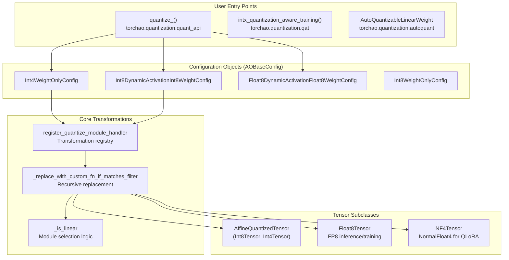
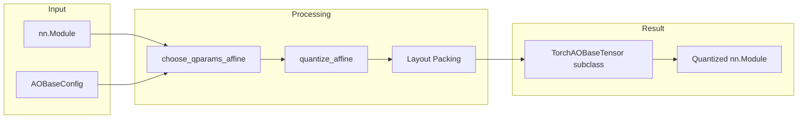

<!-- source: DeepWiki mcp.deepwiki.com · repo pytorch/ao · page 1 Overview · fetched 2026-10-21 -->

# Overview

Relevant source files

The following files were used as context for generating this wiki page:

- [CODE_OF_CONDUCT.md](CODE_OF_CONDUCT.md)
- [CONTRIBUTING.md](CONTRIBUTING.md)
- [LICENSE](LICENSE)
- [README.md](README.md)
- [docs/source/api_reference/api_ref_float8.rst](docs/source/api_reference/api_ref_float8.rst)
- [docs/source/api_reference/api_ref_qat.rst](docs/source/api_reference/api_ref_qat.rst)
- [docs/source/api_reference/api_ref_sparsity.rst](docs/source/api_reference/api_ref_sparsity.rst)
- [docs/source/api_reference/api_ref_utils.rst](docs/source/api_reference/api_ref_utils.rst)
- [docs/source/contributing/benchmarking_api_guide.md](docs/source/contributing/benchmarking_api_guide.md)
- [docs/source/index.rst](docs/source/index.rst)
- [docs/source/pt2e_quantization/index.rst](docs/source/pt2e_quantization/index.rst)
- [docs/source/workflows/training.md](docs/source/workflows/training.md)
- [test/dtypes/test_affine_quantized_float.py](test/dtypes/test_affine_quantized_float.py)
- [test/integration/test_integration.py](test/integration/test_integration.py)
- [test/quantization/quantize_/workflows/float8/test_float8_tensor.py](test/quantization/quantize_/workflows/float8/test_float8_tensor.py)
- [test/quantization/quantize_/workflows/float8/test_float8_tensor_mi300.py](test/quantization/quantize_/workflows/float8/test_float8_tensor_mi300.py)
- [test/quantization/test_quant_api.py](test/quantization/test_quant_api.py)
- [test/quantization/test_quant_primitives.py](test/quantization/test_quant_primitives.py)
- [test/test_utils.py](test/test_utils.py)
- [torchao/float8/inference.py](torchao/float8/inference.py)
- [torchao/prototype/hqq/hqq_tinygemm_linear.py](torchao/prototype/hqq/hqq_tinygemm_linear.py)
- [torchao/quantization/README.md](torchao/quantization/README.md)
- [torchao/quantization/__init__.py](torchao/quantization/__init__.py)
- [torchao/quantization/qat/README.md](torchao/quantization/qat/README.md)
- [torchao/quantization/quant_api.py](torchao/quantization/quant_api.py)
- [torchao/quantization/quant_primitives.py](torchao/quantization/quant_primitives.py)
- [torchao/quantization/quantize_/common/kernel_preference.py](torchao/quantization/quantize_/common/kernel_preference.py)
- [torchao/quantization/quantize_/workflows/float8/float8_tensor.py](torchao/quantization/quantize_/workflows/float8/float8_tensor.py)
- [torchao/quantization/utils.py](torchao/quantization/utils.py)
- [torchao/testing/utils.py](torchao/testing/utils.py)
- [torchao/utils.py](torchao/utils.py)

TorchAO is a PyTorch-native library for model optimization, providing quantization, sparsity, and training acceleration techniques that work seamlessly with `torch.compile()` and distributed training frameworks. The library enables users to apply post-training quantization (PTQ), quantization-aware training (QAT), and specialized training techniques (e.g., float8 training) with minimal code changes, achieving significant speedups and memory reductions while maintaining model quality.

For detailed installation instructions, see [Installation and Setup](#1.1). For in-depth architectural concepts, see [Core Concepts and Architecture](#1.2). For immediate usage examples, see [Quickstart Guide](#1.3).

Sources: [README.md:1-55](), [torchao/quantization/quant_api.py:7-16]()

## Key Capabilities

TorchAO provides three primary optimization approaches:

*   **Post-Training Quantization (PTQ)**: Apply quantization to pre-trained models without retraining. Supports weight-only quantization (Int4, Int8, Float8), dynamic activation quantization, and static quantization. The primary API is `quantize_()` with configuration objects [torchao/quantization/quant_api.py:115]().
*   **Quantization-Aware Training (QAT)**: Insert fake quantization operations during training to recover accuracy degradation. Uses a prepare-train-convert workflow where `_AffineFakeQuantizedTensor` [torchao/quantization/quant_api.py:170-172]() simulates numerics during training.
*   **Accelerated Training**: Native float8 training achieves significant speedups (up to 1.5x) on large-scale pretraining [README.md:8-10](). It also includes support for 2:4 sparsity and low-bit optimizers [README.md:46-48]().

Sources: [README.md:53-60](), [torchao/quantization/quant_api.py:111-120](), [torchao/quantization/quant_primitives.py:55-78]()

## Primary API Entry Points

The `quantize_` function serves as the central entry point for applying optimizations to a `torch.nn.Module`.

The `quantize_` function in [torchao/quantization/quant_api.py:115]() accepts a model and a configuration object. It uses `_replace_with_custom_fn_if_matches_filter` [torchao/quantization/quant_api.py:122-165]() to recursively traverse the module tree and apply transformations to modules that satisfy the `filter_fn` (usually `_is_linear` [torchao/quantization/quant_api.py:168-183]()).

Sources: [torchao/quantization/quant_api.py:111-214](), [torchao/quantization/__init__.py:72-131]()

## Quantization Workflows

### Post-Training Quantization Flow

The PTQ workflow converts standard high-precision weights into tensor subclasses that store quantized data and metadata.

The workflow relies on quantization primitives defined in [torchao/quantization/quant_primitives.py](). `choose_qparams_affine` [torchao/quantization/quant_primitives.py:25]() calculates scales and zero points based on the `MappingType` [torchao/quantization/quant_primitives.py:55-78](). Then `quantize_affine` [torchao/quantization/quant_primitives.py:27]() performs the actual conversion. The resulting data is wrapped in a subclass like `Int4Tensor` or `Float8Tensor` [torchao/quantization/quantize_/workflows.py:53-65]().

Sources: [torchao/quantization/quant_primitives.py:25-52](), [torchao/quantization/quant_api.py:102-106]()

## Tensor Subclass Foundation

All quantized tensor types in TorchAO inherit from `TorchAOBaseTensor` [torchao/utils.py:30](). This framework allows quantized tensors to behave like standard `torch.Tensor` objects while intercepting operations (like `linear` or `matmul`) to dispatch to optimized kernels.

*   **`AffineQuantizedTensor`**: The base for affine quantization (Int8, Int4) [torchao/quantization/__init__.py:92-98]().
*   **`Float8Tensor`**: Implements FP8 inference and dynamic quantization [torchao/quantization/quantize_/workflows/float8/float8_tensor.py:84-155]().
*   **`NF4Tensor`**: Implements 4-bit NormalFloat for parameter-efficient fine-tuning [torchao/quantization/__init__.py:100]().

Sources: [torchao/utils.py:29-30](), [torchao/quantization/quantize_/workflows/float8/float8_tensor.py:84-155](), [torchao/quantization/__init__.py:91-101]()

## Hardware and Performance

TorchAO targets multiple backends with optimized kernels:
*   **CUDA**: Uses `_scaled_mm` and `safe_int_mm` [torchao/quantization/__init__.py:1-4]().
*   **CPU**: Supports AVX-512, AMX, and ARM (KleidiAI) [torchao/utils.py:39-40]().
*   **XPU**: Support for Intel accelerators [torchao/quantization/quant_api.py:75-77]().

Performance gains include up to **1.89x faster** inference and **58% less memory** for Llama-3-8B using int4 quantization [README.md:10]().

Sources: [README.md:7-11](), [torchao/utils.py:32-42](), [torchao/quantization/quant_api.py:70-79]()

## Related Pages

*   [Installation and Setup](#1.1) — Methods to install via pip, conda, or source.
*   [Core Concepts and Architecture](#1.2) — Deep dive into tensor subclasses and dispatch.
*   [Quickstart Guide](#1.3) — Minimal code snippets for PTQ, QAT, and Float8.
*   [Ecosystem Integrations](#1.4) — Details on HuggingFace, vLLM, and ExecuTorch support.

---

