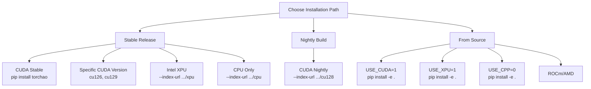
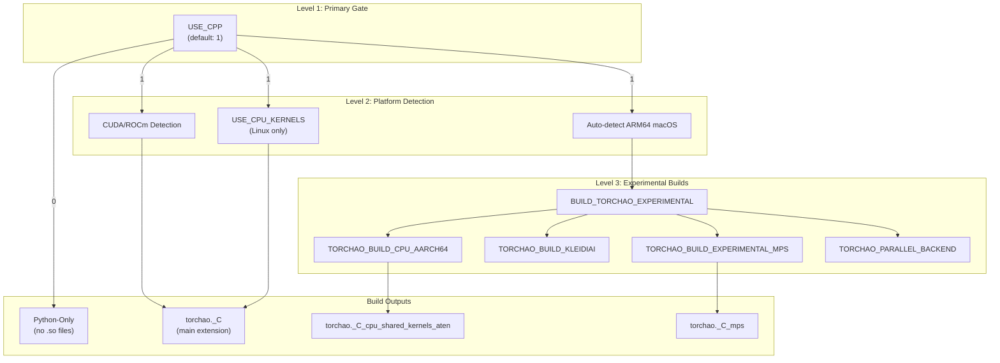
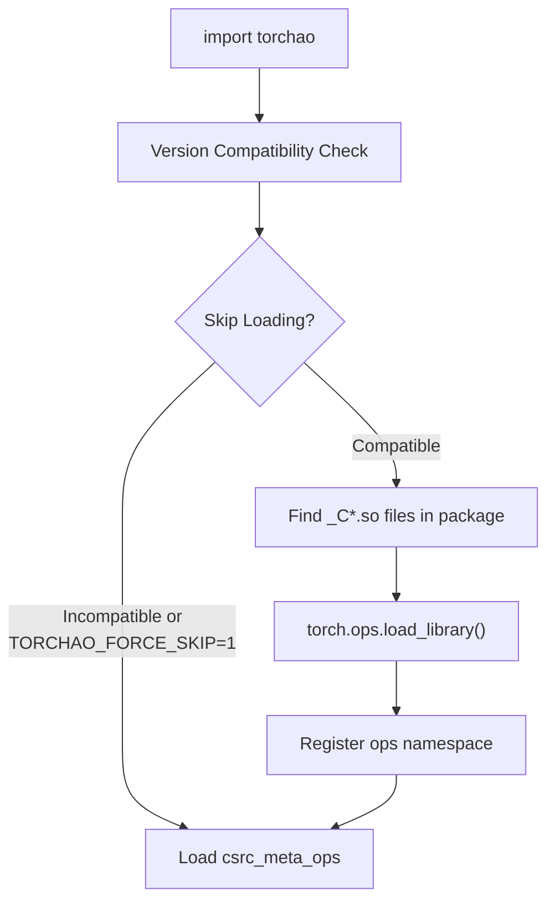

<!-- source: DeepWiki mcp.deepwiki.com · repo pytorch/ao · page 1.1 Installation and Setup · fetched 2026-10-21 -->

# Installation and Setup

<details>
<summary>Relevant source files</summary>

The following files were used as context for generating this wiki page:

- [.github/scripts/validate_binaries.sh](.github/scripts/validate_binaries.sh)
- [.github/workflows/build_wheels_linux_aarch64.yml](.github/workflows/build_wheels_linux_aarch64.yml)
- [.github/workflows/build_wheels_linux_x86.yml](.github/workflows/build_wheels_linux_x86.yml)
- [.github/workflows/validate-binaries.yml](.github/workflows/validate-binaries.yml)
- [packaging/env_var_script_linux.sh](packaging/env_var_script_linux.sh)
- [packaging/post_build_script.sh](packaging/post_build_script.sh)
- [packaging/pre_build_script.sh](packaging/pre_build_script.sh)
- [packaging/smoke_test.py](packaging/smoke_test.py)
- [scripts/test_torch_version_torchao_version_compatibility.sh](scripts/test_torch_version_torchao_version_compatibility.sh)
- [setup.py](setup.py)
- [test/smoke_tests/smoke_tests.py](test/smoke_tests/smoke_tests.py)
- [test/test_ops.py](test/test_ops.py)
- [torchao/__init__.py](torchao/__init__.py)
- [torchao/csrc/cpu/CMakeLists.txt](torchao/csrc/cpu/CMakeLists.txt)
- [torchao/csrc/cpu/README.md](torchao/csrc/cpu/README.md)
- [torchao/csrc/cpu/aten_kernels/da8w4_linear.cpp](torchao/csrc/cpu/aten_kernels/da8w4_linear.cpp)
- [torchao/csrc/cpu/aten_kernels/float8_linear.cpp](torchao/csrc/cpu/aten_kernels/float8_linear.cpp)
- [torchao/csrc/cpu/aten_kernels/quantized_sdpa.cpp](torchao/csrc/cpu/aten_kernels/quantized_sdpa.cpp)
- [torchao/csrc/cpu/aten_kernels/scaled_embedding_bag.cpp](torchao/csrc/cpu/aten_kernels/scaled_embedding_bag.cpp)
- [torchao/csrc/cpu/aten_kernels/utils.h](torchao/csrc/cpu/aten_kernels/utils.h)
- [torchao/csrc/cpu/shared_kernels/Utils.cmake](torchao/csrc/cpu/shared_kernels/Utils.cmake)
- [torchao/ops.py](torchao/ops.py)
- [torchao/prototype/inductor/qsdpa_lowering.py](torchao/prototype/inductor/qsdpa_lowering.py)
- [version.txt](version.txt)

</details>


This page covers installation methods, build configuration, hardware requirements, and environment setup for TorchAO. For information about using TorchAO's quantization APIs after installation, see **Quickstart Guide**. For detailed build system internals, see **Build System**.

---

## Installation Methods

TorchAO provides multiple installation paths depending on your hardware platform and development needs. The library supports CUDA, ROCm, Intel XPU, and CPU-only deployments.

### Stable Release Installation

The simplest installation method uses pip to install the latest stable release:

```bash
pip install torchao
```

This installs a pre-built wheel for your platform with default CUDA support if available. The versioning follows a prefix defined in `version.txt` [version.txt:1]().

### Platform-Specific Installation



**Platform-Specific Installation Commands**

| Platform | Command |
|----------|---------|
| CUDA 12.6 | `pip install torchao --index-url https://download.pytorch.org/whl/cu126` |
| CUDA 12.9 | `pip install torchao --index-url https://download.pytorch.org/whl/cu129` |
| Intel XPU | `pip install torchao --index-url https://download.pytorch.org/whl/xpu` |
| CPU Only | `pip install torchao --index-url https://download.pytorch.org/whl/cpu` |
| Nightly (CUDA 12.8) | `pip install --pre torchao --index-url https://download.pytorch.org/whl/nightly/cu128` |

**Sources:** [setup.py:128-134](), [packaging/env_var_script_linux.sh:11-13]()

### Developer Installation (From Source)

For development or when pre-built wheels are unavailable, install from source. The build process uses `setup.py` to compile C++ and CUDA extensions [setup.py:19-20]().

```bash
# CUDA development
USE_CUDA=1 pip install -e . --no-build-isolation

# Intel XPU development
USE_XPU=1 pip install -e . --no-build-isolation

# Python-only mode (no C++ extensions)
USE_CPP=0 pip install -e . --no-build-isolation
```

The `--no-build-isolation` flag is **required** for source builds to ensure proper environment variable propagation to the `BuildOptions` class [setup.py:201-202]().

**Sources:** [setup.py:94-106](), [setup.py:201-213]()

---

## Build Configuration System

TorchAO's build system uses environment variables to control which components are compiled. The hierarchy determines which extensions are built:



**Sources:** [setup.py:90-126](), [packaging/env_var_script_linux.sh:23-38]()

### Primary Build Variables

| Variable | Default | Description |
|----------|---------|-------------|
| `USE_CPP` | `1` | Master switch for C++ extensions. Set to `0` for Python-only mode [setup.py:95]() |
| `USE_CUDA` | Auto | Build CUDA kernels if CUDA toolkit detected [setup.py:142-148]() |
| `USE_CPU_KERNELS` | `0` | Enable optimized CPU kernels on Linux (AVX512, VNNI) [setup.py:96]() |
| `DEBUG` | `0` | Enable debug mode compilation [setup.py:137-138]() |

### Experimental Build Options

These options are available when `BUILD_TORCHAO_EXPERIMENTAL=1` or on ARM64 macOS [setup.py:103-104]():

| Variable | Default | Description | Requirements |
|----------|---------|-------------|--------------|
| `TORCHAO_BUILD_CPU_AARCH64` | ARM64 macOS | Build ARM64 CPU kernels | ARM64 machine [setup.py:207-213]() |
| `TORCHAO_BUILD_KLEIDIAI` | `0` | Build Kleidi AI library integration | `TORCHAO_BUILD_CPU_AARCH64=1` [setup.py:214-218]() |
| `TORCHAO_BUILD_EXPERIMENTAL_MPS` | `0` | Build MPS acceleration ops | macOS ARM64 with MPS [setup.py:122]() |
| `TORCHAO_ENABLE_ARM_NEON_DOT` | ARM64 macOS | Enable ARM NEON dot product | ARM64 CPU [setup.py:123]() |

---

## Hardware Requirements and Platform Support

### CUDA GPU Support

TorchAO targets modern CUDA architectures for specialized quantization kernels. For example, `TORCH_CUDA_ARCH_LIST` is often set to `8.0;8.6` and `9.0` for recent chips [packaging/env_var_script_linux.sh:17-20]().

**Kernel Availability by Architecture:**
- **SM80+ (Ampere)**: Int4 weight-only quantization.
- **SM89+ (Ada/Hopper)**: FP8 quantization support.
- **SM90+ (Hopper)**: CUTLASS-based sparse FP8 kernels.

### CPU Support

TorchAO includes high-performance CPU kernels for various quantization formats, particularly leveraging AVX-512 and VNNI on x86 [torchao/csrc/cpu/aten_kernels/utils.h:34-38]().

| Feature | x86-64 | ARM64 |
|---------|--------|-------|
| **Base support** | ✓ | ✓ |
| **AVX-512** | ✓ (via `kHasAVX512`) [utils.h:37]() | N/A |
| **Quantized SDPA** | ✓ [quantized_sdpa.cpp:42]() | ✓ |
| **Float8 Linear** | ✓ [float8_linear.cpp:123]() | ✓ |
| **Dynamic Int8/Int4** | ✓ [da8w4_linear.cpp:72]() | ✓ |

**Sources:** [torchao/csrc/cpu/aten_kernels/utils.h:34-38](), [torchao/csrc/cpu/aten_kernels/float8_linear.cpp:22-34]()

### ROCm/AMD GPU Support

ROCm support is detected via `ROCM_HOME` [setup.py:145](). It enables specific swizzling and matrix multiplication logic for AMD hardware [torchao/ops.py:20-24]().

---

## Version Compatibility

TorchAO .so files are built against specific PyTorch versions. Mismatched versions will cause the library to skip loading C++ extensions and operate in Python-only mode to prevent crashes [torchao/__init__.py:70-80]().

**Automatic Compatibility Detection:**

1. If `+git` is in the version, it's assumed to be a local build [torchao/__init__.py:70]().
2. Prebuilt versions check `torch.__version__` against a `min_torch_version` (e.g., `2.11.0`) [torchao/__init__.py:71-72]().
3. If incompatible, `skip_loading_so_files` is set to `True` [torchao/__init__.py:76]().
4. Users can override this with `TORCHAO_FORCE_SKIP_LOADING_SO_FILES=1` [torchao/__init__.py:53-60]().

**Sources:** [torchao/__init__.py:51-81]()

### Minimum Requirements

- **Python**: 3.10+ (hexcode `0x030A0000`) [setup.py:24]()
- **PyTorch**: Typically 2.11.0+ for full C++ extension support [torchao/__init__.py:72]()

---

## Extension Module Loading

After installation, TorchAO loads compiled extensions at import time by scanning for `_C*.so` files in the package directory [torchao/__init__.py:89]().



**Sources:** [torchao/__init__.py:82-100]()

---

## Environment Variables Reference

### Runtime Variables

| Variable | Effect | Default |
|----------|--------|---------|
| `TORCHAO_FORCE_SKIP_LOADING_SO_FILES` | Skip loading all .so files [torchao/__init__.py:53-55]() | `0` |

### Build-Time Variables

| Variable | Effect | Values |
|----------|--------|--------|
| `USE_CPP` | Master switch for C++ extensions [setup.py:95]() | `0`, `1` |
| `USE_CPU_KERNELS` | Enable optimized CPU kernels [setup.py:96]() | `0`, `1` |
| `TORCHAO_BUILD_CPU_AARCH64` | Build ARM64 kernels [setup.py:207]() | `0`, `1` |
| `TORCHAO_NIGHTLY` | Build as nightly version [setup.py:132]() | `1` |
| `DEBUG` | Enable debug symbols [setup.py:138]() | `0`, `1` |

---

## Verification Steps

After installation, verify TorchAO is working correctly:

### Check Version and Loaded Extensions

```python
import torchao
print(torchao.__version__) # [torchao/__init__.py:21]()

# Check if C++ extensions are registered
import torch
print("Quantized SDPA available:", "torchao::qscaled_dot_product" in dir(torch.ops.torchao)) # [torchao/ops.py:32]()
```

### Run Basic Quantization

```python
import torch
from torchao.quantization import quantize_, PerTensor # [test/test_ops.py:24]()

model = torch.nn.Linear(64, 64)
# Simple check: the quantize_ function should be available
from torchao import quantize_ # [torchao/__init__.py:108]()
print("Quantization API loaded.")
```

**Sources:** [torchao/__init__.py:21-23](), [torchao/ops.py:32-33](), [test/test_ops.py:24-25]()

---

