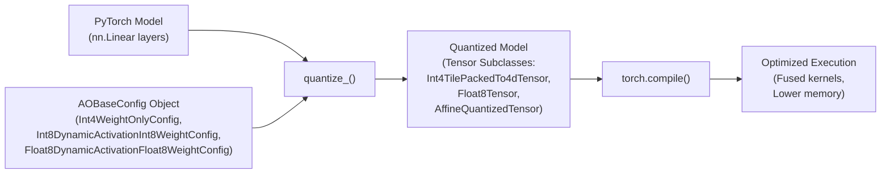
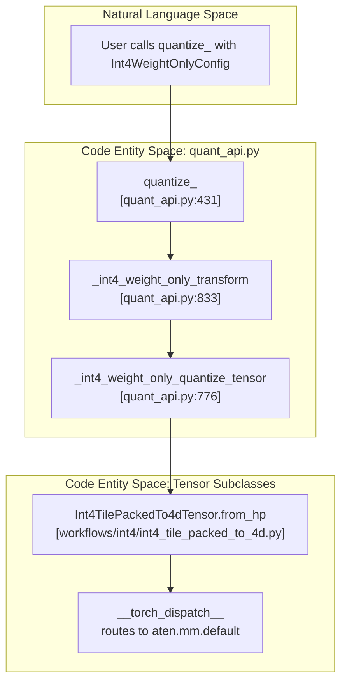
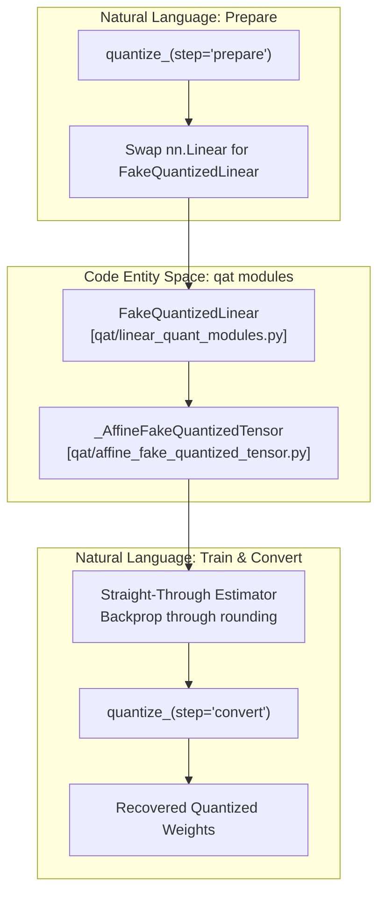

<!-- source: DeepWiki mcp.deepwiki.com · repo pytorch/ao · page 1.3 Quickstart Guide · fetched 2026-10-21 -->

# Quickstart Guide

<details>
<summary>Relevant source files</summary>

The following files were used as context for generating this wiki page:

- [README.md](README.md)
- [docs/source/api_reference/api_ref_prototype_attention.rst](docs/source/api_reference/api_ref_prototype_attention.rst)
- [docs/source/api_reference/index.rst](docs/source/api_reference/index.rst)
- [docs/source/eager_tutorials/first_quantization_example.rst](docs/source/eager_tutorials/first_quantization_example.rst)
- [docs/source/examples/prototype/low_precision_attention.py](docs/source/examples/prototype/low_precision_attention.py)
- [docs/source/workflows/index.md](docs/source/workflows/index.md)
- [test/integration/test_integration.py](test/integration/test_integration.py)
- [test/quantization/test_quant_api.py](test/quantization/test_quant_api.py)
- [test/quantization/test_quant_primitives.py](test/quantization/test_quant_primitives.py)
- [torchao/prototype/hqq/hqq_tinygemm_linear.py](torchao/prototype/hqq/hqq_tinygemm_linear.py)
- [torchao/quantization/README.md](torchao/quantization/README.md)
- [torchao/quantization/__init__.py](torchao/quantization/__init__.py)
- [torchao/quantization/qat/README.md](torchao/quantization/qat/README.md)
- [torchao/quantization/quant_api.py](torchao/quantization/quant_api.py)
- [torchao/quantization/quant_primitives.py](torchao/quantization/quant_primitives.py)
- [torchao/quantization/utils.py](torchao/quantization/utils.py)
- [tutorials/developer_api_guide/export_to_executorch.py](tutorials/developer_api_guide/export_to_executorch.py)
- [tutorials/developer_api_guide/my_dtype_tensor_subclass.py](tutorials/developer_api_guide/my_dtype_tensor_subclass.py)
- [tutorials/developer_api_guide/my_trainable_tensor_subclass.py](tutorials/developer_api_guide/my_trainable_tensor_subclass.py)
- [tutorials/developer_api_guide/tensor_parallel.py](tutorials/developer_api_guide/tensor_parallel.py)
- [tutorials/run_all.sh](tutorials/run_all.sh)

</details>


This guide provides quick examples of the most common TorchAO quantization workflows. It focuses on minimal code snippets to get you started quickly with Post-Training Quantization (PTQ), Quantization-Aware Training (QAT), and Float8 training.

For detailed API reference, see [Quantization API Reference](#2). For integration with external frameworks, see [Ecosystem Integrations](#1.4). For in-depth workflow documentation, see [Performance and Benchmarking](#11).

---

## Overview: Quantization Workflow

The following diagram shows how TorchAO transforms a standard PyTorch model into a quantized model:



Sources: [torchao/quantization/quant_api.py:431-504](), [README.md:61-80](), [torchao/core/config.py:10-25]()

---

## Post-Training Quantization (PTQ)

PTQ quantizes a pre-trained model without retraining. This is the simplest and fastest quantization method in TorchAO.

### Int4 Weight-Only Quantization

Int4 weight-only quantization reduces memory by 75% and provides significant speedups for inference:

```python
import torch
from torchao.quantization import quantize_, Int4WeightOnlyConfig

# Load your model
model = torch.nn.Sequential(
    torch.nn.Linear(1024, 512),
    torch.nn.Linear(512, 256)
)

# Quantize model weights to int4
# Recommended for CUDA: tile_packed_to_4d
quantize_(model, Int4WeightOnlyConfig(group_size=32, int4_packing_format="tile_packed_to_4d"))

# Run inference
input = torch.randn(1, 1024)
output = model(input)

# Optional: compile for better performance
model = torch.compile(model, mode="max-autotune")
```

**Key Parameters:**
- `group_size`: Granularity of quantization (32, 64, 128, 256). Smaller = finer granularity, larger accuracy preservation. [torchao/quantization/quant_api.py:840-845]()
- `int4_packing_format`: Packing format for different hardware targets (see table below). [torchao/quantization/quant_api.py:847-850]()
- `int4_choose_qparams_algorithm`: Algorithm for choosing quantization parameters (`"tinygemm"` or `"hqq"`). [torchao/quantization/quant_api.py:852-855]()

| Target Hardware | Recommended `int4_packing_format` |
|----------------|-----------------------------------|
| CUDA GPUs | `"tile_packed_to_4d"` |
| CPU (x86) | `"plain_int32"` |
| Intel XPU | `"plain_int32"` |

Sources: [torchao/quantization/quant_api.py:742-863](), [README.md:68-78](), [test/quantization/test_quant_api.py:362-398]()

### Int8 Dynamic Activation + Int8 Weight Quantization

Int8 dynamic quantization provides a balance between speed and accuracy by quantizing activations at runtime:

```python
from torchao.quantization import quantize_, Int8DynamicActivationInt8WeightConfig

model = torch.nn.Sequential(
    torch.nn.Linear(1024, 512),
    torch.nn.Linear(512, 256)
)

# Quantize both weights and activations to int8
quantize_(model, Int8DynamicActivationInt8WeightConfig())

# Activations are quantized dynamically at runtime
output = model(torch.randn(1, 1024))
```

Sources: [torchao/quantization/quant_api.py:1158-1232](), [test/integration/test_integration.py:111-122]()

### Float8 Dynamic Quantization (Inference)

Float8 quantization for inference requires SM 8.9+ GPUs (Ada, Hopper, Blackwell):

```python
from torchao.quantization import (
    quantize_,
    Float8DynamicActivationFloat8WeightConfig,
    PerRow
)

model = torch.nn.Sequential(
    torch.nn.Linear(1024, 512),
    torch.nn.Linear(512, 256)
).to("cuda").to(torch.bfloat16)

# Quantize with per-row scaling for better accuracy
quantize_(
    model,
    Float8DynamicActivationFloat8WeightConfig(granularity=PerRow())
)

output = model(torch.randn(1, 1024, device="cuda", dtype=torch.bfloat16))
```

**Granularity Options:**
- `PerTensor()`: Single scale for entire tensor (fastest). [torchao/quantization/granularity.py:27-32]()
- `PerRow()`: Per-row scaling (better accuracy). [torchao/quantization/granularity.py:34-39]()

Sources: [torchao/quantization/quant_api.py:1234-1300](), [test/quantization/test_quant_api.py:402-413]()

---

## PTQ Workflow Diagram

This diagram maps the natural language "Quantize to Int4" to specific code entities in the `quant_api.py` and tensor subclass layers.



Sources: [torchao/quantization/quant_api.py:431-504](), [torchao/quantization/quant_api.py:776-863]()

---

## Quantization-Aware Training (QAT)

QAT simulates quantization during training to recover accuracy lost from PTQ. It uses a prepare-train-convert workflow.

```python
import torch
from torchao.quantization import (
    quantize_,
    Int8DynamicActivationIntxWeightConfig,
    PerGroup
)
from torchao.quantization.qat import QATConfig

# 1. Define base quantization config
base_config = Int8DynamicActivationIntxWeightConfig(
    weight_dtype=torch.int4,
    weight_granularity=PerGroup(32),
)

# 2. Prepare model for QAT (inserts fake quantization)
model = torch.nn.Sequential(
    torch.nn.Linear(1024, 512),
    torch.nn.Linear(512, 256)
)
quantize_(model, QATConfig(base_config, step="prepare"))

# 3. Train model normally (fake quantization is active)
# The Straight-Through Estimator (STE) handles gradients
optimizer = torch.optim.Adam(model.parameters(), lr=1e-4)
# ... training loop ...

# 4. Convert to actual quantized model
quantize_(model, QATConfig(base_config, step="convert"))

# 5. Use quantized model for inference
output = model(torch.randn(1, 1024))
```

**QAT Benefits:**
- Recovers accuracy degradation from PTQ. [README.md:9-10]()
- Essential for low-bit quantization (int4 and below).
- Integrated with `Straight-Through Estimator` (STE) for gradient flow. [torchao/quantization/quant_primitives.py:225-235]()

Sources: [README.md:184-203](), [torchao/quantization/qat/README.md:1-6](), [test/quantization/test_quant_api.py:1028-1047]()

### QAT Workflow Diagram



Sources: [torchao/quantization/qat/__init__.py:1-26](), [test/quantization/test_quant_api.py:1028-1047](), [torchao/quantization/quant_primitives.py:225-235]()

---

## Float8 Training

Float8 training reduces memory and increases training speed by using FP8 for GEMMs in both forward and backward passes.

```python
import torch
from torchao.float8 import convert_to_float8_training

# Create model
model = torch.nn.Sequential(
    torch.nn.Linear(1024, 512),
    torch.nn.Linear(512, 256)
).to("cuda")

# Convert to float8 training
convert_to_float8_training(model)

# Train normally - forward/backward passes use FP8
optimizer = torch.optim.Adam(model.parameters())
# ... training loop ...
```

**Float8 Training Features:**
- Dynamic scaling of activations, weights, and gradients.
- Support for FSDP2 and Tensor Parallelism. [README.md:43-45]()
- Requires SM 8.9+ hardware. [torchao/utils.py:85-86]()

Sources: [README.md:210-221](), [torchao/float8/float8_linear.py]()

---

## Configuration Reference Table

| Config Class | Use Case | Weight Precision | Activation Precision | Hardware |
|--------------|----------|------------------|----------------------|----------|
| `Int4WeightOnlyConfig` | Inference, memory reduction | int4 | float16/bfloat16 | CUDA, CPU, XPU |
| `Int8WeightOnlyConfig` | Inference, balanced | int8 | float16/bfloat16 | CUDA, CPU, XPU |
| `Int8DynamicActivationInt8WeightConfig` | Inference, speed | int8 | int8 (dynamic) | CUDA, CPU, XPU |
| `Int8DynamicActivationIntxWeightConfig` | Inference, flexible | int1-8 | int8 (dynamic) | CUDA, CPU |
| `Float8WeightOnlyConfig` | Inference, high precision | float8 | float16/bfloat16 | SM 8.9+ |
| `Float8DynamicActivationFloat8WeightConfig` | Inference, best FP8 | float8 | float8 (dynamic) | SM 8.9+ |
| `QATConfig` | Training-aware quantization | Configurable | Configurable | CUDA, CPU |

Sources: [torchao/quantization/__init__.py:54-75](), [torchao/quantization/quant_api.py:742-1300]()

---

## Using torch.compile for Performance

For best performance, always apply `torch.compile` after quantization. TorchAO primitives are designed to fuse efficiently within the Inductor compiler. [torchao/quantization/quant_api.py:11-16]()

```python
from torchao.quantization import quantize_, Int4WeightOnlyConfig

model = torch.nn.Sequential(...)
quantize_(model, Int4WeightOnlyConfig(group_size=32))

# Compile for optimized execution
model = torch.compile(model, mode="max-autotune")

# First run triggers compilation
output = model(input)
```

Sources: [torchao/quantization/quant_api.py:11-16](), [README.md:55]()

---

