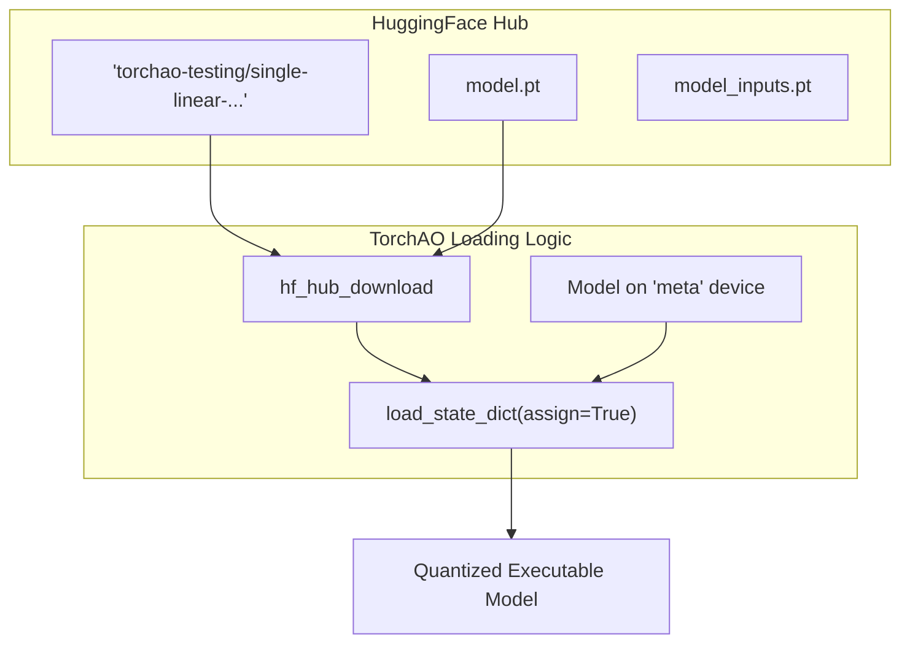
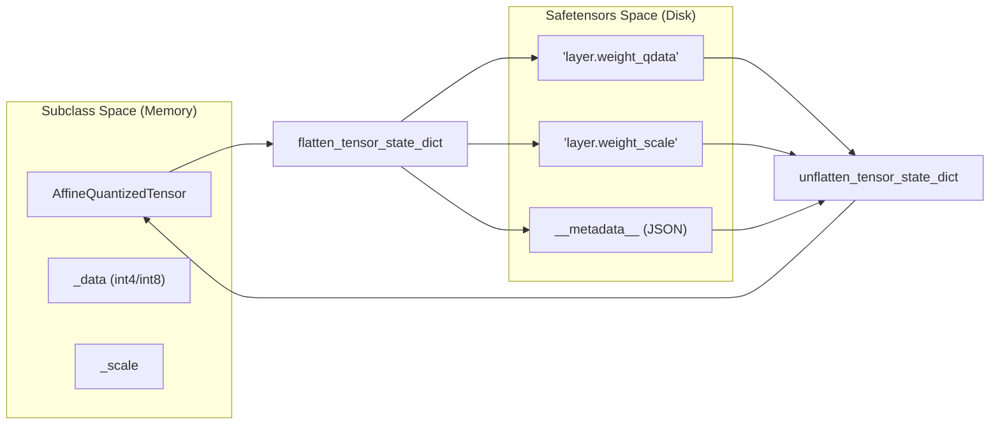

<!-- source: DeepWiki mcp.deepwiki.com · repo pytorch/ao · page 1.4 Ecosystem Integrations · fetched 2026-10-21 -->

# Ecosystem Integrations

Relevant source files

The following files were used as context for generating this wiki page:

- [docs/source/contributing/contributor_guide.rst](docs/source/contributing/contributor_guide.rst)
- [docs/source/contributing/index.rst](docs/source/contributing/index.rst)
- [docs/source/contributing/quantization_overview.rst](docs/source/contributing/quantization_overview.rst)
- [docs/source/contributing/sparsity.rst](docs/source/contributing/sparsity.rst)
- [docs/source/eager_tutorials/finetuning.rst](docs/source/eager_tutorials/finetuning.rst)
- [docs/source/eager_tutorials/pretraining.rst](docs/source/eager_tutorials/pretraining.rst)
- [docs/source/eager_tutorials/serialization.rst](docs/source/eager_tutorials/serialization.rst)
- [docs/source/eager_tutorials/serving.rst](docs/source/eager_tutorials/serving.rst)
- [docs/source/eager_tutorials/static_quantization.rst](docs/source/eager_tutorials/static_quantization.rst)
- [docs/source/eager_tutorials/subclass_advanced.rst](docs/source/eager_tutorials/subclass_advanced.rst)
- [docs/source/eager_tutorials/subclass_basic.rst](docs/source/eager_tutorials/subclass_basic.rst)
- [docs/source/eager_tutorials/torchao_hf_integration.md](docs/source/eager_tutorials/torchao_hf_integration.md)
- [docs/source/eager_tutorials/torchao_vllm_integration.md](docs/source/eager_tutorials/torchao_vllm_integration.md)
- [docs/source/pt2e_quantization/pt2e_quant_openvino_inductor.rst](docs/source/pt2e_quantization/pt2e_quant_openvino_inductor.rst)
- [docs/source/pt2e_quantization/pt2e_quant_ptq.rst](docs/source/pt2e_quantization/pt2e_quant_ptq.rst)
- [docs/source/pt2e_quantization/pt2e_quant_qat.rst](docs/source/pt2e_quantization/pt2e_quant_qat.rst)
- [docs/source/pt2e_quantization/pt2e_quant_x86_inductor.rst](docs/source/pt2e_quantization/pt2e_quant_x86_inductor.rst)
- [docs/source/pt2e_quantization/pt2e_quantizer.rst](docs/source/pt2e_quantization/pt2e_quantizer.rst)
- [test/integration/test_load_and_run_checkpoint.py](test/integration/test_load_and_run_checkpoint.py)
- [test/prototype/moe_training/test_fp8_grouped_mm.py](test/prototype/moe_training/test_fp8_grouped_mm.py)
- [test/prototype/safetensors/test_safetensors_support.py](test/prototype/safetensors/test_safetensors_support.py)
- [test/prototype/safetensors/test_safetensors_utils.py](test/prototype/safetensors/test_safetensors_utils.py)
- [test/prototype/test_autoround.py](test/prototype/test_autoround.py)
- [torchao/prototype/autoround/README.md](torchao/prototype/autoround/README.md)
- [torchao/prototype/autoround/core.py](torchao/prototype/autoround/core.py)
- [torchao/prototype/autoround/eval_autoround.py](torchao/prototype/autoround/eval_autoround.py)
- [torchao/prototype/safetensors/__init__.py](torchao/prototype/safetensors/__init__.py)
- [torchao/prototype/safetensors/safetensors_support.py](torchao/prototype/safetensors/safetensors_support.py)
- [torchao/prototype/safetensors/safetensors_utils.py](torchao/prototype/safetensors/safetensors_utils.py)

TorchAO is designed to work seamlessly with leading open-source frameworks for model training, serving, and deployment. This document covers integrations with HuggingFace, vLLM, ExecuTorch, TorchTune, and TorchTitan, as well as serialization formats like `safetensors`.

## HuggingFace Integration

TorchAO integrates with HuggingFace `transformers` via the `TorchAoConfig` class, which allows users to apply quantization during model loading. The integration supports various bit-widths and formats, including `int4`, `int8`, and `float8`.

### Checkpoint Loading and Compatibility
TorchAO maintains a suite of integration tests to ensure that quantized models can be loaded from HuggingFace Hub without breaking changes across library versions.

*   **BC Stability**: The `TestLoadAndRunCheckpoint` class verifies that models quantized with older versions of `Int4WeightOnlyConfig` or `Float8DynamicActivationFloat8WeightConfig` remain functional [test/integration/test_load_and_run_checkpoint.py:75-125]().
*   **Automatic Quantization**: `TorchAoConfig` (referenced in tutorials) maps HuggingFace parameters to `quantize_` calls [docs/source/eager_tutorials/serving.rst:14-18]().

**Sources**: [test/integration/test_load_and_run_checkpoint.py:31-62](), [docs/source/eager_tutorials/serving.rst:14-18]()

## vLLM and Serving

vLLM leverages TorchAO's optimized kernels to provide throughput improvements and VRAM reduction.

*   **Float8 Serving**: Using `float8` dynamic quantization in vLLM can result in ~36% VRAM reduction and 1.15x-1.2x speedup on H100 hardware [docs/source/eager_tutorials/serving.rst:54-55]().
*   **Kernel Integration**: vLLM automatically detects TorchAO-quantized models and dispatches to optimized kernels for inference [docs/source/eager_tutorials/serving.rst:26-34]().

**Sources**: [docs/source/eager_tutorials/serving.rst:23-58]()

## ExecuTorch and Mobile Deployment

For mobile and edge devices, TorchAO provides specialized quantization schemes that integrate with the ExecuTorch runtime.

*   **Mobile-Optimized Configs**: The `Int8DynamicActivationIntxWeightConfig` (8da4w) is specifically designed for mobile deployment via ExecuTorch [docs/source/eager_tutorials/serving.rst:116-120]().
*   **Weight Untying**: For models like Phi-4, TorchAO supports untying embedding weights from the `lm_head` to allow different quantization granularities for each, which is critical for maintaining accuracy on mobile [docs/source/eager_tutorials/serving.rst:121-160]().

**Sources**: [docs/source/eager_tutorials/serving.rst:116-178]()

## TorchTune and TorchTitan (Training)

TorchAO provides the underlying quantization and sparsity engines for PyTorch's primary training libraries.

### TorchTitan (Pre-training)
TorchTitan uses `torchao.float8` recipes to accelerate large-scale pre-training.
*   **Rowwise Scaling**: Prioritizes numerical stability and accuracy [docs/source/eager_tutorials/pretraining.rst:44-87]().
*   **Tensorwise Scaling**: Prioritizes throughput, achieving up to 1.21x speedup over bfloat16 baselines [docs/source/eager_tutorials/pretraining.rst:88-108]().

### TorchTune (Fine-tuning)
TorchTune integrates TorchAO for QAT and QLoRA workflows.
*   **QAT Workflow**: Uses the `prepare` and `convert` steps to simulate quantization during fine-tuning [docs/source/eager_tutorials/finetuning.rst:33-52]().
*   **QLoRA**: Reduces memory requirements by combining TorchAO's 4-bit quantization with low-rank adapters [docs/source/eager_tutorials/finetuning.rst:22-27]().

**Sources**: [docs/source/eager_tutorials/pretraining.rst:21-115](), [docs/source/eager_tutorials/finetuning.rst:16-52]()

## Serialization with Safetensors

TorchAO provides specialized support for the `safetensors` format to handle the complex state of tensor subclasses (e.g., weights, scales, and zero-points).

### Flattening and Unflattening Logic
Because `safetensors` only supports standard `torch.Tensor` types, TorchAO must "flatten" its subclasses into multiple tensors and metadata.

*   **`flatten_tensor_state_dict`**: Deconstructs a subclass into a dictionary of raw tensors and a JSON-encoded metadata string [torchao/prototype/safetensors/safetensors_support.py:117-164]().
*   **`unflatten_tensor_state_dict`**: Reconstructs the original subclass using the metadata and the raw tensors [torchao/prototype/safetensors/safetensors_support.py:16-62]().
*   **Supported Subclasses**: Includes `Float8Tensor`, `Int4Tensor`, `Int8Tensor`, `MXTensor`, and `NVFP4Tensor` [torchao/prototype/safetensors/safetensors_utils.py:51-60]().

**Sources**: [torchao/prototype/safetensors/safetensors_support.py:16-190](), [torchao/prototype/safetensors/safetensors_utils.py:30-60](), [test/prototype/safetensors/test_safetensors_support.py:94-129]()

## Partner Frameworks (Unsloth & Axolotl)

TorchAO is integrated into popular fine-tuning wrappers to provide QAT capabilities.

| Framework | Integration Detail | Command/API |
| :--- | :--- | :--- |
| **Unsloth** | LoRA + QAT integration | `qat_scheme="int4"` in `get_peft_model` |
| **Axolotl** | FSDP2 + QAT recipes | `axolotl train llama-3-qat.yaml` |

**Sources**: [docs/source/eager_tutorials/finetuning.rst:61-135]()

## Auto-Round Integration

Auto-Round is a calibration-based algorithm for low-bit LLM inference integrated into TorchAO's prototype namespace.

*   **Workflow**:
    1.  **Prepare**: `prepare_model_for_applying_auto_round_` inserts hooks and wraps parameters in `MultiTensor` [torchao/prototype/autoround/core.py:84-110]().
    2.  **Optimize**: Run forward passes with calibration data to tune rounding values [torchao/prototype/autoround/README.md:71-79]().
    3.  **Finalize**: `quantize_(model, apply_auto_round())` converts optimized weights to `AffineQuantizedTensor` [torchao/prototype/autoround/README.md:80-88]().
*   **MultiTensor**: Used to track calibration data across multiple batches without immediate memory overhead [torchao/prototype/autoround/core.py:124-126]().

**Sources**: [torchao/prototype/autoround/core.py:84-165](), [torchao/prototype/autoround/README.md:36-88](), [test/prototype/test_autoround.py:96-132]()

---

