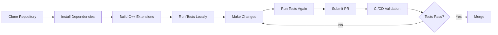
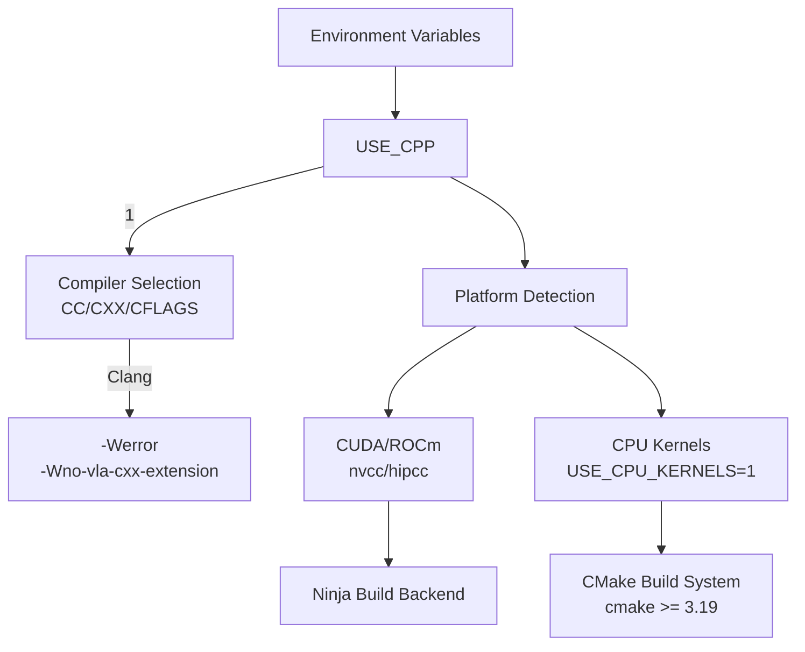
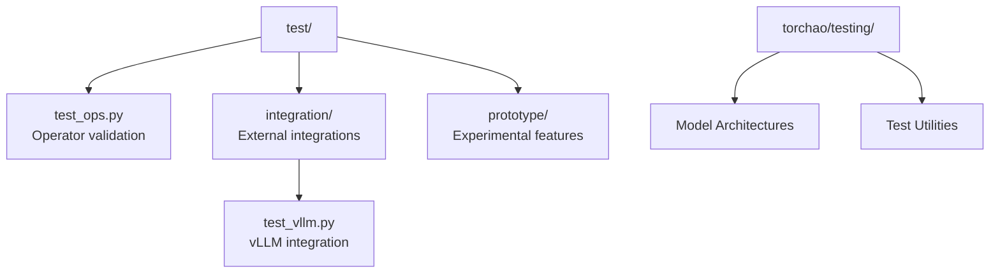
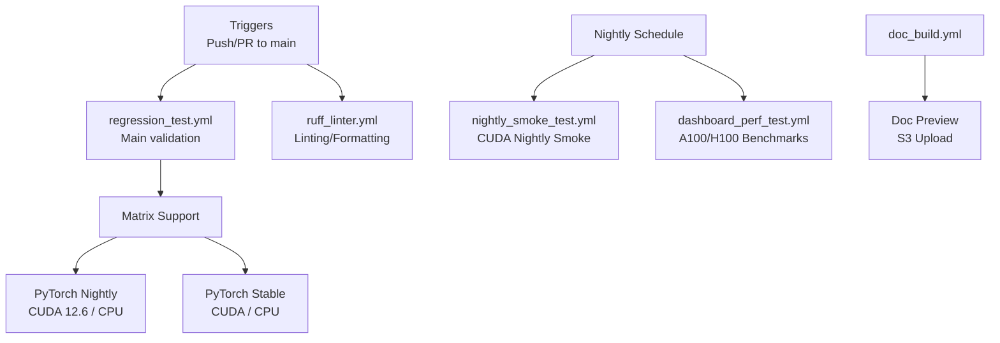

<!-- source: DeepWiki mcp.deepwiki.com · repo pytorch/ao · page 10 Developer Guide · fetched 2026-10-21 -->

# Developer Guide

<details>
<summary>Relevant source files</summary>

The following files were used as context for generating this wiki page:

- [.github/workflows/dashboard_perf_test.yml](.github/workflows/dashboard_perf_test.yml)
- [.github/workflows/doc_build.yml](.github/workflows/doc_build.yml)
- [.github/workflows/nightly_smoke_test.yml](.github/workflows/nightly_smoke_test.yml)
- [.github/workflows/regression_test.yml](.github/workflows/regression_test.yml)
- [.github/workflows/ruff_linter.yml](.github/workflows/ruff_linter.yml)
- [.github/workflows/run_microbenchmarks.yml](.github/workflows/run_microbenchmarks.yml)
- [.github/workflows/run_tutorials.yml](.github/workflows/run_tutorials.yml)
- [.pre-commit-config.yaml](.pre-commit-config.yaml)
- [benchmarks/dashboard/ci_microbenchmark_runner.py](benchmarks/dashboard/ci_microbenchmark_runner.py)
- [benchmarks/dashboard/microbenchmark_quantization_config.yml](benchmarks/dashboard/microbenchmark_quantization_config.yml)
- [dev-requirements.txt](dev-requirements.txt)
- [docs/README.md](docs/README.md)
- [docs/requirements.txt](docs/requirements.txt)
- [docs/source/conf.py](docs/source/conf.py)
- [docs/source/llms.txt](docs/source/llms.txt)
- [docs/static/fp8-loss-curves.png](docs/static/fp8-loss-curves.png)
- [ruff.toml](ruff.toml)

</details>


## Purpose and Scope

This guide covers the development workflow, build system, testing infrastructure, and CI/CD pipeline for contributors to TorchAO. It provides practical information for building, testing, and submitting changes to the codebase.

For detailed information on specific aspects:
- Build system configuration and compilation flags: see [Build System](#10.1)
- Test structure and utilities: see [Testing Infrastructure](#10.2)
- GitHub Actions workflows and test matrices: see [CI/CD Pipeline](#10.3)
- Contribution process and code standards: see [Contributing Guidelines](#10.4)

---

## Development Workflow Overview

The typical development workflow follows these stages:



**Development Workflow Stages**

Sources: [.github/workflows/regression_test.yml:55-83](), [dev-requirements.txt:1-36]()

### Initial Setup

1. **Clone the repository with submodules**:
   ```bash
   git clone --recursive https://github.com/pytorch/ao
   cd ao
   ```

2. **Install Python dependencies**:
   ```bash
   pip install -r dev-requirements.txt
   ```

3. **Build and install TorchAO**:
   ```bash
   pip install . --no-build-isolation
   ```

The `--no-build-isolation` flag is critical for development as it allows the build to utilize your current environment's dependencies (like `ninja` or `cmake`) and ensures the built extensions are compatible with the installed PyTorch version.

Sources: [.github/workflows/regression_test.yml:77-80](), [dev-requirements.txt:27-32]()

### Running Tests

```bash
# Run all tests
pytest test --verbose -s

# Run specific test file
pytest test/test_ops.py -v
```

Sources: [.github/workflows/regression_test.yml:83](), [.github/workflows/nightly_smoke_test.yml:42]()

---

## Build System Architecture

The build system is managed via `setup.py` and uses `TorchAOBuildExt` to handle complex C++ and CUDA extensions.

### Build Configuration Hierarchy



**Build System Configuration Flow**

Sources: [.github/workflows/regression_test.yml:56-72](), [dev-requirements.txt:27-32]()

### Key Build Options

| Variable | Context | Purpose |
|----------|---------|---------|
| `CC` / `CXX` | Compiler Setup | Sets the C/C++ compiler (e.g., `clang`, `gcc`) |
| `CFLAGS` | Compiler Flags | Pass specific flags like `-Werror` to the build |
| `USE_CPU_KERNELS` | CPU Optimization | Enables x86 CPU `aten_kernels` (off by default) |
| `LD_LIBRARY_PATH` | Runtime | Ensures the linker finds Conda/system libraries |

Sources: [.github/workflows/regression_test.yml:64-82]()

---

## Testing Infrastructure

TorchAO uses `pytest` for its testing suite, supported by a variety of utilities in `dev-requirements.txt`.

### Test Organization



**Test Directory Structure**

Sources: [.github/workflows/regression_test.yml:83](), [dev-requirements.txt:1-10]()

### Testing Best Practices

- **Use Parametrization**: Utilize the `parameterized` library for testing across dtypes and shapes.
- **Hypothesis**: Use for property-based testing to avoid test derandomization warnings.
- **Expecttest**: Used for golden-value testing (e.g., checking IR output).

Sources: [dev-requirements.txt:4-9]()

---

## CI/CD Pipeline

TorchAO employs GitHub Actions for rigorous validation across hardware and software configurations.

### CI Workflow Architecture



**CI/CD Workflow Structure**

Sources: [.github/workflows/regression_test.yml:1-44](), [.github/workflows/nightly_smoke_test.yml:1-11](), [.github/workflows/dashboard_perf_test.yml:1-11](), [.github/workflows/doc_build.yml:1-19]()

### Specialized Workflows

- **Regression Tests**: Runs on `linux.g5.12xlarge` (NVIDIA GPU) and `linux.4xlarge` (CPU) runners.
- **Performance Benchmarking**: Runs nightly on A100 (`mt-l-x86iavx512-11-125-a100`) and H100 (`mt-l-x86iamx-22-225-h100`) to track latency for models like Llama 3.1.
- **Microbenchmarks**: Executed via `ci_microbenchmark_runner.py` to track kernel-level performance on the HUD dashboard.
- **Tutorial Validation**: Ensures that all code in the `tutorials/` directory remains functional.

Sources: [.github/workflows/regression_test.yml:27-39](), [.github/workflows/dashboard_perf_test.yml:14-63](), [.github/workflows/run_microbenchmarks.yml:14-78](), [.github/workflows/run_tutorials.yml:11-41]()

---

## Contributing Guidelines

### Code Style and Linting

TorchAO enforces strict linting and formatting using `ruff`.

- **Linter**: Configured in `ruff.toml` to select `F` (Pyflakes) and `I` (Isort) rules.
- **Pre-commit**: Hooks are used for trailing whitespace, end-of-file fixers, and copyright header checks.
- **Automatic Fixes**: The `ruff_linter.yml` workflow can automatically apply fixes to PR branches via `workflow_dispatch`.

Sources: [ruff.toml:1-15](), [.pre-commit-config.yaml:1-40](), [.github/workflows/ruff_linter.yml:78-95]()

### Documentation

- **Build System**: Uses Sphinx with the `pytorch_sphinx_theme2`.
- **Mermaid Diagrams**: Supported via `sphinxcontrib.mermaid`.
- **Deployment**: Docs are built on every push to `main` and deployed to `gh-pages`, with versioned folders (e.g., `main/`, `1.12/`).

Sources: [docs/source/conf.py:26-57](), [.github/workflows/doc_build.yml:132-164]()

---

## Summary

The TorchAO developer experience is centered around a robust CI/CD pipeline and a flexible build system. For more details, visit the specific guides:
- [Build System](#10.1)
- [Testing Infrastructure](#10.2)
- [CI/CD Pipeline](#10.3)
- [Contributing Guidelines](#10.4)

---

