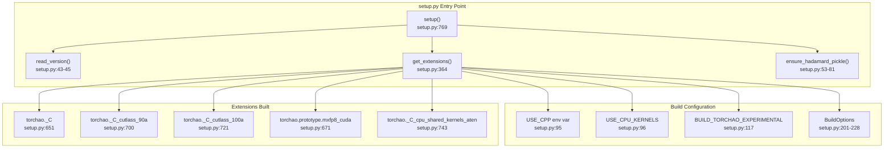
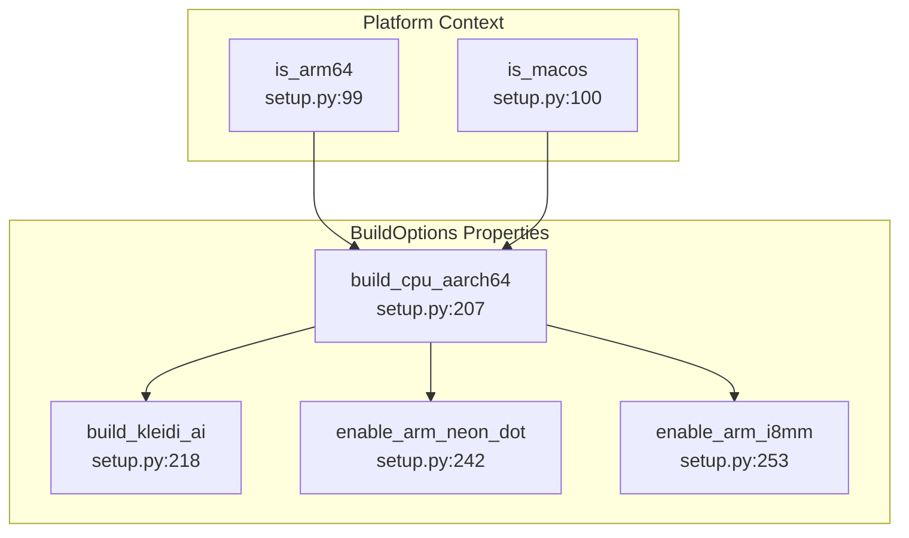
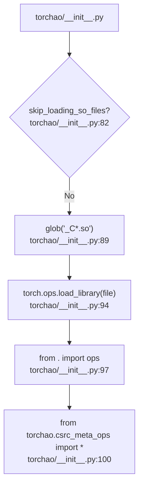

<!-- source: DeepWiki mcp.deepwiki.com · repo pytorch/ao · page 10.1 Build System · fetched 2026-10-21 -->

# Build System

Relevant source files

The following files were used as context for generating this wiki page:

- [.github/workflows/build_wheels_linux_aarch64.yml](.github/workflows/build_wheels_linux_aarch64.yml)
- [.github/workflows/build_wheels_linux_x86.yml](.github/workflows/build_wheels_linux_x86.yml)
- [packaging/env_var_script_linux.sh](packaging/env_var_script_linux.sh)
- [packaging/post_build_script.sh](packaging/post_build_script.sh)
- [packaging/pre_build_script.sh](packaging/pre_build_script.sh)
- [packaging/smoke_test.py](packaging/smoke_test.py)
- [setup.py](setup.py)
- [test/test_ops.py](test/test_ops.py)
- [torchao/__init__.py](torchao/__init__.py)
- [torchao/csrc/cpu/CMakeLists.txt](torchao/csrc/cpu/CMakeLists.txt)
- [torchao/csrc/cpu/README.md](torchao/csrc/cpu/README.md)
- [torchao/csrc/cpu/aten_kernels/da8w4_linear.cpp](torchao/csrc/cpu/aten_kernels/da8w4_linear.cpp)
- [torchao/csrc/cpu/aten_kernels/float8_linear.cpp](torchao/csrc/cpu/aten_kernels/float8_linear.cpp)
- [torchao/csrc/cpu/aten_kernels/quantized_sdpa.cpp](torchao/csrc/cpu/aten_kernels/quantized_sdpa.cpp)
- [torchao/csrc/cpu/aten_kernels/scaled_embedding_bag.cpp](torchao/csrc/cpu/aten_kernels/scaled_embedding_bag.cpp)
- [torchao/csrc/cpu/aten_kernels/utils.h](torchao/csrc/cpu/aten_kernels/utils.h)
- [torchao/csrc/cpu/shared_kernels/Utils.cmake](torchao/csrc/cpu/shared_kernels/Utils.cmake)
- [torchao/experimental/CMakeLists.txt](torchao/experimental/CMakeLists.txt)
- [torchao/ops.py](torchao/ops.py)
- [torchao/prototype/inductor/qsdpa_lowering.py](torchao/prototype/inductor/qsdpa_lowering.py)

This document describes the TorchAO build system, including `setup.py` structure, build options, and extension compilation. It covers the two-tier build architecture (setuptools + CMake), hardware backend detection, and how to build from source.

For testing infrastructure, see page 10.2. For CI/CD pipelines, see page 10.3.

## Build System Architecture

TorchAO uses a two-tier build system implemented through `setup.py` and CMake:

1.  **Primary build system**: `setup.py` using PyTorch's `cpp_extension` framework (`BuildExtension`, `CUDAExtension`, `CppExtension`) [setup.py:141-150]().
2.  **Experimental build system**: CMake-based builds located in `torchao/experimental/` and `torchao/csrc/cpu/` for advanced CPU kernels [torchao/experimental/CMakeLists.txt:1-12]().

The primary system compiles most extensions, while the experimental system handles specialized CPU kernels for ARM64, Kleidi AI integration, and MPS operations [setup.py:116-125]().

**Build System Component Diagram**

Sources: [setup.py:364-762](), [setup.py:201-228](), [setup.py:769-785]()

## Build Environment Variables

The build system is controlled by environment variables read in `setup.py`:

| Variable | Description | Default | Read At |
| :--- | :--- | :--- | :--- |
| `USE_CPP` | Enable/disable all C++ extensions | `"1"` | [setup.py:95]() |
| `USE_CPU_KERNELS` | Enable optimized CPU kernels (AVX512, etc.) | `"0"` | [setup.py:96]() |
| `TORCHAO_BUILD_CPU_AARCH64` | Build ARM64 CPU kernels | `True` (ARM macOS) | [setup.py:207-210]() |
| `TORCHAO_BUILD_KLEIDIAI` | Kleidi AI library integration | `False` | [setup.py:218-220]() |
| `DEBUG` | Enable debug mode (`-g`, `-O0`) | `"0"` | [setup.py:137-138]() |
| `TORCH_CUDA_ARCH_LIST` | Target CUDA architectures | `8.0;8.6;9.0` | [packaging/env_var_script_linux.sh:17-20]() |

### Platform Detection Variables

These are computed automatically in `setup.py`:

| Variable | Condition | Code Location |
| :--- | :--- | :--- |
| `is_arm64` | `platform.machine()` is `arm64`/`aarch64` | [setup.py:99]() |
| `is_macos` | `platform.system() == "Darwin"` | [setup.py:100]() |
| `is_linux` | `platform.system() == "Linux"` | [setup.py:101]() |
| `build_macos_arm_auto` | `USE_CPP=="1" and is_arm64 and is_macos` | [setup.py:104]() |

Sources: [setup.py:95-104](), [packaging/env_var_script_linux.sh:23-38]()

## BuildOptions Class

The `BuildOptions` class manages platform-specific build flags for experimental extensions [setup.py:201-228]().

**BuildOptions Dependency Chain**

Sources: [setup.py:201-258]()

## C++ and CUDA Kernels

TorchAO implements high-performance kernels for various hardware targets.

### CPU Kernels (AVX-512 / AMX)
CPU kernels often include optimized paths for AVX-512 and AMX (Advanced Matrix Extensions) through `at::native::cpublas` [torchao/csrc/cpu/aten_kernels/da8w4_linear.cpp:15-21]().

- **da8w4_linear**: Dynamically quantized linear layer with 8-bit activations and 4-bit weights. It uses VNNI (Vector Neural Network Instructions) when available [torchao/csrc/cpu/aten_kernels/da8w4_linear.cpp:88-90]().
- **float8_linear**: Supports FP8 inference on CPU with optional VNNI packing [torchao/csrc/cpu/aten_kernels/float8_linear.cpp:81-86]().
- **qscaled_dot_product**: Quantized Scaled Dot Product Attention (SDPA) with fusion for dequantization and masking [torchao/csrc/cpu/aten_kernels/quantized_sdpa.cpp:101-136]().

### Custom Operator Registration
Operators are registered via `torch.library` to support both eager execution and `torch.compile` [torchao/ops.py:12-48]().

| Operator | Implementation | Source |
| :--- | :--- | :--- |
| `qscaled_dot_product` | CPU (AVX512) | [torchao/csrc/cpu/aten_kernels/quantized_sdpa.cpp:29]() |
| `da8w4_linear_cpu` | CPU (AMX/VNNI) | [torchao/csrc/cpu/aten_kernels/da8w4_linear.cpp:6]() |
| `float8_linear_cpu` | CPU (FP8) | [torchao/csrc/cpu/aten_kernels/float8_linear.cpp:12]() |
| `_scaled_embedding_bag` | CPU (AVX512) | [torchao/csrc/cpu/aten_kernels/scaled_embedding_bag.cpp:46]() |

Sources: [torchao/ops.py:12-48](), [torchao/csrc/cpu/aten_kernels/utils.h:88-101]()

## Extension Loading at Runtime

Built extensions are loaded at runtime through `torchao/__init__.py`.

**Runtime Loader Flow**

The system performs version checks to ensure the installed PyTorch version is compatible with the prebuilt binaries [torchao/__init__.py:70-80](). Users can override this by setting `TORCHAO_FORCE_SKIP_LOADING_SO_FILES=1` [torchao/__init__.py:53-63]().

Sources: [torchao/__init__.py:47-103]()

## Packaging and Distribution

TorchAO uses `auditwheel` on Linux to repair wheels, ensuring they are `manylinux` compliant [packaging/post_build_script.sh:16-41]().

**Packaging Process**
1.  **Pre-build**: Sourcing environment variables like `TORCH_CUDA_ARCH_LIST` [packaging/env_var_script_linux.sh:17]().
2.  **Build**: Running `setup.py bdist_wheel`.
3.  **Post-build**: Repairing the wheel with `auditwheel` (excluding core PyTorch libraries like `libtorch.so`) [packaging/post_build_script.sh:31-40]().
4.  **Smoke Test**: Installing the new wheel and importing `torchao` [packaging/post_build_script.sh:52-53]().

Sources: [packaging/post_build_script.sh:1-54](), [packaging/env_var_script_linux.sh:1-38]()

---

