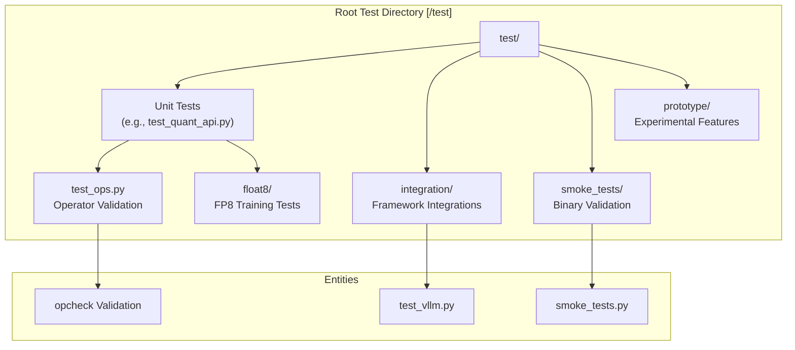
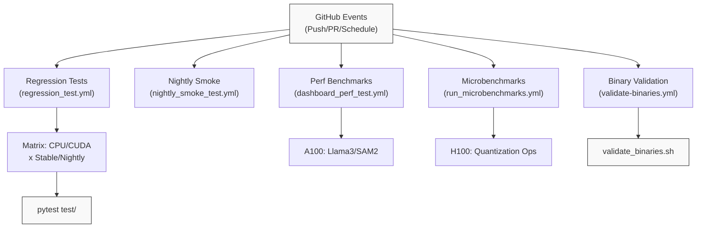

<!-- source: DeepWiki mcp.deepwiki.com · repo pytorch/ao · page 10.2 Testing Infrastructure · fetched 2026-10-21 -->

# Testing Infrastructure

<details>
<summary>Relevant source files</summary>

The following files were used as context for generating this wiki page:

- [.github/scripts/validate_binaries.sh](.github/scripts/validate_binaries.sh)
- [.github/workflows/claude-code.yml](.github/workflows/claude-code.yml)
- [.github/workflows/dashboard_perf_test.yml](.github/workflows/dashboard_perf_test.yml)
- [.github/workflows/nightly_smoke_test.yml](.github/workflows/nightly_smoke_test.yml)
- [.github/workflows/regression_test.yml](.github/workflows/regression_test.yml)
- [.github/workflows/run_microbenchmarks.yml](.github/workflows/run_microbenchmarks.yml)
- [.github/workflows/run_tutorials.yml](.github/workflows/run_tutorials.yml)
- [.github/workflows/validate-binaries.yml](.github/workflows/validate-binaries.yml)
- [CLAUDE.md](CLAUDE.md)
- [benchmarks/dashboard/ci_microbenchmark_runner.py](benchmarks/dashboard/ci_microbenchmark_runner.py)
- [benchmarks/dashboard/microbenchmark_quantization_config.yml](benchmarks/dashboard/microbenchmark_quantization_config.yml)
- [dev-requirements.txt](dev-requirements.txt)
- [scripts/test_torch_version_torchao_version_compatibility.sh](scripts/test_torch_version_torchao_version_compatibility.sh)
- [test/smoke_tests/smoke_tests.py](test/smoke_tests/smoke_tests.py)
- [version.txt](version.txt)

</details>


This document describes TorchAO's testing infrastructure, including test organization, test utilities, operator validation, CI/CD workflows, and local testing procedures.

## Test Organization

TorchAO organizes tests into a hierarchical structure with unit tests, integration tests, and specialized test suites for different components.

### Directory Structure



**Sources:** [CLAUDE.md:43-47](), [.github/scripts/validate_binaries.sh:1-7]()

### Test Categories

| Category | Purpose | Example |
|---------|---------|---------|
| **Unit Tests** | Tests for stable APIs like `quantize_`, `float8`, and `sparsity`. | `test/quantization/test_quant_api.py` |
| **Integration** | Validates interoperability with external libraries like vLLM. | `test/integration/test_vllm.py` |
| **Smoke Tests** | Minimal tests to verify installation and basic imports. | `test/smoke_tests/smoke_tests.py` |
| **Prototype** | Tests for experimental features that may change. | `test/prototype/mx_formats/` |
| **Regression** | CI jobs that run the full suite against multiple PyTorch versions. | `.github/workflows/regression_test.yml` |

**Sources:** [CLAUDE.md:9-14](), [CLAUDE.md:43-47](), [.github/scripts/validate_binaries.sh:1-7]()

## CI/CD Testing Pipeline

TorchAO uses GitHub Actions to ensure stability across hardware (CPU, CUDA, H100, A100) and software (Nightly vs. Stable PyTorch) configurations.

### Workflow Architecture



**Sources:** [.github/workflows/regression_test.yml:21-44](), [.github/workflows/dashboard_perf_test.yml:1-14](), [.github/workflows/run_microbenchmarks.yml:1-14](), [.github/workflows/validate-binaries.yml:1-37]()

### Regression Test Matrix
The regression workflow tests the codebase against specific environment configurations to prevent breaking changes.

*   **Nightly Matrix**: Tests against the latest PyTorch nightlies for both CUDA 12.6 and CPU targets [.github/workflows/regression_test.yml:21-44]().
*   **Stable Matrix**: Validates compatibility with specific versions like PyTorch 2.12.0 [.github/workflows/regression_test.yml:84-102]().
*   **Compiler Variants**: Includes specific runs using `clang` to exercise CPU kernels (`USE_CPU_KERNELS=1`) [.github/workflows/regression_test.yml:56-72]().

**Sources:** [.github/workflows/regression_test.yml:21-102]()

## Performance and Microbenchmarks

TorchAO tracks performance regressions through specialized nightly workflows that upload results to the PyTorch OSS benchmark database.

### Microbenchmark Infrastructure
The `Microbenchmarks-Perf-Nightly` workflow runs daily on H100 runners (`mt-l-x86iamx-22-225-h100`) [.github/workflows/run_microbenchmarks.yml:1-14]().

1.  **Runner**: `ci_microbenchmark_runner.py` [.benchmarks/dashboard/ci_microbenchmark_runner.py:76-78]().
2.  **Configuration**: Defined in `microbenchmark_quantization_config.yml`, targeting linear layers for models like `llama4`, `deepseek_v3`, and `gemma3` [.benchmarks/dashboard/microbenchmark_quantization_config.yml:10-18]().
3.  **Metrics**: Captures Forward Speedup, Bfloat16 Time (ms), Quantized Time (ms), and Peak Allocated Memory [.benchmarks/dashboard/ci_microbenchmark_runner.py:128-176]().

### Model-Level Benchmarks
The `A100-perf-nightly` workflow validates end-to-end model performance [.github/workflows/dashboard_perf_test.yml:1-14]().
*   **Llama 3.1-8B**: Benchmarks `generate.py` with `torch.compile` and `compile_prefill` [.github/workflows/dashboard_perf_test.yml:55-63]().
*   **SAM 2.1**: Benchmarks Segment Anything Model 2.1 using `use_autoquant` [.github/workflows/dashboard_perf_test.yml:74-79]().

**Sources:** [.github/workflows/run_microbenchmarks.yml:14](), [.benchmarks/dashboard/ci_microbenchmark_runner.py:128-176](), [.github/workflows/dashboard_perf_test.yml:55-79]()

## Testing Best Practices

### Local Development Workflow
Developers should follow the setup and test routine defined in the project guidelines:

1.  **Environment Setup**: Install with `dev-requirements.txt` and build extensions without isolation [.github/workflows/regression_test.yml:77-80]().
    ```bash
    pip install -r dev-requirements.txt
    pip install . --no-build-isolation
    ```
2.  **Test Execution**: Use `pytest` to run specific subdirectories or files [CLAUDE.md:44-47]().
    ```bash
    pytest test/quantization/test_quant_api.py
    pytest test/float8/
    ```

### Dependency Management
Test dependencies are centralized in `dev-requirements.txt`, which includes:
*   **Frameworks**: `pytest`, `hypothesis`, `parameterized`.
*   **External Models**: `transformers`, `sentencepiece`.
*   **Profiling**: `matplotlib`, `pandas`, `tabulate`.
*   **Extensions**: `ninja`, `cmake`.

**Sources:** [dev-requirements.txt:1-36](), [CLAUDE.md:38-47]()

### Binary Validation
Before release, binaries are validated using `validate_binaries.sh`. This script:
1.  Installs `torchao` from the specified index [.github/scripts/validate_binaries.sh:1]().
2.  Runs `smoke_tests.py` to ensure basic importability [.github/scripts/validate_binaries.sh:3]().
3.  Installs full dev-requirements and runs the entire `pytest` suite [.github/scripts/validate_binaries.sh:5-6]().

**Sources:** [.github/scripts/validate_binaries.sh:1-6](), [.github/workflows/validate-binaries.yml:38-50]()

---

