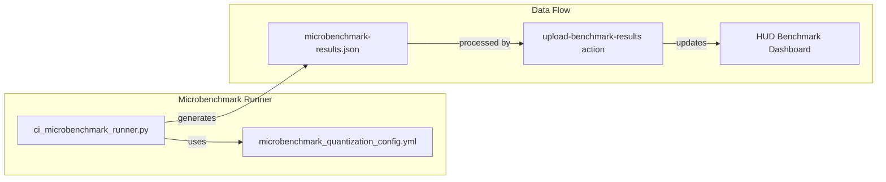

<!-- source: DeepWiki mcp.deepwiki.com · repo pytorch/ao · page 10.3 CI/CD Pipeline · fetched 2026-10-21 -->

# CI/CD Pipeline

<details>
<summary>Relevant source files</summary>

The following files were used as context for generating this wiki page:

- [.github/pytorch-probot.yml](.github/pytorch-probot.yml)
- [.github/scripts/ci_test_xpu.sh](.github/scripts/ci_test_xpu.sh)
- [.github/workflows/1xH100_tests.yml](.github/workflows/1xH100_tests.yml)
- [.github/workflows/1xL4_tests.yml](.github/workflows/1xL4_tests.yml)
- [.github/workflows/4xH100_tests.yml](.github/workflows/4xH100_tests.yml)
- [.github/workflows/dashboard_perf_test.yml](.github/workflows/dashboard_perf_test.yml)
- [.github/workflows/nightly_smoke_test.yml](.github/workflows/nightly_smoke_test.yml)
- [.github/workflows/regression_test.yml](.github/workflows/regression_test.yml)
- [.github/workflows/regression_test_rocm.yml](.github/workflows/regression_test_rocm.yml)
- [.github/workflows/run_microbenchmarks.yml](.github/workflows/run_microbenchmarks.yml)
- [.github/workflows/run_tutorials.yml](.github/workflows/run_tutorials.yml)
- [.github/workflows/xpu_test.yml](.github/workflows/xpu_test.yml)
- [benchmarks/dashboard/ci_microbenchmark_runner.py](benchmarks/dashboard/ci_microbenchmark_runner.py)
- [benchmarks/dashboard/microbenchmark_quantization_config.yml](benchmarks/dashboard/microbenchmark_quantization_config.yml)
- [benchmarks/prototype/moe_training/bench_moe_layer.py](benchmarks/prototype/moe_training/bench_moe_layer.py)
- [benchmarks/prototype/moe_training/benchmark_moe_layer_fsdp.py](benchmarks/prototype/moe_training/benchmark_moe_layer_fsdp.py)
- [dev-requirements.txt](dev-requirements.txt)
- [test/prototype/moe_training/test_everything.sh](test/prototype/moe_training/test_everything.sh)
- [test/prototype/mx_formats/test_mxfp8_allgather.py](test/prototype/mx_formats/test_mxfp8_allgather.py)
- [test/prototype/mx_formats/test_mxfp8_allgather.sh](test/prototype/mx_formats/test_mxfp8_allgather.sh)

</details>


## Purpose and Scope

This document describes TorchAO's continuous integration and deployment infrastructure, which automates testing, building, and releasing the library. The CI/CD system uses GitHub Actions to run tests across multiple PyTorch versions, hardware configurations (CUDA, ROCm, CPU, XPU), and quantization formats. It also handles documentation builds, performance benchmarking, and nightly wheel uploads to PyPI.

For information about the build system that produces the artifacts tested here, see [Build System](#10.1). For details on the test infrastructure and local testing, see [Testing Infrastructure](#10.2).

## Workflow Architecture

The CI/CD pipeline consists of multiple GitHub Actions workflows, each serving a specific purpose:

```mermaid
graph TB
    subgraph "Trigger Events"
        Push["Push to main/gh/**"]
        PR["Pull Request"]
        Schedule["Scheduled (Nightly)"]
        Tag["Tag Push (ciflow/*)"]
        Manual["workflow_dispatch"]
    end
    
    subgraph "Core Testing Workflows"
        RegressionTest["regression_test.yml<br/>CUDA + CPU tests<br/>PyTorch 2.12 + nightly"]
        RegressionROCm["regression_test_rocm.yml<br/>ROCm 7.2 tests<br/>gfx942 hardware"]
        NightlySmoke["nightly_smoke_test.yml<br/>CUDA nightly validation<br/>Scheduled 6am PST"]
        XPUTest["xpu_test.yml<br/>Intel XPU tests<br/>Scheduled + ciflow/xpu"]
    end
    
    subgraph "GPU-Specific Testing"
        H100Single["1xH100_tests.yml<br/>Integration tests<br/>Float8 single GPU<br/>MX formats"]
        H100Multi["4xH100_tests.yml<br/>Multi-GPU FSDP tests<br/>Float8 + MX AllGather"]
        L4Tests["1xL4_tests.yml<br/>SM-89 tests<br/>Float8 validation"]
    end
    
    subgraph "Build & Deploy Workflows"
        WheelBuild["build_wheels_linux.yml<br/>Linux wheel matrix<br/>CUDA/ROCm/CPU/XPU<br/>Upload to PyPI"]
        DocBuild["doc_build.yml<br/>Sphinx documentation<br/>Deploy to gh-pages"]
    end
    
    subgraph "Quality & Performance"
        PerfBench["dashboard_perf_test.yml<br/>A100 benchmarks<br/>Llama3, SAM2<br/>Upload to dashboard"]
        MicroBench["run_microbenchmarks.yml<br/>H100 microbenchmarks<br/>Scheduled 7am UTC"]
        Tutorials["run_tutorials.yml<br/>Tutorial validation<br/>A100 hardware"]
    end
    
    Push --> RegressionTest
    PR --> RegressionTest
    Push --> RegressionROCm
    Schedule --> RegressionROCm
    Tag --> XPUTest
    
    Push --> H100Single
    PR --> H100Single
    Tag --> H100Multi
    Tag --> L4Tests
    
    Push --> WheelBuild
    Schedule --> WheelBuild
    PR --> WheelBuild
    
    Push --> DocBuild
    PR --> DocBuild
    
    Schedule --> NightlySmoke
    Schedule --> PerfBench
    Schedule --> MicroBench
    Tag --> PerfBench
    Tag --> Tutorials
```



**Sources:** [.github/workflows/regression_test.yml](), [.github/workflows/regression_test_rocm.yml](), [.github/workflows/1xH100_tests.yml](), [.github/workflows/4xH100_tests.yml](), [.github/workflows/1xL4_tests.yml](), [.github/workflows/dashboard_perf_test.yml](), [.github/workflows/nightly_smoke_test.yml](), [.github/workflows/run_tutorials.yml](), [.github/workflows/xpu_test.yml](), [.github/workflows/run_microbenchmarks.yml]()

## Trigger Mechanisms

All workflows use GitHub Actions event triggers with concurrency controls to prevent duplicate runs. Specialized workflows are gated by specific `ciflow` tags managed via `.github/pytorch-probot.yml`.

| Trigger Type | Events | Example Workflows |
|-------------|--------|------------------|
| **Push** | Commits to `main`, `gh/**` branches | `regression_test.yml`, `doc_build.yml` |
| **Pull Request** | PRs to `main`, `gh/**` branches | Most testing workflows |
| **Schedule** | Cron expressions for nightly runs | `nightly_smoke_test.yml` (6am PST), `run_microbenchmarks.yml` (7am UTC) |
| **Tag** | Pattern-based tags (`ciflow/*`) | `4xH100_tests.yml` (`ciflow/4xh100/*`), `xpu_test.yml` (`ciflow/xpu/*`) |
| **Manual** | `workflow_dispatch` for on-demand execution | All workflows support manual triggering |

### Concurrency Configuration

All workflows implement concurrency controls to cancel in-progress runs when new commits are pushed:

[.github/workflows/regression_test.yml:13-15]()
```yaml
concurrency:
  group: regression_test-${{ github.workflow }}-${{ github.ref == 'refs/heads/main' && github.run_number || github.ref }}
  cancel-in-progress: true
```

**Sources:** [.github/workflows/regression_test.yml:3-15](), [.github/pytorch-probot.yml:1-8]()

## Test Matrix System

### Regression Test Matrix

The primary regression workflow (`regression_test.yml`) tests TorchAO across multiple PyTorch versions and hardware configurations. It specifically exercises the `USE_CPU_KERNELS=1` flag for x86 CPU aten_kernels when using the Clang compiler [.github/workflows/regression_test.yml:72]().

| Configuration | Runner | PyTorch Version | GPU Type |
|--------------|--------|----------------|----------|
| CUDA Nightly | `linux.g5.12xlarge.nvidia.gpu` | `--pre torch --index-url .../cu126` | CUDA 12.6 |
| CPU Nightly | `linux.4xlarge` | `--pre torch --index-url .../cpu` | N/A |
| CPU Nightly (Clang) | `linux.4xlarge` | `--pre torch --index-url .../cpu` | N/A (Clang CC/CXX) |
| CUDA 2.12 | `linux.g5.12xlarge.nvidia.gpu` | `torch==2.12.0` | CUDA 12.6 |
| CPU 2.12 | `linux.4xlarge` | `torch==2.12.0` | N/A |

**Sources:** [.github/workflows/regression_test.yml:21-102]()

### ROCm Test Configuration

ROCm testing runs on AMD hardware (gfx942) with ROCm 7.2:

[.github/workflows/regression_test_rocm.yml:23-28]()

| Configuration | Runner | PyTorch Version | GPU Type | Docker Image |
|--------------|--------|----------------|----------|--------------|
| ROCM Nightly | `linux.rocm.gpu.gfx942.1` | `--pre torch --index-url .../rocm7.2` | gfx942 | `pytorch/manylinux2_28-builder:rocm7.2` |

**Sources:** [.github/workflows/regression_test_rocm.yml:18-51]()

### XPU Test Configuration

Intel XPU tests are executed on `linux.idc.xpu` runners using a specialized Docker image `ci-image:pytorch-linux-noble-xpu-n-py3` [.github/workflows/xpu_test.yml:29-31](). The workflow executes the `ci_test_xpu.sh` script, which installs `pytorch-triton-xpu` [.github/scripts/ci_test_xpu.sh:12]().

**Sources:** [.github/workflows/xpu_test.yml](), [.github/scripts/ci_test_xpu.sh]()

## GPU-Specific Test Suites

### H100 Single and Multi-GPU Tests

The H100 workflows focus on high-performance features like Float8, MX formats, and MoE training.

**Single GPU (1xH100):**
- Integration tests [.github/workflows/1xH100_tests.yml:68]()
- Affine Quantized Float [.github/workflows/1xH100_tests.yml:69]()
- Float8 Workflows [.github/workflows/1xH100_tests.yml:70]()
- MoE Training (FP8/MXFP8 grouped MM) [.github/workflows/1xH100_tests.yml:75-77]()
- GPTQ prototype tests [.github/workflows/1xH100_tests.yml:78]()

**Multi-GPU (4xH100):**
- Float8 distributed training via `./test/float8/test_everything_multi_gpu.sh` [.github/workflows/4xH100_tests.yml:64]()
- MXFP8 AllGather via `./test/prototype/mx_formats/test_mxfp8_allgather.sh` [.github/workflows/4xH100_tests.yml:65]()

**Sources:** [.github/workflows/1xH100_tests.yml](), [.github/workflows/4xH100_tests.yml]()

## Performance Benchmarking

### Dashboard and Microbenchmarks

TorchAO maintains two primary performance tracking mechanisms:

1.  **A100-perf-nightly**: Runs model-level benchmarks (Llama 3.1 8B) on A100 GPUs and uploads results to the OSS benchmark database [.github/workflows/dashboard_perf_test.yml:12-88]().
2.  **Microbenchmarks-Perf-Nightly**: Runs daily microbenchmarks on H100 GPUs via `ci_microbenchmark_runner.py` [.github/workflows/run_microbenchmarks.yml:72-78]().



**Sources:** [.github/workflows/dashboard_perf_test.yml](), [.github/workflows/run_microbenchmarks.yml](), [benchmarks/dashboard/ci_microbenchmark_runner.py]()

## Environment and Dependencies

### Dev Requirements

The CI environment relies on `dev-requirements.txt` for testing utilities and prototype dependencies.

| Category | Packages |
|----------|----------|
| **Testing** | `pytest`, `hypothesis`, `expecttest`, `parameterized` |
| **Transformers** | `transformers`, `sentencepiece`, `tiktoken` |
| **Prototype/Bench** | `bitsandbytes`, `pandas`, `matplotlib`, `tabulate`, `lm_eval` |
| **Build/Lint** | `ninja`, `cmake`, `ruff`, `pre-commit` |

**Sources:** [dev-requirements.txt:1-36]()

### Environment Setup Pattern

A standard setup pattern is used across H100 and A100 runners to handle egress limitations and speed up installation by pre-installing pure-python dependencies from an in-cluster cache:

[.github/workflows/1xH100_tests.yml:59-67]()
1.  Install pure-python deps: `filelock`, `typing-extensions`, `setuptools`, `sympy`, `networkx`, `jinja2`, `fsspec`, `numpy`, `pillow`, `spmd-types`.
2.  Clear `PIP_EXTRA_INDEX_URL` to prevent accidental `+cpu` torch installation.
3.  Install specific torch nightly via `--index-url`.
4.  Install `dev-requirements.txt` using `uv` for speed.
5.  Install `torchao` with `--no-build-isolation`.

**Sources:** [.github/workflows/1xH100_tests.yml:46-67](), [.github/workflows/4xH100_tests.yml:45-63](), [.github/workflows/dashboard_perf_test.yml:44-51]()

---

