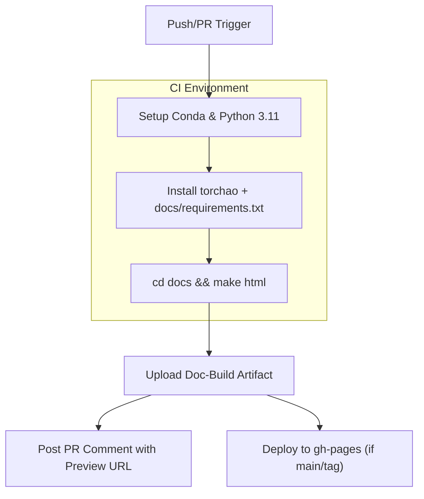
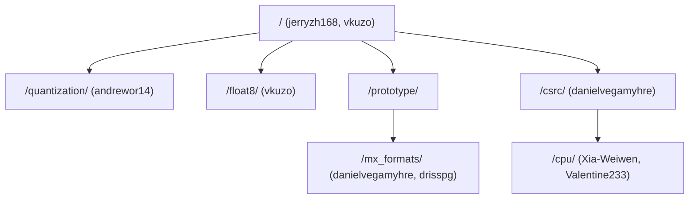

<!-- source: DeepWiki mcp.deepwiki.com · repo pytorch/ao · page 10.4 Contributing Guidelines · fetched 2026-10-21 -->

# Contributing Guidelines

<details>
<summary>Relevant source files</summary>

The following files were used as context for generating this wiki page:

- [.github/ISSUE_TEMPLATE/bug_report.yml](.github/ISSUE_TEMPLATE/bug_report.yml)
- [.github/ISSUE_TEMPLATE/feature_request.yml](.github/ISSUE_TEMPLATE/feature_request.yml)
- [.github/ISSUE_TEMPLATE/performance_regression.yml](.github/ISSUE_TEMPLATE/performance_regression.yml)
- [.github/merge_rules.yaml](.github/merge_rules.yaml)
- [.github/scripts/github_utils.py](.github/scripts/github_utils.py)
- [.github/scripts/gitutils.py](.github/scripts/gitutils.py)
- [.github/scripts/label_utils.py](.github/scripts/label_utils.py)
- [.github/scripts/trymerge.py](.github/scripts/trymerge.py)
- [.github/scripts/trymerge_explainer.py](.github/scripts/trymerge_explainer.py)
- [.github/workflows/doc_build.yml](.github/workflows/doc_build.yml)
- [.github/workflows/ruff_linter.yml](.github/workflows/ruff_linter.yml)
- [.github/workflows/trymerge.yml](.github/workflows/trymerge.yml)
- [.pre-commit-config.yaml](.pre-commit-config.yaml)
- [CODEOWNERS](CODEOWNERS)
- [CODE_OF_CONDUCT.md](CODE_OF_CONDUCT.md)
- [CONTRIBUTING.md](CONTRIBUTING.md)
- [LICENSE](LICENSE)
- [docs/README.md](docs/README.md)
- [docs/requirements.txt](docs/requirements.txt)
- [docs/source/conf.py](docs/source/conf.py)
- [docs/source/llms.txt](docs/source/llms.txt)
- [docs/static/fp8-loss-curves.png](docs/static/fp8-loss-curves.png)
- [examples/sam2_amg_server/amg_example.py](examples/sam2_amg_server/amg_example.py)
- [ruff.toml](ruff.toml)

</details>


This page provides technical guidance for developers contributing code, tests, and documentation to the TorchAO repository. It covers the linting requirements, documentation build system, the `trymerge` workflow, and repository ownership.

## Pull Request Workflow

TorchAO follows a standard fork-and-pull-request model. Contributors are expected to fork the repository and create branches from `main` [CONTRIBUTING.md:8]().

### Contributor Checklist
1. **Tests**: If adding code, include corresponding tests [CONTRIBUTING.md:9]().
2. **Documentation**: If changing APIs, update the documentation [CONTRIBUTING.md:10]().
3. **Linting**: Ensure code passes the `ruff` check and format requirements [CONTRIBUTING.md:12]().
4. **CLA**: Complete the Meta Contributor License Agreement at [https://code.facebook.com/cla](https://code.facebook.com/cla) [CONTRIBUTING.md:26]().

### Pull Request Templates
The repository provides specialized templates for different types of contributions:
* **Feature Request**: Used to suggest new features, specifying the problem solved and the proposed user-facing API [.github/ISSUE_TEMPLATE/feature_request.yml:1-34]().
* **Bug Report**: Used for reporting issues with clear reproduction steps.
* **Performance Regression**: Specifically for tracking performance drops.

**Sources:** [CONTRIBUTING.md:1-44](), [.github/ISSUE_TEMPLATE/feature_request.yml:1-34]()

---

## Coding Style and Linting

TorchAO enforces a strict linting policy using `ruff`. The entire repository is linted except for specific third-party exclusions [ruff.toml:1-10]().

### Linting Configuration
The project uses `ruff` version `0.11.6` [.github/workflows/ruff_linter.yml:63]().

| Rule Set | Description | Configuration File |
| :--- | :--- | :--- |
| **F** | Pyflakes (Errors) | [ruff.toml:3]() |
| **I** | Isort (Import sorting) | [ruff.toml:3]() |
| **F821, F823, W191** | Isolated checks (Undefined names, etc) | [.pre-commit-config.yaml:30]() |

### Automated Fixes
Contributors can trigger an automated lint fix by running:
```bash
ruff check --fix
ruff format .
```
[CONTRIBUTING.md:19-20]()

A GitHub Action is also available to fix PRs automatically via `workflow_dispatch` [.github/workflows/ruff_linter.yml:78-95]().

### Copyright Headers
All source files (`.py`, `.cu`, `.h`, `.sh`, `.metal`) must include the appropriate copyright headers. This is enforced via a local `pre-commit` hook that runs `scripts/check_copyright_header.py` [.pre-commit-config.yaml:32-40]().

**Sources:** [ruff.toml:1-15](), [.pre-commit-config.yaml:1-40](), [.github/workflows/ruff_linter.yml:61-77](), [CONTRIBUTING.md:15-21]()

---

## Documentation System

TorchAO documentation is built using Sphinx and hosted on GitHub Pages.

### Documentation Build Stack
The build environment is defined in `docs/requirements.txt` and `docs/source/conf.py`.

| Component | Role | Version / Reference |
| :--- | :--- | :--- |
| **Sphinx** | Core documentation engine | `7.2.6` [docs/requirements.txt:1]() |
| **PyTorch Theme** | Visual styling | `pytorch-sphinx_theme2` [docs/source/conf.py:26]() |
| **Mermaid** | Diagram rendering | `sphinxcontrib-mermaid` [docs/source/conf.py:53]() |
| **MyST Parser** | Markdown support | `myst-parser` [docs/requirements.txt:12]() |
| **Sphinx Gallery** | Tutorial generation | [docs/source/conf.py:59-65]() |

### Build Workflow
Documentation is built automatically on pushes to `main` and `release/*` branches [.github/workflows/doc_build.yml:3-11]().



The deployment logic distinguishes between the `main` branch (deployed to `/main/`) and tags (e.g., `v0.1.0` deployed to `/0.1/`) [.github/workflows/doc_build.yml:145-158]().

**Sources:** [docs/requirements.txt:1-13](), [docs/source/conf.py:29-57](), [.github/workflows/doc_build.yml:1-164]()

---

## The Trymerge Workflow

TorchAO uses a `trymerge` system to validate and land Pull Requests. This workflow is triggered by a `repository_dispatch` event [.github/workflows/trymerge.yml:4-5]().

### Merge Logic
The process is managed by `PyTorch MergeBot` [.github/workflows/trymerge.yml:37](). The bot executes `.github/scripts/trymerge.py` which handles:
* **Validation**: Ensuring CI checks have passed.
* **Force Merge**: Optional `--force` flag for emergency overrides [.github/workflows/trymerge.yml:55]().
* **Rebase**: Support for rebasing the PR before merging [.github/workflows/trymerge.yml:46]().

### Merge Record
Every successful or failed merge attempt is recorded and uploaded to an S3 bucket for auditing [.github/workflows/trymerge.yml:78-85]().

**Sources:** [.github/workflows/trymerge.yml:1-91]()

---

## CODEOWNERS and Maintainership

The `CODEOWNERS` file defines the individuals responsible for reviewing changes in specific areas of the codebase.

### Ownership Mapping

| Area | Path | Owners |
| :--- | :--- | :--- |
| **Global Defaults** | `*` | @jerryzh168 @vkuzo |
| **Quantization** | `/torchao/quantization/` | @jerryzh168 @andrewor14 |
| **Float8** | `/torchao/float8/` | @vkuzo |
| **MX Formats** | `/torchao/prototype/mx_formats/` | @danielvegamyhre @vkuzo @drisspg |
| **Sparsity** | `/torchao/sparsity/` | @jerryzh168 |
| **Optimizers** | `/torchao/optim/` | @gau-nernst |
| **Kernels/C++** | `/torchao/kernel/`, `/torchao/csrc/` | @danielvegamyhre |
| **X86 Specific** | `torchao/csrc/cpu/` | @Xia-Weiwen @Valentine233 |



**Sources:** [CODEOWNERS:1-38]()

---

