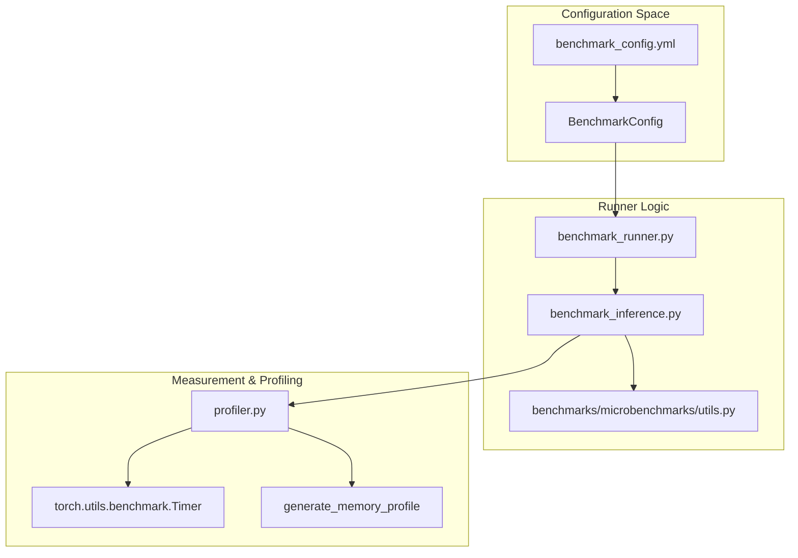
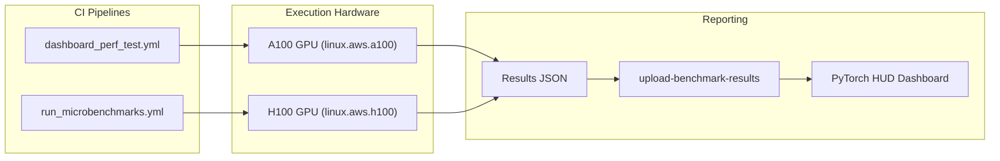

<!-- source: DeepWiki mcp.deepwiki.com · repo pytorch/ao · page 11 Performance and Benchmarking · fetched 2026-10-21 -->

# Performance and Benchmarking

<details>
<summary>Relevant source files</summary>

The following files were used as context for generating this wiki page:

- [.github/workflows/dashboard_perf_test.yml](.github/workflows/dashboard_perf_test.yml)
- [.github/workflows/nightly_smoke_test.yml](.github/workflows/nightly_smoke_test.yml)
- [.github/workflows/regression_test.yml](.github/workflows/regression_test.yml)
- [.github/workflows/run_microbenchmarks.yml](.github/workflows/run_microbenchmarks.yml)
- [.github/workflows/run_tutorials.yml](.github/workflows/run_tutorials.yml)
- [benchmarks/dashboard/ci_microbenchmark_runner.py](benchmarks/dashboard/ci_microbenchmark_runner.py)
- [benchmarks/dashboard/microbenchmark_quantization_config.yml](benchmarks/dashboard/microbenchmark_quantization_config.yml)
- [benchmarks/microbenchmarks/README.md](benchmarks/microbenchmarks/README.md)
- [benchmarks/microbenchmarks/benchmark_inference.py](benchmarks/microbenchmarks/benchmark_inference.py)
- [benchmarks/microbenchmarks/benchmark_runner.py](benchmarks/microbenchmarks/benchmark_runner.py)
- [benchmarks/microbenchmarks/profiler.py](benchmarks/microbenchmarks/profiler.py)
- [benchmarks/microbenchmarks/test/benchmark_config.yml](benchmarks/microbenchmarks/test/benchmark_config.yml)
- [benchmarks/microbenchmarks/test/test_benchmark_inference.py](benchmarks/microbenchmarks/test/test_benchmark_inference.py)
- [benchmarks/microbenchmarks/test/test_benchmark_profiler.py](benchmarks/microbenchmarks/test/test_benchmark_profiler.py)
- [benchmarks/microbenchmarks/test/test_benchmark_runner.py](benchmarks/microbenchmarks/test/test_benchmark_runner.py)
- [benchmarks/microbenchmarks/test/test_utils.py](benchmarks/microbenchmarks/test/test_utils.py)
- [benchmarks/microbenchmarks/utils.py](benchmarks/microbenchmarks/utils.py)
- [dev-requirements.txt](dev-requirements.txt)
- [test/test_model_architecture.py](test/test_model_architecture.py)

</details>


TorchAO provides comprehensive tools for measuring and analyzing quantization performance. The benchmarking infrastructure spans from simple utility functions for timing and memory measurement to sophisticated roofline modeling and CI/CD integration. This page covers the core benchmarking APIs, performance results, and hardware-specific considerations.

For detailed information on specific topics, see:
- [Benchmarking Tools](#11.1) — Detailed documentation on `benchmark_model`, roofline analysis, and profiling.
- [Performance Results](#11.2) — Speedups, memory savings, and accuracy metrics for various recipes.
- [Hardware-Specific Optimizations](#11.3) — Guides for Ampere, Hopper, Blackwell, x86, and ARM.

## Core Benchmarking Utilities

TorchAO provides several core utilities in `torchao/utils.py` for performance measurement:

### benchmark_model Function

The `benchmark_model` function provides a device-agnostic way to measure model inference time. It supports CUDA, XPU, CPU, and MPS devices with appropriate synchronization for each backend [torchao/utils.py:60-129]().

**Usage Example:**
```python
from torchao.utils import benchmark_model

model = MyModel().cuda()
input_tensor = torch.randn(1, 3, 224, 224).cuda()

# Benchmark the model
time_ms = benchmark_model(model, num_runs=100, args=(input_tensor,))
print(f"Average inference time: {time_ms:.2f} ms")
```

### profiler_runner Function

The `profiler_runner` function runs a function under the PyTorch profiler and exports a Chrome trace for visualization [torchao/utils.py:131-141]().

**Usage Example:**
```python
from torchao.utils import profiler_runner

def my_inference():
    return model(input_tensor)

result = profiler_runner("trace.json", my_inference)
# Open chrome://tracing and load trace.json
```

### get_model_size_in_bytes Function

The `get_model_size_in_bytes` function calculates the total size of a model in bytes, with support for nested tensor subclasses and optional embedding exclusion [torchao/utils.py:260-287]().

Sources: [torchao/utils.py:60-287](), [torchao/quantization/utils.py]()

## Microbenchmarking System

TorchAO includes a robust microbenchmarking suite designed to measure the performance of individual layers and model components across different quantization and sparsity configurations.

### Architecture and Flow

The microbenchmarking system orchestrates model creation, quantization, and performance measurement.



### Key Components
- **`BenchmarkConfig`**: Encapsulates quantization/sparsity settings, matrix shapes (M, K, N), and hardware parameters [benchmarks/microbenchmarks/utils.py:49-106]().
- **`benchmark_inference.py`**: The main execution engine that creates models using `create_model_and_input_data`, applies `quantize_` or `sparsify_`, and measures inference time [benchmarks/microbenchmarks/benchmark_inference.py:79-186]().
- **`profiler.py`**: Provides specialized functions like `generate_model_profile` and `generate_memory_profile` for deep analysis [benchmarks/microbenchmarks/profiler.py]().

Sources: [benchmarks/microbenchmarks/benchmark_runner.py:9-32](), [benchmarks/microbenchmarks/benchmark_inference.py:13-36](), [benchmarks/microbenchmarks/utils.py:49-144](), [benchmarks/microbenchmarks/README.md:1-101]()

## Performance Results and Hardware

TorchAO maintains comprehensive benchmark results across different hardware configurations, tracked via automated CI dashboards.

### CI/CD Performance Tracking

TorchAO uses GitHub Actions to run nightly performance tests and upload results to an OSS benchmark database.



### Hardware-Specific Performance
Performance varies significantly based on GPU compute capability. The system utilizes hardware-specific kernels such as:
- **Triton Kernels**: Used for `int4wo` and integer matrix multiplications [benchmarks/microbenchmarks/utils.py:28-32]().
- **CUDA/H100**: Targeted for high-performance FP8 and quantized training benchmarks [benchmarks/microbenchmarks/test/test_benchmark_profiler.py:123-157]().
- **CPU**: Performance optimized for x86 with AVX-512/AMX and AArch64 [benchmarks/microbenchmarks/utils.py:42-46]().

Sources: [.github/workflows/dashboard_perf_test.yml:1-87](), [.github/workflows/run_microbenchmarks.yml:1-87](), [.github/workflows/regression_test.yml:21-44](), [benchmarks/microbenchmarks/README.md:103-155]()

## Accuracy Benchmarking

Quantization is a trade-off between performance and accuracy. TorchAO integrates with evaluation harnesses to measure this impact.

- **SQNR Calculation**: The `compute_error` function calculates Signal-to-Quantization-Noise Ratio to measure quality [torchao/quantization/utils.py]().
- **LM Eval Integration**: Used in model-level benchmarks to measure perplexity on tasks like wikitext [benchmarks/microbenchmarks/README.md:20-25]().
- **Autoquant**: Automatically selects the best configuration by benchmarking multiple `qtensor_class` variants and choosing the one with the best latency-accuracy profile [benchmarks/microbenchmarks/README.md:79-88]().

Sources: [benchmarks/microbenchmarks/benchmark_inference.py:152-180](), [benchmarks/microbenchmarks/utils.py:147-171](), [dev-requirements.txt:20-24]()

---

