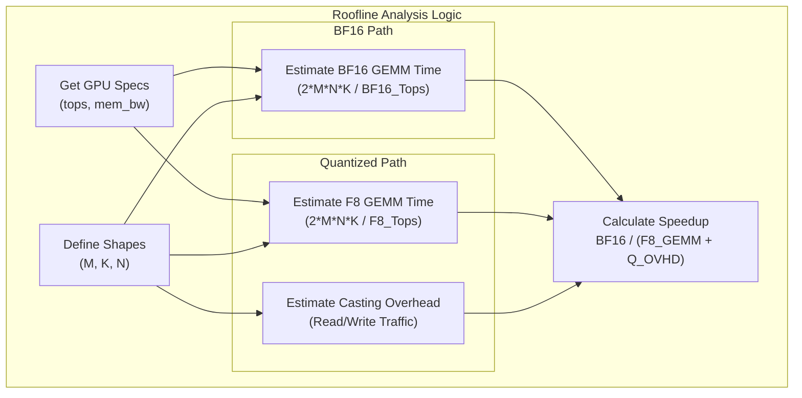

<!-- source: DeepWiki mcp.deepwiki.com · repo pytorch/ao · page 11.1 Benchmarking Tools · fetched 2026-10-21 -->

# Benchmarking Tools

<details>
<summary>Relevant source files</summary>

The following files were used as context for generating this wiki page:

- [.github/workflows/dashboard_perf_test.yml](.github/workflows/dashboard_perf_test.yml)
- [.github/workflows/nightly_smoke_test.yml](.github/workflows/nightly_smoke_test.yml)
- [.github/workflows/regression_test.yml](.github/workflows/regression_test.yml)
- [.github/workflows/run_microbenchmarks.yml](.github/workflows/run_microbenchmarks.yml)
- [.github/workflows/run_tutorials.yml](.github/workflows/run_tutorials.yml)
- [benchmarks/dashboard/ci_microbenchmark_runner.py](benchmarks/dashboard/ci_microbenchmark_runner.py)
- [benchmarks/dashboard/microbenchmark_quantization_config.yml](benchmarks/dashboard/microbenchmark_quantization_config.yml)
- [benchmarks/float8/bench_matmul.py](benchmarks/float8/bench_matmul.py)
- [benchmarks/float8/float8_inference_roofline.py](benchmarks/float8/float8_inference_roofline.py)
- [benchmarks/float8/float8_roofline.py](benchmarks/float8/float8_roofline.py)
- [benchmarks/float8/utils.py](benchmarks/float8/utils.py)
- [benchmarks/microbenchmarks/README.md](benchmarks/microbenchmarks/README.md)
- [benchmarks/microbenchmarks/benchmark_inference.py](benchmarks/microbenchmarks/benchmark_inference.py)
- [benchmarks/microbenchmarks/benchmark_runner.py](benchmarks/microbenchmarks/benchmark_runner.py)
- [benchmarks/microbenchmarks/profiler.py](benchmarks/microbenchmarks/profiler.py)
- [benchmarks/microbenchmarks/test/benchmark_config.yml](benchmarks/microbenchmarks/test/benchmark_config.yml)
- [benchmarks/microbenchmarks/test/test_benchmark_inference.py](benchmarks/microbenchmarks/test/test_benchmark_inference.py)
- [benchmarks/microbenchmarks/test/test_benchmark_profiler.py](benchmarks/microbenchmarks/test/test_benchmark_profiler.py)
- [benchmarks/microbenchmarks/test/test_benchmark_runner.py](benchmarks/microbenchmarks/test/test_benchmark_runner.py)
- [benchmarks/microbenchmarks/test/test_utils.py](benchmarks/microbenchmarks/test/test_utils.py)
- [benchmarks/microbenchmarks/utils.py](benchmarks/microbenchmarks/utils.py)
- [benchmarks/prototype/blockwise_fp8_training/bench_linear_roofline.py](benchmarks/prototype/blockwise_fp8_training/bench_linear_roofline.py)
- [dev-requirements.txt](dev-requirements.txt)
- [docs/source/workflows/inference.md](docs/source/workflows/inference.md)
- [test/prototype/mx_formats/test_mx_mm.py](test/prototype/mx_formats/test_mx_mm.py)
- [test/test_model_architecture.py](test/test_model_architecture.py)
- [torchao/testing/training/roofline_utils.py](torchao/testing/training/roofline_utils.py)

</details>


This page documents the benchmarking and profiling utilities provided by TorchAO for measuring quantization performance, kernel efficiency, and model accuracy. These tools enable users to evaluate the impact of quantization on model speed, memory usage, and numerical precision across various hardware targets including NVIDIA (H100, B200), AMD (MI300X), and Intel (XPU).

## Overview

TorchAO provides a multi-tiered benchmarking infrastructure:

1.  **Core Utilities**: Device-agnostic timing and profiling functions in `torchao.utils`.
2.  **Roofline Analysis**: Scripts to estimate theoretical benefits of Float8/MX formats based on hardware specs and memory traffic modeling.
3.  **Microbenchmark Runner**: A systematic framework for benchmarking specific (M, K, N) shapes across different quantization and sparsity configurations.
4.  **CI/Dashboard Benchmarking**: Automated nightly performance tracking on A100/H100/B200 runners.

## Core Benchmarking Utilities

### benchmark_model Function
The `benchmark_model` function provides standardized timing for model execution with automatic synchronization for CUDA, MPS, XPU, and CPU.

[torchao/utils.py:67-136]()

```python
def benchmark_model(model, num_runs, args=(), kwargs=None, device_type=None):
    """Benchmark model runs with `args` and `kwargs` both are optional"""
```

### profiler_runner Function
Captures detailed execution traces for Chrome tracing visualization, recording both CPU and CUDA activities.

[torchao/utils.py:138-148]()

```python
def profiler_runner(path, fn, *args, **kwargs):
    with torch.profiler.profile(...) as prof:
        result = fn(*args, **kwargs)
    prof.export_chrome_trace(path)
```

## Roofline Analysis Tools

Roofline modeling helps determine if a kernel is compute-bound or memory-bound. TorchAO provides specialized scripts to estimate speedups for Float8 and MX formats before full implementation.

### Implementation Logic
The roofline tools calculate the difference in end-to-end GPU kernel time between high-precision (BF16) and quantized (Float8/MX) execution.


Sources: [benchmarks/float8/float8_roofline.py:7-39](), [torchao/testing/training/roofline_utils.py:126-161]()

### Float8 Training & Inference Roofline
- **float8_roofline.py**: Models the forward and backward passes (input, weight, and grad_output gradients) for training. It assumes `torch.compile` fuses quantization into preceding ops [benchmarks/float8/float8_roofline.py:35-39]().
- **float8_inference_roofline.py**: Focuses on the `ReLU -> Linear` pattern common in inference. It evaluates if `(bf16_activation_time + bf16_gemm_time) > (quant_overhead + fp8_gemm_time)` [benchmarks/float8/float8_inference_roofline.py:110-114]().

### Hardware Specifications
Specifications for H100, B200, MI300X, and others are maintained in `gpu_name_to_specs`, including peak TOPS and achievable memory bandwidth percentages [torchao/testing/training/roofline_utils.py:18-99]().

## Microbenchmark Runner

The `benchmark_runner.py` and associated utilities provide a systematic way to test specific kernels against baselines.

### BenchmarkConfig and Result
The system uses `BenchmarkConfig` to define quantization (e.g., `int4wo`, `float8dq`), sparsity, and shapes [benchmarks/microbenchmarks/utils.py:49-83](). Results are captured in `BenchmarkResult` including eager vs. compiled speedups [benchmarks/microbenchmarks/utils.py:109-126]().

### Key Functions
- **string_to_config**: Maps string identifiers (like "int8dq") to `AOBaseConfig` objects [benchmarks/microbenchmarks/utils.py:147-172]().
- **do_benchmarks**: Measures time/tops for a given function, handling warmups and synchronization [benchmarks/float8/bench_matmul.py:193-195]().

Sources: [benchmarks/microbenchmarks/utils.py:49-172](), [benchmarks/float8/bench_matmul.py:71-200]()

## CI and Dashboard System

TorchAO maintains a nightly performance dashboard to prevent regressions and track progress on high-end hardware.

### A100 Performance Nightly
The `.github/workflows/dashboard_perf_test.yml` workflow runs benchmarks on an A100 runner. It downloads Llama 3.1-8B, performs baseline runs, and uploads results to an OSS benchmark database [github/workflows/dashboard_perf_test.yml:1-88]().

### Regression Tests
The `regression_test.yml` workflow ensures that performance-critical kernels (like CPU kernels enabled via `USE_CPU_KERNELS=1`) are compiled and tested across different compilers (Clang/GCC) and hardware [github/workflows/regression_test.yml:21-83]().

## Profiling and Accuracy Utilities

### Signal-to-Quantization-Noise Ratio (SQNR)
Accuracy is measured using `compute_error` (SQNR in dB). Higher values (typically >20dB) indicate better fidelity to the BF16/FP32 baseline [test/prototype/mx_formats/test_mx_mm.py:94-98]().

### Profiler Filtering
The `profiler_output_to_filtered_time_by_kernel_name` utility in `benchmarks/float8/utils.py` filters out microbenchmarking overhead (like `aten::sum` or `aten::add_` used for gradient accumulation) to isolate the actual kernel execution time [benchmarks/float8/utils.py:21-97]().

Sources: [benchmarks/float8/utils.py:21-97](), [test/prototype/mx_formats/test_mx_mm.py:94-98]()

## Summary of Tools

| Tool | File Path | Primary Use Case |
| :--- | :--- | :--- |
| **Model Benchmarker** | `torchao/utils.py` | End-to-end model timing (CUDA/CPU/XPU/MPS). |
| **Float8 Roofline** | `benchmarks/float8/float8_roofline.py` | Theoretical training speedup estimation. |
| **Inference Roofline** | `benchmarks/float8/float8_inference_roofline.py` | Theoretical inference speedup for Linear layers. |
| **Matmul Bench** | `benchmarks/float8/bench_matmul.py` | Direct measurement of `_scaled_mm` performance. |
| **CI Runner** | `benchmarks/dashboard/ci_microbenchmark_runner.py` | Automated performance tracking for Dashboard. |
| **Accuracy Test** | `test/prototype/mx_formats/test_mx_mm.py` | SQNR verification for new formats (MXFP4/8). |

Sources: [benchmarks/float8/float8_roofline.py:7-16](), [benchmarks/float8/float8_inference_roofline.py:7-12](), [github/workflows/dashboard_perf_test.yml:62-63](), [torchao/utils.py:67-70]()

---

