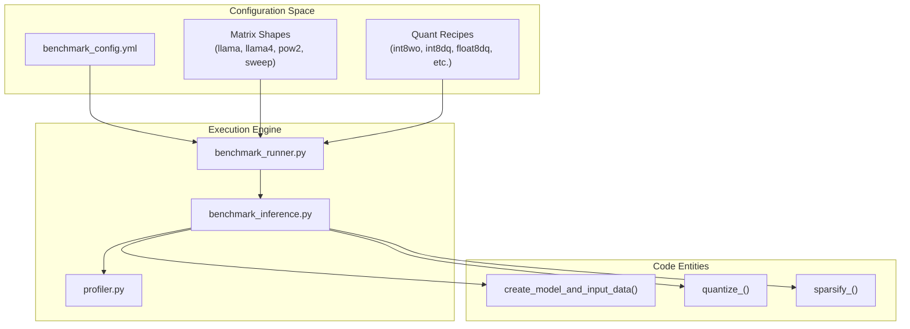
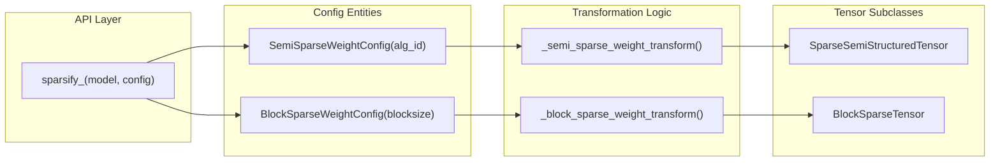

<!-- source: DeepWiki mcp.deepwiki.com · repo pytorch/ao · page 11.2 Performance Results · fetched 2026-10-21 -->

# Performance Results

Relevant source files

The following files were used as context for generating this wiki page:

- [benchmarks/benchmark_aq.py](benchmarks/benchmark_aq.py)
- [benchmarks/intmm.py](benchmarks/intmm.py)
- [benchmarks/intmm_shapes.csv](benchmarks/intmm_shapes.csv)
- [benchmarks/microbenchmarks/README.md](benchmarks/microbenchmarks/README.md)
- [benchmarks/microbenchmarks/benchmark_inference.py](benchmarks/microbenchmarks/benchmark_inference.py)
- [benchmarks/microbenchmarks/benchmark_runner.py](benchmarks/microbenchmarks/benchmark_runner.py)
- [benchmarks/microbenchmarks/profiler.py](benchmarks/microbenchmarks/profiler.py)
- [benchmarks/microbenchmarks/test/benchmark_config.yml](benchmarks/microbenchmarks/test/benchmark_config.yml)
- [benchmarks/microbenchmarks/test/test_benchmark_inference.py](benchmarks/microbenchmarks/test/test_benchmark_inference.py)
- [benchmarks/microbenchmarks/test/test_benchmark_profiler.py](benchmarks/microbenchmarks/test/test_benchmark_profiler.py)
- [benchmarks/microbenchmarks/test/test_benchmark_runner.py](benchmarks/microbenchmarks/test/test_benchmark_runner.py)
- [benchmarks/microbenchmarks/test/test_utils.py](benchmarks/microbenchmarks/test/test_utils.py)
- [benchmarks/microbenchmarks/utils.py](benchmarks/microbenchmarks/utils.py)
- [benchmarks/print_config_shapes.py](benchmarks/print_config_shapes.py)
- [benchmarks/sam_vit_b_shapes.csv](benchmarks/sam_vit_b_shapes.csv)
- [test/sparsity/test_sparse_api.py](test/sparsity/test_sparse_api.py)
- [test/test_model_architecture.py](test/test_model_architecture.py)
- [torchao/_models/sam/benchmark.sh](torchao/_models/sam/benchmark.sh)
- [torchao/_models/sam/eval_combo.py](torchao/_models/sam/eval_combo.py)
- [torchao/_models/sam/results.csv](torchao/_models/sam/results.csv)
- [torchao/_models/utils.py](torchao/_models/utils.py)
- [torchao/kernel/README.md](torchao/kernel/README.md)
- [torchao/sparsity/README.md](torchao/sparsity/README.md)
- [torchao/sparsity/__init__.py](torchao/sparsity/__init__.py)
- [torchao/sparsity/sparse_api.py](torchao/sparsity/sparse_api.py)

This document presents comprehensive benchmark results for TorchAO quantization and optimization techniques across different hardware platforms, models, and workloads. Results include inference speed (tokens/second), memory usage, bandwidth utilization, and accuracy metrics (perplexity) for various quantization schemes.

For benchmarking tools and measurement utilities, see [11.1](). For distributed training performance considerations, see [11.3](). For information on applying quantization techniques to specific models, see [9]().

## Benchmarking Infrastructure

TorchAO's performance testing infrastructure consists of microbenchmarking tools, model-level generation scripts, and automated CI/CD pipelines.

### Microbenchmarking System
The microbenchmarking suite allows for granular performance analysis of individual layers or small model blocks (e.g., `linear`, `transformer_block`, `ln_linear_sigmoid`) across a sweep of matrix shapes [benchmarks/microbenchmarks/utils.py:72-106]().

**Sources:** [benchmarks/microbenchmarks/benchmark_runner.py:28-32](), [benchmarks/microbenchmarks/benchmark_inference.py:79-111](), [benchmarks/microbenchmarks/utils.py:49-83]()

### Performance Measurement Logic
The primary benchmarking workflow uses `generate.py` or the `BenchmarkConfig` system to measure inference performance with the following key functions:

- **`model_inference_time_in_ms()`** - Measures the execution time of a model over multiple iterations [benchmarks/microbenchmarks/utils.py:29]().
- **`benchmark_model()`** - A utility to run warmup and measurement loops for consistent results [benchmarks/benchmark_aq.py:82-96]().
- **`generate_memory_profile()`** - Captures memory snapshots before and after inference to calculate peak memory and fragmentation [benchmarks/microbenchmarks/profiler.py:21]().

**Sources:** [benchmarks/microbenchmarks/utils.py:109-144](), [benchmarks/benchmark_aq.py:72-100](), [benchmarks/microbenchmarks/benchmark_inference.py:122-132]()

## Inference Performance Results

### CUDA Backend - NVIDIA A100-80GB

Performance benchmarks for Llama-3-8B on A100 GPUs demonstrate the trade-offs between quantization precision, speed, and accuracy:

| Technique | Wikitext Perplexity | Tokens/Second | Memory Bandwidth (GB/s) | Peak Memory (GB) | Model Size (GB) |
|-----------|---------------------|---------------|-------------------------|------------------|-----------------|
| Base (bfloat16) | 7.441 | 95.64 | 1435.54 | 16.43 | 15.01 |
| int8dq | 7.581 | 8.61 | 64.75 | 9.24 | 7.52 |
| int8wo | 7.447 | 153.03 | 1150.80 | 10.42 | 7.52 |
| int4wo-64 | 8.316 | 180.80 | 763.33 | 6.88 | 4.22 |
| **int4wo-64-sparse-marlin** | **N/A** | **226.02** | **689.20** | **5.32** | **3.05** |

**Key Observations:**
- **Sparse-Marlin (2:4 Sparsity + Int4)**: Achieves a 25% increase in tokens/second (180 -> 226) compared to the standard int4-wo implementation [torchao/sparsity/README.md:30-37]().
- **Int8 weight-only (int8wo)**: Provides a significant speedup over baseline while maintaining bandwidth efficiency [benchmarks/benchmark_aq.py:118-126]().

**Sources:** [torchao/sparsity/README.md:30-39](), [benchmarks/benchmark_aq.py:108-137]()

### Vision Models (Segment Anything)

Performance improvements on the SAM ViT-h model (NVIDIA A100-80GB, `max-autotune`):

| Technique | img/s | Memory (MiB) | mIoU (coco2017) | Relative Speedup |
|-----------|-------|--------------|-----------------|------------------|
| Baseline (bf16) | 22.75 | 15172 | 0.5811 | - |
| Int8 Dynamic Quant | 24.91 | 15154 | 0.5822 | 1.09x |
| 2:4 Sparsity (MLP) | 24.81 | 15632 | 0.5672 | 1.10x |

**Key Observations:**
- **Sparsity on MLP**: Accelerating MLP linear layers (`lin1`, `lin2`) provided the most speedups while mitigating accuracy loss [torchao/sparsity/README.md:11-12]().
- **Attention Sparsity**: Applying sparsity to attention layers led to slower models because `torch.compile` cannot currently fuse into semi-structured sparse matmuls [torchao/sparsity/README.md:13-15]().

**Sources:** [torchao/sparsity/README.md:8-25](), [torchao/_models/sam/eval_combo.py:168-195]()

## Specialized Quantization and Sparsity

### Semi-Structured (2:4) Sparsity
2:4 sparsity removes 2 out of every 4 elements in a weight matrix. It is applied using the `sparsify_` API with `SemiSparseWeightConfig` [torchao/sparsity/sparse_api.py:113-142]().

**Sources:** [torchao/sparsity/sparse_api.py:49-111](), [torchao/sparsity/sparse_api.py:113-151]()

### Block Sparsity
TorchAO offers prototype support for block sparsity using Triton kernels for `bfloat16`/`float16` workloads. This is configured via `BlockSparseWeightConfig` [torchao/sparsity/sparse_api.py:49-58]().

- **Hardware Requirement**: Requires NVIDIA H100 (SM90) for optimal execution of Triton-based block sparse kernels [test/sparsity/test_sparse_api.py:54]().
- **Performance**: Theoretical speedups depend on the sparsity level, with the API supporting custom block sizes (default 64) [torchao/sparsity/sparse_api.py:51]().

**Sources:** [torchao/sparsity/sparse_api.py:49-70](), [test/sparsity/test_sparse_api.py:53-86]()

## Quantization Recipe Performance (Microbenchmarks)

The following recipes are frequently measured using the `ci_microbenchmark_runner.py` to ensure no performance regressions:

| Recipe Name | Implementation | Target Hardware |
|-------------|----------------|-----------------|
| `int8wo` | `Int8WeightOnlyConfig` | CUDA, CPU, XPU |
| `int8dq` | `Int8DynamicActivationInt8WeightConfig` | CUDA, CPU |
| `float8wo` | `Float8WeightOnlyConfig` | H100+ (SM90) |
| `float8dq-tensor` | `Float8DynamicActivationFloat8WeightConfig` (PerTensor) | H100+ (SM90) |
| `float8dq-row` | `Float8DynamicActivationFloat8WeightConfig` (PerRow) | H100+ (SM90) |

**Sources:** [benchmarks/microbenchmarks/utils.py:16-24](), [benchmarks/microbenchmarks/test/benchmark_config.yml:3-7]()

## Summary of Speedups and Memory Savings

### Throughput Gains
- **LLM Inference**: Up to **2.37x** speedup on Llama-3-8B using `int4wo-64-sparse-marlin` on A100 [torchao/sparsity/README.md:37]().
- **Vision Inference**: **1.10x** speedup on SAM ViT-h using 2:4 sparsity on MLP layers [torchao/sparsity/README.md:9]().

### Memory Savings
- **Llama-3-8B**: Model size reduced from **15.01 GB** (bf16) to **3.05 GB** (int4-sparse-marlin), representing a ~80% reduction in storage requirements [torchao/sparsity/README.md:34-37]().
- **SAM ViT-h**: 2:4 sparsity on both Attention and MLP layers reduces memory from **15172 MiB** to **13429 MiB** [torchao/sparsity/README.md:21-24]().

**Sources:** [torchao/sparsity/README.md:19-37](), [benchmarks/microbenchmarks/benchmark_runner.py:51-62]()

---

