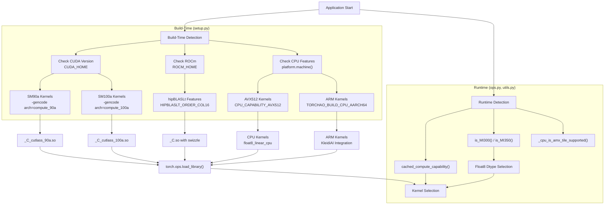
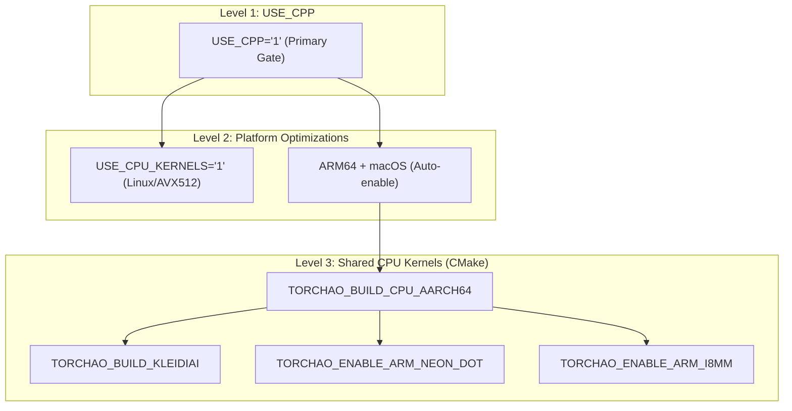

<!-- source: DeepWiki mcp.deepwiki.com · repo pytorch/ao · page 11.3 Hardware-Specific Optimizations · fetched 2026-10-21 -->

# Hardware-Specific Optimizations

<details>
<summary>Relevant source files</summary>

The following files were used as context for generating this wiki page:

- [.github/workflows/regression_test_aarch64.yml](.github/workflows/regression_test_aarch64.yml)
- [setup.py](setup.py)
- [test/dtypes/test_affine_quantized_float.py](test/dtypes/test_affine_quantized_float.py)
- [test/prototype/test_tensor_conversion.py](test/prototype/test_tensor_conversion.py)
- [test/quantization/quantize_/workflows/float8/test_float8_tensor.py](test/quantization/quantize_/workflows/float8/test_float8_tensor.py)
- [test/quantization/quantize_/workflows/float8/test_float8_tensor_mi300.py](test/quantization/quantize_/workflows/float8/test_float8_tensor_mi300.py)
- [test/quantization/quantize_/workflows/intx/test_intx_opaque_tensor.py](test/quantization/quantize_/workflows/intx/test_intx_opaque_tensor.py)
- [test/quantization/quantize_/workflows/intx/test_intx_unpacked_to_int8_tensor.py](test/quantization/quantize_/workflows/intx/test_intx_unpacked_to_int8_tensor.py)
- [test/test_ops.py](test/test_ops.py)
- [test/test_utils.py](test/test_utils.py)
- [torchao/__init__.py](torchao/__init__.py)
- [torchao/csrc/cpu/README.md](torchao/csrc/cpu/README.md)
- [torchao/csrc/cpu/aten_kernels/da8w4_linear.cpp](torchao/csrc/cpu/aten_kernels/da8w4_linear.cpp)
- [torchao/csrc/cpu/aten_kernels/float8_linear.cpp](torchao/csrc/cpu/aten_kernels/float8_linear.cpp)
- [torchao/csrc/cpu/aten_kernels/quantized_sdpa.cpp](torchao/csrc/cpu/aten_kernels/quantized_sdpa.cpp)
- [torchao/csrc/cpu/aten_kernels/scaled_embedding_bag.cpp](torchao/csrc/cpu/aten_kernels/scaled_embedding_bag.cpp)
- [torchao/csrc/cpu/aten_kernels/utils.h](torchao/csrc/cpu/aten_kernels/utils.h)
- [torchao/float8/inference.py](torchao/float8/inference.py)
- [torchao/ops.py](torchao/ops.py)
- [torchao/prototype/inductor/qsdpa_lowering.py](torchao/prototype/inductor/qsdpa_lowering.py)
- [torchao/prototype/tensor_conversion/api.py](torchao/prototype/tensor_conversion/api.py)
- [torchao/quantization/quantize_/common/kernel_preference.py](torchao/quantization/quantize_/common/kernel_preference.py)
- [torchao/quantization/quantize_/workflows/float8/float8_tensor.py](torchao/quantization/quantize_/workflows/float8/float8_tensor.py)
- [torchao/quantization/quantize_/workflows/intx/intx_opaque_tensor.py](torchao/quantization/quantize_/workflows/intx/intx_opaque_tensor.py)
- [torchao/quantization/quantize_/workflows/intx/intx_packing_format.py](torchao/quantization/quantize_/workflows/intx/intx_packing_format.py)
- [torchao/quantization/quantize_/workflows/intx/intx_unpacked_to_int8_tensor.py](torchao/quantization/quantize_/workflows/intx/intx_unpacked_to_int8_tensor.py)
- [torchao/testing/utils.py](torchao/testing/utils.py)
- [torchao/utils.py](torchao/utils.py)

</details>


## Purpose and Scope

This document describes TorchAO's hardware-specific optimizations across NVIDIA GPUs, AMD GPUs, and CPUs. It covers compute capability requirements, platform-specific kernel implementations, build-time configuration, and runtime detection mechanisms. For general quantization workflows, see [Quantization API Reference](2.1. quantize_ Function). For float8 training specifics, see [Float8 Training System](5.1. Float8Linear and Configuration).

---

## Overview of Hardware Support

TorchAO provides optimized kernels tailored to specific hardware architectures, with performance varying significantly based on available capabilities. The library supports three major platforms with distinct optimization strategies:

| Platform | Key Features | Minimum Requirements |
|----------|-------------|---------------------|
| **NVIDIA GPU** | Float8 tensor cores, CUTLASS kernels, sparse operations | SM75+ (basic), SM89+ (native FP8), SM90+ (rowwise), SM100+ (NVFP4) |
| **AMD GPU** | hipBLASLt, swizzled layouts, MI300-optimized float8 | ROCm 5.0+, MI300 for fnuz variants |
| **CPU** | AVX512, VNNI, AMX, ARM NEON, KleidiAI | AVX512 (x86-64), ARMv8.4+ (ARM64) |

### Hardware Detection Flow



**Sources:** [setup.py:94-125](), [setup.py:201-215](), [torchao/utils.py:31-41](), [torchao/__init__.py:82-98](), [torchao/ops.py:65-70]()

---

## NVIDIA GPU Architecture Support

### Compute Capability Requirements

TorchAO's NVIDIA GPU support is tiered by compute capability (SM version). The library provides utilities in `torchao.utils` to check these at runtime.

| Capability | Architecture | Primary Features Enabled |
|------------|--------------|--------------------------|
| **SM75+**  | Turing/Ampere| `quant_llm_linear`, basic int8 weight-only |
| **SM89+**  | Ada Lovelace | Native FP8 support, `is_sm_at_least_89()` |
| **SM90+**  | Hopper       | CUTLASS Rowwise Scaling, `is_sm_at_least_90()` |
| **SM100+** | Blackwell    | NVFP4, advanced microscaling, `is_sm_at_least_100()` |

**Sources:** [torchao/utils.py:33-35](), [torchao/ops.py:65-70](), [test/quantization/quantize_/workflows/float8/test_float8_tensor.py:36-38]()

### SM89+ Features: Native Float8 Support

Starting with SM89 (L4, L40), NVIDIA GPUs provide native float8 tensor core support. TorchAO utilizes `torch._scaled_mm` for these operations [torchao/float8/inference.py:104-123]().

**Float8 Configuration Selection:**
For inference, `Float8Tensor` handles the dispatch logic between native and emulated paths based on the `KernelPreference` and hardware capability [torchao/quantization/quantize_/workflows/float8/float8_tensor.py:84-113]().

### SM90+ Features: Rowwise and Blockwise Scaling

SM90 (H100) introduces specialized kernels for rowwise and blockwise scaling. TorchAO implements `blockwise_fp8_gemm` for high-precision scaling [torchao/quantization/quantize_/workflows/float8/float8_tensor.py:27-29]().

**Rowwise Scaling Logic:**
[torchao/float8/inference.py:177-183]()
```python
def _is_rowwise_scaled(x: torch.Tensor) -> bool:
    assert hasattr(x, "block_size"), "Expecting input to have `block_size` attribute"
    return tuple(x.block_size) == (1,) * (x.dim() - 1) + (x.shape[-1],)
```

**Sources:** [torchao/float8/inference.py:86-123](), [torchao/quantization/quantize_/workflows/float8/float8_tensor.py:182-189](), [test/quantization/quantize_/workflows/float8/test_float8_tensor.py:199-200]()

### SM90+ Sparse Operations

SM90 enables sparse 2:4 operations with float8 via specialized CUTLASS kernels registered in the `torchao` namespace.

| Operator | File Reference | Purpose |
|----------|----------------|---------|
| `rowwise_scaled_linear_sparse_cutlass_f8f8` | [torchao/ops.py:158-183]() | Sparse 2:4 FP8×FP8 GEMM |
| `to_sparse_semi_structured_cutlass_sm9x_f8` | [torchao/ops.py:17-18]() | FP8 sparsification metadata |

**Sources:** [torchao/ops.py:13-18](), [torchao/ops.py:158-183]()

---

## AMD GPU Support (ROCm)

### MI300 and MI350 Series Optimizations

AMD MI300 GPUs utilize different float8 encoding variants (`fnuz`). TorchAO detects these via `is_MI300()` and `is_MI350()` [torchao/utils.py:32](), [torchao/float8/inference.py:17-21]().

**Float8 Dtype Adjustment:**
On AMD hardware, the library prefers `float8_e4m3fnuz` for compatibility with hipBLASLt kernels [test/quantization/quantize_/workflows/float8/test_float8_tensor_mi300.py]().

### Swizzle Layouts
ROCm hardware often requires swizzled matrix layouts for optimal throughput. TorchAO defines custom ops `swizzle_mm` and `swizzle_scaled_mm` to handle these transformations [torchao/ops.py:20-24]().

**Sources:** [torchao/utils.py:32](), [torchao/float8/inference.py:17-21](), [torchao/ops.py:20-24]()

---

## CPU Optimizations

### x86-64: AVX512, VNNI, and AMX

TorchAO provides deep integration for x86 CPUs, specifically targeting AVX-512 and AMX instructions for quantized linear operations.

**Kernel Dispatch Utilities:**
The library uses C++ templates to dispatch based on quantization modes and output types [torchao/csrc/cpu/aten_kernels/utils.h:88-101]().

**Key CPU Kernels:**
*   **da8w4_linear_cpu**: Dynamic activation int8, weight int4 linear [torchao/ops.py:37-39]().
*   **float8_linear_cpu**: Native float8 linear for CPUs supporting appropriate vector extensions [torchao/ops.py:46-48]().
*   **qscaled_dot_product**: Quantized SDPA for CPU, supporting `uint8` and `float8_e4m3fn` [test/test_ops.py:114-130]().

**Sources:** [torchao/ops.py:34-48](), [torchao/csrc/cpu/aten_kernels/utils.h:34-46](), [test/test_ops.py:109-130]()

### ARM AArch64: NEON and KleidiAI

For ARM architectures, TorchAO integrates with **KleidiAI** and utilizes NEON dot product instructions (`sdot`/`udot`).

**Build Configuration:**
Build-time toggles in `setup.py` control ARM-specific features:
*   `TORCHAO_BUILD_CPU_AARCH64`: Main gate for ARM kernels [setup.py:207-210]().
*   `TORCHAO_BUILD_KLEIDIAI`: Enables Kleidi AI library integration [setup.py:218-220]().
*   `TORCHAO_ENABLE_ARM_NEON_DOT`: Specifically targets ARM dot-product instructions [setup.py:233-236]().

**Sources:** [setup.py:98-104](), [setup.py:207-240]()

---

## Build System Configuration

The `setup.py` script manages the complexity of multi-hardware support through environment variables.

### Build Configuration Hierarchy



**Sources:** [setup.py:94-125](), [setup.py:201-240]()

### Extension Loading
At runtime, `torchao` attempts to load hardware-specific `.so` files. If the PyTorch version is incompatible with the prebuilt binaries, it logs a warning and skips loading to prevent crashes [torchao/__init__.py:70-83]().

**Sources:** [torchao/__init__.py:51-102]()

---

