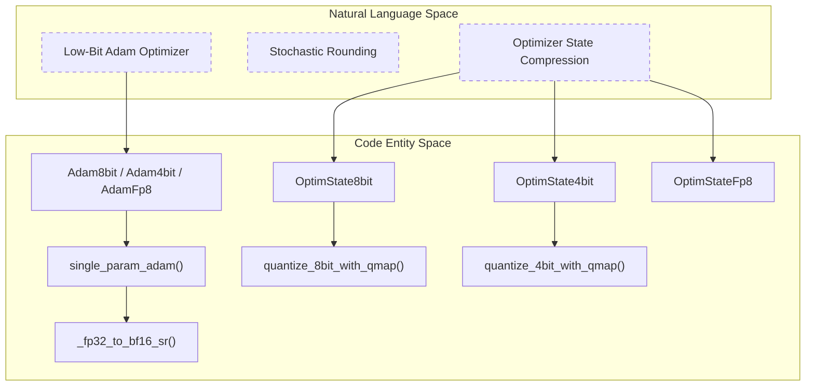
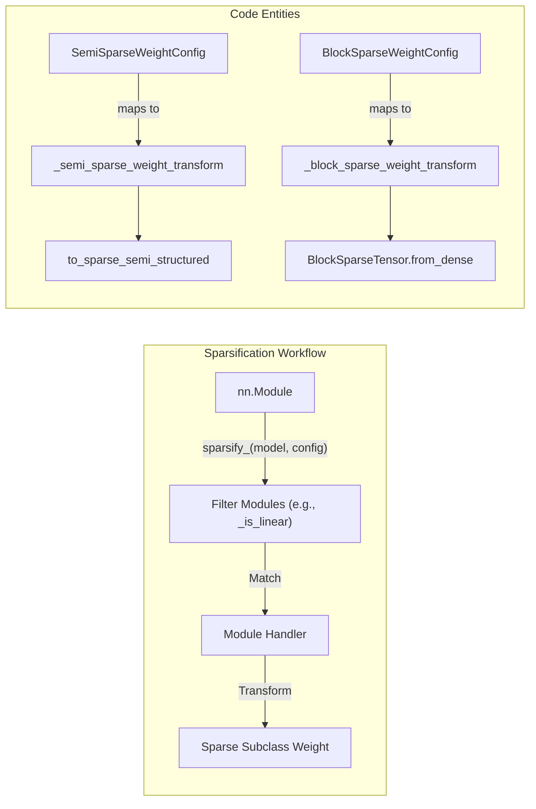

<!-- source: DeepWiki mcp.deepwiki.com · repo pytorch/ao · page 12 Low-Bit Optimizers and Sparsity · fetched 2026-10-21 -->

# Low-Bit Optimizers and Sparsity

Relevant source files

The following files were used as context for generating this wiki page:

- [test/sparsity/test_sparse_api.py](test/sparsity/test_sparse_api.py)
- [test/test_low_bit_optim.py](test/test_low_bit_optim.py)
- [torchao/_models/sam/benchmark.sh](torchao/_models/sam/benchmark.sh)
- [torchao/_models/sam/eval_combo.py](torchao/_models/sam/eval_combo.py)
- [torchao/_models/sam/results.csv](torchao/_models/sam/results.csv)
- [torchao/_models/utils.py](torchao/_models/utils.py)
- [torchao/optim/README.md](torchao/optim/README.md)
- [torchao/optim/__init__.py](torchao/optim/__init__.py)
- [torchao/optim/adam.py](torchao/optim/adam.py)
- [torchao/optim/cpu_offload.py](torchao/optim/cpu_offload.py)
- [torchao/optim/quant_utils.py](torchao/optim/quant_utils.py)
- [torchao/optim/subclass_4bit.py](torchao/optim/subclass_4bit.py)
- [torchao/optim/subclass_8bit.py](torchao/optim/subclass_8bit.py)
- [torchao/optim/subclass_fp8.py](torchao/optim/subclass_fp8.py)
- [torchao/sparsity/README.md](torchao/sparsity/README.md)
- [torchao/sparsity/__init__.py](torchao/sparsity/__init__.py)
- [torchao/sparsity/sparse_api.py](torchao/sparsity/sparse_api.py)

This page provides an overview of TorchAO's capabilities for reducing the memory footprint and increasing the performance of model training and inference through low-bit optimizers and sparsity techniques. These methods aim to reduce parameter overhead while maintaining model quality.

## Low-Bit Optimizers

TorchAO provides a suite of low-bit optimizers designed to reduce the memory required for optimizer states, such as momentum and variance in Adam. These implementations utilize **Tensor Subclasses** to transparently quantize optimizer states to 8-bit, 4-bit, or FP8 formats.

### Key Features
*   **State Quantization**: Optimizers like `Adam8bit`, `Adam4bit`, and `AdamFp8` store their states in lower precision using specialized subclasses like `OptimState8bit` [torchao/optim/subclass_8bit.py:40-42](), `OptimState4bit` [torchao/optim/subclass_4bit.py:44-46](), and `OptimStateFp8` [torchao/optim/subclass_fp8.py:34-35]().
*   **Stochastic Rounding**: Supports `BF16` stochastic rounding to mitigate accuracy loss when using low-precision weights during training [torchao/optim/quant_utils.py:121-162]().
*   **torch.compile Integration**: The optimizer update logic is designed to be compatible with `torch.compile` by implementing custom dispatch rules for `aten` operations like `lerp`, `copy_`, and `addcdiv_` [torchao/optim/adam.py:142-156]().
*   **Distributed Training**: Support for `DTensor` and `FSDP2` ensures these optimizers work in multi-GPU environments [torchao/optim/adam.py:84-93]().

### Optimizer Entity Mapping

The following diagram shows how the user-facing optimizer classes interact with the underlying tensor subclasses and quantization utilities.

| Optimizer Class | State Subclass | Precision | Logic File |
| :--- | :--- | :--- | :--- |
| `Adam8bit` | `OptimState8bit` | 8-bit (uint8 + qmap) | [torchao/optim/subclass_8bit.py]() |
| `Adam4bit` | `OptimState4bit` | 4-bit (packed uint8 + qmap) | [torchao/optim/subclass_4bit.py]() |
| `AdamFp8` | `OptimStateFp8` | 8-bit (e4m3fn) | [torchao/optim/subclass_fp8.py]() |

**Sources:** [torchao/optim/adam.py:19-158](), [torchao/optim/subclass_8bit.py:40-101](), [torchao/optim/subclass_4bit.py:44-112](), [torchao/optim/subclass_fp8.py:34-83](), [torchao/optim/quant_utils.py:121-125]()

For details on implementation and usage, see [Low-Bit Optimizers](#12.1).

---

## Sparsity API

Sparsity in TorchAO focuses on removing parameters to reduce memory and latency. The library supports various patterns, from structured 2:4 sparsity to block-based sparsity.

### Key Features
*   **`sparsify_` API**: A high-level, in-place API similar to `quantize_` that applies sparsity configurations to a model [torchao/sparsity/sparse_api.py:113-151]().
*   **Semi-Structured (2:4) Sparsity**: Leverages hardware acceleration (e.g., NVIDIA Tensor Cores) via `SemiSparseWeightConfig` and `SparseSemiStructuredTensor` [torchao/sparsity/sparse_api.py:73-81]().
*   **Block Sparsity**: Provides prototype support for accelerating block-sparse weights using Triton kernels via `BlockSparseWeightConfig` [torchao/sparsity/sparse_api.py:50-51]().
*   **Pruning Algorithms**: Includes implementations like `WandaSparsifier` for finding optimal sparse masks [torchao/sparsity/__init__.py:15]().

### Sparsity Transformation Flow

The transformation process involves identifying target modules and replacing their weights with sparse tensor subclasses.

**Sources:** [torchao/sparsity/sparse_api.py:61-110](), [torchao/sparsity/sparse_api.py:113-151](), [torchao/sparsity/blocksparse.py:26]()

### Performance and Accuracy
| Technique | Speedup (A100) | Accuracy (mIoU) |
| :--- | :--- | :--- |
| Dense Baseline (BF16) | 1.0x | 0.581 |
| 2:4 Sparsity (MLP) | 1.10x | 0.567 |
| 2:4 Sparsity (All) | 1.07x | 0.530 |

**Sources:** [torchao/sparsity/README.md:19-25]()

For details on pruning algorithms and sparse kernel acceleration, see [Sparsity API](#12.2).

---

