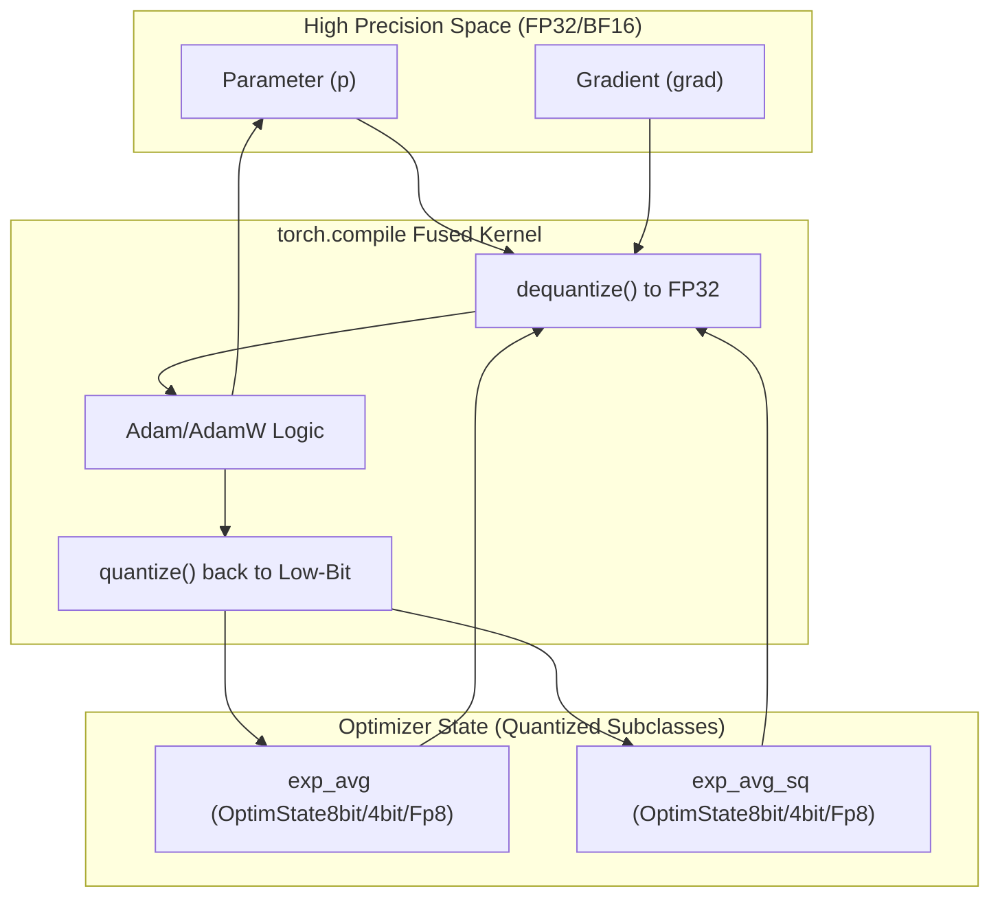
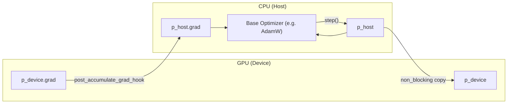

<!-- source: DeepWiki mcp.deepwiki.com · repo pytorch/ao · page 12.1 Low-Bit Optimizers · fetched 2026-10-21 -->

# Low-Bit Optimizers

Relevant source files

The following files were used as context for generating this wiki page:

- [test/test_low_bit_optim.py](test/test_low_bit_optim.py)
- [torchao/optim/README.md](torchao/optim/README.md)
- [torchao/optim/__init__.py](torchao/optim/__init__.py)
- [torchao/optim/adam.py](torchao/optim/adam.py)
- [torchao/optim/cpu_offload.py](torchao/optim/cpu_offload.py)
- [torchao/optim/quant_utils.py](torchao/optim/quant_utils.py)
- [torchao/optim/subclass_4bit.py](torchao/optim/subclass_4bit.py)
- [torchao/optim/subclass_8bit.py](torchao/optim/subclass_8bit.py)
- [torchao/optim/subclass_fp8.py](torchao/optim/subclass_fp8.py)

The `torchao.optim` module provides high-performance, memory-efficient optimizer implementations using quantization and offloading techniques. These optimizers are designed as drop-in replacements for standard PyTorch optimizers like `torch.optim.Adam` and `torch.optim.AdamW`, enabling significant reductions in GPU memory usage for optimizer states [torchao/optim/README.md:1-22]().

## Architecture and Design

The low-bit optimizers in TorchAO are implemented using **Tensor Subclasses** and `torch.compile`. Unlike traditional implementations that rely on custom C++/CUDA extensions, TorchAO defines the quantization logic within Python subclasses of `torch.Tensor`. This allows for seamless integration with `torch.compile`, which generates efficient fused kernels for the optimizer step [torchao/optim/README.md:11-12]().

### Data Flow and Optimization Step
The following diagram illustrates the data flow when an optimizer step is performed using a low-bit subclass.

**Optimizer Step Data Flow**

Sources: [torchao/optim/adam.py:163-205](), [torchao/optim/subclass_8bit.py:97-101](), [torchao/optim/subclass_4bit.py:107-113]()

## Supported Optimizers

TorchAO provides several variants of the Adam and AdamW optimizers. By default, these use a block-size of 256 for 8-bit and FP8, and 128 for 4-bit [torchao/optim/README.md:24-25]().

| Optimizer Class | Quantization Format | State Subclass |
| :--- | :--- | :--- |
| `Adam8bit` / `AdamW8bit` | 8-bit Dynamic | `OptimState8bit` |
| `Adam4bit` / `AdamW4bit` | 4-bit Dynamic | `OptimState4bit` |
| `AdamFp8` / `AdamWFp8` | FP8 (E4M3FN) | `OptimStateFp8` |

Sources: [torchao/optim/adam.py:14-16](), [torchao/optim/__init__.py:1-13]()

### Quantization Subclasses

Each optimizer state is wrapped in a specific subclass that manages its own storage and quantization parameters:

1.  **`OptimState8bit`**: Implements 8-bit block-wise quantization using a lookup table (`qmap`) [torchao/optim/subclass_8bit.py:40-76]().
2.  **`OptimState4bit`**: Similar to 8-bit but packs two 4-bit values into a single `uint8` element [torchao/optim/subclass_4bit.py:44-95]().
3.  **`OptimStateFp8`**: Uses the native `torch.float8_e4m3fn` data type with block-wise scaling [torchao/optim/subclass_fp8.py:34-63]().

These subclasses implement `__tensor_flatten__` and `__tensor_unflatten__` to support `torch.compile` and serialization [torchao/optim/subclass_8bit.py:86-95]().

## BF16 Stochastic Rounding

Standard BFloat16 (BF16) has limited precision (approx. 3 decimal digits). When updating weights, if the update is smaller than 1/1000th of the weight value, the weight remains unchanged under nearest-rounding. TorchAO provides `_fp32_to_bf16_sr` to perform **stochastic rounding** [torchao/optim/README.md:61-70]().

*   **Mechanism**: The probability of rounding up is proportional to the distance of the FP32 value from the lower BF16 representable number [torchao/optim/quant_utils.py:127-128]().
*   **Implementation**: Uses `torch.randint` to generate 16-bit random values and compares them against the lower 16 bits of the FP32 representation [torchao/optim/quant_utils.py:134-146]().

Sources: [torchao/optim/quant_utils.py:121-162](), [torchao/optim/adam.py:155]()

## CPU Offload Optimizer

`CPUOffloadOptimizer` implements ZeRO-Offload for single-GPU training. It moves optimizer states and (optionally) gradients to CPU memory [torchao/optim/README.md:82-99]().

### Key Features:
*   **`offload_gradients`**: If enabled, GPU gradients are freed immediately after being copied to the CPU [torchao/optim/cpu_offload.py:34-35]().
*   **`minimal_size`**: Tensors smaller than this threshold (default 4096) are kept on the GPU to avoid overhead from small transfers [torchao/optim/cpu_offload.py:49-50]().
*   **Asynchronous Transfer**: Uses a dedicated CUDA/XPU stream to overlap gradient D2H (Device-to-Host) transfers with the backward pass [torchao/optim/cpu_offload.py:60-85]().

**Entity Mapping: CPU Offload Lifecycle**

Sources: [torchao/optim/cpu_offload.py:65-85](), [torchao/optim/cpu_offload.py:126-135]()

## Integration with torch.compile

The optimizers use `single_param_adam` as the entry point for compilation. This function is decorated with `torch.no_grad()` and compiled with `fullgraph=True` [torchao/optim/adam.py:101-142]().

To ensure compatibility with FSDP2 and `torch.compile`, parameters are detached before being passed to the compiled kernel [torchao/optim/adam.py:143](). The kernel performs all arithmetic in FP32 for precision before the subclass `copy_` implementation re-quantizes the results into the low-bit state [torchao/optim/adam.py:179-205]().

Sources: [torchao/optim/adam.py:101-158](), [torchao/optim/subclass_8bit.py:126-146]()

---

