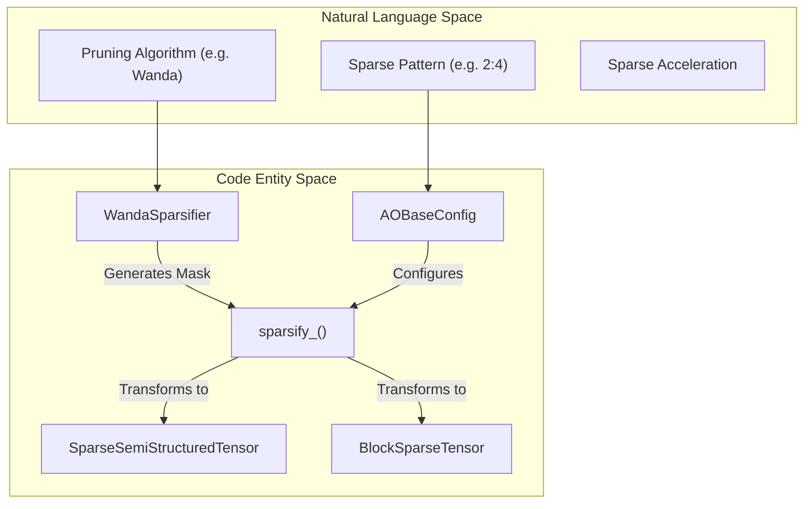
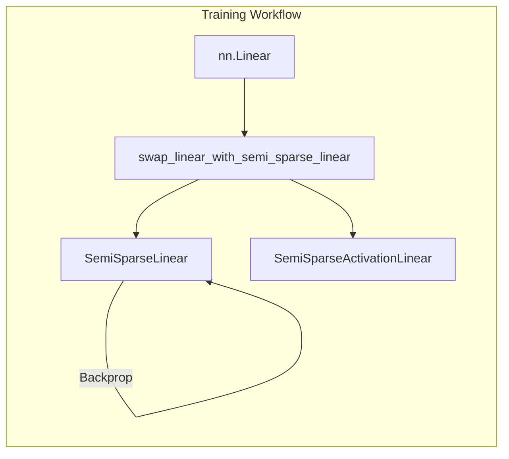

<!-- source: DeepWiki mcp.deepwiki.com · repo pytorch/ao · page 12.2 Sparsity API · fetched 2026-10-21 -->

# Sparsity API

<details>
<summary>Relevant source files</summary>

The following files were used as context for generating this wiki page:

- [benchmarks/benchmark_gpu_sparsity.py](benchmarks/benchmark_gpu_sparsity.py)
- [benchmarks/benchmark_semi_sparse_training.py](benchmarks/benchmark_semi_sparse_training.py)
- [test/sparsity/test_fast_sparse_training.py](test/sparsity/test_fast_sparse_training.py)
- [test/sparsity/test_sparse_api.py](test/sparsity/test_sparse_api.py)
- [test/sparsity/test_wanda.py](test/sparsity/test_wanda.py)
- [torchao/_models/sam/benchmark.sh](torchao/_models/sam/benchmark.sh)
- [torchao/_models/sam/eval_combo.py](torchao/_models/sam/eval_combo.py)
- [torchao/_models/sam/results.csv](torchao/_models/sam/results.csv)
- [torchao/_models/utils.py](torchao/_models/utils.py)
- [torchao/sparsity/README.md](torchao/sparsity/README.md)
- [torchao/sparsity/__init__.py](torchao/sparsity/__init__.py)
- [torchao/sparsity/sparse_api.py](torchao/sparsity/sparse_api.py)
- [torchao/sparsity/training/README.md](torchao/sparsity/training/README.md)
- [torchao/sparsity/training/__init__.py](torchao/sparsity/training/__init__.py)
- [torchao/sparsity/training/autograd.py](torchao/sparsity/training/autograd.py)
- [torchao/sparsity/training/pointwise_ops.py](torchao/sparsity/training/pointwise_ops.py)
- [torchao/sparsity/utils.py](torchao/sparsity/utils.py)
- [torchao/sparsity/wanda.py](torchao/sparsity/wanda.py)

</details>


The Sparsity API in `torchao` provides a unified interface for reducing model memory overhead and latency by removing network parameters. It supports various sparsity patterns, including 2:4 semi-structured sparsity and block-wise sparsity, while integrating with both inference-time acceleration and sparse training workflows [torchao/sparsity/README.md:1-5]().

## Overview and Design

Sparsity in `torchao` is treated as an accuracy/performance trade-off similar to quantization. While quantization performance is determined by data types (e.g., Float32 to Int8), sparsity performance is determined by the sparsity level and pattern [torchao/sparsity/README.md:83-87](). The library decouples the sparsity problem into two subproblems:
1.  **Accuracy**: Finding a set of sparse weights that minimize accuracy degradation using pruning algorithms like Wanda [torchao/sparsity/README.md:91-94]().
2.  **Performance**: Accelerating sparse weights for inference using specialized kernels and tensor subclasses [torchao/sparsity/README.md:94-95]().

### Sparsity Flow Diagram
This diagram illustrates the transition from a dense model to a performance-optimized sparse model using the `sparsify_` API.


Sources: [torchao/sparsity/sparse_api.py:113-117](), [torchao/sparsity/wanda.py:20-33](), [torchao/sparsity/README.md:96-101]()

## Core API: sparsify_

The primary entry point for applying sparsity is the `sparsify_` function. It operates similarly to the `quantize_` API, utilizing a handler registry to transform `nn.Linear` modules into sparse variants based on a configuration object [torchao/sparsity/sparse_api.py:113-127]().

### Key Functions and Classes
| Entity | Role |
| :--- | :--- |
| `sparsify_` | In-place model transformation function that replaces dense layers with sparse subclasses [torchao/sparsity/sparse_api.py:113](). |
| `SemiSparseWeightConfig` | Configuration for 2:4 semi-structured sparsity, utilizing `SparseSemiStructuredTensor` [torchao/sparsity/sparse_api.py:73-80](). |
| `BlockSparseWeightConfig` | Configuration for block-wise sparsity, utilizing `BlockSparseTensor` [torchao/sparsity/sparse_api.py:50-52](). |
| `apply_fake_sparsity` | Simulates 2:4 sparsity on linear layers to evaluate accuracy without requiring sparse hardware [torchao/sparsity/sparse_api.py:30-33](). |

Sources: [torchao/sparsity/sparse_api.py:1-151](), [torchao/sparsity/__init__.py:7-12]()

## Pruning Algorithms

### Wanda Pruning
The `WandaSparsifier` implements "Pruning by Weights and Activations". It removes weights based on the product of the input activation norm and the weight magnitude [torchao/sparsity/wanda.py:21-25]().

**Pruning Flow:**
1.  **Prepare**: Attaches a `PerChannelNormObserver` to collect activation statistics during a calibration pass [torchao/sparsity/wanda.py:51-78]().
2.  **Step**: Calculates the pruning metric $|weight| \times ||activation||$ and updates the mask [torchao/sparsity/wanda.py:80-97]().
3.  **Squash**: Removes observers and parameterizations, leaving the model with sparse weights [torchao/sparsity/wanda.py:118-135]().

Sources: [torchao/sparsity/wanda.py:20-135](), [torchao/sparsity/utils.py:51-69]()

## Sparse Training

`torchao` supports accelerated sparse training through module swapping. This allows for hardware-accelerated 2:4 sparsity during the forward and backward passes [torchao/sparsity/training/README.md:1-3]().

### Training Entities Mapping


**Implementation Details:**
- **SemiSparseLinear**: Replaces standard linear layers to use 2:4 sparse kernels during training [torchao/sparsity/training/README.md:14-16]().
- **Weight Sparsification**: Weights are pruned and compressed at runtime using `SparseSemiStructuredTensorCUSPARSELT` [test/sparsity/test_fast_sparse_training.py:35-40]().
- **Compatibility**: Supports `torch.compile` for end-to-end speedups (approx. 6% for ViT-L training) [torchao/sparsity/training/README.md:45-50]().

Sources: [torchao/sparsity/training/README.md:8-41](), [test/sparsity/test_fast_sparse_training.py:22-53]()

## Sparse Kernel Acceleration

The API routes to specific kernels based on the configuration:

1.  **2:4 Semi-Structured Sparsity**:
    - Uses `to_sparse_semi_structured` to convert weights [torchao/sparsity/sparse_api.py:100-107]().
    - Backend support includes `cusparselt` and `cutlass` [benchmarks/benchmark_gpu_sparsity.py:44](), [benchmarks/benchmark_gpu_sparsity.py:180]().
2.  **Block Sparsity**:
    - Uses `BlockSparseTensor.from_dense` with a specified `blocksize` (default 64) [torchao/sparsity/sparse_api.py:50-51](), [torchao/sparsity/sparse_api.py:66-67]().
    - Leverages Triton kernels for acceleration on bfloat16/float16 workloads [torchao/sparsity/README.md:55]().

### Example: Applying 2:4 Sparsity
[torchao/sparsity/sparse_api.py:134-142]()
```python
from torchao.sparsity import sparsify_, semi_sparse_weight
import torch.nn as nn

model = nn.Sequential(nn.Linear(32, 1024), nn.Linear(1024, 32)).cuda()

# Apply 2:4 semi-structured sparsity to all Linear layers
sparsify_(model, semi_sparse_weight())
```

Sources: [torchao/sparsity/sparse_api.py:49-111](), [benchmarks/benchmark_gpu_sparsity.py:43-51](), [torchao/sparsity/README.md:45-63]()

---

