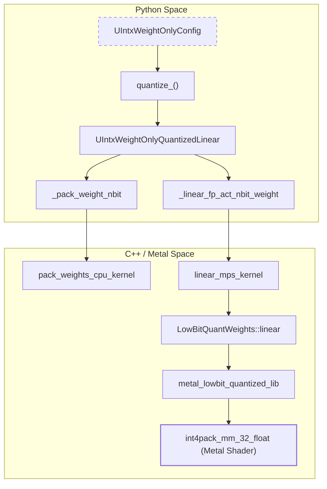
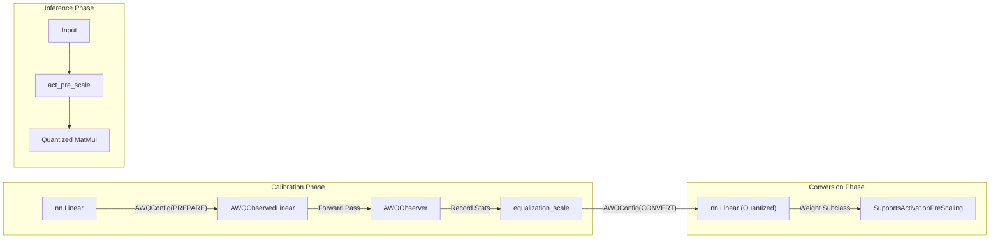

<!-- source: DeepWiki mcp.deepwiki.com · repo pytorch/ao · page 13 Prototype and Experimental Features · fetched 2026-10-21 -->

# Prototype and Experimental Features

Relevant source files

The following files were used as context for generating this wiki page:

- [test/prototype/test_awq.py](test/prototype/test_awq.py)
- [test/prototype/test_int4_opaque_tensor.py](test/prototype/test_int4_opaque_tensor.py)
- [test/prototype/test_smoothquant.py](test/prototype/test_smoothquant.py)
- [torchao/experimental/kernels/mps/metal.yaml](torchao/experimental/kernels/mps/metal.yaml)
- [torchao/experimental/kernels/mps/metal/int1mm.metal](torchao/experimental/kernels/mps/metal/int1mm.metal)
- [torchao/experimental/kernels/mps/metal/int2mm_opt.metal](torchao/experimental/kernels/mps/metal/int2mm_opt.metal)
- [torchao/experimental/kernels/mps/metal/int3mm_opt.metal](torchao/experimental/kernels/mps/metal/int3mm_opt.metal)
- [torchao/experimental/kernels/mps/metal/int4mm_opt.metal](torchao/experimental/kernels/mps/metal/int4mm_opt.metal)
- [torchao/experimental/kernels/mps/metal/int5mm.metal](torchao/experimental/kernels/mps/metal/int5mm.metal)
- [torchao/experimental/kernels/mps/metal/int6mm.metal](torchao/experimental/kernels/mps/metal/int6mm.metal)
- [torchao/experimental/kernels/mps/metal/int7mm.metal](torchao/experimental/kernels/mps/metal/int7mm.metal)
- [torchao/experimental/kernels/mps/src/dispatch.h](torchao/experimental/kernels/mps/src/dispatch.h)
- [torchao/experimental/kernels/mps/src/lowbit.h](torchao/experimental/kernels/mps/src/lowbit.h)
- [torchao/experimental/kernels/mps/test/test_lowbit.mm](torchao/experimental/kernels/mps/test/test_lowbit.mm)
- [torchao/experimental/ops/mps/cshim.py](torchao/experimental/ops/mps/cshim.py)
- [torchao/experimental/ops/mps/linear_fp_act_xbit_weight_aten.mm](torchao/experimental/ops/mps/linear_fp_act_xbit_weight_aten.mm)
- [torchao/experimental/ops/mps/linear_fp_act_xbit_weight_executorch.mm](torchao/experimental/ops/mps/linear_fp_act_xbit_weight_executorch.mm)
- [torchao/experimental/ops/mps/test/test_lowbit.py](torchao/experimental/ops/mps/test/test_lowbit.py)
- [torchao/experimental/ops/mps/test/test_quantizer.py](torchao/experimental/ops/mps/test/test_quantizer.py)
- [torchao/experimental/quant_api.py](torchao/experimental/quant_api.py)
- [torchao/prototype/awq/__init__.py](torchao/prototype/awq/__init__.py)
- [torchao/prototype/awq/api.py](torchao/prototype/awq/api.py)
- [torchao/prototype/awq/core.py](torchao/prototype/awq/core.py)
- [torchao/prototype/awq/example.py](torchao/prototype/awq/example.py)
- [torchao/prototype/quantization/int4/__init__.py](torchao/prototype/quantization/int4/__init__.py)
- [torchao/prototype/quantization/int4/inference_workflow.py](torchao/prototype/quantization/int4/inference_workflow.py)
- [torchao/prototype/smoothquant/README.md](torchao/prototype/smoothquant/README.md)
- [torchao/prototype/smoothquant/__init__.py](torchao/prototype/smoothquant/__init__.py)
- [torchao/prototype/smoothquant/api.py](torchao/prototype/smoothquant/api.py)
- [torchao/prototype/smoothquant/core.py](torchao/prototype/smoothquant/core.py)
- [torchao/prototype/smoothquant/example.py](torchao/prototype/smoothquant/example.py)
- [torchao/quantization/quantize_/common/quantization_step.py](torchao/quantization/quantize_/common/quantization_step.py)

The `torchao` library serves as a staging ground for cutting-edge quantization and training techniques. Features in the `prototype` and `experimental` namespaces are actively evolving and may undergo breaking changes. These features cover advanced Post-Training Quantization (PTQ) methods, hardware-specific kernels for Apple MPS, and novel quantized training paradigms.

## Prototype Quantization Methods

TorchAO includes several high-accuracy PTQ methods that go beyond simple min-max scaling. These methods typically involve a calibration step to optimize quantization parameters based on representative data.

*   **AWQ (Activation-aware Weight Quantization)**: Protects important weights by observing activation scales during calibration. It applies an equalization scale to weights and a corresponding pre-scale to activations to reduce quantization error [torchao/prototype/awq/api.py:33-56]().
*   **SmoothQuant**: A systematic approach that migrates quantization difficulty from activations to weights by smoothing activation outliers. It supports both a standard observer and a memory-efficient `RunningAbsMaxSmoothQuantObserver` for large datasets [torchao/prototype/smoothquant/core.py:78-134]().
*   **HQQ (Half-Quadratic Quantization)**: An iterative optimization algorithm used to find optimal scale and zero-point parameters, often yielding better accuracy than min-max at the cost of slower quantization time [torchao/experimental/quant_api.py:49-54]().

For details, see [Prototype Quantization Methods](#13.1).

**Sources:**
- [torchao/prototype/awq/api.py:33-125]()
- [torchao/prototype/smoothquant/api.py:35-166]()
- [torchao/experimental/quant_api.py:39-55]()

---

## Quantized Training Prototypes

Experimental features for training allow for reduced memory footprints and increased throughput during the pre-training or fine-tuning phases.

*   **Blockwise FP8 Training**: Explores high-granularity scaling for 8-bit floating point formats to maintain training stability.
*   **Int8 Mixed-Precision Training**: Prototypes for training models where activations and weights are kept in 8-bit integers.
*   **Low-Bit Optimizers**: Integration of 4-bit and 8-bit optimizer states (e.g., Adam8bit) to significantly reduce VRAM requirements during training [torchao/experimental/quant_api.py:9-25]().

For details, see [Quantized Training Prototypes](#13.2).

**Sources:**
- [torchao/experimental/quant_api.py:1-27]()
- [torchao/quantization/quantize_/common/quantization_step.py:1-20]()

---

## Apple MPS and ExecuTorch Support

TorchAO provides experimental support for Apple Silicon via the Metal Performance Shaders (MPS) backend. This includes custom Metal shaders for low-bit weight-only quantization (1-bit through 7-bit).

*   **MPS Low-Bit Kernels**: Custom implementations for `_linear_fp_act_xbit_weight` that handle dequantization and matrix multiplication directly in Metal shaders [torchao/experimental/kernels/mps/src/lowbit.h:179-184]().
*   **Weight Packing**: Specialized CPU kernels to pack weights into formats expected by Metal shaders (e.g., `_pack_weight_4bit`) [torchao/experimental/ops/mps/linear_fp_act_xbit_weight_aten.mm:156-167]().
*   **ExecuTorch Integration**: Early-stage support for exporting these experimental MPS ops for use on mobile devices via ExecuTorch [torchao/experimental/ops/mps/test/test_quantizer.py:58-71]().

For details, see [Apple MPS and ExecuTorch Support](#13.3).

### System Mapping: MPS Quantization Flow

The following diagram illustrates how the Python-level `quantize_` API interacts with the underlying Metal kernels for Apple Silicon.

Title: MPS Quantization Entity Map

**Sources:**
- [torchao/experimental/quant_api.py:99-184]()
- [torchao/experimental/ops/mps/linear_fp_act_xbit_weight_aten.mm:169-205]()
- [torchao/experimental/kernels/mps/src/lowbit.h:141-174]()

### System Mapping: SmoothQuant and AWQ Transformation

This diagram shows the lifecycle of a module undergoing prototype PTQ transformations.

Title: Prototype Transformation Lifecycle

**Sources:**
- [torchao/prototype/awq/api.py:59-125]()
- [torchao/prototype/smoothquant/api.py:66-166]()
- [torchao/prototype/smoothquant/core.py:41-75]()

**Sources:**
- [torchao/experimental/ops/mps/linear_fp_act_xbit_weight_aten.mm:21-75]()
- [torchao/experimental/kernels/mps/src/lowbit.h:20-70]()
- [torchao/experimental/ops/mps/test/test_quantizer.py:25-55]()

---

