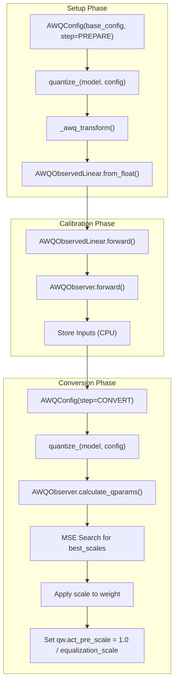
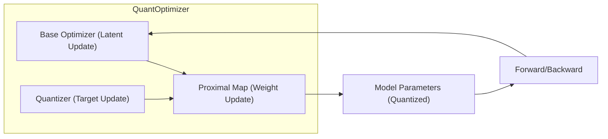

<!-- source: DeepWiki mcp.deepwiki.com · repo pytorch/ao · page 13.1 Prototype Quantization Methods · fetched 2026-10-21 -->

# Prototype Quantization Methods

Relevant source files

The following files were used as context for generating this wiki page:

- [benchmarks/benchmark_hqq.py](benchmarks/benchmark_hqq.py)
- [test/hqq/test_triton_mm.py](test/hqq/test_triton_mm.py)
- [test/hqq/test_triton_qkv_fused.py](test/hqq/test_triton_qkv_fused.py)
- [test/prototype/test_awq.py](test/prototype/test_awq.py)
- [test/prototype/test_int4_opaque_tensor.py](test/prototype/test_int4_opaque_tensor.py)
- [test/prototype/test_parq.py](test/prototype/test_parq.py)
- [test/prototype/test_smoothquant.py](test/prototype/test_smoothquant.py)
- [torchao/prototype/awq/__init__.py](torchao/prototype/awq/__init__.py)
- [torchao/prototype/awq/api.py](torchao/prototype/awq/api.py)
- [torchao/prototype/awq/core.py](torchao/prototype/awq/core.py)
- [torchao/prototype/awq/example.py](torchao/prototype/awq/example.py)
- [torchao/prototype/common/triton/__init__.py](torchao/prototype/common/triton/__init__.py)
- [torchao/prototype/common/triton/matmul.py](torchao/prototype/common/triton/matmul.py)
- [torchao/prototype/common/triton/matmul_perf_model.py](torchao/prototype/common/triton/matmul_perf_model.py)
- [torchao/prototype/hqq/README.md](torchao/prototype/hqq/README.md)
- [torchao/prototype/hqq/__init__.py](torchao/prototype/hqq/__init__.py)
- [torchao/prototype/hqq/kernels.py](torchao/prototype/hqq/kernels.py)
- [torchao/prototype/hqq/mixed_mm.py](torchao/prototype/hqq/mixed_mm.py)
- [torchao/prototype/parq/README.md](torchao/prototype/parq/README.md)
- [torchao/prototype/parq/optim/quantopt.py](torchao/prototype/parq/optim/quantopt.py)
- [torchao/prototype/parq/quant/__init__.py](torchao/prototype/parq/quant/__init__.py)
- [torchao/prototype/parq/quant/config_torchao.py](torchao/prototype/parq/quant/config_torchao.py)
- [torchao/prototype/parq/quant/quant_api.py](torchao/prototype/parq/quant/quant_api.py)
- [torchao/prototype/parq/quant/uniform_torchao.py](torchao/prototype/parq/quant/uniform_torchao.py)
- [torchao/prototype/quantization/int4/__init__.py](torchao/prototype/quantization/int4/__init__.py)
- [torchao/prototype/quantization/int4/inference_workflow.py](torchao/prototype/quantization/int4/inference_workflow.py)
- [torchao/prototype/smoothquant/README.md](torchao/prototype/smoothquant/README.md)
- [torchao/prototype/smoothquant/__init__.py](torchao/prototype/smoothquant/__init__.py)
- [torchao/prototype/smoothquant/api.py](torchao/prototype/smoothquant/api.py)
- [torchao/prototype/smoothquant/core.py](torchao/prototype/smoothquant/core.py)
- [torchao/prototype/smoothquant/example.py](torchao/prototype/smoothquant/example.py)
- [torchao/quantization/quantize_/common/quantization_step.py](torchao/quantization/quantize_/common/quantization_step.py)

This page documents prototype and experimental quantization methods implemented in TorchAO. These methods represent advanced techniques for improving the accuracy of low-bit models (AWQ, SmoothQuant, HQQ) or novel optimization frameworks for training and fine-tuning (PARQ).

## Activation-Aware Weight Quantization (AWQ)

AWQ is a technique that protects "salient" weights—those corresponding to large activation magnitudes—from quantization error by applying a per-channel scaling factor before weight-only quantization [torchao/prototype/awq/core.py:32-40]().

### Implementation and Data Flow
The AWQ implementation follows a three-step workflow integrated into the `quantize_` API: `PREPARE`, calibration, and `CONVERT` [torchao/prototype/awq/api.py:32-56]().

1.  **PREPARE**: The `AWQConfig` swaps `nn.Linear` modules with `AWQObservedLinear`, which contains an `AWQObserver` [torchao/prototype/awq/api.py:69-76]().
2.  **Calibration**: The model is run with exemplar data. The `AWQObserver` collects input activation statistics [torchao/prototype/awq/core.py:51-54]().
3.  **CONVERT**: The observer searches for an optimal scaling factor by minimizing the Mean Squared Error (MSE) between the original output and the quantized output across a search space [torchao/prototype/awq/core.py:70-87](). The resulting scale is applied to the weights, and its reciprocal is stored in `act_pre_scale` for runtime fusion [torchao/prototype/awq/api.py:102-113]().

### Code Entity Space Mapping
The following diagram maps the AWQ logical flow to the specific classes and functions in the codebase.

**AWQ Lifecycle Diagram**

**Sources:** [torchao/prototype/awq/api.py:59-125](), [torchao/prototype/awq/core.py:23-90]()

---

## SmoothQuant

SmoothQuant migrates the quantization difficulty from activations to weights by smoothing out activation outliers using a mathematically equivalent transformation: $Y = (X \cdot S^{-1}) \cdot (S \cdot W)$ [torchao/prototype/smoothquant/README.md]().

### Key Components
*   **`SmoothQuantConfig`**: Controls the `alpha` parameter (balancing migration between activation and weight) and the calibration step [torchao/prototype/smoothquant/api.py:34-57]().
*   **`SmoothQuantObserver`**: Collects per-channel max values for activations and weights to calculate the smoothing factor $S$ [torchao/prototype/smoothquant/core.py:16-75]().
*   **`RunningAbsMaxSmoothQuantObserver`**: A memory-efficient variant that uses a two-pass approach to avoid storing all calibration tensors in RAM [torchao/prototype/smoothquant/core.py:78-134]().

### Two-Pass Calibration Flow
For large datasets, the `RunningAbsMax` observer is preferred:
1.  **Pass 1**: Collect `x_abs_max` incrementally [torchao/prototype/smoothquant/core.py:166-187]().
2.  **Finalize**: Call `compute_smoothing_factor()` [torchao/prototype/smoothquant/core.py:214-228]().
3.  **Pass 2**: Collect statistics on the *smoothed* activations to determine the final activation quantization scales [torchao/prototype/smoothquant/core.py:189-211]().

**Sources:** [torchao/prototype/smoothquant/api.py:66-167](), [torchao/prototype/smoothquant/core.py:78-211]()

---

## Half-Quadratic Quantization (HQQ)

HQQ is a fast, calibration-free quantization method that treats quantization as an optimization problem. In `torchao`, prototype HQQ support focuses on high-performance Triton kernels for mixed-precision matrix multiplication.

### Triton Mixed-Precision Matmul
The `triton_mixed_mm` function enables efficient multiplication between a floating-point activation and a 4-bit quantized weight [torchao/prototype/hqq/mixed_mm.py]().
*   **Packing**: Weights are typically packed as 2xint4 into `uint8` containers using `pack_2xint4` [torchao/prototype/hqq/mixed_mm.py:12-23]().
*   **Kernel Types**: Supports `compute_bound` and `max_autotune` kernel configurations to optimize for different hardware shapes [test/hqq/test_triton_mm.py:35-39]().

**Sources:** [torchao/prototype/hqq/mixed_mm.py:12-23](), [test/hqq/test_triton_mm.py:86-152]()

---

## Proximal Analogous Robust Quantization (PARQ)

PARQ is a prototype framework for Quantization-Aware Training (QAT) that uses proximal optimization to update model parameters [torchao/prototype/parq/README.md]().

### System Architecture
PARQ decouples the quantization process into three entities managed by a `QuantOptimizer` [torchao/prototype/parq/optim/quantopt.py:34-47]():
1.  **Base Optimizer**: Updates latent variables (e.g., `AdamW`) [torchao/prototype/parq/optim/quantopt.py:51]().
2.  **Quantizer**: Defines the target quantization values (e.g., `UnifTorchaoQuantizer`) [torchao/prototype/parq/quant/uniform_torchao.py:36-48]().
3.  **Proximal Mapping**: Updates weights based on latent variables and quantization targets (e.g., `ProxPARQ`, `ProxHardQuant`) [torchao/prototype/parq/optim/proxmap.py]().

**PARQ Entity Interaction**

### Stretched Quantization
PARQ introduces `StretchedIntxWeightConfig`, which uses a "stretched" affine mapping to improve representation for specific bit-widths [torchao/prototype/parq/quant/config_torchao.py:42-51](). It utilizes `choose_qparams_stretched_affine` and `quantize_stretched_affine` primitives [torchao/prototype/parq/quant/config_torchao.py:80-93]().

**Sources:** [torchao/prototype/parq/optim/quantopt.py:34-77](), [torchao/prototype/parq/quant/config_torchao.py:53-113](), [torchao/prototype/parq/quant/uniform_torchao.py:141-160]()

---

## Summary of Prototype Configurations

| Method | Config Class | Primary Use Case |
| :--- | :--- | :--- |
| **AWQ** | `AWQConfig` | Post-Training Weight-Only Quantization (LLMs) |
| **SmoothQuant** | `SmoothQuantConfig` | Static/Dynamic W8A8 Quantization with Outliers |
| **PARQ** | `StretchedIntxWeightConfig` | Experimental QAT using Proximal Optimization |
| **HQQ** | `BaseQuantizeConfig` (External) | Fast 4-bit Weight-Only Quantization |

**Sources:** [torchao/prototype/awq/api.py:32-50](), [torchao/prototype/smoothquant/api.py:34-57](), [torchao/prototype/parq/quant/config_torchao.py:42-51]()

---

