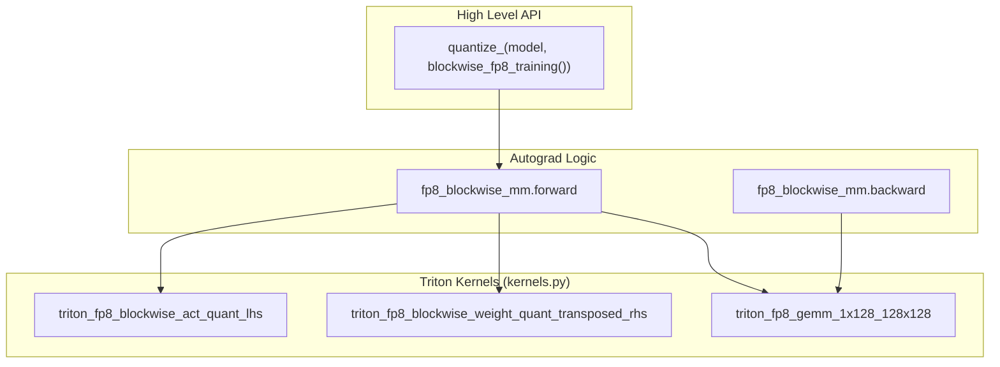

<!-- source: DeepWiki mcp.deepwiki.com · repo pytorch/ao · page 13.2 Quantized Training Prototypes · fetched 2026-10-21 -->

# Quantized Training Prototypes

Relevant source files

The following files were used as context for generating this wiki page:

- [benchmarks/benchmark_low_bit_adam.py](benchmarks/benchmark_low_bit_adam.py)
- [benchmarks/prototype/blockwise_fp8_training/bench_1x128_128x128_gemms.py](benchmarks/prototype/blockwise_fp8_training/bench_1x128_128x128_gemms.py)
- [benchmarks/prototype/blockwise_fp8_training/bench_1x128_128x1_gemms.py](benchmarks/prototype/blockwise_fp8_training/bench_1x128_128x1_gemms.py)
- [benchmarks/prototype/blockwise_fp8_training/bench_linear_fwd_bwd.py](benchmarks/prototype/blockwise_fp8_training/bench_linear_fwd_bwd.py)
- [benchmarks/quantized_training/benchmark_int8mm.py](benchmarks/quantized_training/benchmark_int8mm.py)
- [benchmarks/quantized_training/pretrain_llama2.py](benchmarks/quantized_training/pretrain_llama2.py)
- [test/prototype/blockwise_fp8_training/__init__.py](test/prototype/blockwise_fp8_training/__init__.py)
- [test/prototype/blockwise_fp8_training/_distributed_test_utils.py](test/prototype/blockwise_fp8_training/_distributed_test_utils.py)
- [test/prototype/blockwise_fp8_training/test_blockwise_kernels.py](test/prototype/blockwise_fp8_training/test_blockwise_kernels.py)
- [test/prototype/blockwise_fp8_training/test_blockwise_linear.py](test/prototype/blockwise_fp8_training/test_blockwise_linear.py)
- [test/prototype/blockwise_fp8_training/test_dtensor.py](test/prototype/blockwise_fp8_training/test_dtensor.py)
- [test/prototype/blockwise_fp8_training/test_fsdp2.py](test/prototype/blockwise_fp8_training/test_fsdp2.py)
- [test/prototype/blockwise_fp8_training/test_fsdp2_tp.py](test/prototype/blockwise_fp8_training/test_fsdp2_tp.py)
- [test/prototype/test_quantized_training.py](test/prototype/test_quantized_training.py)
- [torchao/prototype/README.md](torchao/prototype/README.md)
- [torchao/prototype/blockwise_fp8_training/kernels.py](torchao/prototype/blockwise_fp8_training/kernels.py)
- [torchao/prototype/blockwise_fp8_training/linear.py](torchao/prototype/blockwise_fp8_training/linear.py)
- [torchao/prototype/float8nocompile/README.md](torchao/prototype/float8nocompile/README.md)
- [torchao/prototype/float8nocompile/__init__.py](torchao/prototype/float8nocompile/__init__.py)
- [torchao/prototype/float8nocompile/benchmark/benchmark.py](torchao/prototype/float8nocompile/benchmark/benchmark.py)
- [torchao/prototype/float8nocompile/examples/example.py](torchao/prototype/float8nocompile/examples/example.py)
- [torchao/prototype/float8nocompile/float8nocompile_linear.py](torchao/prototype/float8nocompile/float8nocompile_linear.py)
- [torchao/prototype/float8nocompile/float8nocompile_linear_test.py](torchao/prototype/float8nocompile/float8nocompile_linear_test.py)
- [torchao/prototype/float8nocompile/float8nocompile_linear_utils.py](torchao/prototype/float8nocompile/float8nocompile_linear_utils.py)
- [torchao/prototype/float8nocompile/float8nocompile_loss_curves.png](torchao/prototype/float8nocompile/float8nocompile_loss_curves.png)
- [torchao/prototype/float8nocompile/float8nocompile_scaling_utils.py](torchao/prototype/float8nocompile/float8nocompile_scaling_utils.py)
- [torchao/prototype/float8nocompile/kernels/__init__.py](torchao/prototype/float8nocompile/kernels/__init__.py)
- [torchao/prototype/float8nocompile/kernels/fp8_dynamic_tensorwise.py](torchao/prototype/float8nocompile/kernels/fp8_dynamic_tensorwise.py)
- [torchao/prototype/float8nocompile/kernels/fp8_dynamic_tensorwise_test.py](torchao/prototype/float8nocompile/kernels/fp8_dynamic_tensorwise_test.py)
- [torchao/prototype/float8nocompile/test/train_test.py](torchao/prototype/float8nocompile/test/train_test.py)
- [torchao/prototype/quantized_training/README.md](torchao/prototype/quantized_training/README.md)
- [torchao/prototype/quantized_training/__init__.py](torchao/prototype/quantized_training/__init__.py)
- [torchao/prototype/quantized_training/bitnet.py](torchao/prototype/quantized_training/bitnet.py)
- [torchao/prototype/quantized_training/int8.py](torchao/prototype/quantized_training/int8.py)
- [torchao/prototype/quantized_training/int8_mixed_precision.py](torchao/prototype/quantized_training/int8_mixed_precision.py)
- [torchao/prototype/quantized_training/int8_mm.py](torchao/prototype/quantized_training/int8_mm.py)

The `torchao.prototype` directory contains experimental implementations for memory-efficient and high-performance training using low-precision formats. These prototypes cover weight-only quantization, mixed-precision INT8 training, BitNet (1.58-bit), and specialized Float8 strategies that bypass `torch.compile` requirements or utilize blockwise scaling for improved accuracy.

## 1. INT8 Training Strategies

TorchAO provides two primary INT8 training prototypes: Weight-Only (WO) and Mixed-Precision (MP). Both utilize stochastic rounding to prevent small gradient updates from being zeroed out during quantization.

### Int8 Weight-Only Training
This approach quantizes weights to INT8 while keeping activations in high precision. It is designed to reduce memory footprint during training without significantly impacting convergence.

*   **Implementation**: Uses the `Int8QuantizedTrainingLinearWeight` tensor subclass [torchao/prototype/quantized_training/int8.py:56-64]().
*   **Stochastic Rounding**: Applied during in-place updates (e.g., `aten.copy_`) to ensure that the expected value of the quantized update equals the floating-point update [torchao/prototype/quantized_training/int8.py:25-53]().
*   **Key Function**: `int8_weight_only_quantized_training()` provides the config for the `quantize_` API [test/prototype/test_quantized_training.py:83-86]().

### Int8 Mixed-Precision Training
This strategy utilizes INT8 Tensor Cores for the matrix multiplications in both forward and backward passes.

*   **Data Flow**: Weights and activations are dynamically quantized to INT8 per-row. The matmul is performed using `torch._int_mm` (or a custom Triton kernel `scaled_int8_mm`), and the result is scaled back to the original precision [torchao/prototype/quantized_training/int8_mixed_precision.py:189-206]().
*   **Components**:
    *   `Int8MixedPrecisionTrainingLinearWeight`: A subclass that wraps the high-precision weight and intercepts `torch.nn.functional.linear` [torchao/prototype/quantized_training/int8_mixed_precision.py:54-70]().
    *   `_Int8MixedPrecisionTrainingLinearFunction`: An `autograd.Function` that manages the three GEMMs of training: output, grad_input, and grad_weight [torchao/prototype/quantized_training/int8_mixed_precision.py:176-186]().

### Code Entity Mapping: INT8 Training
| Code Entity | Role |
| :--- | :--- |
| `quantize_int8_rowwise` | Primitive for absmax symmetric quantization with stochastic rounding [torchao/prototype/quantized_training/int8.py:25](). |
| `Int8QuantizedTrainingLinearWeight` | Subclass for weight-only training; handles `aten.copy_` for updates [torchao/prototype/quantized_training/int8.py:56](). |
| `Int8MixedPrecisionTrainingLinearWeight` | Subclass for MP training; triggers INT8 matmuls via `__torch_dispatch__` [torchao/prototype/quantized_training/int8_mixed_precision.py:54](). |
| `scaled_int8_mm` | Triton or ATen fallback for `(A_int8 @ B_int8) * scale_a * scale_b` [torchao/prototype/quantized_training/int8_mixed_precision.py:23-33](). |

**Sources**: [torchao/prototype/quantized_training/int8.py](), [torchao/prototype/quantized_training/int8_mixed_precision.py](), [test/prototype/test_quantized_training.py]()

---

## 2. BitNet Training (1.58-bit)

BitNet 1.58b is a prototype implementation of the "Era of 1-bit LLMs" architecture. It quantizes weights to $\{-1, 0, 1\}$ and activations to 8-bit.

*   **Implementation**: Uses a specialized `BitNetTrainingLinearWeight` subclass [torchao/prototype/quantized_training/bitnet.py]().
*   **Workflow**: The `bitnet_training()` config swaps standard linear layers with a version that performs `Sign(W - mean(W))` for weights and per-token absolute max scaling for activations.
*   **Integration**: Often requires modifying `RMSNorm` to be applied before the linear layer as per BitNet training tips [benchmarks/quantized_training/pretrain_llama2.py:150-166]().

**Sources**: [torchao/prototype/quantized_training/bitnet.py](), [benchmarks/quantized_training/pretrain_llama2.py]()

---

## 3. Blockwise FP8 Training

Standard FP8 training typically uses per-tensor or per-row scaling. The blockwise prototype implements a more granular (1x128 or 128x128) scaling system to preserve dynamic range in large models.

### Implementation Details
*   **Kernels**: Custom Triton kernels for blockwise quantization and GEMMs, such as `triton_fp8_gemm_1x128_128x128` [torchao/prototype/blockwise_fp8_training/kernels.py:199]().
*   **Scaling Recipes**: Uses `BLOCKWISE_1X128_SCALING_TYPE` and `BLOCKWISE_128X128_SCALING_TYPE` to interface with `torch.ops.aten._scaled_mm_v2` or Triton fallbacks [torchao/prototype/blockwise_fp8_training/kernels.py:40-49]().
*   **Autograd**: The `fp8_blockwise_mm` class handles the forward and backward logic, ensuring that activations and weights are quantized into the correct blockwise formats for the three training GEMMs [torchao/prototype/blockwise_fp8_training/linear.py:98-133]().

### Code Entity Mapping: Blockwise FP8

**Sources**: [torchao/prototype/blockwise_fp8_training/linear.py](), [torchao/prototype/blockwise_fp8_training/kernels.py](), [test/prototype/blockwise_fp8_training/test_blockwise_kernels.py]()

---

## 4. Float8 No-Compile Training

While standard `Float8Linear` relies heavily on `torch.compile` to fuse quantization and dequantization, the `Float8LinearNoCompile` prototype is designed to be performant in eager mode using hand-written Triton kernels.

*   **Mechanism**: It computes FP8 tensors needed for backward pass during the forward pass to reduce kernel dispatch overhead [torchao/prototype/float8nocompile/float8nocompile_linear.py:126-130]().
*   **Kernel Algorithms**: Supports `ATOMIC_MAX` and `REDUCTION` strategies for computing the absolute maximum (amax) across blocks [torchao/prototype/float8nocompile/kernels/fp8_dynamic_tensorwise.py:55-62]().
*   **API**: Users can convert models using `convert_to_float8_nocompile_training(module)` [torchao/prototype/float8nocompile/float8nocompile_linear_utils.py:24-31]().

**Sources**: [torchao/prototype/float8nocompile/float8nocompile_linear.py](), [torchao/prototype/float8nocompile/kernels/fp8_dynamic_tensorwise.py](), [torchao/prototype/float8nocompile/float8nocompile_linear_utils.py]()

---

## 5. Low-Bit Optimizer Integration

TorchAO prototypes include integration for low-bit optimizers that reduce the memory footprint of optimizer states (e.g., Adam moments).

*   **Optimizers**: `AdamW8bit`, `AdamW4bit`, and `AdamWFp8` [benchmarks/benchmark_low_bit_adam.py:58-64]().
*   **Technique**: Optimizer states are stored as quantized tensors. Stochastic rounding is used during state updates to maintain precision over long training runs.
*   **CPU Offloading**: Supports offloading optimizer states to CPU via `optim_cpu_offload="ao"` to enable training larger models on limited GPU memory [benchmarks/benchmark_low_bit_adam.py:21-29]().

**Sources**: [benchmarks/benchmark_low_bit_adam.py](), [benchmarks/quantized_training/pretrain_llama2.py]()

---

