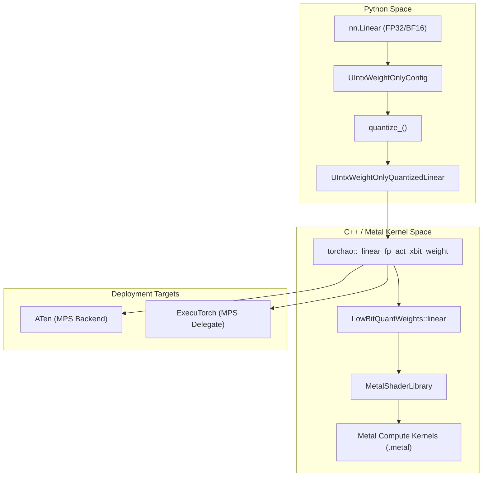
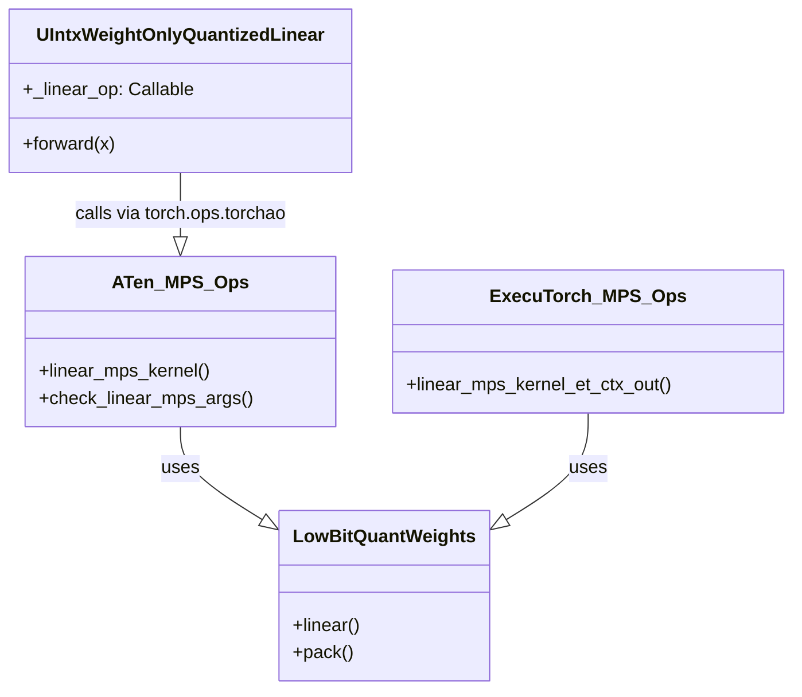

<!-- source: DeepWiki mcp.deepwiki.com · repo pytorch/ao · page 13.3 Apple MPS and ExecuTorch Support · fetched 2026-10-21 -->

# Apple MPS and ExecuTorch Support

Relevant source files

The following files were used as context for generating this wiki page:

- [.github/workflows/metal_test.yml](.github/workflows/metal_test.yml)
- [torchao/experimental/kernels/mps/codegen/gen_metal_shader_lib.py](torchao/experimental/kernels/mps/codegen/gen_metal_shader_lib.py)
- [torchao/experimental/kernels/mps/metal.yaml](torchao/experimental/kernels/mps/metal.yaml)
- [torchao/experimental/kernels/mps/metal/int1mm.metal](torchao/experimental/kernels/mps/metal/int1mm.metal)
- [torchao/experimental/kernels/mps/metal/int2mm_opt.metal](torchao/experimental/kernels/mps/metal/int2mm_opt.metal)
- [torchao/experimental/kernels/mps/metal/int3mm_opt.metal](torchao/experimental/kernels/mps/metal/int3mm_opt.metal)
- [torchao/experimental/kernels/mps/metal/int4mm_opt.metal](torchao/experimental/kernels/mps/metal/int4mm_opt.metal)
- [torchao/experimental/kernels/mps/metal/int5mm.metal](torchao/experimental/kernels/mps/metal/int5mm.metal)
- [torchao/experimental/kernels/mps/metal/int6mm.metal](torchao/experimental/kernels/mps/metal/int6mm.metal)
- [torchao/experimental/kernels/mps/metal/int7mm.metal](torchao/experimental/kernels/mps/metal/int7mm.metal)
- [torchao/experimental/kernels/mps/metal/qmv.metal](torchao/experimental/kernels/mps/metal/qmv.metal)
- [torchao/experimental/kernels/mps/src/MetalShaderLibrary.h](torchao/experimental/kernels/mps/src/MetalShaderLibrary.h)
- [torchao/experimental/kernels/mps/src/OperationUtils.h](torchao/experimental/kernels/mps/src/OperationUtils.h)
- [torchao/experimental/kernels/mps/src/OperationUtils.mm](torchao/experimental/kernels/mps/src/OperationUtils.mm)
- [torchao/experimental/kernels/mps/src/common.h](torchao/experimental/kernels/mps/src/common.h)
- [torchao/experimental/kernels/mps/src/dispatch.h](torchao/experimental/kernels/mps/src/dispatch.h)
- [torchao/experimental/kernels/mps/src/lowbit.h](torchao/experimental/kernels/mps/src/lowbit.h)
- [torchao/experimental/kernels/mps/test/Makefile](torchao/experimental/kernels/mps/test/Makefile)
- [torchao/experimental/kernels/mps/test/test_lowbit.mm](torchao/experimental/kernels/mps/test/test_lowbit.mm)
- [torchao/experimental/ops/__init__.py](torchao/experimental/ops/__init__.py)
- [torchao/experimental/ops/mps/CMakeLists.txt](torchao/experimental/ops/mps/CMakeLists.txt)
- [torchao/experimental/ops/mps/__init__.py](torchao/experimental/ops/mps/__init__.py)
- [torchao/experimental/ops/mps/cshim.py](torchao/experimental/ops/mps/cshim.py)
- [torchao/experimental/ops/mps/linear_fp_act_xbit_weight_aten.mm](torchao/experimental/ops/mps/linear_fp_act_xbit_weight_aten.mm)
- [torchao/experimental/ops/mps/linear_fp_act_xbit_weight_executorch.mm](torchao/experimental/ops/mps/linear_fp_act_xbit_weight_executorch.mm)
- [torchao/experimental/ops/mps/mps_op_lib.py](torchao/experimental/ops/mps/mps_op_lib.py)
- [torchao/experimental/ops/mps/test/test_lowbit.py](torchao/experimental/ops/mps/test/test_lowbit.py)
- [torchao/experimental/ops/mps/test/test_quantizer.py](torchao/experimental/ops/mps/test/test_quantizer.py)
- [torchao/experimental/ops/mps/utils.py](torchao/experimental/ops/mps/utils.py)
- [torchao/experimental/quant_api.py](torchao/experimental/quant_api.py)

This section documents the experimental support for Apple Metal Performance Shaders (MPS) and ExecuTorch within `torchao`. This integration provides high-performance low-bit linear kernels (1-7 bit) optimized for Apple Silicon, enabling efficient model deployment on mobile and edge devices.

## Overview

The MPS support in `torchao` is centered around a set of custom Metal kernels and a specialized quantization API (`quant_api.py`) designed for weight-only quantization. These kernels support various bit-widths and group sizes, with specific optimizations for both matrix-matrix multiplication (GEMM) and matrix-vector multiplication (GEMV) workloads. Integration with ExecuTorch allows these optimized kernels to be exported and run in mobile environments.

### Data Flow and System Architecture

The following diagram illustrates the flow from a standard PyTorch model to an optimized MPS/ExecuTorch deployment.

**Figure 1: MPS Quantization and Deployment Flow**

Sources: [torchao/experimental/quant_api.py:188-216](), [torchao/experimental/ops/mps/linear_fp_act_xbit_weight_aten.mm:102-112](), [torchao/experimental/ops/mps/linear_fp_act_xbit_weight_executorch.mm:98-108]()

## Quantization API for MPS

The primary entry point for MPS quantization is the `quantize_` function used with `UIntxWeightOnlyConfig`. This process transforms standard `nn.Linear` layers into `UIntxWeightOnlyQuantizedLinear` modules.

### Key Components

*   **`UIntxWeightOnlyConfig`**: A configuration class that specifies the target `bitwidth` (1-7) and `group_size` (32, 64, 128, or 256) [torchao/experimental/quant_api.py:330-339]().
*   **`UIntxWeightOnlyQuantizedLinear`**: A replacement module that stores `packed_weights`, `weight_scales`, and `weight_zeros` as `nn.Parameter` [torchao/experimental/quant_api.py:99-112]().
*   **Quantization Algorithms**: Supports `MIN_MAX` and `HQQ` (Half-Quadratic Quantization) for calculating scales and zero points [torchao/experimental/quant_api.py:39-54]().

### Weight Packing and Scaling
Weights are quantized into `uint8` values and then packed into a bit-compact format using specialized packing operators (e.g., `_pack_weight_4bit`). The dequantization formula used by the kernels is:
$W_{dequant} = W_{q} \times scale + zero\_point$ [torchao/experimental/quant_api.py:139-141]().

Sources: [torchao/experimental/quant_api.py:99-156](), [torchao/experimental/ops/mps/linear_fp_act_xbit_weight_aten.mm:155-167]()

## Metal Kernels and Dispatch

The core performance of the MPS support comes from highly specialized Metal shaders. These are managed via the `LowBitQuantWeights` template class in C++.

### Kernel Selection Logic
The system dynamically selects the most efficient kernel based on the input shape (M, N, K):
*   **GEMV (M=1)**: Uses `qmv_fast` or `qmv_impl` shaders optimized for memory bandwidth [torchao/experimental/kernels/mps/src/lowbit.h:121-133]().
*   **GEMM (M>1)**: Uses bit-specific matrix multiplication kernels (e.g., `int4pack_mm`) with tiled dispatch strategies [torchao/experimental/kernels/mps/src/lowbit.h:134-137]().

### Dispatch Strategies
Different dispatch patterns are implemented in `torchao::kernels::mps::lowbit::dispatch` to maximize GPU utilization:
| Strategy | Description | Target Bit-widths |
| :--- | :--- | :--- |
| `dispatch_mm` | Standard grid dispatch | 1, 5, 6, 7 |
| `dispatch_mm_Mr1xNr4_per_TG` | Optimized tiling (1 row, 4 columns per threadgroup) | 2, 3, 4 |
| `dispatch_qmv` | Optimized for vector-matrix (M=1) | All (M=1) |

Sources: [torchao/experimental/kernels/mps/src/lowbit.h:20-70](), [torchao/experimental/kernels/mps/src/dispatch.h:13-49]()

## ExecuTorch Integration

`torchao` provides a path to export these MPS-optimized models for use with the ExecuTorch runtime via the MPS delegate.

### Implementation Details
The ExecuTorch kernels are defined in `linear_fp_act_xbit_weight_executorch.mm`. They bridge the ExecuTorch `Tensor` types to the same `LowBitQuantWeights` underlying Metal implementations used by the ATen backend [torchao/experimental/ops/mps/linear_fp_act_xbit_weight_executorch.mm:98-108]().

**Figure 2: Code Entity Mapping (Python to C++)**

Sources: [torchao/experimental/quant_api.py:99-108](), [torchao/experimental/ops/mps/linear_fp_act_xbit_weight_aten.mm:117-128](), [torchao/experimental/ops/mps/linear_fp_act_xbit_weight_executorch.mm:79-111](), [torchao/experimental/kernels/mps/src/lowbit.h:179-183]()

## Build System and Codegen

The MPS ops require a specialized build process to handle Metal shader compilation and C++ header generation.

### Shader Library Generation
Because Metal shaders are often provided as source strings or pre-compiled libraries, `torchao` uses a Python script `gen_metal_shader_lib.py` to bundle `.metal` files into a C++ header `metal_shader_lib.h` [torchao/experimental/kernels/mps/codegen/gen_metal_shader_lib.py:12-69]().
1.  The script reads `metal.yaml` to identify required source files [torchao/experimental/kernels/mps/metal.yaml:1-27]().
2.  It wraps the contents in a `MetalShaderLibrary` object [torchao/experimental/kernels/mps/codegen/gen_metal_shader_lib.py:45-50]().

### CMake Configuration
The `CMakeLists.txt` handles the following:
*   **Validation**: Ensures the build is running on Darwin (macOS/iOS) with arm64 architecture [torchao/experimental/ops/mps/CMakeLists.txt:18-24]().
*   **Codegen Trigger**: Executes the Python generator before compiling C++ sources [torchao/experimental/ops/mps/CMakeLists.txt:36-42]().
*   **Library Targets**: Creates `torchao_ops_mps_aten` for standard PyTorch and `torchao_ops_mps_executorch` if `TORCHAO_BUILD_EXECUTORCH_OPS` is enabled [torchao/experimental/ops/mps/CMakeLists.txt:63-84]().

Sources: [torchao/experimental/ops/mps/CMakeLists.txt:1-85](), [torchao/experimental/kernels/mps/codegen/gen_metal_shader_lib.py:1-69]()

---

