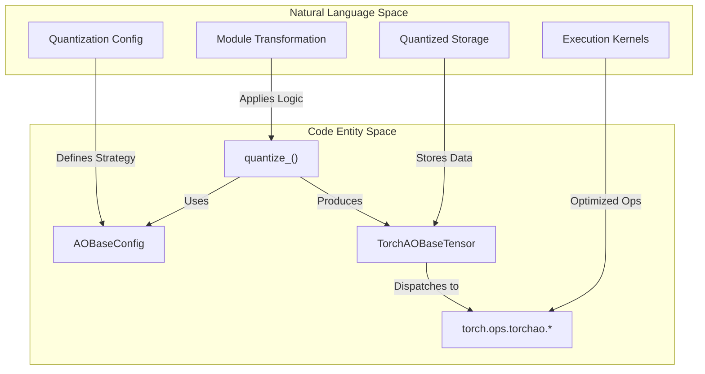
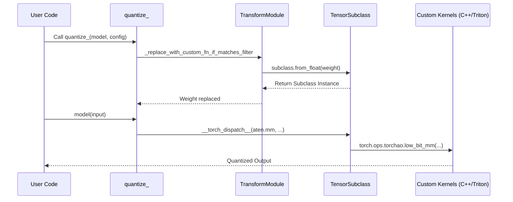

<!-- source: DeepWiki mcp.deepwiki.com · repo pytorch/ao · page 14 Glossary · fetched 2026-10-21 -->

# Glossary

Relevant source files

The following files were used as context for generating this wiki page:

- [README.md](README.md)
- [benchmarks/mx_formats/cast_bench.py](benchmarks/mx_formats/cast_bench.py)
- [benchmarks/prototype/moe_training/mxfp8/bench_dequantize.py](benchmarks/prototype/moe_training/mxfp8/bench_dequantize.py)
- [benchmarks/prototype/moe_training/mxfp8/bench_mx_block_rearrange_2d_M_groups.py](benchmarks/prototype/moe_training/mxfp8/bench_mx_block_rearrange_2d_M_groups.py)
- [benchmarks/prototype/moe_training/mxfp8/bench_quantize_3d.py](benchmarks/prototype/moe_training/mxfp8/bench_quantize_3d.py)
- [benchmarks/prototype/moe_training/mxfp8/roofline_unified.py](benchmarks/prototype/moe_training/mxfp8/roofline_unified.py)
- [setup.py](setup.py)
- [test/dtypes/test_affine_quantized_float.py](test/dtypes/test_affine_quantized_float.py)
- [test/float8/test_base.py](test/float8/test_base.py)
- [test/float8/test_compile.py](test/float8/test_compile.py)
- [test/float8/test_dtensor.py](test/float8/test_dtensor.py)
- [test/float8/test_fsdp.py](test/float8/test_fsdp.py)
- [test/float8/test_fsdp2/test_fsdp2.py](test/float8/test_fsdp2/test_fsdp2.py)
- [test/float8/test_fsdp_compile.py](test/float8/test_fsdp_compile.py)
- [test/float8/test_numerics_integration.py](test/float8/test_numerics_integration.py)
- [test/integration/test_integration.py](test/integration/test_integration.py)
- [test/integration/test_vllm.py](test/integration/test_vllm.py)
- [test/prototype/moe_training/test_kernels.py](test/prototype/moe_training/test_kernels.py)
- [test/prototype/moe_training/test_mxfp8_grouped_mm.py](test/prototype/moe_training/test_mxfp8_grouped_mm.py)
- [test/prototype/mx_formats/test_inference_workflow.py](test/prototype/mx_formats/test_inference_workflow.py)
- [test/prototype/mx_formats/test_kernels.py](test/prototype/mx_formats/test_kernels.py)
- [test/prototype/mx_formats/test_mx_serialization.py](test/prototype/mx_formats/test_mx_serialization.py)
- [test/prototype/mx_formats/test_mx_tensor.py](test/prototype/mx_formats/test_mx_tensor.py)
- [test/prototype/mx_formats/test_nvfp4_tensor.py](test/prototype/mx_formats/test_nvfp4_tensor.py)
- [test/quantization/quantize_/workflows/float8/test_float8_tensor.py](test/quantization/quantize_/workflows/float8/test_float8_tensor.py)
- [test/quantization/quantize_/workflows/float8/test_float8_tensor_mi300.py](test/quantization/quantize_/workflows/float8/test_float8_tensor_mi300.py)
- [test/quantization/test_quant_api.py](test/quantization/test_quant_api.py)
- [test/quantization/test_quant_primitives.py](test/quantization/test_quant_primitives.py)
- [test/test_ops.py](test/test_ops.py)
- [test/test_utils.py](test/test_utils.py)
- [torchao/__init__.py](torchao/__init__.py)
- [torchao/csrc/cpu/README.md](torchao/csrc/cpu/README.md)
- [torchao/csrc/cpu/aten_kernels/da8w4_linear.cpp](torchao/csrc/cpu/aten_kernels/da8w4_linear.cpp)
- [torchao/csrc/cpu/aten_kernels/float8_linear.cpp](torchao/csrc/cpu/aten_kernels/float8_linear.cpp)
- [torchao/csrc/cpu/aten_kernels/quantized_sdpa.cpp](torchao/csrc/cpu/aten_kernels/quantized_sdpa.cpp)
- [torchao/csrc/cpu/aten_kernels/scaled_embedding_bag.cpp](torchao/csrc/cpu/aten_kernels/scaled_embedding_bag.cpp)
- [torchao/csrc/cpu/aten_kernels/utils.h](torchao/csrc/cpu/aten_kernels/utils.h)
- [torchao/csrc/cuda/mx_kernels/mx_block_rearrange_2d_M_groups.cu](torchao/csrc/cuda/mx_kernels/mx_block_rearrange_2d_M_groups.cu)
- [torchao/csrc/cuda/mx_kernels/mxfp8_cuda.cu](torchao/csrc/cuda/mx_kernels/mxfp8_cuda.cu)
- [torchao/csrc/cuda/mx_kernels/mxfp8_extension.cpp](torchao/csrc/cuda/mx_kernels/mxfp8_extension.cpp)
- [torchao/csrc/cuda/mx_kernels/mxfp8_quantize.cuh](torchao/csrc/cuda/mx_kernels/mxfp8_quantize.cuh)
- [torchao/csrc/cuda/mx_kernels/ptx.cuh](torchao/csrc/cuda/mx_kernels/ptx.cuh)
- [torchao/float8/README.md](torchao/float8/README.md)
- [torchao/float8/__init__.py](torchao/float8/__init__.py)
- [torchao/float8/config.py](torchao/float8/config.py)
- [torchao/float8/float8_linear.py](torchao/float8/float8_linear.py)
- [torchao/float8/float8_linear_utils.py](torchao/float8/float8_linear_utils.py)
- [torchao/float8/float8_ops.py](torchao/float8/float8_ops.py)
- [torchao/float8/float8_scaling_utils.py](torchao/float8/float8_scaling_utils.py)
- [torchao/float8/float8_tensor_parallel.py](torchao/float8/float8_tensor_parallel.py)
- [torchao/float8/float8_training_tensor.py](torchao/float8/float8_training_tensor.py)
- [torchao/float8/float8_utils.py](torchao/float8/float8_utils.py)
- [torchao/float8/fsdp_utils.py](torchao/float8/fsdp_utils.py)
- [torchao/float8/inference.py](torchao/float8/inference.py)
- [torchao/float8/types.py](torchao/float8/types.py)
- [torchao/ops.py](torchao/ops.py)
- [torchao/prototype/hqq/hqq_tinygemm_linear.py](torchao/prototype/hqq/hqq_tinygemm_linear.py)
- [torchao/prototype/inductor/qsdpa_lowering.py](torchao/prototype/inductor/qsdpa_lowering.py)
- [torchao/prototype/moe_training/kernels/mxfp8/cutedsl_quantize_2d_1x32.py](torchao/prototype/moe_training/kernels/mxfp8/cutedsl_quantize_2d_1x32.py)
- [torchao/prototype/moe_training/kernels/mxfp8/cutedsl_quantize_2d_32x1.py](torchao/prototype/moe_training/kernels/mxfp8/cutedsl_quantize_2d_32x1.py)
- [torchao/prototype/moe_training/kernels/mxfp8/cutedsl_quantize_3d.py](torchao/prototype/moe_training/kernels/mxfp8/cutedsl_quantize_3d.py)
- [torchao/prototype/moe_training/kernels/mxfp8/quant.py](torchao/prototype/moe_training/kernels/mxfp8/quant.py)
- [torchao/prototype/moe_training/mxfp8_grouped_mm.py](torchao/prototype/moe_training/mxfp8_grouped_mm.py)
- [torchao/prototype/mx_formats/README.md](torchao/prototype/mx_formats/README.md)
- [torchao/prototype/mx_formats/__init__.py](torchao/prototype/mx_formats/__init__.py)
- [torchao/prototype/mx_formats/config.py](torchao/prototype/mx_formats/config.py)
- [torchao/prototype/mx_formats/constants.py](torchao/prototype/mx_formats/constants.py)
- [torchao/prototype/mx_formats/fp_format_spec.py](torchao/prototype/mx_formats/fp_format_spec.py)
- [torchao/prototype/mx_formats/inference_workflow.py](torchao/prototype/mx_formats/inference_workflow.py)
- [torchao/prototype/mx_formats/kernels.py](torchao/prototype/mx_formats/kernels.py)
- [torchao/prototype/mx_formats/mx_tensor.py](torchao/prototype/mx_formats/mx_tensor.py)
- [torchao/prototype/mx_formats/nvfp4_tensor.py](torchao/prototype/mx_formats/nvfp4_tensor.py)
- [torchao/prototype/mx_formats/utils.py](torchao/prototype/mx_formats/utils.py)
- [torchao/quantization/README.md](torchao/quantization/README.md)
- [torchao/quantization/__init__.py](torchao/quantization/__init__.py)
- [torchao/quantization/qat/README.md](torchao/quantization/qat/README.md)
- [torchao/quantization/quant_api.py](torchao/quantization/quant_api.py)
- [torchao/quantization/quant_primitives.py](torchao/quantization/quant_primitives.py)
- [torchao/quantization/quantize_/common/kernel_preference.py](torchao/quantization/quantize_/common/kernel_preference.py)
- [torchao/quantization/quantize_/workflows/float8/float8_tensor.py](torchao/quantization/quantize_/workflows/float8/float8_tensor.py)
- [torchao/quantization/utils.py](torchao/quantization/utils.py)
- [torchao/testing/utils.py](torchao/testing/utils.py)
- [torchao/utils.py](torchao/utils.py)

This glossary provides definitions for codebase-specific terms, jargon, and domain concepts used within TorchAO. It is designed to assist onboarding engineers in navigating the relationship between quantization theory and its specific implementation in the TorchAO repository.

## Core Concepts

### Affine Quantization
The process of mapping floating-point values to a lower-precision integer or floating-point representation using a linear transformation: $Q = \text{round}(V / S) + Z$.
*   **Scale ($S$):** A floating-point value that determines the step size of the quantization levels.
*   **Zero Point ($Z$):** An integer or float offset that ensures the floating-point zero is exactly representable in the quantized space.
*   **Implementation:** Primary logic is found in `torchao/quantization/quant_primitives.py`. Key functions include `choose_qparams_affine` [torchao/quantization/quant_primitives.py:25]() and `quantize_affine` [torchao/quantization/quant_primitives.py:27]().

### Tensor Subclass
A PyTorch mechanism used by TorchAO to intercept operations (via `__torch_dispatch__`) on quantized tensors. This allows quantized tensors to behave like standard `torch.Tensor` objects while storing data in packed or low-precision formats.
*   **Base Class:** `TorchAOBaseTensor` [torchao/utils.py:30]().
*   **Key Subclasses:** `AffineQuantizedTensor`, `Float8Tensor` [torchao/quantization/quantize_/workflows/float8/float8_tensor.py:33](), `NF4Tensor` [torchao/quantization/quantize_/workflows/int4/int4_tensor.py:461](), and `MXTensor` [torchao/prototype/mx_formats/mx_tensor.py:100]().

### Granularity
Defines the scope over which quantization parameters (scales and zero points) are shared across a tensor's elements.
*   **PerTensor:** One scale/zero-point for the entire tensor [torchao/quantization/granularity.py:22]().
*   **PerRow / PerChannel:** One scale/zero-point per row or output channel [torchao/quantization/granularity.py:41]().
*   **PerGroup:** Elements are divided into blocks (e.g., groups of 32 or 64), each with its own parameters [torchao/quantization/granularity.py:69]().
*   **PerBlock:** 2D tiling of parameters, common in MX formats and Microscaling [torchao/quantization/granularity.py:114]().

---

## Code Entity Mapping

The following diagram bridges natural language quantization concepts to the specific classes and functions in the TorchAO codebase.

### Quantization Lifecycle Mapping

**Sources:** [torchao/quantization/quant_api.py:115](), [torchao/core/config.py:15](), [torchao/utils.py:30]().

---

## Technical Terms & Abbreviations

| Term | Definition | Code Pointer |
| :--- | :--- | :--- |
| **AQ** | Affine Quantization. | `torchao/quantization/quant_primitives.py` |
| **DQ** | Dynamic Quantization (activations quantized at runtime). | `Int8DynamicActivationInt8WeightConfig` [torchao/quantization/quant_api.py:42]() |
| **WO** | Weight-Only Quantization. | `Int4WeightOnlyConfig` [torchao/quantization/quant_api.py:41]() |
| **FQN** | Fully Qualified Name (e.g., `model.layers.0.self_attn.q_proj`). | `ModuleFqnToConfig` [torchao/quantization/quant_api.py:118]() |
| **MX** | Microscaling Formats (OCP spec). | `torchao/prototype/mx_formats/` |
| **NF4** | 4-bit NormalFloat (used in QLoRA). | `NF4Tensor` [torchao/quantization/quantize_/workflows/int4/int4_tensor.py:461]() |
| **STE** | Straight-Through Estimator (for QAT gradients). | `_Round.backward` [torchao/quantization/quant_primitives.py:234]() |
| **HQQ** | Half-Quadratic Quantization (optimization for weight-only). | `_choose_qparams_and_quantize_affine_hqq` [torchao/quantization/quant_primitives.py:35]() |

---

## System Architecture: The `quantize_` Flow

The `quantize_` function is the primary entry point for users. It traverses the model, identifies modules (like `nn.Linear`), and replaces their weights with `TorchAOBaseTensor` subclasses.

### Data Flow and Dispatch

**Sources:** [torchao/quantization/quant_api.py:115-165](), [torchao/quantization/transform_module.py:10-50](), [torchao/ops.py:1-50]().

---

## Hardware-Specific Jargon

*   **SM89 / SM90 / SM100:** NVIDIA GPU Architectures (Ada, Hopper, Blackwell). Checked via `is_sm_at_least_89()` [torchao/utils.py:33]().
*   **MI300 / MI350:** AMD Instinct GPU Architectures. Checked via `is_MI300()` [torchao/utils.py:32]().
*   **AMX / VNNI:** Intel CPU instructions for matrix multiplication acceleration. Checked via `_cpu_is_amx_tile_supported()` [torchao/utils.py:39]().
*   **KleidiAI:** Arm-optimized routines for quantization. Toggled via `TORCHAO_BUILD_KLEIDIAI` in `setup.py` [setup.py:214]().

**Sources:** [torchao/utils.py:24-42](), [setup.py:201-220]().