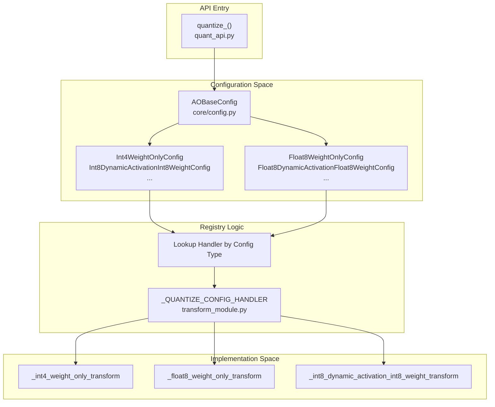
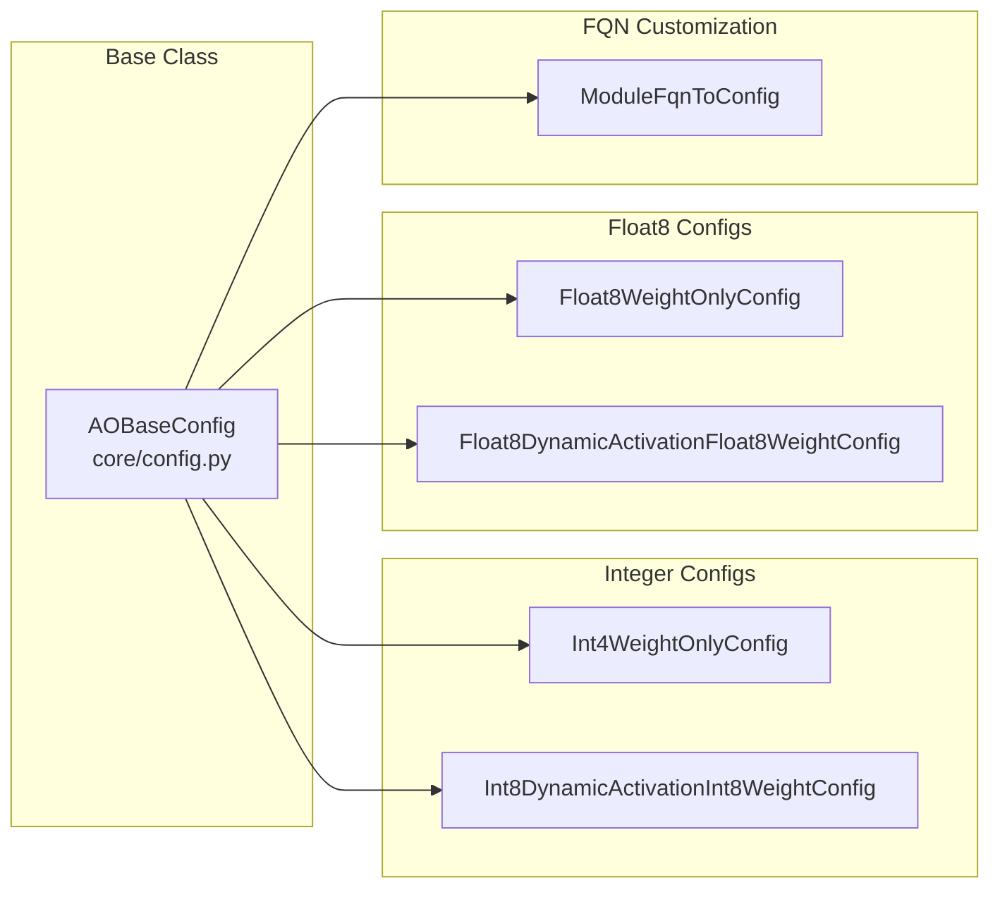

<!-- source: DeepWiki mcp.deepwiki.com · repo pytorch/ao · page 2 Quantization API Reference · fetched 2026-10-21 -->

# Quantization API Reference

<details>
<summary>Relevant source files</summary>

The following files were used as context for generating this wiki page:

- [README.md](README.md)
- [test/integration/test_integration.py](test/integration/test_integration.py)
- [test/quantization/pt2e/test_learnable_fake_quantize.py](test/quantization/pt2e/test_learnable_fake_quantize.py)
- [test/quantization/test_observer.py](test/quantization/test_observer.py)
- [test/quantization/test_quant_api.py](test/quantization/test_quant_api.py)
- [test/quantization/test_quant_primitives.py](test/quantization/test_quant_primitives.py)
- [torchao/prototype/hqq/hqq_tinygemm_linear.py](torchao/prototype/hqq/hqq_tinygemm_linear.py)
- [torchao/quantization/README.md](torchao/quantization/README.md)
- [torchao/quantization/__init__.py](torchao/quantization/__init__.py)
- [torchao/quantization/granularity.py](torchao/quantization/granularity.py)
- [torchao/quantization/observer.py](torchao/quantization/observer.py)
- [torchao/quantization/pt2e/__init__.py](torchao/quantization/pt2e/__init__.py)
- [torchao/quantization/pt2e/_affine_quantization.py](torchao/quantization/pt2e/_affine_quantization.py)
- [torchao/quantization/pt2e/learnable_fake_quantize.py](torchao/quantization/pt2e/learnable_fake_quantize.py)
- [torchao/quantization/pt2e/observer.py](torchao/quantization/pt2e/observer.py)
- [torchao/quantization/qat/README.md](torchao/quantization/qat/README.md)
- [torchao/quantization/quant_api.py](torchao/quantization/quant_api.py)
- [torchao/quantization/quant_primitives.py](torchao/quantization/quant_primitives.py)
- [torchao/quantization/utils.py](torchao/quantization/utils.py)

</details>


This document describes TorchAO's primary quantization API and configuration system. The `quantize_()` function serves as the main entry point for applying quantization to PyTorch models, accepting configuration objects that specify how quantization should be performed. This system provides a unified interface for weight-only, dynamic activation, static activation, and quantization-aware training workflows.

For details on specific topics, see the following child pages:
- [quantize_ Function](#2.1) — Detailed documentation of the main entry point and its parameters.
- [Configuration System (AOBaseConfig)](#2.2) — Reference for all available quantization configuration classes.
- [Quantization Primitives](#2.3) — Low-level mathematical functions for affine quantization.
- [Module Handler Registration](#2.4) — How to extend the system with custom module transformations.
- [Autoquantization](#2.5) — Automated benchmarking and selection of optimal configurations.
- [GPTQ Quantization](#2.6) — Advanced second-order quantization for improved accuracy.

## System Architecture

The quantization API is built on three primary components: the `quantize_()` function, a hierarchy of configuration classes derived from `AOBaseConfig`, and a handler registration system that maps configurations to transformation functions.

### Architecture Overview: Config to Handler Mapping



**Sources:** [torchao/quantization/quant_api.py:115-119](), [torchao/quantization/transform_module.py:72-75](), [torchao/core/config.py:34-34]()

## The quantize_() Function

The `quantize_()` function is the primary user-facing API. it modifies a model in-place by replacing linear weights with quantized tensor subclasses. It uses a recursive replacement strategy to traverse the module tree.

**Function Signature:**
```python
def quantize_(
    model: torch.nn.Module,
    config: AOBaseConfig,
    filter_fn: Optional[Callable[[torch.nn.Module, str], bool]] = None,
    device: Optional[torch.types.Device] = None,
) -> None
```

**Workflow:**
1. It identifies the appropriate handler from the `_QUANTIZE_CONFIG_HANDLER` registry based on the provided `config` type [torchao/quantization/quant_api.py:511-512]().
2. It uses `_replace_with_custom_fn_if_matches_filter` to traverse the model [torchao/quantization/quant_api.py:534-540]().
3. For every module where `filter_fn` is true, it applies the transformation [torchao/quantization/quant_api.py:145-149]().

**Sources:** [torchao/quantization/quant_api.py:476-540](), [torchao/quantization/quant_api.py:122-165]()

## Configuration System (AOBaseConfig)

Configurations in TorchAO are structured as dataclasses inheriting from `AOBaseConfig`. These objects encapsulate all hyperparameters needed for a specific quantization strategy, such as group size, mapping types, and hardware-specific layouts.

### Core Configuration Entities



For details on specific parameters for each class, see [Configuration System (AOBaseConfig)](#2.2).

**Sources:** [torchao/quantization/quant_api.py:37-49](), [torchao/quantization/quant_api.py:602-626](), [torchao/quantization/quant_api.py:2133-2159]()

## Quantization Primitives

Primitives are the low-level building blocks used by handlers. They include functions like `choose_qparams_affine`, `quantize_affine`, and `dequantize_affine`. These functions support various `MappingType` (Symmetric/Asymmetric) and `ZeroPointDomain` (INT/FLOAT/NONE) settings.

**Key Primitives:**
- `choose_qparams_affine`: Calculates scale and zero point [torchao/quantization/quant_primitives.py:25-25]().
- `quantize_affine`: Converts a float tensor to a quantized integer/float representation [torchao/quantization/quant_primitives.py:27-27]().
- `dequantize_affine`: Recovers floating point approximations from quantized values [torchao/quantization/quant_primitives.py:28-28]().

For details, see [Quantization Primitives](#2.3).

**Sources:** [torchao/quantization/quant_primitives.py:55-90](), [torchao/quantization/quant_primitives.py:103-106]()

## Module Handler Registration

The system is extensible via `register_quantize_module_handler`. This allows developers to define how a specific `AOBaseConfig` should transform a standard `nn.Module`.

**Registry:** `_QUANTIZE_CONFIG_HANDLER` stores the mapping between config classes and their transformation functions [torchao/quantization/transform_module.py:73-73]().

For details on implementing new handlers, see [Module Handler Registration](#2.4).

**Sources:** [torchao/quantization/transform_module.py:72-75]()

## Autoquantization and GPTQ

TorchAO provides advanced workflows for optimizing model performance and accuracy:

- **Autoquantization**: Automatically benchmarks different quantization configurations (e.g., int8 vs int4) on the user's specific hardware and selects the fastest one for each layer. For details, see [Autoquantization](#2.5).
- **GPTQ**: A post-training quantization method that uses second-order information (Hessian-based) to minimize the error of quantized weights. For details, see [GPTQ Quantization](#2.6).

**Sources:** [torchao/quantization/quant_api.py:58-62](), [torchao/quantization/quant_api.py:96-101]()

---

