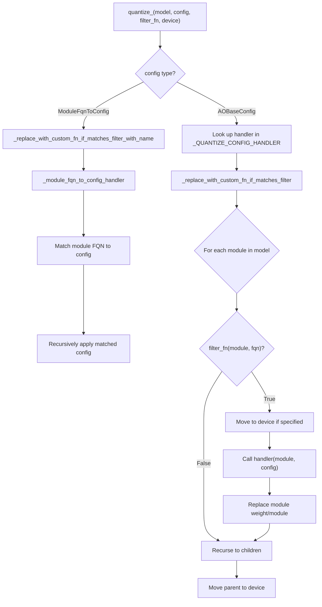
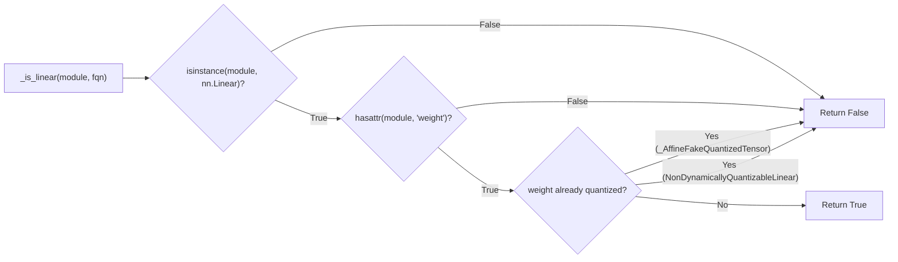
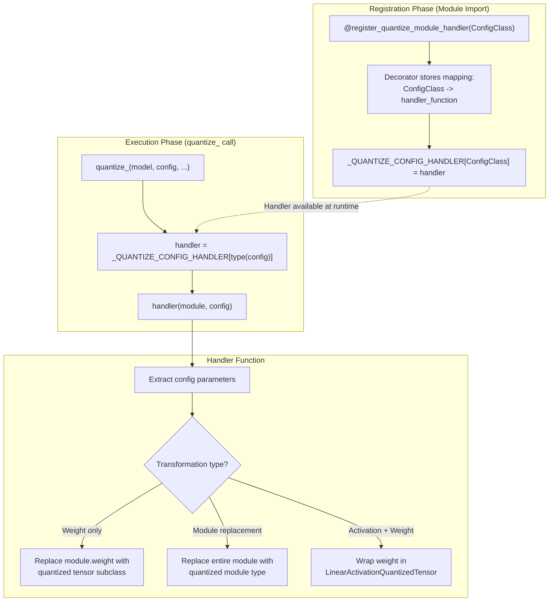
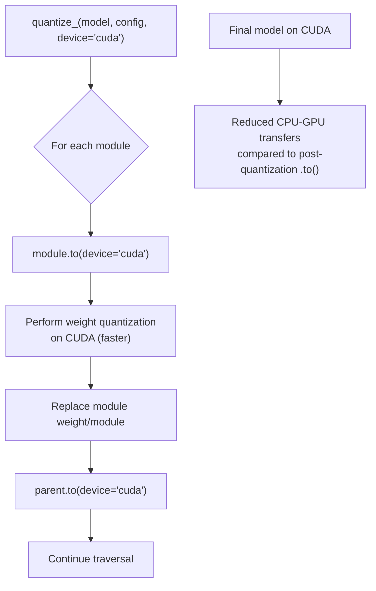
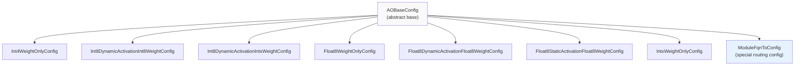

<!-- source: DeepWiki mcp.deepwiki.com · repo pytorch/ao · page 2.1 quantize_ Function · fetched 2026-10-21 -->

# quantize_ Function

<details>
<summary>Relevant source files</summary>

The following files were used as context for generating this wiki page:

- [README.md](README.md)
- [test/integration/test_integration.py](test/integration/test_integration.py)
- [test/quantization/test_quant_api.py](test/quantization/test_quant_api.py)
- [test/quantization/test_quant_primitives.py](test/quantization/test_quant_primitives.py)
- [torchao/prototype/hqq/hqq_tinygemm_linear.py](torchao/prototype/hqq/hqq_tinygemm_linear.py)
- [torchao/quantization/README.md](torchao/quantization/README.md)
- [torchao/quantization/__init__.py](torchao/quantization/__init__.py)
- [torchao/quantization/qat/README.md](torchao/quantization/qat/README.md)
- [torchao/quantization/quant_api.py](torchao/quantization/quant_api.py)
- [torchao/quantization/quant_primitives.py](torchao/quantization/quant_primitives.py)
- [torchao/quantization/utils.py](torchao/quantization/utils.py)

</details>


## Purpose and Scope

The `quantize_` function is the primary entrypoint for applying quantization to PyTorch models in TorchAO. It performs in-place modification of model weights and/or modules according to a provided configuration object, enabling users to quantize models with a single function call. The API is designed to work seamlessly with `torch.compile` to access optimized kernels.

For information about:
- The configuration classes that `quantize_` accepts, see [Configuration System (AOBaseConfig)](./2.2)
- The handler registration mechanism used internally, see [Module Handler Registration](./2.4)
- Autoquantization workflows, see [Autoquantization](./2.5)
- GPTQ-based quantization, see [GPTQ Quantization](./2.6)

Sources: [torchao/quantization/quant_api.py:7-16](), [torchao/quantization/quant_api.py:476-540]()

## Function Signature

```python
def quantize_(
    model: torch.nn.Module,
    config: AOBaseConfig,
    filter_fn: Optional[Callable[[torch.nn.Module, str], bool]] = None,
    device: Optional[torch.types.Device] = None,
) -> None
```

**Parameters:**

| Parameter | Type | Description |
|-----------|------|-------------|
| `model` | `torch.nn.Module` | Input model to be quantized (modified in-place) |
| `config` | `AOBaseConfig` | Configuration object specifying quantization workflow |
| `filter_fn` | `Optional[Callable]` | Function that takes `(module, fqn)` and returns `True` if the module should be quantized. If `None`, defaults to `_is_linear` |
| `device` | `Optional[torch.types.Device]` | Device to move modules to before quantization. Final model will remain on this device |

**Returns:** `None` (model is modified in-place)

Sources: [torchao/quantization/quant_api.py:476-540](), [torchao/quantization/quant_api.py:115-115]()

## Core Workflow



**Workflow Diagram: quantize_ Execution Flow**

The `quantize_` function operates in two main modes:

1. **Single Config Mode** (when `config` is an `AOBaseConfig` subclass):
   - Looks up the registered handler for the config type in `_QUANTIZE_CONFIG_HANDLER` [torchao/quantization/transform_module.py:73-73]().
   - Traverses the model tree in post-order depth-first search using `_replace_with_custom_fn_if_matches_filter` [torchao/quantization/quant_api.py:122-165]().
   - Applies `filter_fn` to each module to determine if it should be quantized.
   - Calls the handler function to transform matching modules.

2. **Per-Module Config Mode** (when `config` is `ModuleFqnToConfig`):
   - Maps fully qualified names (FQNs) or regex patterns to different configs.
   - Allows different quantization strategies for different layers via `_module_fqn_to_config_handler` [torchao/quantization/quant_api.py:226-263]().

Sources: [torchao/quantization/quant_api.py:476-540](), [torchao/quantization/quant_api.py:180-223](), [torchao/quantization/quant_api.py:226-263]()

## Default Filter Function

The default filter function `_is_linear` determines which modules are quantized when no custom `filter_fn` is provided:



**Default Filter Logic**

The filter ensures:
- Only `torch.nn.Linear` modules are quantized [torchao/quantization/quant_api.py:178-178]().
- Weights are not quantized multiple times if shared across layers [torchao/quantization/quant_api.py:174-175]().
- `NonDynamicallyQuantizableLinear` modules are skipped [torchao/quantization/quant_api.py:181-181]().

Sources: [torchao/quantization/quant_api.py:168-182]()

## Handler Registration and Dispatch System

The handler system provides extensibility through a decorator-based registration pattern:



**Handler Registration and Dispatch Architecture**

**Registration Example:**
```python
@register_quantize_module_handler(Int8DynamicActivationInt8WeightConfig)
def _int8_dynamic_activation_int8_weight_transform(
    module: torch.nn.Module,
    config: Int8DynamicActivationInt8WeightConfig,
    **kwargs,
) -> torch.nn.Module:
    # Transform module according to config
    ...
```

The `_QUANTIZE_CONFIG_HANDLER` dictionary maps configuration classes to their corresponding transformation functions [torchao/quantization/transform_module.py:73-73]().

Sources: [torchao/quantization/quant_api.py:634-711](), [torchao/quantization/transform_module.py:72-75]()

## Module Transformation Patterns

### Pattern 1: Weight Tensor Replacement

Used for weight-only quantization (e.g., `Int4WeightOnlyConfig`, `Int8WeightOnlyConfig`).

**Process:**
1. Quantize `module.weight` to a quantized tensor subclass like `Int4Tensor` [torchao/quantization/quant_api.py:56-62]().
2. Wrap in `torch.nn.Parameter(quantized_weight, requires_grad=False)` [torchao/quantization/quant_api.py:209-213]().
3. Replace the module's weight parameter.

Sources: [torchao/quantization/quant_api.py:209-213]()

### Pattern 2: Weight + Activation Quantization

Used when activations are dynamically quantized during the forward pass (e.g., `Int8DynamicActivationInt8WeightConfig`).

**Process:**
1. Quantize weight to a subclass like `Int8Tensor`.
2. Intercept the linear operation to apply on-the-fly quantization to activations using functions like `_quantize_activation_per_token_absmax` [torchao/quantization/utils.py:162-193]().

Sources: [torchao/quantization/quant_api.py:634-711](), [torchao/quantization/utils.py:195-212]()

### Pattern 3: Module Replacement

Used for specialized quantization modules, such as Float8 training.

**Process:**
1. Create a new module instance (e.g., `Float8Linear`) [torchao/float8/float8_linear.py:36-36]().
2. Copy weights and configuration.
3. Replace the entire module in the parent module [torchao/quantization/quant_api.py:161-162]().

Sources: [torchao/quantization/quant_api.py:161-162](), [torchao/float8/float8_linear.py:36-36]()

## Device-Aware Quantization

The `device` parameter enables performance optimization by performing quantization on the target accelerator (e.g., CUDA) rather than CPU.



**Device-Aware Quantization Flow**

The `device` parameter is particularly beneficial for large models, as it moves modules to the device before applying the transformation [torchao/quantization/quant_api.py:146-147]().

Sources: [torchao/quantization/quant_api.py:145-165]()

## Configuration Hierarchy



**Configuration Class Hierarchy**

Each configuration class inherits from `AOBaseConfig` [torchao/core/config.py:34-34]() and has a corresponding handler registered via `@register_quantize_module_handler`.

Sources: [torchao/quantization/quant_api.py:24-44](), [torchao/quantization/quant_api.py:118-118]()

## Common Usage Patterns

### Basic Weight-Only Quantization

```python
import torch
from torchao.quantization import Int4WeightOnlyConfig, quantize_

# Quantize all linear layers to INT4
quantize_(model, Int4WeightOnlyConfig(group_size=32))
```

### Per-Module Configuration

`AOPerModuleConfig` is an alias for `ModuleFqnToConfig` [torchao/quantization/__init__.py:70-70]().

```python
from torchao.quantization import ModuleFqnToConfig, Int4WeightOnlyConfig, Int8WeightOnlyConfig

config = ModuleFqnToConfig({
    "layers.0": Int8WeightOnlyConfig(),
    "re:.*attention.*": Int4WeightOnlyConfig(group_size=64)
})

quantize_(model, config)
```

Sources: [torchao/quantization/quant_api.py:492-509](), [torchao/quantization/__init__.py:70-70]()

## Implementation Details

### Module Traversal

The `_replace_with_custom_fn_if_matches_filter` function implements post-order depth-first traversal [torchao/quantization/quant_api.py:122-165]():

1. **Check current module**: Apply `filter_fn(model, cur_fqn)`.
2. **If matched**: Move to `device` and call `replacement_fn`.
3. **If not matched**: Recurse to children via `named_children()`.

Sources: [torchao/quantization/quant_api.py:145-165]()

### Inductor Configuration

Many configs include logic to automatically apply recommended `torch.compile` settings via `recommended_inductor_config_setter` [torchao/quantization/utils.py:56-56]().

Sources: [torchao/quantization/utils.py:56-56]()

### Module Extra Representation

After quantization, linear modules have their `extra_repr` method overridden to display quantization information via `_linear_extra_repr` [torchao/quantization/quant_api.py:78-78]().

Sources: [torchao/quantization/quant_api.py:78-78]()

---

