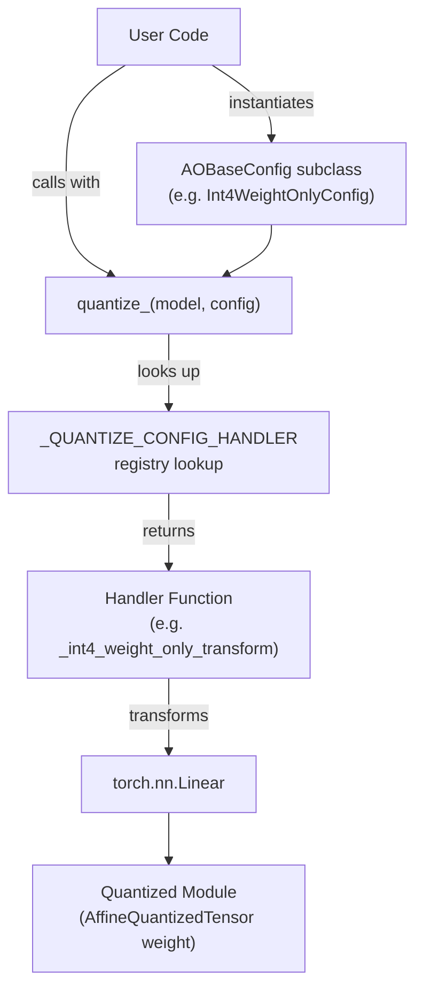

<!-- source: DeepWiki mcp.deepwiki.com · repo pytorch/ao · page 2.2 Configuration System (AOBaseConfig) · fetched 2026-10-21 -->

# Configuration System (AOBaseConfig)

<details>
<summary>Relevant source files</summary>

The following files were used as context for generating this wiki page:

- [README.md](README.md)
- [test/core/test_config.py](test/core/test_config.py)
- [test/integration/test_integration.py](test/integration/test_integration.py)
- [test/prototype/test_prototype_float8_tensor.py](test/prototype/test_prototype_float8_tensor.py)
- [test/quantization/test_quant_api.py](test/quantization/test_quant_api.py)
- [test/quantization/test_quant_primitives.py](test/quantization/test_quant_primitives.py)
- [torchao/core/config.py](torchao/core/config.py)
- [torchao/prototype/hqq/hqq_tinygemm_linear.py](torchao/prototype/hqq/hqq_tinygemm_linear.py)
- [torchao/prototype/quantization/float8_static_quant/__init__.py](torchao/prototype/quantization/float8_static_quant/__init__.py)
- [torchao/prototype/quantization/float8_static_quant/prototype_float8_tensor.py](torchao/prototype/quantization/float8_static_quant/prototype_float8_tensor.py)
- [torchao/prototype/quantization/quant_api.py](torchao/prototype/quantization/quant_api.py)
- [torchao/quantization/README.md](torchao/quantization/README.md)
- [torchao/quantization/__init__.py](torchao/quantization/__init__.py)
- [torchao/quantization/qat/README.md](torchao/quantization/qat/README.md)
- [torchao/quantization/quant_api.py](torchao/quantization/quant_api.py)
- [torchao/quantization/quant_primitives.py](torchao/quantization/quant_primitives.py)
- [torchao/quantization/utils.py](torchao/quantization/utils.py)

</details>


The Configuration System provides a declarative API for specifying quantization workflows in TorchAO. Rather than manually constructing tensor subclasses and applying transformations, users create configuration objects that encapsulate quantization parameters and dispatch to optimized implementations. This page documents the `AOBaseConfig` hierarchy, configuration classes for different quantization schemes, and the handler registration mechanism.

For information about the actual quantization primitives (choose_qparams, quantize_affine, dequantize_affine), see [Quantization Primitives](#2.3). For details on the `quantize_` function that consumes these configs, see [quantize_ Function](#2.1). For module handler registration, see [Module Handler Registration](#2.4).

---

## Overview and Architecture

The configuration system consists of three main components:

1. **Configuration Classes**: Dataclasses (using `@dataclass` decorator) that inherit from `AOBaseConfig` and define quantization parameters.
2. **Handler Functions**: Functions decorated with `@register_quantize_module_handler` that transform modules based on a config.
3. **Dispatch Registry**: The `_QUANTIZE_CONFIG_HANDLER` dictionary mapping config types to handler functions.

**Config-to-Handler Dispatch Flow**



Sources: [torchao/quantization/quant_api.py:440-511](), [torchao/quantization/transform_module.py:73-75](), [torchao/core/config.py:27-50]()

---

## AOBaseConfig Base Class

`AOBaseConfig` is the abstract base class defined in `torchao/core/config.py`. All quantization configuration classes inherit from this base. It serves as a marker interface that `quantize_` recognizes to dispatch to the handler registry.

### Versioning and Serialization
`AOBaseConfig` implements an instance-level versioning system to support backward compatibility during loading.
- `version`: Defaults to `_DEFAULT_VERSION = 1` [torchao/core/config.py:24-67]().
- **Serialization**: Handled via `config_to_dict` and `config_from_dict` [torchao/core/config.py:174-236]().
- **JSON Encoding**: A custom `ConfigJSONEncoder` handles nested objects, `torch.dtype`, and Enums [torchao/core/config.py:70-172]().

```python
from torchao.core.config import AOBaseConfig
from dataclasses import dataclass

@dataclass
class MyQuantConfig(AOBaseConfig):
    # quantization parameters here
    version: int = 1
```

Sources: [torchao/core/config.py:24-189](), [torchao/quantization/quant_api.py:34]()

---

## Configuration Class Taxonomy

**Configuration Class Hierarchy by Quantization Scheme**

```mermaid
graph TB
    AOBaseConfig["AOBaseConfig<br/>(base class)"]
    
    subgraph "Weight-Only Quantization"
        Int4WO["Int4WeightOnlyConfig"]
        Int8WO["Int8WeightOnlyConfig"]
        IntxWO["IntxWeightOnlyConfig"]
        UIntxWO["UIntxWeightOnlyConfig (Prototype)"]
        F8WO["Float8WeightOnlyConfig"]
    end
    
    subgraph "Dynamic Activation Quantization"
        Int8DA_Int8W["Int8DynamicActivationInt8WeightConfig"]
        Int8DA_IntxW["Int8DynamicActivationIntxWeightConfig"]
        Int8DA_Int4W["Int8DynamicActivationInt4WeightConfig"]
        F8DA_F8W["Float8DynamicActivationFloat8WeightConfig"]
        F8DA_Int4W["Float8DynamicActivationInt4WeightConfig"]
        MXDA_MXW["MXDynamicActivationMXWeightConfig"]
    end
    
    subgraph "Static Activation Quantization"
        F8SA_F8W["Float8StaticActivationFloat8WeightConfig"]
        Int8SA_Int8W["Int8StaticActivationInt8WeightConfig"]
    end
    
    AOBaseConfig --> Int4WO
    AOBaseConfig --> Int8WO
    AOBaseConfig --> IntxWO
    AOBaseConfig --> UIntxWO
    AOBaseConfig --> F8WO
    
    AOBaseConfig --> Int8DA_Int8W
    AOBaseConfig --> Int8DA_IntxW
    AOBaseConfig --> Int8DA_Int4W
    AOBaseConfig --> F8DA_F8W
    AOBaseConfig --> F8DA_Int4W
    AOBaseConfig --> MXDA_MXW
    
    AOBaseConfig --> F8SA_F8W
    AOBaseConfig --> Int8SA_Int8W
```



Sources: [torchao/quantization/quant_api.py:572-1953](), [torchao/prototype/quantization/quant_api.py:52-180](), [test/quantization/test_quant_api.py:20-51]()

---

## Weight-Only Quantization Configs

Weight-only quantization applies quantization only to weights, leaving activations in high precision (typically float16/bfloat16).

### Int4WeightOnlyConfig
The primary configuration for 4-bit weight-only quantization.

| Parameter | Type | Default | Description |
|-----------|------|---------|-------------|
| `group_size` | `int` | `256` | Elements per quantization group |
| `version` | `int` | `1` or `2` | Legacy (v1) vs Recommended (v2) |
| `int4_packing_format` | `Int4PackingFormat` | Varies | Format like `tile_packed_to_4d` or `plain_int32` |
| `int4_choose_qparams_algorithm` | `Int4ChooseQParamsAlgorithm` | `AFFINE` | Algorithm like `hqq` or `affine` |
| `use_hqq` | `bool` | `False` | Enable Half-Quadratic Quantization |

Sources: [torchao/quantization/quant_api.py:1306-1344](), [torchao/quantization/quant_api.py:1346-1634]()

### Float8WeightOnlyConfig
FP8 weight-only quantization for modern GPUs (requires SM89+).

| Parameter | Type | Default | Description |
|-----------|------|---------|-------------|
| `granularity` | `FP8Granularity` | `PerRow()` | `PerTensor` or `PerRow` quantization |
| `mm_config` | `Float8MMConfig` | `None` | Matrix multiplication configuration |

Sources: [torchao/quantization/quant_api.py:998-1058]()

---

## Dynamic Activation Quantization Configs

Dynamic activation quantization computes quantization parameters per-forward-pass at runtime.

### Int8DynamicActivationInt8WeightConfig
Standard 8-bit dynamic quantization for activations and weights.

| Parameter | Type | Default | Description |
|-----------|------|---------|-------------|
| `act_mapping_type` | `MappingType` | `SYMMETRIC` | Symmetric vs Asymmetric for activations |
| `layout` | `Layout` | `PlainLayout()` | Memory layout for weights |

Sources: [torchao/quantization/quant_api.py:1754-1808]()

### Float8DynamicActivationFloat8WeightConfig
FP8 dynamic activation and weight quantization (SM90+ recommended).

| Parameter | Type | Default | Description |
|-----------|------|---------|-------------|
| `activation_granularity` | `FP8Granularity` | `PerRow()` | Activation scaling granularity |
| `weight_granularity` | `FP8Granularity` | `PerRow()` | Weight scaling granularity |

Sources: [torchao/quantization/quant_api.py:1060-1134](), [torchao/quantization/quant_api.py:2060-2158]()

---

## Static/Calibrated Activation Quantization Configs

Static quantization uses pre-computed scales for activations, determined during a calibration phase.

### Float8StaticActivationFloat8WeightConfig
FP8 static activation quantization with FP8 weights.

| Parameter | Type | Default | Description |
|-----------|------|---------|-------------|
| `act_quant_scale` | `torch.Tensor` | Required | Pre-computed activation scale |
| `granularity` | `FP8Granularity` | `PerRow()` | Granularity for weight and activation |

Sources: [torchao/prototype/quantization/quant_api.py:23-28](), [test/prototype/test_prototype_float8_tensor.py:15-24]()

---

## Handler Registration Mechanism

The system uses a registry to link configuration classes to their transformation logic.

**Code Entity Space Mapping**

| Code Entity | File Path | Role |
|-------------|-----------|------|
| `AOBaseConfig` | `torchao/core/config.py` | Abstract base for all configs |
| `_QUANTIZE_CONFIG_HANDLER` | `torchao/quantization/transform_module.py` | Global registry dictionary |
| `register_quantize_module_handler` | `torchao/quantization/transform_module.py` | Decorator to register handlers |
| `quantize_` | `torchao/quantization/quant_api.py` | Entry point that invokes handlers |

**Registration Example:**
```python
@register_quantize_module_handler(Int4WeightOnlyConfig)
def _int4_weight_only_transform(module, config):
    # logic to swap weight with Int4Tensor
    ...
```

Sources: [torchao/quantization/transform_module.py:72-75](), [torchao/quantization/quant_api.py:440-511]()

---

## Serialization via config_to_dict

The configuration system supports robust serialization to allow saving quantization settings alongside model checkpoints.

```python
from torchao.core.config import config_to_dict, config_from_dict
from torchao.quantization import Int4WeightOnlyConfig

config = Int4WeightOnlyConfig(group_size=128)
# Convert to serializable dict
config_dict = config_to_dict(config)
# Reconstruct from dict
new_config = config_from_dict(config_dict)
```

The `ConfigJSONEncoder` specifically handles `torch.dtype` (e.g., `torch.bfloat16`) and `Layout` objects which are not standard JSON serializable [torchao/core/config.py:70-156]().

Sources: [torchao/core/config.py:174-236](), [torchao/core/config.py:70-156]()

---

