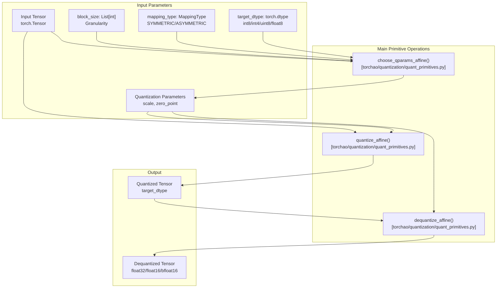
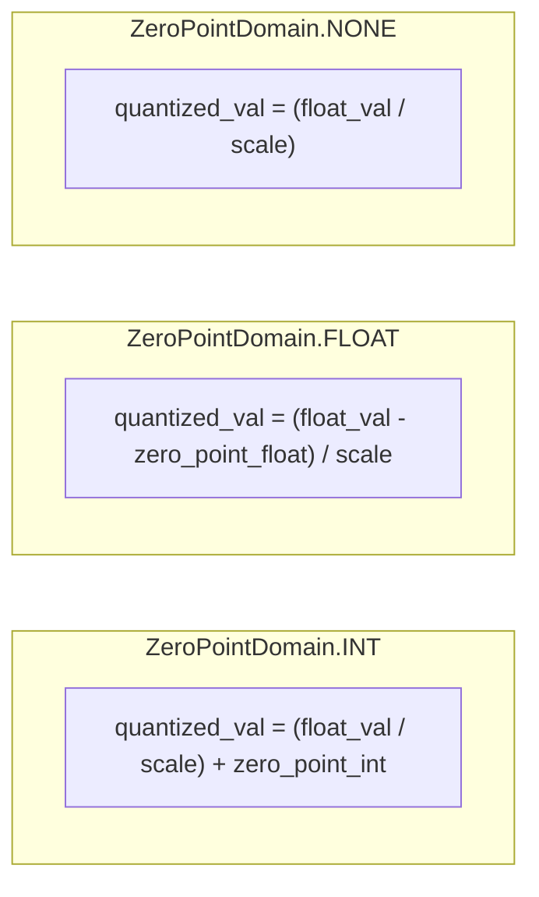

<!-- source: DeepWiki mcp.deepwiki.com · repo pytorch/ao · page 2.3 Quantization Primitives · fetched 2026-10-21 -->

# Quantization Primitives

<details>
<summary>Relevant source files</summary>

The following files were used as context for generating this wiki page:

- [README.md](README.md)
- [test/integration/test_integration.py](test/integration/test_integration.py)
- [test/quantization/pt2e/test_learnable_fake_quantize.py](test/quantization/pt2e/test_learnable_fake_quantize.py)
- [test/quantization/test_observer.py](test/quantization/test_observer.py)
- [test/quantization/test_quant_api.py](test/quantization/test_quant_api.py)
- [test/quantization/test_quant_primitives.py](test/quantization/test_quant_primitives.py)
- [torchao/prototype/hqq/hqq_tinygemm_linear.py](torchao/prototype/hqq/hqq_tinygemm_linear.py)
- [torchao/quantization/README.md](torchao/quantization/README.md)
- [torchao/quantization/__init__.py](torchao/quantization/__init__.py)
- [torchao/quantization/granularity.py](torchao/quantization/granularity.py)
- [torchao/quantization/observer.py](torchao/quantization/observer.py)
- [torchao/quantization/pt2e/__init__.py](torchao/quantization/pt2e/__init__.py)
- [torchao/quantization/pt2e/_affine_quantization.py](torchao/quantization/pt2e/_affine_quantization.py)
- [torchao/quantization/pt2e/learnable_fake_quantize.py](torchao/quantization/pt2e/learnable_fake_quantize.py)
- [torchao/quantization/pt2e/observer.py](torchao/quantization/pt2e/observer.py)
- [torchao/quantization/qat/README.md](torchao/quantization/qat/README.md)
- [torchao/quantization/quant_api.py](torchao/quantization/quant_api.py)
- [torchao/quantization/quant_primitives.py](torchao/quantization/quant_primitives.py)
- [torchao/quantization/utils.py](torchao/quantization/utils.py)

</details>


This page documents the low-level quantization primitive operations that form the foundation of TorchAO's quantization system. These primitives implement the core mathematical operations for affine quantization: computing quantization parameters, quantizing tensors, and dequantizing tensors. For higher-level quantization workflows and configurations, see [Quantization API Reference](2) and [Configuration System](2.2).

---

## Purpose and Scope

Quantization primitives provide the fundamental operations for converting between high-precision floating-point tensors and low-precision quantized representations. The primitives support:

- **Affine quantization**: `quantized_val = (float_val / scale) + zero_point`
- **Multiple mapping types**: symmetric, asymmetric, and no-clipping-error variants
- **Multiple zero-point domains**: integer, float, or none
- **Block-wise granularity**: per-tensor, per-channel, per-group, per-token
- **Multiple target dtypes**: int8, int4, uint8, uint4, float8, and custom floatx formats

These primitives are used internally by all higher-level quantization APIs in TorchAO, including `quantize_()`, `AffineQuantizedTensor`, and configuration classes.

Sources: [torchao/quantization/quant_primitives.py:1-54](), [torchao/quantization/__init__.py:106-111]()

---

## Core Quantization Operations

### Natural Language to Code Entity Mapping: Primitives



**Diagram: Core Quantization Primitive Operations**

The three fundamental operations work together to perform quantization:

1. **choose_qparams_affine**: Analyzes the input tensor and computes optimal quantization parameters (scale and zero_point). [torchao/quantization/quant_primitives.py:322-367]()
2. **quantize_affine**: Applies quantization using the computed parameters. [torchao/quantization/quant_primitives.py:658-736]()
3. **dequantize_affine**: Reverses quantization to reconstruct approximate floating-point values. [torchao/quantization/quant_primitives.py:738-806]()

Sources: [torchao/quantization/quant_primitives.py:322-806]()

---

## MappingType Enum

The `MappingType` enum controls how floating-point ranges are mapped to integer ranges during quantization:

| MappingType | Description | Mathematical Formula |
|-------------|-------------|---------------------|
| `SYMMETRIC` | Symmetric mapping around zero | Range: `[-max_abs, max_abs]` → `[quant_min, quant_max]` |
| `ASYMMETRIC` | Direct mapping of min/max range | Range: `[min_val, max_val]` → `[quant_min, quant_max]` |
| `SYMMETRIC_NO_CLIPPING_ERR` | Symmetric with separate min/max scales | `scale = max(smin, smax)` where `smin = min_val_neg / quant_min` |

**SYMMETRIC Example:**
- Float range: `(-3.5, 10.2)` with int4 range `(-8, 7)`
- Symmetric range: `(-10.2, 10.2)` → `(-8, 7)`
- Scale: `(10.2 - (-10.2)) / (7 - (-8)) = 1.36`

**ASYMMETRIC Example:**
- Float range: `(-3.5, 10.2)` with int4 range `(-8, 7)`
- Direct mapping: `(-3.5, 10.2)` → `(-8, 7)`
- Scale: `(10.2 - (-3.5)) / (7 - (-8)) = 0.913`

Sources: [torchao/quantization/quant_primitives.py:55-78]()

---

## ZeroPointDomain Enum

The `ZeroPointDomain` enum specifies whether the zero-point is represented in integer or floating-point domain:



**Diagram: Zero Point Domain Variants**

| Domain | Typical Use |
|--------|-------------|
| `INT` | Standard PyTorch quantization, ONNX export. [torchao/quantization/quant_primitives.py:82-82]() |
| `FLOAT` | TensorCore tiled layouts, tinygemm kernels. [torchao/quantization/quant_primitives.py:83-83]() |
| `NONE` | Symmetric quantization (weight-only, some activations). [torchao/quantization/quant_primitives.py:84-84]() |

Sources: [torchao/quantization/quant_primitives.py:79-91]()

---

## Block Size and Granularity

The `block_size` parameter (a `List[int]`) controls the granularity of quantization by specifying which tensor elements share the same quantization parameters.

The implementation uses `_get_reduction_params()` to compute the reshape and reduction dimensions for calculating statistics:

```python
# For block_size = (1, 32) and input_size = (128, 128)
# It identifies dimensions to reduce over to get per-group scales
shape_for_reduction, reduction_dims = _get_reduction_params(block_size, input_size)
```

This allows efficient computation of per-group, per-channel, or per-tensor statistics using standard PyTorch reduction operations like `torch.amin` and `torch.amax`. [torchao/quantization/quant_primitives.py:280-318]()

Sources: [torchao/quantization/quant_primitives.py:280-318](), [torchao/quantization/observer.py:148-155]()

---

## choose_qparams_affine

This function analyzes an input tensor to compute the `scale` and `zero_point`.

```python
def choose_qparams_affine(
    input: torch.Tensor,
    mapping_type: MappingType,
    block_size: Tuple[int, ...],
    target_dtype: torch.dtype,
    quant_min: Optional[int] = None,
    quant_max: Optional[int] = None,
    eps: Optional[float] = None,
    scale_dtype: Optional[torch.dtype] = None,
    zero_point_dtype: Optional[torch.dtype] = None,
) -> Tuple[torch.Tensor, torch.Tensor]:
```

**Key Implementation Details:**
1. **Reduction**: It computes `min_val` and `max_val` over the dimensions specified by the `block_size`. [torchao/quantization/quant_primitives.py:688-693]()
2. **Epsilon**: An `eps` value is used to prevent division by zero when calculating scales. [torchao/quantization/quant_primitives.py:706-706]()
3. **Symmetric vs Asymmetric**: For `MappingType.SYMMETRIC`, the zero_point is forced to 0. [torchao/quantization/quant_primitives.py:712-713]()

Sources: [torchao/quantization/quant_primitives.py:658-736]()

---

## quantize_affine

`quantize_affine` converts high-precision tensors into quantized representations.

### Natural Language to Code Entity Mapping: Quantization Logic

```mermaid
graph TB
    subgraph "Input"
        Input["input: torch.Tensor"]
        Scale["scale: torch.Tensor"]
        ZP["zero_point: torch.Tensor"]
    end
    
    subgraph "Internal Logic"
        Dispatch["_quantize_affine()<br/>[torchao/quantization/quant_primitives.py]"]
        Bounds["_get_and_check_qmin_qmax()<br/>[torchao/quantization/quant_primitives.py]"]
        Core["_quantize_affine_no_dtype_cast()<br/>[torchao/quantization/quant_primitives.py]"]
        Compute["round(input / scale) + zero_point"]
        Clamp["torch.clamp(..., qmin, qmax)"]
    end
    
    Input --> Dispatch
    Dispatch --> Bounds
    Bounds --> Core
    Core --> Compute
    Compute --> Clamp
    Clamp --> Output["Quantized Tensor"]
```

**Diagram: quantize_affine Implementation Flow**

The function performs three main steps:
1. **Reshape**: Reshapes the input and qparams based on `block_size` to ensure broadcasting. [torchao/quantization/quant_primitives.py:441-444]()
2. **Compute**: Applies the affine formula `(input / scale) + zero_point`. [torchao/quantization/quant_primitives.py:456-456]()
3. **Clamp and Cast**: Clamps values to the valid range for the `target_dtype` and performs the final cast. [torchao/quantization/quant_primitives.py:465-474]()

Sources: [torchao/quantization/quant_primitives.py:322-475]()

---

## dequantize_affine

Dequantization reverses the process to reconstruct floating-point values: `dequantized = (quantized - zero_point) * scale`.

**Key Points:**
1. **Precision**: The `output_dtype` can be specified to return values in `float32`, `float16`, or `bfloat16`. [torchao/quantization/quant_primitives.py:738-747]()
2. **Broadcasting**: Like quantization, it handles broadcasting of scales and zero-points across the tensor based on `block_size`. [torchao/quantization/quant_primitives.py:788-791]()

Sources: [torchao/quantization/quant_primitives.py:738-806]()

---

## Specialized Primitive Variants

TorchAO provides specialized versions of these primitives for specific formats and kernels:

| Variant Family | Functions | Use Case |
|----------------|-----------|----------|
| **Tinygemm** | `_choose_qparams_affine_tinygemm` | Used for kernels requiring `FLOAT` domain zero points. [torchao/quantization/quant_primitives.py:478-524]() |
| **Float8** | `_quantize_affine_float8` | Specialized for `torch.float8_e4m3fn` and other FP8 types. [torchao/quantization/quant_primitives.py:916-953]() |
| **HQQ** | `_choose_qparams_and_quantize_affine_hqq` | Implementation of Half-Quadratic Quantization. [torchao/quantization/quant_primitives.py:1020-1065]() |
| **Floatx** | `_quantize_affine_floatx` | For custom floating point formats (e.g. 3-bit float). [torchao/quantization/quant_primitives.py:851-885]() |

Sources: [torchao/quantization/quant_primitives.py:478-1100]()

---

## Custom Op Registration

To ensure compatibility with `torch.compile` and `torch.export`, primitives are registered as custom operators using `torch.library`.

```python
# torchao/quantization/quant_primitives.py:205-222
quant_lib = torch.library.Library("torchao", "FRAGMENT")
register_custom_op = _register_custom_op(quant_lib)

@register_custom_op
def _quantize_affine(
    input: torch.Tensor,
    block_size: List[int],
    scale: torch.Tensor,
    zero_point: Optional[torch.Tensor],
    output_dtype: torch.dtype,
    # ...
):
```

**Straight-Through Estimator (STE):**
The `_Round` class implements a custom autograd function where the backward pass is an identity operation (`gy`), allowing gradients to flow through the non-differentiable `round` function during QAT. [torchao/quantization/quant_primitives.py:225-242]()

Sources: [torchao/quantization/quant_primitives.py:205-242](), [torchao/quantization/quant_primitives.py:369-411]()

---

## Testing and Validation

Primitives are validated in `test/quantization/test_quant_primitives.py` for:
- **Idempotency**: Ensuring multiple calls yield consistent results. [test/quantization/test_quant_primitives.py:53-60]()
- **Numerical Parity**: Comparing against PyTorch core observers and standard formulas. [test/quantization/test_quant_primitives.py:196-225]()
- **Device Support**: Verified across CPU, CUDA, and XPU. [test/quantization/test_quant_primitives.py:157-159]()

Sources: [test/quantization/test_quant_primitives.py:1-611]()

---

