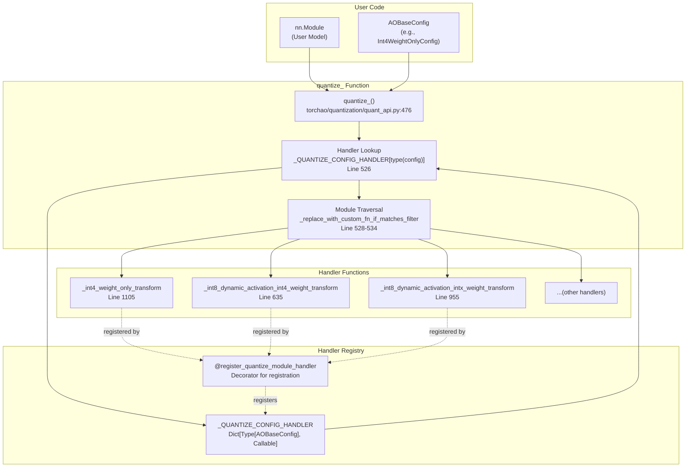
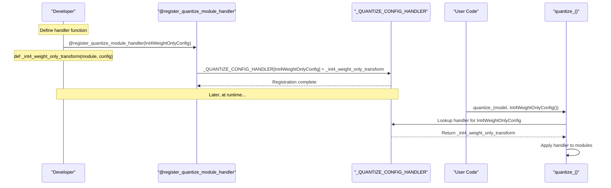
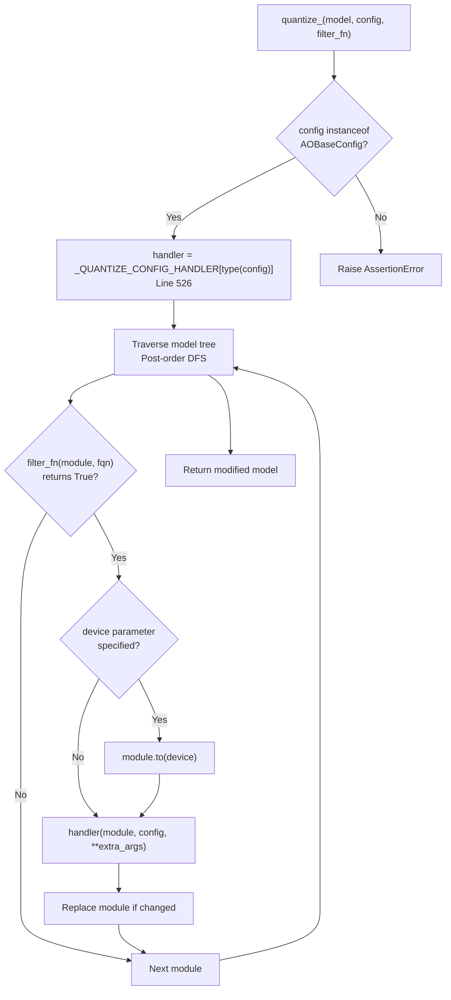

<!-- source: DeepWiki mcp.deepwiki.com · repo pytorch/ao · page 2.4 Module Handler Registration · fetched 2026-10-21 -->

# Module Handler Registration

<details>
<summary>Relevant source files</summary>

The following files were used as context for generating this wiki page:

- [README.md](README.md)
- [test/integration/test_integration.py](test/integration/test_integration.py)
- [test/quantization/test_quant_api.py](test/quantization/test_quant_api.py)
- [test/quantization/test_quant_primitives.py](test/quantization/test_quant_primitives.py)
- [torchao/prototype/hqq/hqq_tinygemm_linear.py](torchao/prototype/hqq/hqq_tinygemm_linear.py)
- [torchao/quantization/README.md](torchao/quantization/README.md)
- [torchao/quantization/__init__.py](torchao/quantization/__init__.py)
- [torchao/quantization/qat/README.md](torchao/quantization/qat/README.md)
- [torchao/quantization/quant_api.py](torchao/quantization/quant_api.py)
- [torchao/quantization/quant_primitives.py](torchao/quantization/quant_primitives.py)
- [torchao/quantization/utils.py](torchao/quantization/utils.py)

</details>


## Purpose and Scope

This document describes the **module handler registration system** in TorchAO, which provides an extensible mechanism for mapping quantization configuration classes to transformation functions. This system is the backbone of how `quantize_` applies different quantization schemes to neural network modules.

For information about the `quantize_` API itself, see [2.1. quantize_ Function](). For details on configuration classes, see [2.2. Configuration System (AOBaseConfig)]().

## System Architecture

The module handler registration system acts as a dispatcher between configuration objects and the functions that implement quantization transformations. When users call `quantize_` with a specific configuration, the system looks up the appropriate handler function and applies it to matching modules in the model.

### Handler Dispatch Flow
Title: Handler Registration and Application Flow


**Sources:** [torchao/quantization/quant_api.py:476-540](), [torchao/quantization/transform_module.py:1-20]()

## Handler Registry

The handler registry is a module-level dictionary `_QUANTIZE_CONFIG_HANDLER` that maps configuration class types to handler functions. It is managed in `torchao.quantization.transform_module` and used by the `quantize_` entry point.

At runtime, when `quantize_` is called with a configuration object, the system performs the lookup:

```python
# torchao/quantization/quant_api.py:525-534
if isinstance(config, AOBaseConfig):
    handler = _QUANTIZE_CONFIG_HANDLER[type(config)]
    # Apply handler to filtered modules
    _replace_with_custom_fn_if_matches_filter(
        model,
        handler,
        filter_fn,
        device=device,
        extra_args=(config,),
    )
```

**Sources:** [torchao/quantization/quant_api.py:525-534](), [torchao/quantization/transform_module.py:1-15]()

## Registration Mechanism

### The `@register_quantize_module_handler` Decorator

Handlers are registered using the `@register_quantize_module_handler` decorator. This decorator maps a configuration class (subclass of `AOBaseConfig`) to a specific transformation function.

```python
# torchao/quantization/transform_module.py:17-25
def register_quantize_module_handler(config_cls):
    def decorator(handler):
        _QUANTIZE_CONFIG_HANDLER[config_cls] = handler
        return handler
    return decorator
```

**Sources:** [torchao/quantization/transform_module.py:17-25]()

### Registration Flow
Title: Static Registration Sequence


**Sources:** [torchao/quantization/quant_api.py:476-540](), [torchao/quantization/transform_module.py:17-25]()

## Handler Function Signature

All handler functions must follow a specific signature pattern to be compatible with the `_replace_with_custom_fn_if_matches_filter` traversal.

### Required Parameters

| Parameter | Type | Description |
|-----------|------|-------------|
| `module` | `torch.nn.Module` | The module to be transformed (typically `nn.Linear`). |
| `config` | `AOBaseConfig` subclass | The configuration object containing quantization parameters. |

### Optional Keyword-Only Parameters

Handler functions may accept additional keyword-only parameters for specialized use cases like GPTQ:

| Parameter | Type | Use Case |
|-----------|------|----------|
| `custom_scale` | `Optional[torch.Tensor]` | Pre-computed quantization scales. |
| `custom_zero_point` | `Optional[torch.Tensor]` | Pre-computed zero points. |

**Sources:** [torchao/quantization/quant_api.py:635-711](), [torchao/quantization/quant_api.py:955-972]()

## Dispatch Process

The dispatch process follows a recursive post-order traversal of the model tree.

Title: Runtime Dispatch Logic


**Sources:** [torchao/quantization/quant_api.py:476-540](), [torchao/quantization/quant_api.py:122-165]()

## Built-in Handlers

TorchAO provides handlers for all standard quantization configurations. Below is a mapping of configuration classes to their registered handlers:

| Configuration Class | Handler Function | Line Reference |
|---------------------|------------------|----------------|
| `Int8DynamicActivationInt4WeightConfig` | `_int8_dynamic_activation_int4_weight_transform` | [quant_api.py:634-711]() |
| `Int8DynamicActivationIntxWeightConfig` | `_int8_dynamic_activation_intx_weight_transform` | [quant_api.py:954-972]() |
| `Int8DynamicActivationInt8WeightConfig` | `_int8_dynamic_activation_int8_weight_transform` | [quant_api.py:1002-1026]() |
| `Int8WeightOnlyConfig` | `_int8_weight_only_transform` | [quant_api.py:1080-1103]() |
| `Int4WeightOnlyConfig` | `_int4_weight_only_transform` | [quant_api.py:1180-1247]() |
| `IntxWeightOnlyConfig` | `_intx_weight_only_transform` | [quant_api.py:1320-1345]() |
| `Float8WeightOnlyConfig` | `_float8_weight_only_transform` | [quant_api.py:1587-1622]() |
| `Float8DynamicActivationFloat8WeightConfig` | `_float8_dynamic_activation_float8_weight_transform` | [quant_api.py:1696-1803]() |
| `Float8StaticActivationFloat8WeightConfig` | `_float8_static_activation_float8_weight_transform` | [quant_api.py:1890-1953]() |

### Handler Implementation Pattern

Each handler typically follows this pattern:

1. **Extract Parameters**: Retrieve settings from the config object (e.g., `group_size`, `mapping_type`).
2. **Inductor Config**: Optionally call `recommended_inductor_config_setter()` if `config.set_inductor_config` is True.
3. **Weight Transformation**: Quantize `module.weight` using primitives like `quantize_affine`.
4. **Subclass Wrapping**: Wrap the quantized data in a tensor subclass (e.g., `Int4Tensor`, `AffineQuantizedTensor`).
5. **State Update**: Assign the new quantized parameter back to the module and update its `extra_repr`.

**Sources:** [torchao/quantization/quant_api.py:1180-1247](), [torchao/quantization/quant_api.py:1696-1803]()

## Module Traversal and Filtering

The handler system integrates with the module traversal mechanism in `quantize_`:

### Filter Function

The `filter_fn` parameter determines which modules receive the transformation. It receives the current module instance and its fully qualified name (FQN).

```python
# torchao/quantization/quant_api.py:122-145
def _replace_with_custom_fn_if_matches_filter(
    model,
    replacement_fn,
    filter_fn,
    cur_fqn="",
    device=None,
    extra_args: Optional[Tuple[Any, ...]] = (),
) -> None:
    if filter_fn(model, cur_fqn[:-1]):
        # ... transformation logic
```

### Default Filter

If no filter is provided, `quantize_` defaults to `_is_linear`, which matches:
- Instances of `torch.nn.Linear`.
- Modules that have a `weight` attribute.
- Modules not already quantized (no existing quantized tensor subclasses).
- Not `nn.modules.linear.NonDynamicallyQuantizableLinear`.

**Sources:** [torchao/quantization/quant_api.py:168-182](), [torchao/quantization/quant_api.py:514]()

## Public API

The handler registration system is part of TorchAO's public API through the `register_quantize_module_handler` function. This allows library users and third-party extensions to register handlers for custom configuration classes, making the quantization system fully extensible.

**Sources:** [torchao/quantization/__init__.py:115](), [torchao/quantization/transform_module.py:17]()

---

