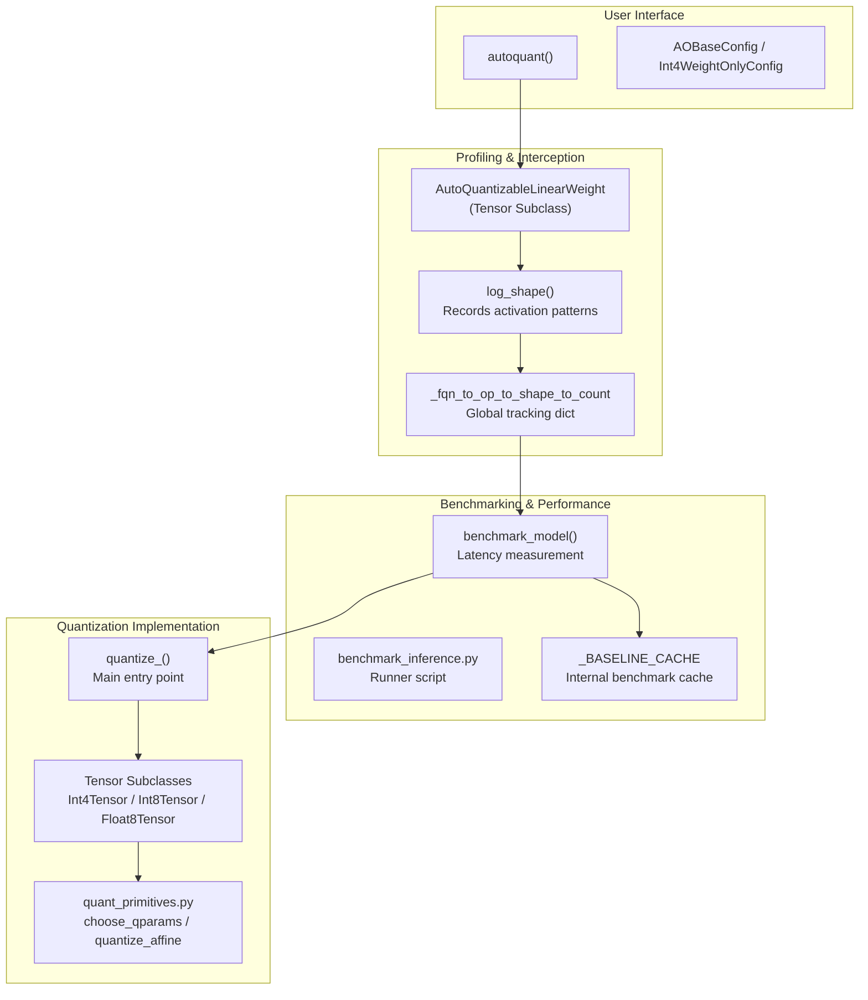
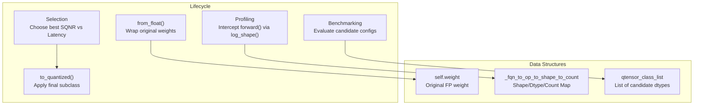
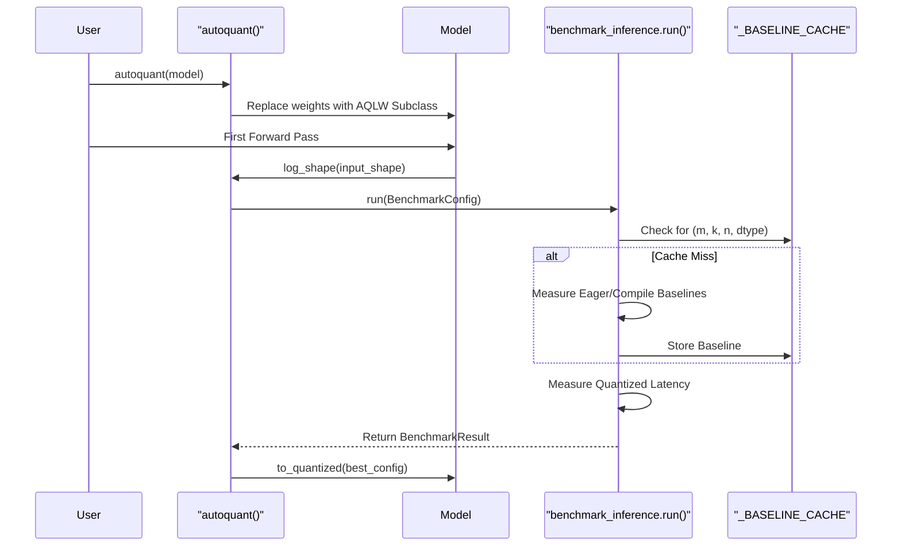

<!-- source: DeepWiki mcp.deepwiki.com · repo pytorch/ao · page 2.5 Autoquantization · fetched 2026-10-21 -->

# Autoquantization

Relevant source files

The following files were used as context for generating this wiki page:

- [README.md](README.md)
- [benchmarks/microbenchmarks/README.md](benchmarks/microbenchmarks/README.md)
- [benchmarks/microbenchmarks/benchmark_inference.py](benchmarks/microbenchmarks/benchmark_inference.py)
- [benchmarks/microbenchmarks/benchmark_runner.py](benchmarks/microbenchmarks/benchmark_runner.py)
- [benchmarks/microbenchmarks/profiler.py](benchmarks/microbenchmarks/profiler.py)
- [benchmarks/microbenchmarks/test/benchmark_config.yml](benchmarks/microbenchmarks/test/benchmark_config.yml)
- [benchmarks/microbenchmarks/test/test_benchmark_inference.py](benchmarks/microbenchmarks/test/test_benchmark_inference.py)
- [benchmarks/microbenchmarks/test/test_benchmark_profiler.py](benchmarks/microbenchmarks/test/test_benchmark_profiler.py)
- [benchmarks/microbenchmarks/test/test_benchmark_runner.py](benchmarks/microbenchmarks/test/test_benchmark_runner.py)
- [benchmarks/microbenchmarks/test/test_utils.py](benchmarks/microbenchmarks/test/test_utils.py)
- [benchmarks/microbenchmarks/utils.py](benchmarks/microbenchmarks/utils.py)
- [test/integration/test_integration.py](test/integration/test_integration.py)
- [test/quantization/test_quant_api.py](test/quantization/test_quant_api.py)
- [test/quantization/test_quant_primitives.py](test/quantization/test_quant_primitives.py)
- [test/test_model_architecture.py](test/test_model_architecture.py)
- [torchao/prototype/hqq/hqq_tinygemm_linear.py](torchao/prototype/hqq/hqq_tinygemm_linear.py)
- [torchao/quantization/README.md](torchao/quantization/README.md)
- [torchao/quantization/__init__.py](torchao/quantization/__init__.py)
- [torchao/quantization/qat/README.md](torchao/quantization/qat/README.md)
- [torchao/quantization/quant_api.py](torchao/quantization/quant_api.py)
- [torchao/quantization/quant_primitives.py](torchao/quantization/quant_primitives.py)
- [torchao/quantization/utils.py](torchao/quantization/utils.py)

The AutoQuant system in TorchAO is designed to automatically determine the optimal quantization technique for each linear layer in a model by benchmarking candidate methods against actual activation shapes and data types encountered during execution. This avoids a "one-size-fits-all" approach and optimizes for specific hardware and model workloads.

## Overview

AutoQuant operates through a lifecycle of profiling, benchmarking, and selection. It wraps standard linear layers with a specialized tensor subclass that monitors traffic and evaluates performance.

1.  **Profiling Phase**: During the initial forward pass(es), the system records the shapes and dtypes of activations entering each linear layer.
2.  **Benchmarking Phase**: For each recorded activation pattern, the system runs performance tests across a suite of quantization configurations.
3.  **Selection Phase**: The configuration with the lowest latency (that meets accuracy constraints like SQNR) is selected and applied to the layer.

Sources: [torchao/quantization/quant_api.py:10-16](), [torchao/utils.py:56-61]()

## Core Architecture

The system leverages PyTorch tensor subclasses to intercept operations and the `torch.compile` infrastructure to access optimized kernels.

### System Entity Mapping

The following diagram maps high-level AutoQuant concepts to their specific implementations in the `torchao` codebase.

**Autoquant System Entity Mapping**

Sources: [torchao/quantization/quant_api.py:36-106](), [torchao/quantization/utils.py:88-113](), [benchmarks/microbenchmarks/benchmark_inference.py:50-77](), [torchao/utils.py:56-61]()

## AutoQuantizable Workflow

The system relies on `AutoQuantizableLinearWeight` (a tensor subclass) to manage the transition from floating point to quantized states.

**AutoQuantizable Component Logic**

Sources: [torchao/quantization/utils.py:88-113](), [torchao/quantization/quant_api.py:185-214](), [torchao/quantization/quant_primitives.py:55-89]()

## Benchmarking System

The benchmarking system measures the inference time of different configurations. It uses a caching mechanism to avoid redundant calculations for identical layer shapes across the model.

### Cache Key Structure
The cache key is uniquely identified by:
*   **Model Type**: (e.g., `linear`)
*   **Shape Dimensions**: (m, k, n)
*   **Dtype**: High precision input dtype (e.g., `torch.bfloat16`)
*   **Device**: Target hardware (e.g., `cuda`, `cpu`)
*   **Compile Mode**: Settings for `torch.compile`

Sources: [benchmarks/microbenchmarks/benchmark_inference.py:53-77]()

### Performance Metrics
The system evaluates configurations using:
*   **Latency**: Measured in milliseconds (ms) using `model_inference_time_in_ms`.
*   **SQNR**: Signal-to-Quantization-Noise Ratio, calculated via `compute_error(x, y)` to ensure accuracy is maintained.
*   **Speedup**: Calculated as `baseline_time / quantized_time`.

Sources: [torchao/quantization/utils.py:63-66](), [benchmarks/microbenchmarks/utils.py:109-144]()

## Implementation Details

### Key Functions and Classes

| Entity | Location | Description |
| :--- | :--- | :--- |
| `quantize_` | [torchao/quantization/quant_api.py:115]() | Primary API to apply a selected config to a module. |
| `compute_error` | [torchao/quantization/utils.py:63]() | Calculates SQNR between original and quantized tensors. |
| `MappingType` | [torchao/quantization/quant_primitives.py:55]() | Defines if mapping is `SYMMETRIC` or `ASYMMETRIC`. |
| `LoggingTensorMode` | [torchao/quantization/utils.py:93]() | A `TorchDispatchMode` used to record op names and shapes during profiling. |
| `string_to_config` | [benchmarks/microbenchmarks/utils.py:147]() | Utility to map string identifiers (e.g., "int4wo") to `AOBaseConfig` objects. |

Sources: [torchao/quantization/quant_api.py:115-119](), [torchao/quantization/utils.py:63-66](), [torchao/quantization/quant_primitives.py:55-77](), [torchao/quantization/utils.py:93-115](), [benchmarks/microbenchmarks/utils.py:147-180]()

### Sequence of Execution

**Autoquant Execution Sequence**

Sources: [benchmarks/microbenchmarks/benchmark_inference.py:79-180](), [torchao/quantization/utils.py:88-113](), [torchao/quantization/quant_api.py:122-165]()

## Integration with torch.compile

AutoQuant is designed to be used in conjunction with `torch.compile`. The recommended flow is to apply quantization configurations that produce `torch.compile` friendly primitives. This allows the compiler to fuse dequantization with subsequent operations (like `addmm`) or use specialized quantized kernels like `int_scaled_matmul`.

Sources: [torchao/quantization/quant_api.py:10-16](), [torchao/quantization/utils.py:12-27]()

---

