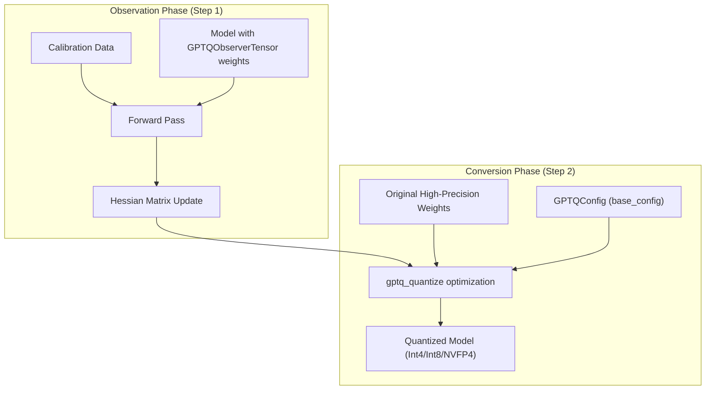
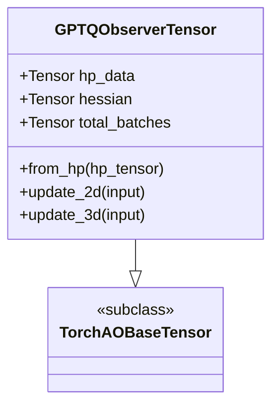

<!-- source: DeepWiki mcp.deepwiki.com · repo pytorch/ao · page 2.6 GPTQ Quantization · fetched 2026-10-21 -->

# GPTQ Quantization

<details>
<summary>Relevant source files</summary>

The following files were used as context for generating this wiki page:

- [benchmarks/benchmark_gptq.py](benchmarks/benchmark_gptq.py)
- [test/prototype/gptq/test_gptqv2.py](test/prototype/gptq/test_gptqv2.py)
- [torchao/prototype/float8_opaque_tensor/inference_workflow.py](torchao/prototype/float8_opaque_tensor/inference_workflow.py)
- [torchao/prototype/gptq/__init__.py](torchao/prototype/gptq/__init__.py)
- [torchao/prototype/gptq/api.py](torchao/prototype/gptq/api.py)
- [torchao/prototype/gptq/gptq_example.py](torchao/prototype/gptq/gptq_example.py)
- [torchao/prototype/gptq/gptq_nvfp4_llama3_2_1b_nonsequential_wikitext.sh](torchao/prototype/gptq/gptq_nvfp4_llama3_2_1b_nonsequential_wikitext.sh)
- [torchao/prototype/gptq/gptq_nvfp4_olmoe_1b_7b_nonsequential_wikitext.sh](torchao/prototype/gptq/gptq_nvfp4_olmoe_1b_7b_nonsequential_wikitext.sh)
- [torchao/prototype/gptq/observer.py](torchao/prototype/gptq/observer.py)

</details>


## Purpose and Scope

GPTQ (Generalized Post-Training Quantization) is an optimization-based quantization method that finds better quantization parameters (scales and zero points) by minimizing the reconstruction error of the layer outputs. Unlike simple min-max quantization, GPTQ uses second-order information (Hessian matrix of activations) to compensate for the error introduced by quantization.

In TorchAO, GPTQ is implemented as a two-step "observe and convert" workflow. It supports standard integer formats (Int4, Int8) as well as advanced formats like NVFP4.

**Sources:** [torchao/prototype/gptq/api.py:64-85](), [torchao/prototype/gptq/observer.py:13-65]()

## Overview and Architecture

The GPTQ implementation in TorchAO leverages a specialized tensor subclass, `GPTQObserverTensor`, to collect calibration statistics during a forward pass. Once statistics are gathered, the `gptq_quantize` function performs the optimization.

### GPTQ Data Flow



**Diagram: GPTQ Two-Step Workflow**

**Sources:** [torchao/prototype/gptq/api.py:67-70](), [torchao/prototype/gptq/api.py:111-160]()

## The GPTQ API

The primary interface for GPTQ is the `GPTQConfig` class, which is used with the standard `quantize_` API.

### GPTQConfig
The `GPTQConfig` determines whether the model is currently in the observation phase or the conversion phase.

| Argument | Type | Description |
| :--- | :--- | :--- |
| `step` | `str` | `"observe"` to wrap weights in observers, `"convert"` to perform quantization. |
| `base_config` | `AOBaseConfig` | The target quantization format (e.g., `Int4WeightOnlyConfig`, `NVFP4DynamicActivationNVFP4WeightConfig`). |
| `percdamp` | `float` | Damping factor for the Hessian diagonal (default: 0.01). |
| `gptq_quantize_block_size` | `int` | Block size for the GPTQ algorithm (default: 256). |

**Sources:** [torchao/prototype/gptq/api.py:64-95]()

### Observation Mechanism: GPTQObserverTensor
The `GPTQObserverTensor` is a `TorchAOBaseTensor` subclass that intercepts linear operations (via `aten.linear.default` and `aten.bmm.default`) to calculate a running average of the Hessian matrix $H = X^T X$.



**Diagram: GPTQ Observer Entity Relationship**

**Sources:** [torchao/prototype/gptq/observer.py:13-65](), [torchao/prototype/gptq/observer.py:131-178]()

## Integration with NVFP4 and Other Formats

GPTQ in TorchAO is designed to be format-agnostic. By providing different `base_config` objects to `GPTQConfig`, users can apply GPTQ optimization to various target dtypes.

### Supported Target Configs
- `Int4WeightOnlyConfig`: For 4-bit integer weight-only quantization. [torchao/prototype/gptq/api.py:57]()
- `Int8WeightOnlyConfig`: For 8-bit integer weight-only quantization. [torchao/prototype/gptq/api.py:58]()
- `NVFP4DynamicActivationNVFP4WeightConfig`: For NVIDIA's FP4 format. [torchao/prototype/gptq/api.py:59]()

### NVFP4 Specifics
When using `NVFP4DynamicActivationNVFP4WeightConfig`, the GPTQ optimization uses specialized kernels and swizzling logic to ensure the resulting weights are compatible with Blackwell-generation hardware.

**Sources:** [torchao/prototype/gptq/api.py:27-44](), [torchao/prototype/gptq/api.py:56-60]()

## Usage Workflows

### Standard Non-Sequential GPTQ
In this workflow, the entire model is first wrapped in observers, a forward pass is run on calibration data, and then the entire model is converted.

```python
from torchao.prototype.gptq import GPTQConfig
from torchao.quantization import quantize_, Int4WeightOnlyConfig

# 1. Observe
gptq_config = GPTQConfig(step="observe", base_config=Int4WeightOnlyConfig())
quantize_(model, gptq_config)

# 2. Calibration forward passes
for batch in calibration_loader:
    model(batch)

# 3. Convert
gptq_config.step = "convert"
quantize_(model, gptq_config)
```

**Sources:** [torchao/prototype/gptq/api.py:111-160](), [test/prototype/gptq/test_gptqv2.py:116-146]()

### Sequential GPTQ (HuggingFace)
For better accuracy, sequential quantization quantizes the model block-by-block. This ensures that layer $N$ observes the quantized outputs of layer $N-1$ during calibration.

The `sequential_quantize` utility handles this by iterating through `model.model.layers`, performing observation and conversion on a per-block basis.

**Sources:** [torchao/prototype/gptq/gptq_example.py:48-94]()

## Implementation Details

### Hessian Calculation
The Hessian is updated using a running average to avoid storing all activations in memory.
For a new activation $X$ with $n$ samples and existing total samples $T$:
$H_{new} = H_{old} \cdot \frac{T}{T+n} + \frac{2}{T+n} \cdot X^T X$

**Sources:** [torchao/prototype/gptq/observer.py:67-90](), [test/prototype/gptq/test_gptqv2.py:37-58]()

### Optimization Loop
The `gptq_quantize` function implements the core GPTQ algorithm, iterating through columns of the weight matrix and updating remaining weights based on the quantization error and the inverse Hessian.

**Sources:** [torchao/prototype/gptq/api.py:204-325]()

### Expert Support (MoE)
The implementation supports 3D tensors and grouped matrix multiplications, enabling GPTQ for Mixture-of-Experts (MoE) models. The `update_3d_with_offs` method handles `aten._grouped_mm.default` by using offset indices to attribute activations to specific experts.

**Sources:** [torchao/prototype/gptq/observer.py:104-119](), [torchao/prototype/gptq/observer.py:170-178]()

---

