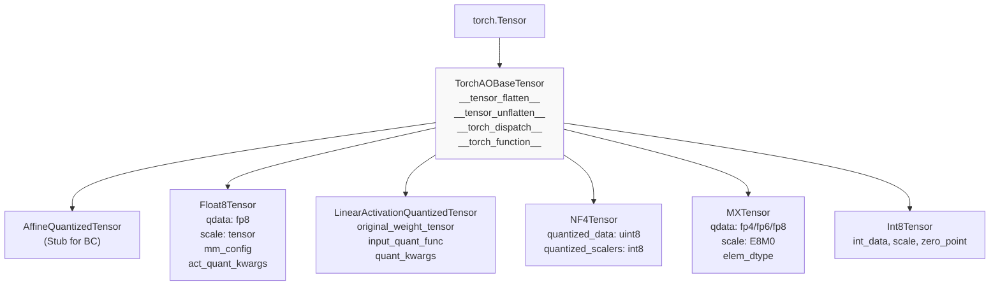
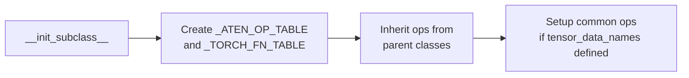
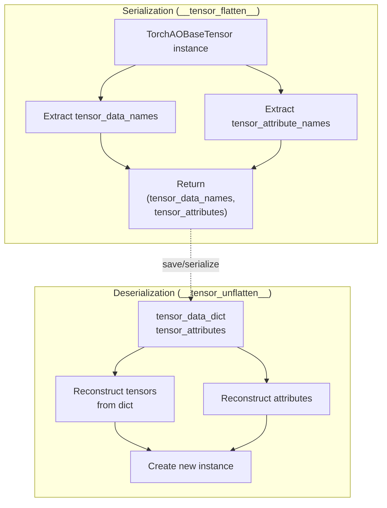
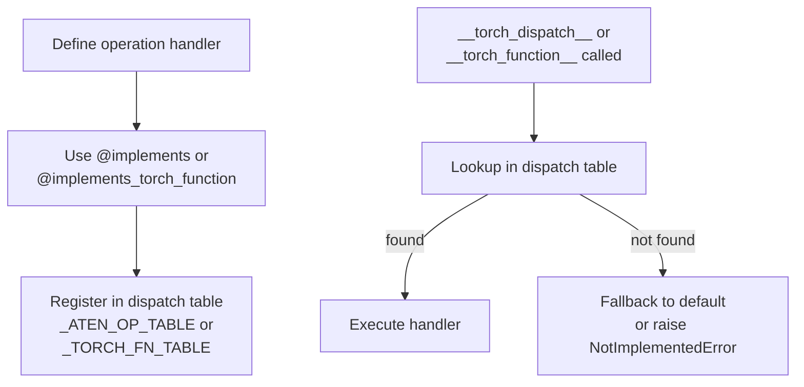
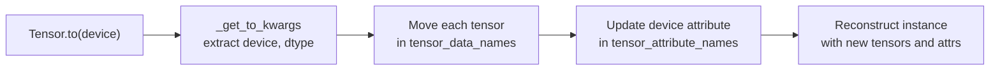

<!-- source: DeepWiki mcp.deepwiki.com · repo pytorch/ao · page 3 Tensor Subclass Framework · fetched 2026-10-21 -->

# Tensor Subclass Framework

<details>
<summary>Relevant source files</summary>

The following files were used as context for generating this wiki page:

- [test/dtypes/test_affine_quantized_float.py](test/dtypes/test_affine_quantized_float.py)
- [test/quantization/quantize_/workflows/float8/test_float8_tensor.py](test/quantization/quantize_/workflows/float8/test_float8_tensor.py)
- [test/quantization/quantize_/workflows/float8/test_float8_tensor_mi300.py](test/quantization/quantize_/workflows/float8/test_float8_tensor_mi300.py)
- [test/test_utils.py](test/test_utils.py)
- [torchao/dtypes/__init__.py](torchao/dtypes/__init__.py)
- [torchao/float8/inference.py](torchao/float8/inference.py)
- [torchao/prototype/dtypes/__init__.py](torchao/prototype/dtypes/__init__.py)
- [torchao/prototype/dtypes/uintx/__init__.py](torchao/prototype/dtypes/uintx/__init__.py)
- [torchao/quantization/quantize_/common/kernel_preference.py](torchao/quantization/quantize_/common/kernel_preference.py)
- [torchao/quantization/quantize_/workflows/float8/float8_tensor.py](torchao/quantization/quantize_/workflows/float8/float8_tensor.py)
- [torchao/testing/utils.py](torchao/testing/utils.py)
- [torchao/utils.py](torchao/utils.py)

</details>


## Purpose and Scope

The Tensor Subclass Framework provides the foundational infrastructure for implementing quantized and specialized tensor types in TorchAO. It defines base classes, dispatch mechanisms, serialization protocols, and common operations that enable tensor subclasses to integrate seamlessly with PyTorch's tensor system while providing custom behavior for quantization and optimization.

This page covers the core framework components used by all tensor subclasses in TorchAO. For information about specific quantized tensor implementations, see [AffineQuantizedTensor](#3.2), [Float8Tensor (Inference)](#3.3), and [LinearActivationQuantizedTensor](#3.4). For layout-specific details, see [Layout System](#3.5).

---

## Tensor Subclass Architecture

The tensor subclass system is organized around a base class that provides common functionality, with specialized subclasses implementing specific quantization strategies.

### Class Hierarchy



**Sources:** [torchao/utils.py:783-985](), [torchao/dtypes/__init__.py:2-20](), [torchao/quantization/quantize_/workflows/float8/float8_tensor.py:84-155](), [torchao/testing/utils.py:210-218]()

---

## TorchAOBaseTensor Base Class

`TorchAOBaseTensor` is the foundational base class that provides common functionality for all TorchAO tensor subclasses. It implements serialization protocols, dispatch mechanisms, and default operations.

### Core Attributes and Structure

Subclasses must define metadata about their tensor data and attributes to leverage automatic dispatch and serialization:

| Attribute | Type | Required | Purpose |
|-----------|------|----------|---------|
| `tensor_data_names` | `List[str]` | Yes | Names of tensor attributes (e.g., `["qdata", "scale"]`) |
| `tensor_attribute_names` | `List[str]` | Yes | Names of non-tensor attributes (e.g., `["attr", "device"]`) |
| `optional_tensor_data_names` | `List[str]` | No | Names of optional tensor attributes |
| `optional_tensor_attribute_names` | `List[str]` | No | Names of optional non-tensor attributes |

**Example structure from Float8Tensor:**

```python
class Float8Tensor(TorchAOBaseTensor):
    tensor_data_names = ["qdata", "scale"]
    tensor_attribute_names = []
    optional_tensor_attribute_names = [
        "block_size",
        "mm_config", 
        "act_quant_kwargs",
        "kernel_preference",
        "dtype",
    ]
```

**Sources:** [torchao/utils.py:783-865](), [torchao/quantization/quantize_/workflows/float8/float8_tensor.py:105-113]()

### Initialization and Subclass Registration

The `__init_subclass__` method automatically sets up dispatch tables for each subclass:



This mechanism enables:
1. Each subclass to have independent dispatch tables.
2. Automatic inheritance of operations from parent classes via MRO.
3. Default implementations for common operations (detach, clone, etc.) when metadata is defined.

**Sources:** [torchao/utils.py:947-975]()

---

## Serialization and Lifecycle

The framework provides standard serialization protocols for saving and loading quantized tensors, specifically integrated with `torch.export` and `safetensors`.

### Tensor Flatten and Unflatten



**Sources:** [torchao/utils.py:818-822](), [test/test_utils.py:105-114](), [torchao/testing/utils.py:223-231]()

### State Management and Backward Compatibility

The `__setstate__` method handles loading old checkpoints when new optional attributes have been added to a subclass, ensuring `None` is assigned to missing keys rather than raising errors.

**Sources:** [torchao/utils.py:828-830]()

---

## Dispatch Mechanisms

TorchAO uses two dispatch mechanisms for routing operations: `__torch_dispatch__` for `aten` ops and `__torch_function__` for `torch` functions.

### Operation Registration Flow



**Sources:** [torchao/utils.py:404-436](), [torchao/utils.py:438-471]()

### Implementing Operations

Subclasses use the `implements` decorator to define custom behavior for specific ops. For example, `Float8Tensor` implements `aten.addmm.default` to route to optimized FP8 kernels.

**Sources:** [torchao/quantization/quantize_/workflows/float8/float8_tensor.py:254-266](), [torchao/utils.py:418-434]()

---

## Default Operation Implementations

`TorchAOBaseTensor` provides default implementations for common operations when `tensor_data_names` and `tensor_attribute_names` are defined.

### Supported Operations

| Operation | aten op | Purpose |
|-----------|---------|---------|
| `detach` | `aten.detach.default` | Detach from autograd graph |
| `clone` | `aten.clone.default` | Create a copy |
| `alias` | `aten.alias.default` | Create an alias |
| `contiguous` | `aten.contiguous.default` | Make tensor contiguous |
| `copy_` | `aten.copy_.default` | In-place copy |
| `to` | `aten._to_copy.default` | Device/dtype conversion |

**Sources:** [torchao/utils.py:473-531](), [torchao/utils.py:570-626]()

### Device Transfer (`to` operation)

The framework handles moving all internal components (e.g., `qdata` and `scale`) to the target device automatically via `_get_to_kwargs`.



**Sources:** [torchao/utils.py:583-626](), [torchao/utils.py:759-780]()

---

## Specialized Tensor Subclasses

### Float8Tensor (Inference)

`Float8Tensor` implements float8 quantization for weights, supporting dynamic quantization for activations. It manages `qdata` (FP8) and `scale` (HP) and supports various `KernelPreference` options like `TORCH`, `MSLK`, and `TRITON`.

**Sources:** [torchao/quantization/quantize_/workflows/float8/float8_tensor.py:84-155](), [torchao/quantization/quantize_/common/kernel_preference.py:17-49]()

### LinearActivationQuantizedTensor

This subclass is used to intercept linear operations to apply dynamic activation quantization. It wraps an `original_weight_tensor` and uses an `input_quant_func` to quantize the input on-the-fly during the forward pass.

**Sources:** [torchao/quantization/linear_activation_quantized_tensor.py:21-77]()

---

## Layout and Granularity Integration

The framework interacts closely with:
- **Layouts**: Classes like `PlainLayout` or `TensorCoreTiledLayout` define how data is packed. For details, see [Layout System](#3.5).
- **Granularity**: Classes like `PerRow` or `PerGroup` define how scaling factors are shared. For details, see [Granularity System](#3.6).

**Sources:** [torchao/quantization/granularity.py](), [torchao/float8/inference.py:177-212]()

---

## Summary

The Tensor Subclass Framework provides:

1. **Base Infrastructure**: `TorchAOBaseTensor` for serialization and dispatch.
2. **Dispatch System**: `_ATEN_OP_TABLE` for routing aten operations.
3. **Default Behavior**: Automatic handling of `detach`, `clone`, and `to` operations.
4. **Hardware Routing**: Ability to select kernels via `KernelPreference`.
5. **Serialization**: Full support for `torch.export` and `safetensors` via flattening.

**Sources:** [torchao/utils.py:783-985](), [torchao/quantization/quantize_/workflows/float8/float8_tensor.py:84-155]()

---

