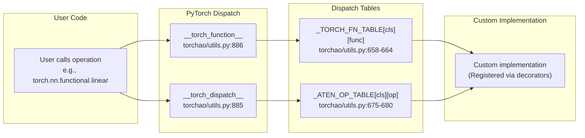
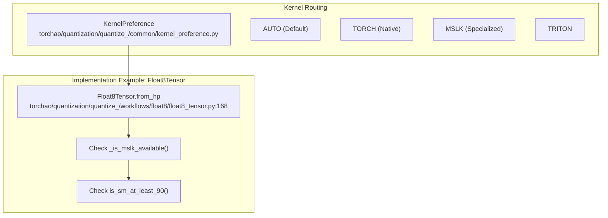

<!-- source: DeepWiki mcp.deepwiki.com · repo pytorch/ao · page 3.1 TorchAOBaseTensor · fetched 2026-10-21 -->

# TorchAOBaseTensor

<details>
<summary>Relevant source files</summary>

The following files were used as context for generating this wiki page:

- [test/dtypes/test_affine_quantized_float.py](test/dtypes/test_affine_quantized_float.py)
- [test/quantization/quantize_/workflows/float8/test_float8_tensor.py](test/quantization/quantize_/workflows/float8/test_float8_tensor.py)
- [test/quantization/quantize_/workflows/float8/test_float8_tensor_mi300.py](test/quantization/quantize_/workflows/float8/test_float8_tensor_mi300.py)
- [test/test_utils.py](test/test_utils.py)
- [torchao/float8/inference.py](torchao/float8/inference.py)
- [torchao/quantization/quantize_/common/kernel_preference.py](torchao/quantization/quantize_/common/kernel_preference.py)
- [torchao/quantization/quantize_/workflows/float8/float8_tensor.py](torchao/quantization/quantize_/workflows/float8/float8_tensor.py)
- [torchao/testing/utils.py](torchao/testing/utils.py)
- [torchao/utils.py](torchao/utils.py)
- [tutorials/developer_api_guide/export_to_executorch.py](tutorials/developer_api_guide/export_to_executorch.py)
- [tutorials/developer_api_guide/my_dtype_tensor_subclass.py](tutorials/developer_api_guide/my_dtype_tensor_subclass.py)
- [tutorials/developer_api_guide/my_trainable_tensor_subclass.py](tutorials/developer_api_guide/my_trainable_tensor_subclass.py)
- [tutorials/developer_api_guide/tensor_parallel.py](tutorials/developer_api_guide/tensor_parallel.py)
- [tutorials/run_all.sh](tutorials/run_all.sh)

</details>


## Purpose and Scope

`TorchAOBaseTensor` is the foundational base class for all quantized tensor subclasses in TorchAO. It provides a dispatch infrastructure, default implementations for common operations, and a metadata-driven framework that simplifies the creation of custom tensor types. This page documents the dispatch mechanisms, decorator systems, metadata conventions, and utility methods that `TorchAOBaseTensor` provides.

For information about specific tensor subclasses that inherit from `TorchAOBaseTensor`, see:
- **3.2 AffineQuantizedTensor** - Core affine quantized tensor implementation
- **3.3 Float8Tensor (Inference)** - Float8 quantization for inference
- **3.4 LinearActivationQuantizedTensor** - Dynamic activation quantization

## Class Overview

`TorchAOBaseTensor` is a `torch.Tensor` subclass that intercepts PyTorch operations and routes them to custom implementations registered by subclasses. It eliminates boilerplate code by providing default implementations for serialization, device movement, and common tensor operations when subclasses declare metadata about their structure.

### System Architecture Diagram

```mermaid
graph TB
    subgraph "PyTorch Core"
        [torch.Tensor]
    end
    
    subgraph "TorchAO Infrastructure"
        TorchAOBase["TorchAOBaseTensor<br/>torchao/utils.py:762-1267"]
    end
    
    subgraph "Quantized Tensor Subclasses"
        AQT["AffineQuantizedTensor<br/>Affine quantization"]
        Float8["Float8Tensor<br/>torchao/quantization/quantize_/workflows/float8/float8_tensor.py:84"]
        NF4["NF4Tensor<br/>4-bit NormalFloat"]
        LAQ["LinearActivationQuantizedTensor<br/>Dynamic activation quant"]
    end
    
    subgraph "Dispatch Tables"
        AtenTable["_ATEN_OP_TABLE<br/>Maps aten ops to handlers"]
        TorchFnTable["_TORCH_FN_TABLE<br/>Maps torch functions to handlers"]
    end
    
    [torch.Tensor] --> TorchAOBase
    TorchAOBase --> AQT
    TorchAOBase --> Float8
    TorchAOBase --> NF4
    TorchAOBase --> LAQ
    
    TorchAOBase --> AtenTable
    TorchAOBase --> TorchFnTable
```

**Sources:** [torchao/utils.py:762-890](), [torchao/quantization/quantize_/workflows/float8/float8_tensor.py:84-113]()

## Dispatch Mechanism

### Two-Level Dispatch System

`TorchAOBaseTensor` implements both `__torch_dispatch__` and `__torch_function__` protocols to intercept operations at different levels:



The dispatch process:
1. **`__torch_function__`** intercepts high-level PyTorch functions (e.g., `torch.nn.functional.linear`).
2. **`__torch_dispatch__`** intercepts low-level aten operations (e.g., `aten.mm.default`).
3. Each looks up the operation in the corresponding class-level dispatch table.
4. If found, it routes to the custom implementation.
5. If not found, `__torch_dispatch__` raises `NotImplementedError` with diagnostic information including argument types [test/test_utils.py:41-57]().

**Sources:** [torchao/utils.py:648-687](), [torchao/utils.py:885-886](), [test/test_utils.py:41-57]()

### Implements Decorators

Subclasses use two primary decorators to populate dispatch tables:
*   **`@implements(aten_ops)`**: Registers handlers for low-level `aten` operators [torchao/utils.py:461-481]().
*   **`@implements_torch_function(torch_functions)`**: Registers handlers for high-level `torch` functions [torchao/utils.py:483-502]().

**Sources:** [torchao/utils.py:461-502](), [tutorials/developer_api_guide/my_dtype_tensor_subclass.py:183-184]()

## Metadata Declaration System

`TorchAOBaseTensor` uses class variables to declare tensor structure. This enables automatic implementation of serialization, device movement, and common operations via `__init_subclass__` [torchao/utils.py:857-880]().

### Core Metadata Attributes

| Attribute | Purpose | Required |
|-----------|---------|----------|
| `tensor_data_names` | Names of `torch.Tensor` attributes (e.g., `qdata`, `scale`) | Yes |
| `tensor_attribute_names` | Names of non-Tensor metadata attributes (e.g., `transposed`) | Yes |
| `optional_tensor_data_names` | Names of Tensor attributes that may be `None` | No |
| `optional_tensor_attribute_names` | Names of non-Tensor attributes that may be `None` | No |

**Example (Float8Tensor):**
```python
class Float8Tensor(TorchAOBaseTensor):
    tensor_data_names = ["qdata", "scale"]
    tensor_attribute_names = []
    optional_tensor_attribute_names = [
        "block_size",
        "mm_config",
        "act_quant_kwargs",
        "kernel_preference",
        "dtype",
    ]
```
[torchao/quantization/quantize_/workflows/float8/float8_tensor.py:105-113]()

**Sources:** [torchao/utils.py:795-854](), [torchao/quantization/quantize_/workflows/float8/float8_tensor.py:105-113]()

## Key Functions and Implementation

### Serialization for `torch.export`

To support `torch.compile` and `torch.export`, `TorchAOBaseTensor` provides default implementations for flattening and unflattening:

*   **`__tensor_flatten__`**: Returns the names of tensor fields and a list of non-tensor attributes [torchao/utils.py:894-918]().
*   **`__tensor_unflatten__`**: Reconstructs the subclass instance from the flattened components [torchao/utils.py:920-954]().

These methods rely on the metadata declared in `tensor_data_names` and `tensor_attribute_names` [test/test_utils.py:105-130]().

### Data Manipulation

*   **`_apply_fn_to_data(fn)`**: A utility that applies a function (like `clone` or `detach`) to all tensor components defined in the metadata while preserving non-tensor attributes [torchao/utils.py:956-989](). This is frequently used to implement `aten.clone` and `aten.detach` [tutorials/developer_api_guide/my_dtype_tensor_subclass.py:155-165]().

### Common Operation Registration

During `__init_subclass__`, the base class automatically registers common operations if the metadata is present:
*   `detach`, `clone`, `alias` [torchao/utils.py:518-526]().
*   `to`, `_to_copy` (handles device and dtype movement) [torchao/utils.py:583-621]().
*   `copy_` [torchao/utils.py:570-581]().

**Sources:** [torchao/utils.py:857-989](), [test/test_utils.py:92-165](), [tutorials/developer_api_guide/my_dtype_tensor_subclass.py:155-165]()

## Layout and Kernel Selection

`TorchAOBaseTensor` integrates with the `KernelPreference` system to route operations to specialized kernels:



**Sources:** [torchao/quantization/quantize_/common/kernel_preference.py:17-49](), [torchao/quantization/quantize_/workflows/float8/float8_tensor.py:168-190]()

## Testing and Validation

The framework includes comprehensive tests to ensure that subclasses maintain PyTorch contracts:
*   **`test_flatten_unflatten`**: Ensures that tensors can be serialized and reconstructed without data loss [test/quantization/quantize_/workflows/float8/test_float8_tensor.py:223-231]().
*   **`_get_to_kwargs`**: Validates that flags like `non_blocking` are correctly propagated during device transfers [test/test_utils.py:59-90]().
*   **`TorchAOBasicTestCase`**: A reusable test base for new tensor subclasses that checks basic arithmetic and SQNR [torchao/testing/utils.py:210-222]().

**Sources:** [test/test_utils.py:59-90](), [torchao/testing/utils.py:210-222](), [test/quantization/quantize_/workflows/float8/test_float8_tensor.py:223-231]()

---

