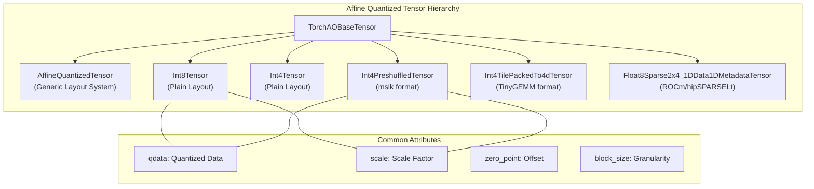
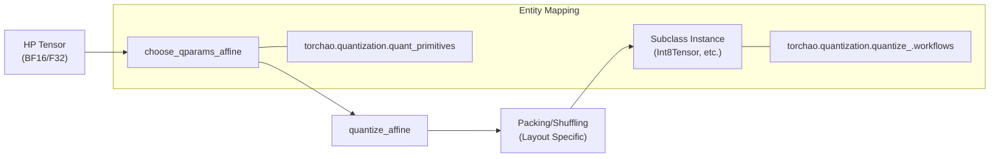

<!-- source: DeepWiki mcp.deepwiki.com · repo pytorch/ao · page 3.2 AffineQuantizedTensor · fetched 2026-10-21 -->

# AffineQuantizedTensor

<details>
<summary>Relevant source files</summary>

The following files were used as context for generating this wiki page:

- [test/quantization/quantize_/workflows/int4/test_int4_plain_int32_tensor.py](test/quantization/quantize_/workflows/int4/test_int4_plain_int32_tensor.py)
- [test/quantization/quantize_/workflows/int4/test_int4_preshuffled_tensor.py](test/quantization/quantize_/workflows/int4/test_int4_preshuffled_tensor.py)
- [test/quantization/quantize_/workflows/int4/test_int4_tensor.py](test/quantization/quantize_/workflows/int4/test_int4_tensor.py)
- [test/quantization/quantize_/workflows/int4/test_int4_tile_packed_to_4d_tensor.py](test/quantization/quantize_/workflows/int4/test_int4_tile_packed_to_4d_tensor.py)
- [test/quantization/quantize_/workflows/int8/test_int8_tensor.py](test/quantization/quantize_/workflows/int8/test_int8_tensor.py)
- [test/quantization/quantize_/workflows/int8/test_int8_tensor_cpu.py](test/quantization/quantize_/workflows/int8/test_int8_tensor_cpu.py)
- [torchao/quantization/quantize_/common/__init__.py](torchao/quantization/quantize_/common/__init__.py)
- [torchao/quantization/quantize_/common/packing_format.py](torchao/quantization/quantize_/common/packing_format.py)
- [torchao/quantization/quantize_/common/protocol.py](torchao/quantization/quantize_/common/protocol.py)
- [torchao/quantization/quantize_/common/quantize_tensor_kwargs.py](torchao/quantization/quantize_/common/quantize_tensor_kwargs.py)
- [torchao/quantization/quantize_/workflows/__init__.py](torchao/quantization/quantize_/workflows/__init__.py)
- [torchao/quantization/quantize_/workflows/float8/float8_packing_format.py](torchao/quantization/quantize_/workflows/float8/float8_packing_format.py)
- [torchao/quantization/quantize_/workflows/float8/float8_sparse_2x4_1d_data_1d_metadata_tensor.py](torchao/quantization/quantize_/workflows/float8/float8_sparse_2x4_1d_data_1d_metadata_tensor.py)
- [torchao/quantization/quantize_/workflows/float8/float8_sparse_2x4_2d_data_2d_metadata_tensor.py](torchao/quantization/quantize_/workflows/float8/float8_sparse_2x4_2d_data_2d_metadata_tensor.py)
- [torchao/quantization/quantize_/workflows/int4/__init__.py](torchao/quantization/quantize_/workflows/int4/__init__.py)
- [torchao/quantization/quantize_/workflows/int4/int4_choose_qparams_algorithm.py](torchao/quantization/quantize_/workflows/int4/int4_choose_qparams_algorithm.py)
- [torchao/quantization/quantize_/workflows/int4/int4_plain_int32_tensor.py](torchao/quantization/quantize_/workflows/int4/int4_plain_int32_tensor.py)
- [torchao/quantization/quantize_/workflows/int4/int4_preshuffled_tensor.py](torchao/quantization/quantize_/workflows/int4/int4_preshuffled_tensor.py)
- [torchao/quantization/quantize_/workflows/int4/int4_tensor.py](torchao/quantization/quantize_/workflows/int4/int4_tensor.py)
- [torchao/quantization/quantize_/workflows/int4/int4_tile_packed_to_4d_tensor.py](torchao/quantization/quantize_/workflows/int4/int4_tile_packed_to_4d_tensor.py)
- [torchao/quantization/quantize_/workflows/int8/int8_tensor.py](torchao/quantization/quantize_/workflows/int8/int8_tensor.py)

</details>


## Purpose and Scope

`AffineQuantizedTensor` is the primary tensor subclass in TorchAO for representing affine quantized tensors. It provides a unified abstraction for storing quantized data with scale and zero point parameters, supporting various quantization formats (INT4, INT8, FP8, etc.) and hardware-specific layouts. 

In addition to the general-purpose `AffineQuantizedTensor`, TorchAO provides specialized variants like `Int8Tensor` and `Int4Tensor` which are optimized for specific workflows and packing formats, including support for the `mslk` kernel and sparse layouts.

This page covers the structure, quantization/dequantization process, and the specialized implementations of affine quantized tensors.

Sources: [torchao/dtypes/affine_quantized_tensor.py:43-82](), [torchao/quantization/quantize_/workflows/int8/int8_tensor.py:59-72](), [torchao/quantization/quantize_/workflows/int4/int4_tensor.py:12-24]()

## Core Concepts

### Affine Quantization

Affine quantization maps high-precision floating point values to low-precision quantized values using an affine transformation:

```
quantized_value = (float_value / scale) + zero_point
```

The inverse operation (dequantization) reconstructs the approximate original value:

```
float_value ≈ (quantized_value - zero_point) * scale
```

The `AffineQuantizedTensor` class encapsulates this scheme, while specialized subclasses like `Int8Tensor` [torchao/quantization/quantize_/workflows/int8/int8_tensor.py:59-72]() and `Int4Tensor` [torchao/quantization/quantize_/workflows/int4/int4_tensor.py:12-24]() provide concrete implementations for specific bit-widths and layouts.

Sources: [torchao/dtypes/affine_quantized_tensor.py:57-63](), [torchao/quantization/quant_primitives.py:321-365]()

### Tensor Structure and Variants



**Key Implementation Variants:**

| Class | Packing Format | Use Case | Target Backend |
|-------|----------------|----------|----------------|
| `Int8Tensor` | `PLAIN` | INT8 Weight/Act | General purpose [torchao/quantization/quantize_/workflows/int8/int8_tensor.py:59]() |
| `Int4Tensor` | `PLAIN` | INT4 Weight-only | CUDA/CPU [torchao/quantization/quantize_/workflows/int4/int4_tensor.py:12]() |
| `Int4PreshuffledTensor` | `PRESHUFFLED` | INT4 Weight + FP8/BF16 Act | H100 (mslk) [torchao/quantization/quantize_/workflows/int4/int4_preshuffled_tensor.py:33]() |
| `Int4TilePackedTo4dTensor` | `TILE_PACKED` | INT4 Weight-only | TinyGEMM (NVIDIA) [torchao/quantization/quantize_/workflows/int4/int4_tile_packed_to_4d_tensor.py:31]() |
| `Float8Sparse2x4...` | `SPARSE_1D` | FP8 + 2:4 Sparsity | ROCm (hipSPARSELt) [torchao/quantization/quantize_/workflows/float8/float8_sparse_2x4_1d_data_1d_metadata_tensor.py:42]() |

Sources: [torchao/quantization/quantize_/workflows/__init__.py:1-65](), [torchao/quantization/quantize_/common/packing_format.py:12-35]()

## Implementation Details

### Int8Tensor
`Int8Tensor` represents quantized data with a plain layout. It supports both symmetric and asymmetric quantization and is often used for dynamic activation quantization.

- **Attributes**: Stores `qdata`, `scale`, and optionally `zero_point`, `act_quant_scale`, and `act_quant_zero_point` [torchao/quantization/quantize_/workflows/int8/int8_tensor.py:74-80]().
- **Creation**: The `from_hp` factory method computes quantization parameters using `choose_qparams_affine` [torchao/quantization/quantize_/workflows/int8/int8_tensor.py:177-206]().
- **Kernels**: Dispatches to `int_scaled_matmul` for efficient computation [torchao/quantization/quantize_/workflows/int8/int8_tensor.py:13]().

### Int4PreshuffledTensor
Designed specifically for the `mslk` library on NVIDIA H100 GPUs, this tensor uses a preshuffled packing format to optimize memory loads for WGMMA instructions.

- **Motivation**: Shuffles elements so that four 4-bit weight groups can be loaded with a single 64-bit instruction [torchao/quantization/quantize_/workflows/int4/int4_preshuffled_tensor.py:55-67]().
- **Compatibility**: Supports BF16 and FP8 activations [torchao/quantization/quantize_/workflows/int4/int4_preshuffled_tensor.py:40-50]().

### Int4TilePackedTo4dTensor
This variant is used by `tinygemm` kernels (`_weight_int4pack_mm`). It stores weights in a 4D packed format optimized for Tensor Cores.

- **Structure**: Shape is transformed to `[n/8][k/(inner_k_tiles*16)][32][inner_k_tiles/2]` [torchao/quantization/quantize_/workflows/int4/int4_tile_packed_to_4d_tensor.py:36-39]().
- **Algorithms**: Supports standard TinyGEMM parameter selection and the HQQ (Half-Quadratic Quantization) algorithm for improved accuracy [torchao/quantization/quantize_/workflows/int4/int4_tile_packed_to_4d_tensor.py:143-167]().

Sources: [torchao/quantization/quantize_/workflows/int4/int4_preshuffled_tensor.py:33-71](), [torchao/quantization/quantize_/workflows/int4/int4_tile_packed_to_4d_tensor.py:31-57]()

## Quantization Workflow

The data flow from a high-precision (HP) tensor to an affine quantized variant follows a standardized path.



### Quantization Parameters
Quantization granularity is defined by `block_size`. For `Int8Tensor`, common granularities include `PerRow()` and `PerTensor()` [torchao/quantization/quantize_/workflows/int8/int8_tensor.py:48](). For `Int4TilePackedTo4dTensor`, only groupwise quantization is supported [torchao/quantization/quantize_/workflows/int4/int4_tile_packed_to_4d_tensor.py:108-110]().

### Slicing and Aliasing
Affine quantized tensors in TorchAO implement slicing logic to ensure that `qdata` and `scale` tensors are sliced correctly, preserving memory aliasing where possible [torchao/quantization/quantize_/workflows/int8/int8_tensor.py:10-12]().

Example for `Int8Tensor`:
- Slicing along the row dimension slices both `qdata` and `scale`.
- Slicing along the column dimension only slices `qdata` if using per-row scales.

Sources: [test/quantization/quantize_/workflows/int8/test_int8_tensor.py:169-184](), [test/quantization/quantize_/workflows/int4/test_int4_tensor.py:105-118]()

## Operator Dispatch

Subclasses implement `__torch_dispatch__` to route operations like `aten.linear` or `aten.addmm` to optimized kernels.

| Operation | Implementation | Backend |
|-----------|----------------|---------|
| `aten.linear` (Int8) | `int_scaled_matmul` | CUDA/CPU [torchao/quantization/quantize_/workflows/int8/int8_tensor.py:13]() |
| `aten.linear` (Int4 Tile) | `_weight_int4pack_mm` | NVIDIA SM80+ [torchao/quantization/quantize_/workflows/int4/int4_tile_packed_to_4d_tensor.py:54]() |
| `aten.linear` (Int4 Preshuffle) | `mslk` kernels | NVIDIA SM90 (H100) [torchao/quantization/quantize_/workflows/int4/int4_preshuffled_tensor.py:29]() |
| `aten.linear` (FP8 Sparse) | `torch._cslt_sparse_mm` | ROCm (hipSPARSELt) [torchao/quantization/quantize_/workflows/float8/float8_sparse_2x4_1d_data_1d_metadata_tensor.py:49]() |

Sources: [torchao/quantization/quantize_/workflows/int8/int8_tensor.py:13](), [torchao/quantization/quantize_/workflows/int4/int4_tile_packed_to_4d_tensor.py:54](), [torchao/quantization/quantize_/workflows/float8/float8_sparse_2x4_1d_data_1d_metadata_tensor.py:42-52]()

---

