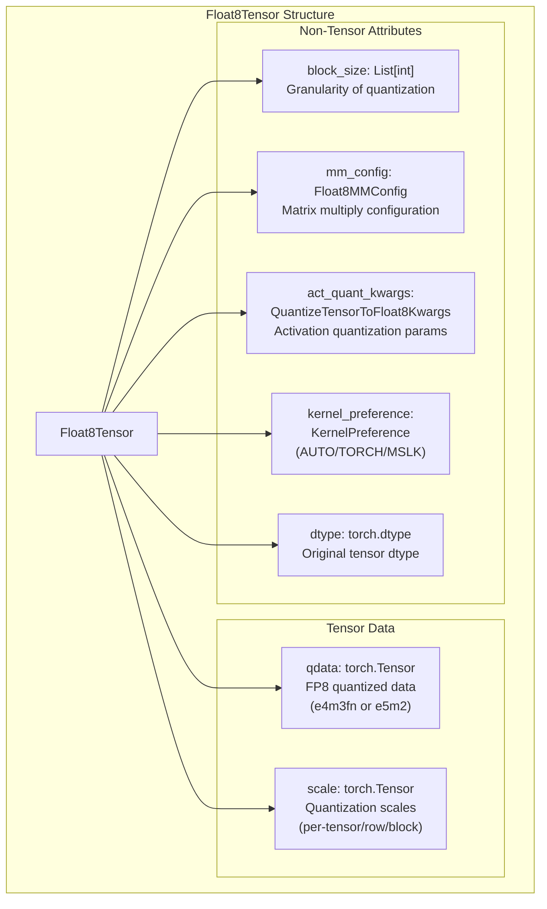
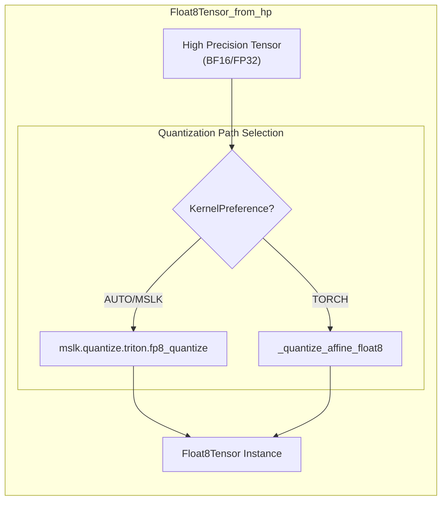

<!-- source: DeepWiki mcp.deepwiki.com · repo pytorch/ao · page 3.3 Float8Tensor (Inference) · fetched 2026-10-21 -->

# Float8Tensor (Inference)

<details>
<summary>Relevant source files</summary>

The following files were used as context for generating this wiki page:

- [test/dtypes/test_affine_quantized_float.py](test/dtypes/test_affine_quantized_float.py)
- [test/quantization/quantize_/workflows/float8/test_float8_tensor.py](test/quantization/quantize_/workflows/float8/test_float8_tensor.py)
- [test/quantization/quantize_/workflows/float8/test_float8_tensor_mi300.py](test/quantization/quantize_/workflows/float8/test_float8_tensor_mi300.py)
- [test/quantization/quantize_/workflows/int4/test_int4_tile_packed_to_4d_tensor.py](test/quantization/quantize_/workflows/int4/test_int4_tile_packed_to_4d_tensor.py)
- [test/test_utils.py](test/test_utils.py)
- [torchao/float8/inference.py](torchao/float8/inference.py)
- [torchao/quantization/quantize_/common/kernel_preference.py](torchao/quantization/quantize_/common/kernel_preference.py)
- [torchao/quantization/quantize_/common/packing_format.py](torchao/quantization/quantize_/common/packing_format.py)
- [torchao/quantization/quantize_/workflows/__init__.py](torchao/quantization/quantize_/workflows/__init__.py)
- [torchao/quantization/quantize_/workflows/float8/float8_packing_format.py](torchao/quantization/quantize_/workflows/float8/float8_packing_format.py)
- [torchao/quantization/quantize_/workflows/float8/float8_sparse_2x4_1d_data_1d_metadata_tensor.py](torchao/quantization/quantize_/workflows/float8/float8_sparse_2x4_1d_data_1d_metadata_tensor.py)
- [torchao/quantization/quantize_/workflows/float8/float8_sparse_2x4_2d_data_2d_metadata_tensor.py](torchao/quantization/quantize_/workflows/float8/float8_sparse_2x4_2d_data_2d_metadata_tensor.py)
- [torchao/quantization/quantize_/workflows/float8/float8_tensor.py](torchao/quantization/quantize_/workflows/float8/float8_tensor.py)
- [torchao/quantization/quantize_/workflows/int4/__init__.py](torchao/quantization/quantize_/workflows/int4/__init__.py)
- [torchao/quantization/quantize_/workflows/int4/int4_choose_qparams_algorithm.py](torchao/quantization/quantize_/workflows/int4/int4_choose_qparams_algorithm.py)
- [torchao/quantization/quantize_/workflows/int4/int4_tile_packed_to_4d_tensor.py](torchao/quantization/quantize_/workflows/int4/int4_tile_packed_to_4d_tensor.py)
- [torchao/testing/utils.py](torchao/testing/utils.py)
- [torchao/utils.py](torchao/utils.py)

</details>


## Overview

`Float8Tensor` is a tensor subclass designed for efficient inference using FP8 (8-bit floating point) quantization. It supports both **weight-only quantization** (FP8 weights with BF16/FP32 activations) and **dynamic activation quantization** (FP8 weights with runtime FP8 activation quantization).

`Float8Tensor` is created via the `quantize_` API with `Float8WeightOnlyConfig` or `Float8DynamicActivationFloat8WeightConfig`. It extends `TorchAOBaseTensor` and provides optimized kernels for matrix multiplication, convolution, and other operations on CUDA and XPU devices.

**Sources:** [torchao/quantization/quantize_/workflows/float8/float8_tensor.py:84-114](), [test/quantization/quantize_/workflows/float8/test_float8_tensor.py:19-29]()

## Tensor Structure and Attributes

### Core Components



### Attribute Details

| Attribute | Type | Purpose |
|-----------|------|---------|
| `qdata` | `torch.Tensor` | FP8 quantized data (dtype: `float8_e4m3fn` or `float8_e5m2`) |
| `scale` | `torch.Tensor` | Scales for dequantization, shape depends on granularity |
| `block_size` | `List[int]` | Dimensions of quantization blocks; empty list means per-tensor |
| `mm_config` | `Float8MMConfig` | Configuration for scaled matrix multiply operations |
| `act_quant_kwargs` | `QuantizeTensorToFloat8Kwargs` | Parameters for dynamic activation quantization (if enabled) |
| `kernel_preference` | `KernelPreference` | Kernel selection: `AUTO`, `TORCH`, `MSLK`, or `EMULATED` |
| `dtype` | `torch.dtype` | Original high-precision dtype (e.g., `bfloat16`, `float32`) |

**Sources:** [torchao/quantization/quantize_/workflows/float8/float8_tensor.py:84-114](), [torchao/quantization/quantize_/workflows/float8/float8_tensor.py:132-149]()

## Quantization and Creation

### Factory Method: `from_hp`

The primary way to create a `Float8Tensor` is via the `from_hp` (from high-precision) class method. This method handles scale calculation and data quantization.



**Key Logic:**
1. **Kernel Selection**: If `kernel_preference=AUTO` and MSLK is available on SM90+ hardware with `PerRow` granularity, it uses optimized MSLK quantization kernels.
2. **Scale Computation**: Uses `_choose_scale_float8` to calculate scales based on the specified `granularity`.
3. **Bounds Handling**: Supports `hp_value_lb` and `hp_value_ub` to clamp high-precision values during scale calculation.

**Sources:** [torchao/quantization/quantize_/workflows/float8/float8_tensor.py:168-252](), [torchao/quantization/quant_primitives.py:321-348]()

### Granularity Options

The `granularity` parameter controls the scale computation:

| Granularity | Block Size Example | Scale Shape (N×K tensor) |
|-------------|-------------------|------------------------|
| `PerTensor()` | `[N, K]` | `(1, 1)` |
| `PerRow()` | `[1, K]` | `(N, 1)` |
| `PerBlock([128, 128])` | `[128, 128]` | `(N//128, K//128)` |

**Sources:** [torchao/quantization/quantize_/workflows/float8/float8_tensor.py:179-181](), [test/quantization/quantize_/workflows/float8/test_float8_tensor.py:58-76]()

## Kernel Preference and Dispatch

### Kernel Preference Enum

`Float8Tensor` supports multiple kernel backends via the `KernelPreference` enum:

- **AUTO**: Automatically selects the most efficient kernel based on hardware (e.g., SM90/SM100) and available libraries (MSLK).
- **TORCH**: Uses native PyTorch operators like `torch._scaled_mm`.
- **MSLK**: Uses the MSLK library for optimized GEMM and Conv kernels.
- **EMULATED**: Performs matmuls in FP32 by dequantizing first (for debugging).

**Sources:** [torchao/quantization/quantize_/common/kernel_preference.py:17-50]()

### Matrix Multiplication Routing

The `_float8_addmm_impl` function routes matrix multiplications based on the tensor's configuration:

1. **Dynamic Activation**: If `act_quant_kwargs` is present, the input activation is dynamically quantized to FP8 using `Float8Tensor.from_hp`.
2. **Kernel Selection**:
   - On **SM100+ (Blackwell)**: Defaults to `torch._scaled_mm` for per-tensor scales.
   - On **SM90 (Hopper)**: Prefers `mslk.gemm` for per-row/per-block scaling if available.
   - **Blockwise**: If granularity is `128x128`, it dispatches to `blockwise_fp8_gemm`.

**Sources:** [torchao/quantization/quantize_/workflows/float8/float8_tensor.py:344-462](), [torchao/float8/inference.py:86-123]()

## Supported Operations

### Linear and Matmul
The subclass implements `aten.addmm`, `aten.mm`, and `aten.bmm`. For `bmm` (batched matrix multiplication), it currently requires the MSLK backend and per-row scaling.

**Sources:** [torchao/quantization/quantize_/workflows/float8/float8_tensor.py:258-281](), [torchao/quantization/quantize_/workflows/float8/float8_tensor.py:464-518]()

### Convolution
Supports `aten.convolution` for 2D and 3D. It handles `channels_last` memory formats and routes to `mslk.conv` when applicable.

**Sources:** [torchao/quantization/quantize_/workflows/float8/float8_tensor.py:520-722]()

### Slicing and Aliasing
`Float8Tensor` supports slicing (`aten.slice`, `aten.narrow`) and aliasing (`aten.alias`). When a tensor is sliced, the `scale` tensor is also sliced according to the quantization block size to maintain consistency.

```python
# Example of scale slicing logic
def _slice_scale_for_dimension(scale, data_shape, dim, start, end, step):
    # Calculates which scale elements correspond to the sliced data
    # based on the block_size in that dimension.
```

**Sources:** [torchao/float8/inference.py:126-175](), [torchao/quantization/quantize_/workflows/float8/float8_tensor.py:724-811]()

## Sparse 2:4 Support (ROCm)

For AMD/ROCm hardware (specifically MI350+), `Float8Sparse2x4_1DData1DMetadataTensor` provides a specialized subclass for 2:4 structured sparsity combined with FP8 quantization.

- **Packing**: Uses `torch._cslt_compress` to pack specified values and metadata.
- **Computation**: Dispatches to `torch._cslt_sparse_mm` for execution.
- **Restriction**: Currently only supports per-tensor scaling.

**Sources:** [torchao/quantization/quantize_/workflows/float8/float8_sparse_2x4_1d_data_1d_metadata_tensor.py:42-108](), [torchao/quantization/quantize_/workflows/float8/float8_sparse_2x4_1d_data_1d_metadata_tensor.py:138-183]()

---

