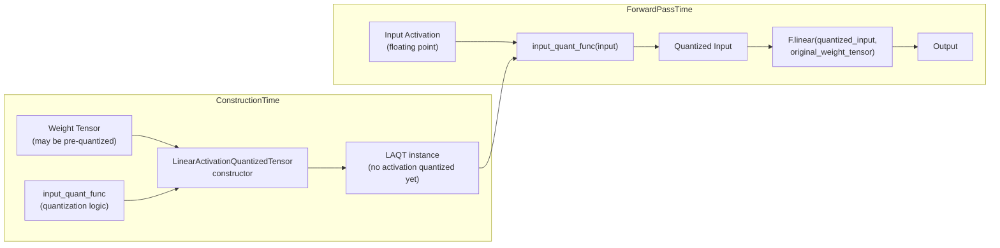
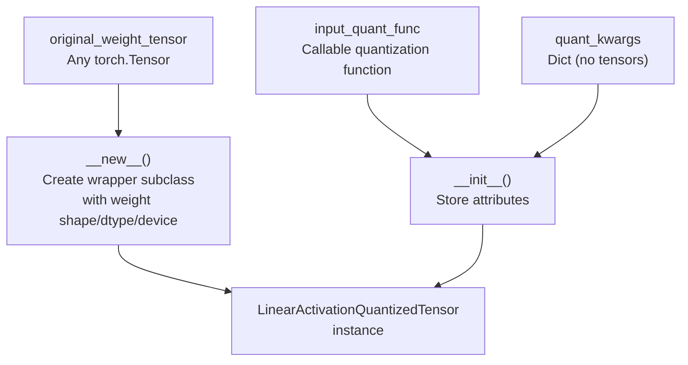
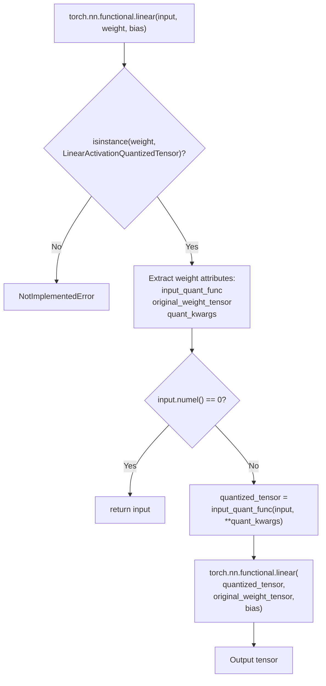
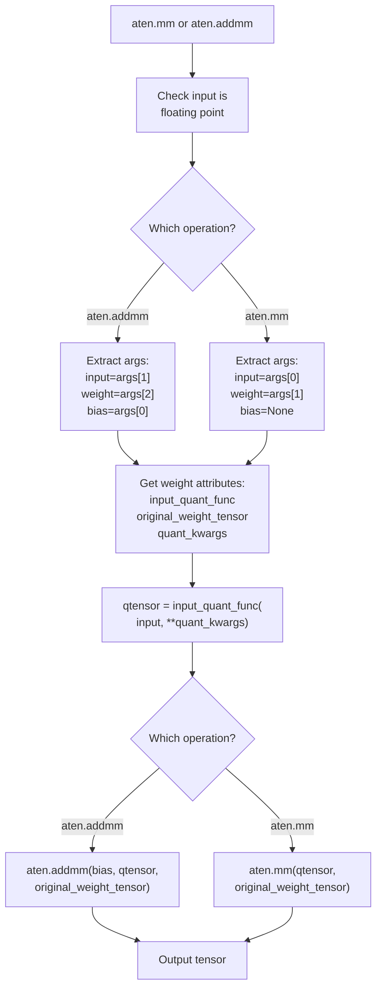
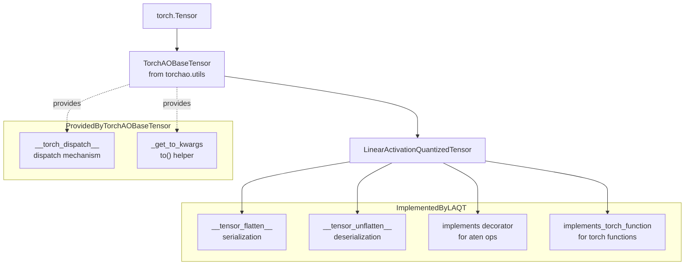
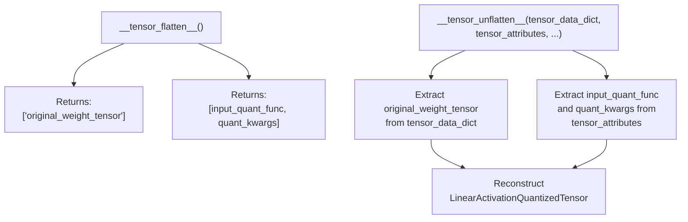
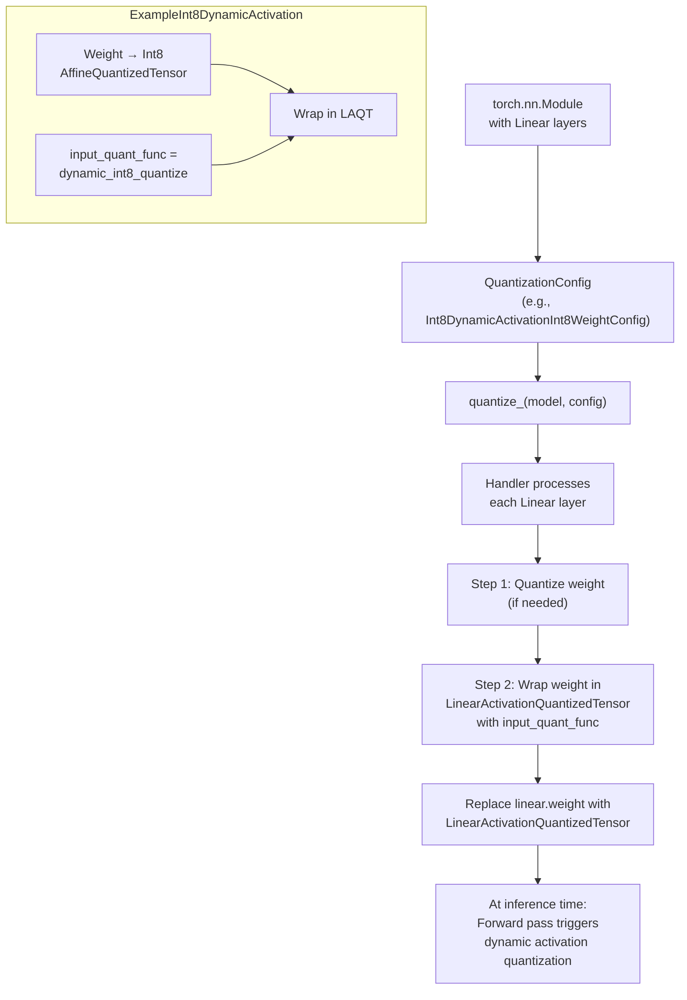
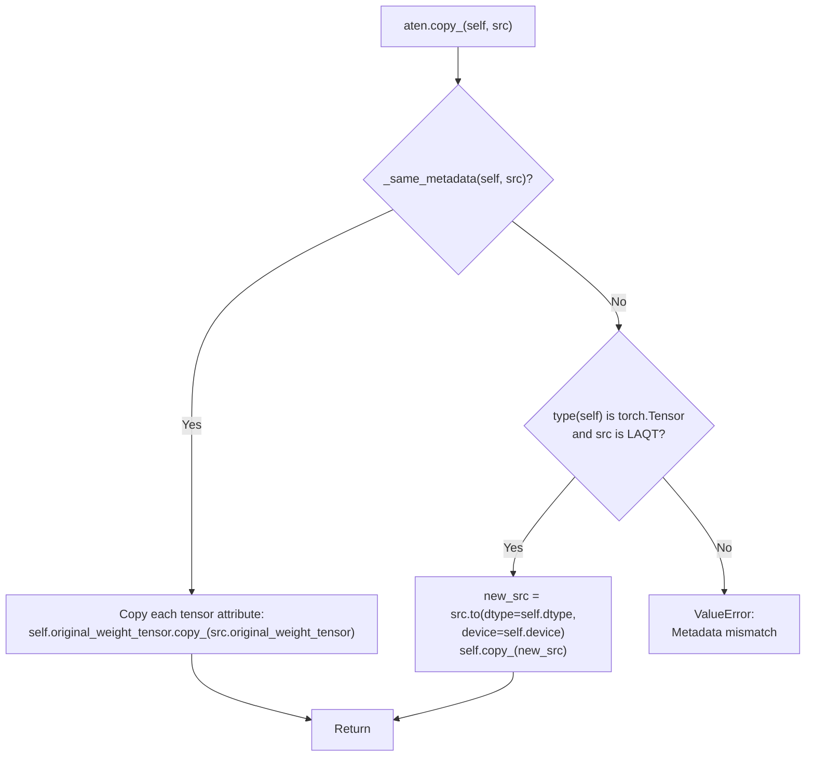
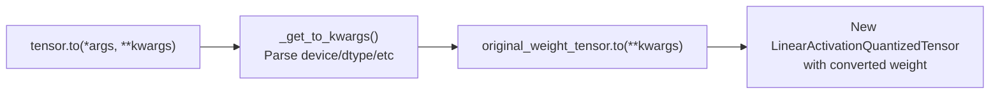

<!-- source: DeepWiki mcp.deepwiki.com · repo pytorch/ao · page 3.4 LinearActivationQuantizedTensor · fetched 2026-10-21 -->

# LinearActivationQuantizedTensor

<details>
<summary>Relevant source files</summary>

The following files were used as context for generating this wiki page:

- [README.md](README.md)
- [test/dtypes/test_affine_quantized_float.py](test/dtypes/test_affine_quantized_float.py)
- [test/integration/test_integration.py](test/integration/test_integration.py)
- [test/quantization/quantize_/workflows/float8/test_float8_tensor.py](test/quantization/quantize_/workflows/float8/test_float8_tensor.py)
- [test/quantization/quantize_/workflows/float8/test_float8_tensor_mi300.py](test/quantization/quantize_/workflows/float8/test_float8_tensor_mi300.py)
- [test/quantization/test_quant_api.py](test/quantization/test_quant_api.py)
- [test/quantization/test_quant_primitives.py](test/quantization/test_quant_primitives.py)
- [test/test_utils.py](test/test_utils.py)
- [torchao/float8/inference.py](torchao/float8/inference.py)
- [torchao/prototype/hqq/hqq_tinygemm_linear.py](torchao/prototype/hqq/hqq_tinygemm_linear.py)
- [torchao/quantization/README.md](torchao/quantization/README.md)
- [torchao/quantization/__init__.py](torchao/quantization/__init__.py)
- [torchao/quantization/qat/README.md](torchao/quantization/qat/README.md)
- [torchao/quantization/quant_api.py](torchao/quantization/quant_api.py)
- [torchao/quantization/quant_primitives.py](torchao/quantization/quant_primitives.py)
- [torchao/quantization/quantize_/common/kernel_preference.py](torchao/quantization/quantize_/common/kernel_preference.py)
- [torchao/quantization/quantize_/workflows/float8/float8_tensor.py](torchao/quantization/quantize_/workflows/float8/float8_tensor.py)
- [torchao/quantization/utils.py](torchao/quantization/utils.py)
- [torchao/testing/utils.py](torchao/testing/utils.py)
- [torchao/utils.py](torchao/utils.py)

</details>


## Purpose and Scope

`LinearActivationQuantizedTensor` is a tensor subclass for applying dynamic activation quantization in linear layers. It wraps weight tensors and defers activation quantization until the linear operation is executed, enabling per-token or per-batch dynamic quantization strategies.

This class is primarily used for dynamic int8 activation quantization schemes where the input activation is quantized at runtime based on its statistics. For static quantization or weight-only quantization, see [AffineQuantizedTensor](#3.2) and related layouts.

Sources: [torchao/quantization/linear_activation_quantized_tensor.py:1-308]()

## Overview

`LinearActivationQuantizedTensor` enables dynamic quantization of activations without pre-computing quantization parameters. The class stores the original weight tensor and a user-provided quantization function that is applied to the input during the forward pass.

### Key Characteristics

| Characteristic | Description |
|---------------|-------------|
| **Quantization Timing** | Dynamic (runtime) |
| **Primary Use Case** | Int8 dynamic activation with quantized weights |
| **Weight Storage** | Can wrap any tensor type (plain, quantized, etc.) |
| **Quantization Function** | User-provided callable for activation quantization |
| **Supported Operations** | `linear`, `mm`, `addmm` |
| **Typical Workflow** | Weight pre-quantized → Activation quantized at runtime |

Sources: [torchao/quantization/linear_activation_quantized_tensor.py:21-36]()

## Design Philosophy

### Deferred Quantization Pattern

`LinearActivationQuantizedTensor` implements a deferred quantization pattern where the weight is wrapped but activation quantization is delayed until computation:



**Diagram: Deferred Quantization Flow**

This pattern enables per-token dynamic quantization where quantization parameters are computed based on the statistics of each input batch or token.

Sources: [torchao/quantization/linear_activation_quantized_tensor.py:79-90]()

### Tensor Attributes

| Attribute | Type | Description |
|-----------|------|-------------|
| `original_weight_tensor` | `torch.Tensor` | The weight tensor (can be quantized or floating point) |
| `input_quant_func` | `Callable` | Function that takes activation and returns quantized activation |
| `quant_kwargs` | `Dict[str, Any]` | Additional keyword arguments for `input_quant_func` (no tensor values) |

**Invariant:** The `quant_kwargs` dictionary must not contain tensor values to ensure proper serialization.

Sources: [torchao/quantization/linear_activation_quantized_tensor.py:27-62]()

## Construction Methods

### Constructor: Direct Instantiation

The primary constructor creates a `LinearActivationQuantizedTensor` by wrapping a weight tensor:



**Diagram: Constructor Flow**

**Usage:**
```python
laqt = LinearActivationQuantizedTensor(
    original_weight_tensor=weight,
    input_quant_func=my_quantize_func,
    quant_kwargs={"scale": 0.1}
)
```

Sources: [torchao/quantization/linear_activation_quantized_tensor.py:40-62]()

### from_float: Convenience Factory Method

The `from_float` class method provides a simpler interface:

```mermaid
graph LR
    input_float["input_float<br/>torch.Tensor"] --> from_float["from_float(input_float,<br/>input_quant_func,<br/>quant_kwargs=None)"]
    from_float --> constructor["Calls constructor with<br/>default quant_kwargs={}"]
    constructor --> laqt["LinearActivationQuantizedTensor"]
```

**Diagram: from_float Factory Method**

**Method Signature:**
```python
@classmethod
def from_float(
    cls,
    input_float: torch.Tensor,
    input_quant_func: Callable,
    quant_kwargs: Optional[Dict[str, Any]] = None,
)
```

This method is aliased as `to_linear_activation_quantized` for convenience.

Sources: [torchao/quantization/linear_activation_quantized_tensor.py:92-101](), [torchao/quantization/linear_activation_quantized_tensor.py:304]()

## Operator Dispatch

`LinearActivationQuantizedTensor` implements custom dispatch for matrix multiplication operations to apply dynamic activation quantization:

### Linear Operation



**Diagram: Linear Operation Dispatch Flow**

The dispatch handles both `aten.linear.default` and `torch.nn.functional.linear`.

Sources: [torchao/quantization/linear_activation_quantized_tensor.py:135-150](), [torchao/quantization/linear_activation_quantized_tensor.py:79-90]()

### Matrix Multiplication (mm and addmm)



**Diagram: mm/addmm Operation Dispatch**

Both operations apply the quantization function to the input before calling the corresponding aten operation with the original weight tensor.

Sources: [torchao/quantization/linear_activation_quantized_tensor.py:153-188]()

### Tensor Manipulation Operations

`LinearActivationQuantizedTensor` supports various tensor operations by applying them to the underlying weight:

| Operation | Behavior |
|-----------|----------|
| `aten.detach.default` | Detaches `original_weight_tensor` |
| `aten.alias.default` | Creates alias of wrapped weight |
| `aten.clone.default` | Clones `original_weight_tensor` |
| `aten._to_copy.default` | Moves to device/dtype and clones |
| `aten.copy_.default` | Copies between matching LAQT instances |
| `aten.t.default` | Transposes `original_weight_tensor` |
| `aten.slice.Tensor` | Slices `original_weight_tensor` |
| `aten.select.int` | Selects from `original_weight_tensor` |
| `aten.index.Tensor` | Indexes `original_weight_tensor` |
| `aten.view.default` | Reshapes `original_weight_tensor` |
| `aten.abs.default` | Applies abs to `original_weight_tensor` |

These operations preserve the `input_quant_func` and `quant_kwargs` while modifying the weight.

Sources: [torchao/quantization/linear_activation_quantized_tensor.py:190-302]()

## Class Implementation Details

### Inheritance Hierarchy



**Diagram: Class Hierarchy and Dispatch Mechanism**

Sources: [torchao/quantization/linear_activation_quantized_tensor.py:21](), [torchao/quantization/linear_activation_quantized_tensor.py:131-132]()

### Tensor Subclass Protocol

The class implements the tensor subclass protocol for serialization:



**Diagram: Serialization Protocol**

| Component | Contents |
|-----------|----------|
| **Tensor Data** | `["original_weight_tensor"]` |
| **Attributes** | `[input_quant_func, quant_kwargs]` |

The `input_quant_func` (a callable) and `quant_kwargs` (a dict) are stored as attributes rather than tensor data. This requires that `quant_kwargs` contains only serializable non-tensor values.

Sources: [torchao/quantization/linear_activation_quantized_tensor.py:67-76]()

## Integration with quantize_ Workflow

`LinearActivationQuantizedTensor` is typically used as a building block in quantization configurations that require dynamic activation quantization:



**Diagram: Integration with quantize_ API**

### Typical Usage Pattern

1. **Weight Quantization**: Pre-quantize the weight (e.g., to int8 using `AffineQuantizedTensor`)
2. **Wrap with LAQT**: Wrap the quantized weight in `LinearActivationQuantizedTensor` with an `input_quant_func` that performs dynamic quantization
3. **Runtime Execution**: During forward pass, the `input_quant_func` dynamically quantizes each input batch/token before the linear operation

Sources: [torchao/quantization/linear_activation_quantized_tensor.py:21-36](), [torchao/quantization/linear_activation_quantized_tensor.py:79-90]()

## Runtime Behavior and Metadata Checking

### Copy Operation Behavior

The `copy_` operation has special handling for `LinearActivationQuantizedTensor`:



**Diagram: copy_ Operation Logic**

**Metadata Comparison:**
The `_same_metadata` function checks:
- Both are `LinearActivationQuantizedTensor` instances
- Same shape
- Same `input_quant_func`
- Same `quant_kwargs`

Sources: [torchao/quantization/linear_activation_quantized_tensor.py:119-128](), [torchao/quantization/linear_activation_quantized_tensor.py:214-230]()

### Device and Type Conversion

The `to()` method handles device/dtype conversion:



**Diagram: to() Method Flow**

The `input_quant_func` and `quant_kwargs` are preserved during device/dtype conversion.

Sources: [torchao/quantization/linear_activation_quantized_tensor.py:110-116]()

## Usage Examples

### Basic Usage with Custom Quantization Function

```python
import torch
from torchao.quantization.linear_activation_quantized_tensor import (
    LinearActivationQuantizedTensor,
)

# Define a simple per-tensor dynamic int8 quantization function
def dynamic_int8_quantize(x, **kwargs):
    scale = x.abs().max() / 127.0
    return (x / scale).round().clamp(-128, 127).to(torch.int8)

# Original weight
weight = torch.randn(512, 256, device='cuda', dtype=torch.float32)

# Wrap weight with dynamic activation quantization
quantized_weight = LinearActivationQuantizedTensor(
    original_weight_tensor=weight,
    input_quant_func=dynamic_int8_quantize,
    quant_kwargs={}
)

# Use in linear operation
input_activation = torch.randn(32, 256, device='cuda', dtype=torch.float32)
output = torch.nn.functional.linear(input_activation, quantized_weight)
```

Sources: [torchao/quantization/linear_activation_quantized_tensor.py:92-101](), [torchao/quantization/linear_activation_quantized_tensor.py:79-90]()

## Serialization

`LinearActivationQuantizedTensor` supports PyTorch's serialization mechanisms:

```python
import torch
from torchao.quantization.linear_activation_quantized_tensor import LinearActivationQuantizedTensor

# Add to safe globals for weights_only=True loading
torch.serialization.add_safe_globals([LinearActivationQuantizedTensor])

# Save state_dict
torch.save(model.state_dict(), 'model.pt')
```

The `input_quant_func` must be a globally accessible callable for proper serialization.

Sources: [torchao/quantization/linear_activation_quantized_tensor.py:306-307](), [torchao/quantization/linear_activation_quantized_tensor.py:67-76]()

---

