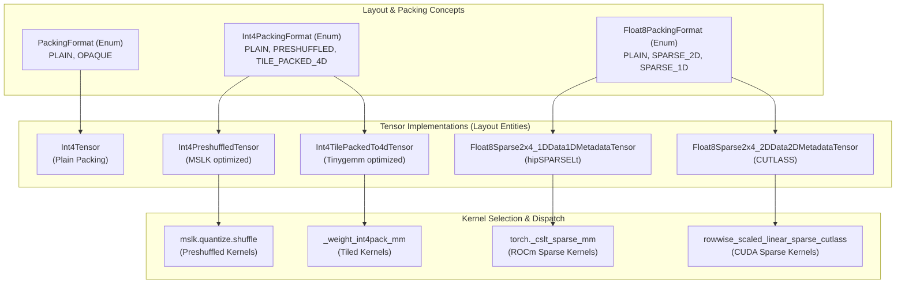
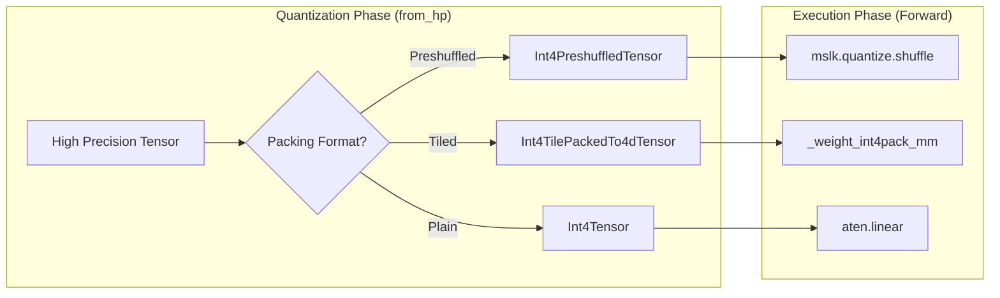

<!-- source: DeepWiki mcp.deepwiki.com · repo pytorch/ao · page 3.5 Layout System · fetched 2026-10-21 -->

# Layout System

Relevant source files

The following files were used as context for generating this wiki page:

- [test/quantization/quantize_/workflows/int4/test_int4_plain_int32_tensor.py](test/quantization/quantize_/workflows/int4/test_int4_plain_int32_tensor.py)
- [test/quantization/quantize_/workflows/int4/test_int4_preshuffled_tensor.py](test/quantization/quantize_/workflows/int4/test_int4_preshuffled_tensor.py)
- [test/quantization/quantize_/workflows/int4/test_int4_tensor.py](test/quantization/quantize_/workflows/int4/test_int4_tensor.py)
- [test/quantization/quantize_/workflows/int4/test_int4_tile_packed_to_4d_tensor.py](test/quantization/quantize_/workflows/int4/test_int4_tile_packed_to_4d_tensor.py)
- [torchao/dtypes/__init__.py](torchao/dtypes/__init__.py)
- [torchao/prototype/dtypes/__init__.py](torchao/prototype/dtypes/__init__.py)
- [torchao/prototype/dtypes/uintx/__init__.py](torchao/prototype/dtypes/uintx/__init__.py)
- [torchao/quantization/quantize_/common/__init__.py](torchao/quantization/quantize_/common/__init__.py)
- [torchao/quantization/quantize_/common/packing_format.py](torchao/quantization/quantize_/common/packing_format.py)
- [torchao/quantization/quantize_/common/protocol.py](torchao/quantization/quantize_/common/protocol.py)
- [torchao/quantization/quantize_/workflows/__init__.py](torchao/quantization/quantize_/workflows/__init__.py)
- [torchao/quantization/quantize_/workflows/float8/float8_packing_format.py](torchao/quantization/quantize_/workflows/float8/float8_packing_format.py)
- [torchao/quantization/quantize_/workflows/float8/float8_sparse_2x4_1d_data_1d_metadata_tensor.py](torchao/quantization/quantize_/workflows/float8/float8_sparse_2x4_1d_data_1d_metadata_tensor.py)
- [torchao/quantization/quantize_/workflows/float8/float8_sparse_2x4_2d_data_2d_metadata_tensor.py](torchao/quantization/quantize_/workflows/float8/float8_sparse_2x4_2d_data_2d_metadata_tensor.py)
- [torchao/quantization/quantize_/workflows/int4/__init__.py](torchao/quantization/quantize_/workflows/int4/__init__.py)
- [torchao/quantization/quantize_/workflows/int4/int4_choose_qparams_algorithm.py](torchao/quantization/quantize_/workflows/int4/int4_choose_qparams_algorithm.py)
- [torchao/quantization/quantize_/workflows/int4/int4_plain_int32_tensor.py](torchao/quantization/quantize_/workflows/int4/int4_plain_int32_tensor.py)
- [torchao/quantization/quantize_/workflows/int4/int4_preshuffled_tensor.py](torchao/quantization/quantize_/workflows/int4/int4_preshuffled_tensor.py)
- [torchao/quantization/quantize_/workflows/int4/int4_tensor.py](torchao/quantization/quantize_/workflows/int4/int4_tensor.py)
- [torchao/quantization/quantize_/workflows/int4/int4_tile_packed_to_4d_tensor.py](torchao/quantization/quantize_/workflows/int4/int4_tile_packed_to_4d_tensor.py)

## Purpose and Overview

The Layout System is the mechanism by which `AffineQuantizedTensor` (and newer workflow-specific tensors) selects storage formats and computational kernels for quantized weights. Different quantization schemes require different data layouts and memory organizations to achieve optimal performance on various hardware backends (CUDA, CPU, XPU, ROCm).

The Layout System provides:
- **Pluggable storage formats**: Different layouts pack quantized data differently (e.g., plain tensors, tiled 4D tensors, or preshuffled formats for MSLK).
- **Kernel dispatch**: Each layout routes operations to optimized kernel implementations.
- **Hardware specialization**: Layouts target specific hardware features, such as NVIDIA Tensor Cores or AMD hipSPARSELt.

Note: While `AffineQuantizedTensor` was the original implementation, the system has evolved into specialized tensor subclasses like `Int4Tensor`, `Int4PreshuffledTensor`, and `Float8Sparse2x4_1DData1DMetadataTensor` which encapsulate layout logic.

Sources: [torchao/dtypes/__init__.py:1-20](), [torchao/quantization/quantize_/common/packing_format.py:12-35]()

## Architecture Overview

**Architecture Overview: Packing formats drive the selection of Tensor subclasses, which in turn dispatch to specific hardware kernels.**

Sources: [torchao/quantization/quantize_/common/packing_format.py:12-35](), [torchao/quantization/quantize_/workflows/float8/float8_packing_format.py:19-52](), [torchao/quantization/quantize_/workflows/int4/int4_preshuffled_tensor.py:33-71]()

## Key Layout Classes and Packing Formats

### Plain Packing (`PLAIN`)
The simplest layout where quantized data elements are laid out sequentially in memory. For `int4`, two adjacent elements are typically packed into a single `uint8` or `int8` value.

**Implementation:** `Int4Tensor` or `Int8Tensor`.
**Use cases:** Standard quantization without hardware-specific shuffling requirements.

Sources: [torchao/quantization/quantize_/common/packing_format.py:17-27](), [torchao/quantization/quantize_/workflows/int4/int4_tensor.py:11-20]()

### Preshuffled Layout (`PRESHUFFLED`)
A specialized layout for `mslk` kernels on NVIDIA H100 (SM90) GPUs. It addresses inefficiencies in how WGMMA (Wait Group Matrix Multiply Accumulate) tiles are loaded into shared memory.

**Implementation:** `Int4PreshuffledTensor`.
**Mechanism:** Shuffles the order of elements so that multiple groups can be loaded using a single 64-bit load instruction instead of multiple smaller, slower loads.
**Attributes:**
- `qdata`: Preshuffled and packed int4 weight.
- `group_scale`: Scaling factors for quantization groups.

Sources: [torchao/quantization/quantize_/workflows/int4/int4_preshuffled_tensor.py:33-71]()

### Tile Packed to 4D (`TILE_PACKED_TO_4D`)
Optimized for `tinygemm` kernels (`_weight_int4pack_mm`). The weight is stored as a 4D packed tensor to align with Tensor Core matrix multiplication patterns.

**Implementation:** `Int4TilePackedTo4dTensor`.
**Data Organization:**
- `qdata` shape: `[n / 8][k / (inner_k_tiles * 16)][32][inner_k_tiles / 2]`.
- `inner_k_tiles` is fixed to 8.
- `scale_and_zero`: Combined tensor packed specifically for `tinygemm`.

Sources: [torchao/quantization/quantize_/workflows/int4/int4_tile_packed_to_4d_tensor.py:31-57]()

### Sparse Layouts (2:4 Sparsity)
These layouts handle the memory organization for 2:4 structured sparsity combined with Float8 quantization.

| Layout Name | Implementation Class | Backend | Memory Organization |
|-------------|----------------------|---------|---------------------|
| `SPARSE_2D_DATA_2D_METADATA` | `Float8Sparse2x4_2DData2DMetadataTensor` | CUDA (CUTLASS) | Stores specified values and metadata as two separate tensors. |
| `SPARSE_1D_DATA_1D_METADATA` | `Float8Sparse2x4_1DData1DMetadataTensor` | ROCm (hipSPARSELt) | Packs data and metadata into a single 1D tensor: `[compressed_data \| metadata]`. |

Sources: [torchao/quantization/quantize_/workflows/float8/float8_packing_format.py:29-52](), [torchao/quantization/quantize_/workflows/float8/float8_sparse_2x4_1d_data_1d_metadata_tensor.py:42-63]()

## Data Flow and Kernel Selection

The layout system controls how high-precision (HP) tensors are transformed into quantized representations and which kernels are invoked during inference.

**Data Flow: From HP tensor to specialized layout subclass to hardware-optimized kernel.**

### Kernel Dispatch Examples

1.  **Int4 Preshuffled**: Uses `quantize_int4_preshuffle` from the `mslk` library to prepare data and routes to `mslk` optimized linear kernels during the forward pass.
    Sources: [torchao/quantization/quantize_/workflows/int4/int4_preshuffled_tensor.py:25-30, 137-166]()
2.  **Int4 Tile Packed**: Uses `_quantize_affine_tinygemm` to pack data into 4D tiles and dispatches to `_weight_int4pack_mm`.
    Sources: [torchao/quantization/quantize_/workflows/int4/int4_tile_packed_to_4d_tensor.py:13-18, 54-57]()
3.  **Float8 Sparse (ROCm)**: Uses `torch._cslt_compress` to pack data and metadata into a single 1D tensor and dispatches to `torch._cslt_sparse_mm`.
    Sources: [torchao/quantization/quantize_/workflows/float8/float8_sparse_2x4_1d_data_1d_metadata_tensor.py:48-52, 172-173]()

## Layout Selection Logic

Layout selection is primarily driven by the `PackingFormat` specified in the quantization configuration (e.g., `Int4WeightOnlyConfig`).

| Hardware/Capability | Recommended Packing Format | Implementation |
|---------------------|---------------------------|----------------|
| NVIDIA SM90 (H100)  | `preshuffled`             | `Int4PreshuffledTensor` |
| NVIDIA SM80+ (Ampere+) | `tile_packed_to_4d`    | `Int4TilePackedTo4dTensor` |
| AMD ROCm (MI350)    | `sparse_1d_data_1d_metadata` | `Float8Sparse2x4_1DData1DMetadataTensor` |
| CPU (x86)           | `plain`                   | `Int4PlainInt32Tensor` |

Sources: [test/quantization/quantize_/workflows/int4/test_int4_preshuffled_tensor.py:32-40](), [test/quantization/quantize_/workflows/int4/test_int4_tile_packed_to_4d_tensor.py:27-36](), [torchao/quantization/quantize_/workflows/float8/float8_sparse_2x4_1d_data_1d_metadata_tensor.py:148-157]()

---

