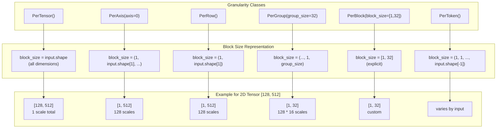
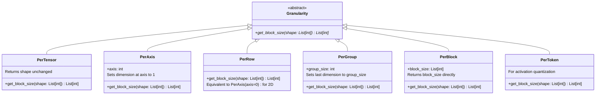
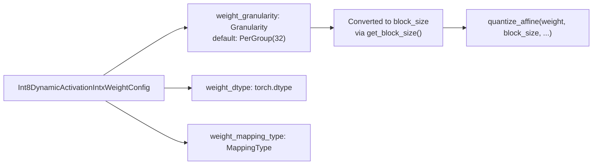
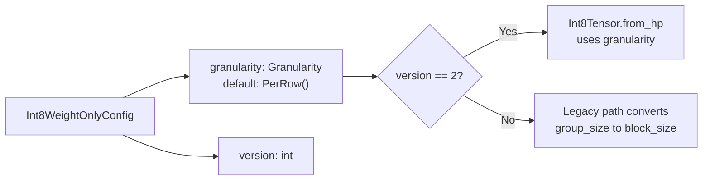
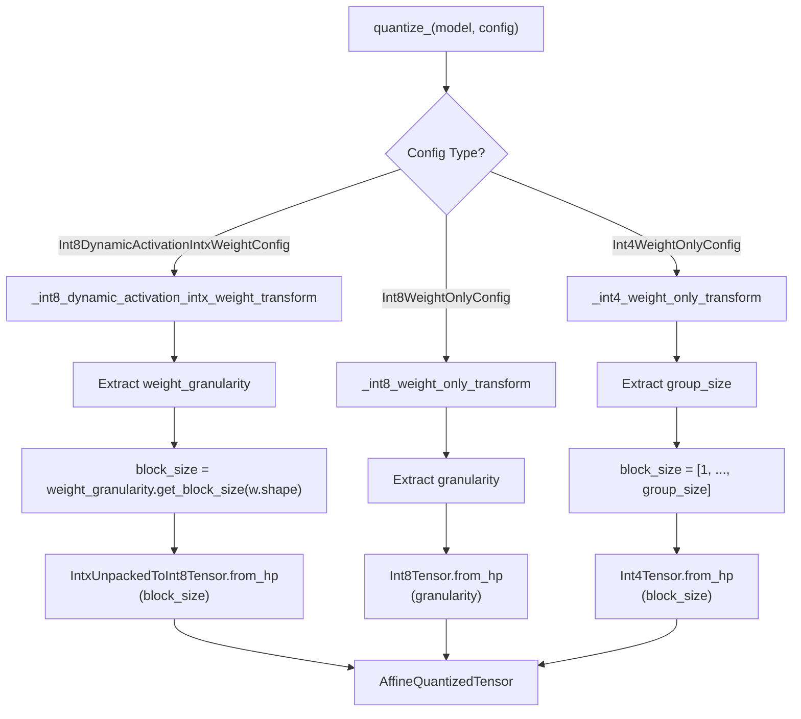
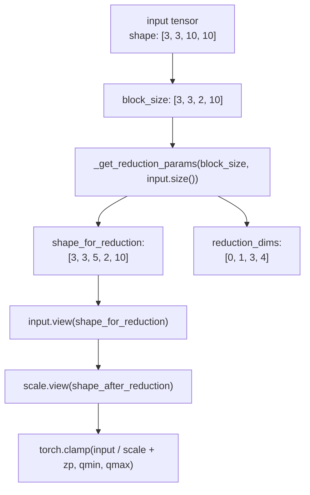
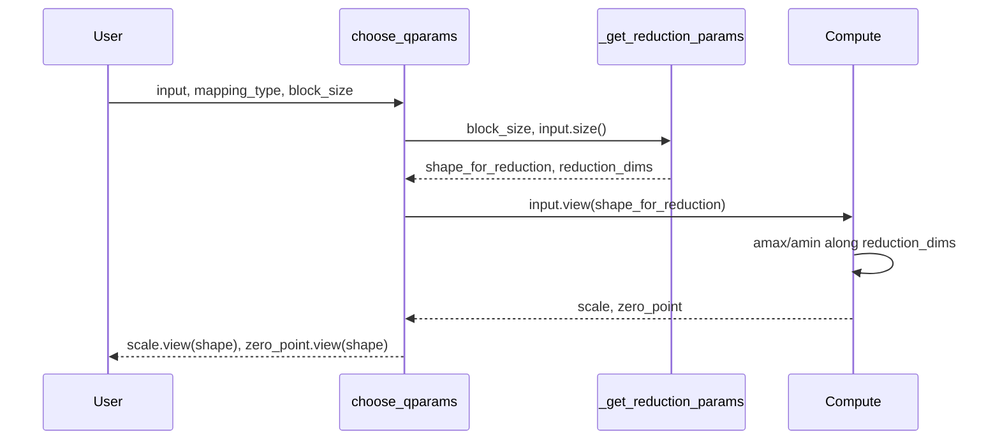
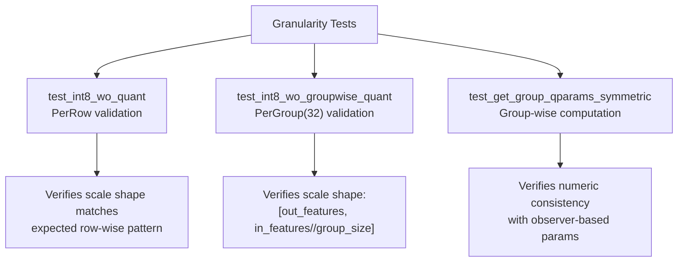

<!-- source: DeepWiki mcp.deepwiki.com · repo pytorch/ao · page 3.6 Granularity System · fetched 2026-10-21 -->

# Granularity System

Relevant source files

The following files were used as context for generating this wiki page:

- [README.md](README.md)
- [test/integration/test_integration.py](test/integration/test_integration.py)
- [test/quantization/pt2e/test_learnable_fake_quantize.py](test/quantization/pt2e/test_learnable_fake_quantize.py)
- [test/quantization/test_observer.py](test/quantization/test_observer.py)
- [test/quantization/test_quant_api.py](test/quantization/test_quant_api.py)
- [test/quantization/test_quant_primitives.py](test/quantization/test_quant_primitives.py)
- [torchao/prototype/hqq/hqq_tinygemm_linear.py](torchao/prototype/hqq/hqq_tinygemm_linear.py)
- [torchao/quantization/README.md](torchao/quantization/README.md)
- [torchao/quantization/__init__.py](torchao/quantization/__init__.py)
- [torchao/quantization/granularity.py](torchao/quantization/granularity.py)
- [torchao/quantization/observer.py](torchao/quantization/observer.py)
- [torchao/quantization/pt2e/__init__.py](torchao/quantization/pt2e/__init__.py)
- [torchao/quantization/pt2e/_affine_quantization.py](torchao/quantization/pt2e/_affine_quantization.py)
- [torchao/quantization/pt2e/learnable_fake_quantize.py](torchao/quantization/pt2e/learnable_fake_quantize.py)
- [torchao/quantization/pt2e/observer.py](torchao/quantization/pt2e/observer.py)
- [torchao/quantization/qat/README.md](torchao/quantization/qat/README.md)
- [torchao/quantization/quant_api.py](torchao/quantization/quant_api.py)
- [torchao/quantization/quant_primitives.py](torchao/quantization/quant_primitives.py)
- [torchao/quantization/utils.py](torchao/quantization/utils.py)

The granularity system in TorchAO defines how quantization parameters (scale and zero_point) are shared across tensor elements during quantization. It provides a high-level abstraction for specifying the grouping strategy of quantization parameters, which directly impacts quantization accuracy, memory usage, and computational efficiency.

For information about quantization primitives that use granularity, see [Quantization Primitives](2.3). For configuration objects that accept granularity arguments, see [Configuration System](2.2).

## Overview and Core Concepts

Granularity determines the **block size** - the size of tensor elements sharing the same quantization parameters. Finer granularity (smaller blocks) typically provides better accuracy at the cost of increased memory for storing more quantization parameters.

### Granularity to Block Size Mapping

**Sources:** [torchao/quantization/granularity.py:1-125](), [torchao/quantization/utils.py:151-156]()

### Relationship to Quantization Parameters

The block size determines the shape of scale and zero_point tensors. For a weight tensor of shape `[out_features, in_features]`:

| Granularity Type | Block Size | Scale Shape | Use Case |
|------------------|------------|-------------|----------|
| `PerTensor()` | `[out_features, in_features]` | `[1, 1]` | Uniform quantization across entire tensor |
| `PerRow()` | `[1, in_features]` | `[out_features, 1]` | Per-channel weight quantization (common) |
| `PerAxis(axis=0)` | `[1, in_features]` | `[out_features, 1]` | Same as PerRow for 2D tensors |
| `PerGroup(32)` | `[1, 32]` | `[out_features, in_features//32]` | Group-wise quantization (4-bit common) |
| `PerBlock([1, 32])` | `[1, 32]` | `[out_features, in_features//32]` | Explicit block specification |

**Sources:** [torchao/quantization/granularity.py:1-125](), [torchao/quantization/quant_primitives.py:278-316]()

## Granularity Class Hierarchy

The base `Granularity` class and its variants are defined in `torchao/quantization/granularity.py`. Each subclass implements `get_block_size(shape)` to return a list of integers representing the quantization block.

**Sources:** [torchao/quantization/granularity.py:11-125](), [torchao/quantization/__init__.py:6-14]()

## Usage in Configuration Objects

Granularity objects are primary arguments in quantization configuration classes, typically passed to `quantize_`.

### Int8DynamicActivationIntxWeightConfig

This configuration uses `weight_granularity` to determine how the weight tensor is partitioned for quantization.

**Sources:** [torchao/quantization/quant_api.py:588-605](), [torchao/quantization/quant_api.py:612-628]()

### Int8WeightOnlyConfig

In `Int8WeightOnlyConfig`, the `granularity` parameter (defaulting to `PerRow()`) controls the quantization of weights.

**Sources:** [torchao/quantization/quant_api.py:938-994]()

## Configuration to Tensor Subclass Flow

The following diagram illustrates how the `quantize_` function routes different configurations and their granularities to the underlying tensor subclasses like `Int8Tensor` or `IntxUnpackedToInt8Tensor`.

**Sources:** [torchao/quantization/quant_api.py:707-738](), [torchao/quantization/quant_api.py:833-863](), [torchao/quantization/quant_api.py:997-1018]()

## Internal Implementation Details

### Block Size Calculation in quantize_affine

The `quantize_affine` primitive uses `block_size` to determine reduction dimensions via `_get_reduction_params`.

**Sources:** [torchao/quantization/quant_primitives.py:278-316](), [torchao/quantization/quant_primitives.py:412-473]()

### Granularity in choose_qparams_affine

The function `choose_qparams_affine` calculates quantization parameters based on the specified `block_size`.

**Sources:** [torchao/quantization/quant_primitives.py:878-1009]()

## Common Granularity Patterns by Data Type

| Weight Dtype | Typical Granularity | Rationale |
|--------------|---------------------|-----------|
| `torch.int8` | `PerRow()` or `PerTensor()` | Per-channel quantization is standard for 8-bit to balance accuracy and speed. |
| `torch.int4` | `PerGroup(32)` or `PerGroup(64)` | Finer group-wise granularity is required for 4-bit to minimize accuracy loss. |
| `torch.float8_e4m3fn` | `PerRow()` or `PerTensor()` | FP8 typically uses per-tensor or per-row scaling for hardware compatibility. |

**Sources:** [torchao/quantization/quant_api.py:593](), [torchao/quantization/quant_api.py:958](), [torchao/quantization/quant_api.py:1052-1065]()

## Testing and Validation

Granularity behavior is validated in `test/integration/test_integration.py` and `test/quantization/test_quant_primitives.py`.

**Sources:** [test/integration/test_integration.py:83-91](), [test/quantization/test_quant_primitives.py:196-223]()

---

