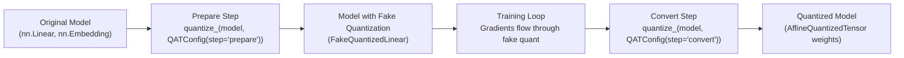
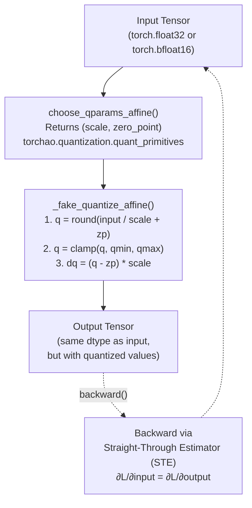
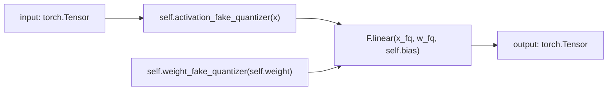

<!-- source: DeepWiki mcp.deepwiki.com · repo pytorch/ao · page 4 Quantization-Aware Training (QAT) · fetched 2026-10-21 -->

# Quantization-Aware Training (QAT)

<details>
<summary>Relevant source files</summary>

The following files were used as context for generating this wiki page:

- [test/quantization/test_qat.py](test/quantization/test_qat.py)
- [torchao/quantization/linear_quant_modules.py](torchao/quantization/linear_quant_modules.py)
- [torchao/quantization/prototype/__init__.py](torchao/quantization/prototype/__init__.py)
- [torchao/quantization/prototype/qat/README.md](torchao/quantization/prototype/qat/README.md)
- [torchao/quantization/prototype/qat/__init__.py](torchao/quantization/prototype/qat/__init__.py)
- [torchao/quantization/prototype/qat/_module_swap_api.py](torchao/quantization/prototype/qat/_module_swap_api.py)
- [torchao/quantization/prototype/qat/affine_fake_quantized_tensor.py](torchao/quantization/prototype/qat/affine_fake_quantized_tensor.py)
- [torchao/quantization/prototype/qat/api.py](torchao/quantization/prototype/qat/api.py)
- [torchao/quantization/prototype/qat/embedding.py](torchao/quantization/prototype/qat/embedding.py)
- [torchao/quantization/prototype/qat/fake_quantizer.py](torchao/quantization/prototype/qat/fake_quantizer.py)
- [torchao/quantization/prototype/qat/linear.py](torchao/quantization/prototype/qat/linear.py)
- [torchao/quantization/qat/__init__.py](torchao/quantization/qat/__init__.py)
- [torchao/quantization/qat/affine_fake_quantized_tensor.py](torchao/quantization/qat/affine_fake_quantized_tensor.py)
- [torchao/quantization/qat/api.py](torchao/quantization/qat/api.py)
- [torchao/quantization/qat/embedding.py](torchao/quantization/qat/embedding.py)
- [torchao/quantization/qat/fake_quantize_config.py](torchao/quantization/qat/fake_quantize_config.py)
- [torchao/quantization/qat/fake_quantizer.py](torchao/quantization/qat/fake_quantizer.py)
- [torchao/quantization/qat/linear.py](torchao/quantization/qat/linear.py)
- [torchao/quantization/qat/two_step_quantizer.py](torchao/quantization/qat/two_step_quantizer.py)
- [torchao/quantization/qat/utils.py](torchao/quantization/qat/utils.py)

</details>


## Purpose and Scope

This document covers the Quantization-Aware Training (QAT) system in TorchAO, which enables training neural network models with simulated quantization numerics to minimize accuracy degradation when deploying quantized models. QAT applies "fake quantization" during training—simulating low-precision quantization (e.g., int4, int8, float8) using high-precision arithmetic—so that the model learns to be robust to quantization errors.

For post-training quantization without retraining, see [Quantization API Reference](#2). For native float8 training that uses actual FP8 precision rather than simulation, see [Float8 Training System](#5).

**Sources:** [torchao/quantization/qat/api.py:1-186](), [test/quantization/test_qat.py:1-110]()

---

## QAT Workflow Overview

QAT follows a two-step workflow: **prepare** and **convert**. The prepare step inserts fake quantization operations into the model before training, and the convert step replaces fake quantized modules with actual quantized implementations after training.



### Prepare Step
In the prepare step, `torch.nn.Linear` modules are replaced with `FakeQuantizedLinear` modules, which apply fake quantization to weights and/or activations during the forward pass:
- **Weights**: Quantized per-group or per-channel using specified bit-width and granularity.
- **Activations**: Optionally quantized per-token (dynamic) or per-tensor (static).
- **Backward pass**: Gradients flow through the fake quantization operation using straight-through estimation (STE).

### Convert Step
In the convert step, `FakeQuantizedLinear` modules are converted back to `torch.nn.Linear`, then the base post-training quantization (PTQ) config is applied to produce the final quantized model. If range learning is used, custom learned scales and zero points are recovered from the fake quantizers.

**Sources:** [torchao/quantization/qat/api.py:33-148](), [torchao/quantization/qat/linear.py:42-156]()

---

## QATConfig: Main API

The `QATConfig` class is the primary entry point for QAT, designed to work with the `quantize_` API. It has two usage modes:

### Mode 1: Base PTQ Config (Recommended)
Specify a base post-training quantization config, and `QATConfig` will automatically infer the corresponding fake quantization schemes.

```python
from torchao.quantization import quantize_, Int8DynamicActivationInt4WeightConfig
from torchao.quantization.qat import QATConfig

# Define base PTQ config
base_config = Int8DynamicActivationInt4WeightConfig(group_size=32)

# Prepare: Insert fake quantization
quantize_(model, QATConfig(base_config, step="prepare"))

# Train the model...

# Convert: Apply actual quantization
quantize_(model, QATConfig(base_config, step="convert"))
```

### Mode 2: Custom Fake Quantization Configs
Directly specify fake quantization configs for experimentation.

```python
from torchao.quantization.qat import QATConfig, IntxFakeQuantizeConfig

# Define custom fake quantization configs
activation_config = IntxFakeQuantizeConfig(dtype=torch.int8, granularity="per_token")
weight_config = IntxFakeQuantizeConfig(dtype=torch.int4, group_size=32)

# Prepare: Insert fake quantization
quantize_(model, QATConfig(
    activation_config=activation_config,
    weight_config=weight_config,
    step="prepare",
))
```

For details on configuration and workflow, see [QATConfig and Workflow](#4.1).

**Sources:** [torchao/quantization/qat/api.py:42-186]()

---

## Fake Quantization System

The fake quantization system simulates quantization numerics in high precision to enable gradient-based training.

**Fake Quantization Data Flow with Code Primitives**



### Key Components
- **Fake Quantization Configs**: `IntxFakeQuantizeConfig` [torchao/quantization/qat/fake_quantize_config.py:105-150](), `Float8FakeQuantizeConfig` [torchao/quantization/qat/fake_quantize_config.py:49-64](), and `Int4WeightFakeQuantizeConfig` [torchao/quantization/qat/fake_quantize_config.py:82-95]().
- **Fake Quantizers**: `IntxFakeQuantizer` [torchao/quantization/qat/fake_quantizer.py:184-196](), `Float8FakeQuantizer` [torchao/quantization/qat/fake_quantizer.py:73-82](), and `Int4WeightFakeQuantizer` [torchao/quantization/qat/fake_quantizer.py:98-111]().

For details on range learning and STE, see [Fake Quantization System](#4.2).

**Sources:** [torchao/quantization/qat/fake_quantize_config.py:40-185](), [torchao/quantization/qat/fake_quantizer.py:48-196]()

---

## QAT Linear and Embedding Modules

TorchAO provides specialized modules that wrap standard PyTorch layers to inject fake quantization.

### FakeQuantizedLinear
`FakeQuantizedLinear` replaces `torch.nn.Linear`. It holds an `activation_fake_quantizer` and a `weight_fake_quantizer`.



### FakeQuantizedEmbedding
`FakeQuantizedEmbedding` replaces `torch.nn.Embedding` to simulate weight quantization in look-up tables.

### Legacy Quantizers
TorchAO also supports a "Two-Step" pattern using classes like `Int8DynActInt4WeightQATQuantizer` [torchao/quantization/qat/linear.py:201-215]() which manually handle the `prepare` and `convert` logic via module swapping.

For details on module swap mechanics, see [QAT Linear and Embedding Modules](#4.3).

**Sources:** [torchao/quantization/qat/linear.py:42-115](), [torchao/quantization/qat/embedding.py:26-88](), [torchao/quantization/qat/two_step_quantizer.py]() (referenced via inheritance)

---

## Implementation Details

### Module Transformation
The `quantize_` API uses the `_QUANTIZE_CONFIG_HANDLER` registry to dispatch to `_qat_config_transform` [torchao/quantization/qat/api.py:188-191](). This handler inspects the `QATStep` and either swaps modules for their fake-quantized counterparts or reverts them to standard layers for final PTQ conversion.

**Sources:** [torchao/quantization/qat/api.py:188-308](), [torchao/quantization/transform_module.py:16-19]()

### Related Documentation
- [QATConfig and Workflow](#4.1)
- [Fake Quantization System](#4.2)
- [QAT Linear and Embedding Modules](#4.3)

---

